# 🤖 编程入门

> ## 写给完全零基础的普通人
>
> **用最少的时间，真正搞懂「编程」这件事**
>
> 不讲天书，不堆术语，不教某一门语言的死语法。
> 这本书要给你的，是一张能用一辈子的地图。

**作者：大魔王博士**

---

## 这本书是关于什么的？

你可能听说过这些说法：

- 「现在人人都要学编程。」
- 「Python 是最简单的语言，21 天就能学会。」
- 「不写代码，将来会被 AI 淘汰。」

这些话里，有一半是对的，另一半是卖课的。

这本书不贩卖焦虑，也不承诺「学完就能月入三万」。它只想踏踏实实地回答五个问题：

1. **编程到底是什么？** —— 从最本质的层面讲清楚，而不是背一句「编程就是写代码」。
2. **编程是怎么发展成今天的样子的？** —— 关键节点，不堆年份，讲清楚「为什么会有这些变化」。
3. **程序员手里有哪些工具？主流编程语言有哪些？各自擅长解决什么问题？**
4. **我该怎么开始？** —— 建立正确的思维框架和入门路径，而不是上来就背语法。
5. **我该选哪门语言？之后怎么走？** —— 这是本书最后两章，也是你合上书就能用的东西。

## 这本书不是什么

先把话说清楚，免得你期待错了：

- **它不是某一门语言的语法手册。** 你不会在书里看到「Python 的 37 个内置函数一览表」。
- **它不是速成班。** 它不承诺「三天做出一个 App」。
- **它不是刷题集。** 没有 LeetCode，没有算法竞赛。
- **它不是鸡汤。** 每一章都要有实质内容，能让你「哦，原来是这样」。

## 一句话说明它的价值

> 如果你打算将来学 Python、JavaScript、Java 或者任何一门语言，**先读这本书，会让你后面少走一半的弯路**。

因为它解决的是那个最容易被跳过、也最要命的问题：**在你还不会写代码的时候，先搞清楚「写代码」这件事到底在干什么。**

## 作者简介

**大魔王博士**，一个坚信「任何复杂的东西都能用大白话讲清楚」的人。

他的口号是：**如果一个概念讲不明白，那是讲的人没本事，不是听的人笨。**

---

# 导言

> 在正式上路之前，先把三块挡路的石头搬开：数学、英语、天赋。
>
> 这一章也讲清楚这本书每一章的结构，以及你该怎么用它。

## 第 1 章 欢迎来到编程世界

> ## 🎯 本章目标
>
> 读完这一章，你应该能够：
> - 说清楚这本书会带你走一条什么样的路
> - 破除三个最常见的「我不配学编程」的迷思
> - 知道每章的固定结构，以及怎么用它来提高效率
> - 理解书里「伪代码」是怎么回事，以及为什么这么设计

---

### 一、先破三个迷思

在开始前，我必须先清掉你脑子里可能存在的三块石头。这三块石头，挡住过无数想学编程的人。

#### 迷思一：「我数学不好，肯定学不会编程」

**真相：90% 的编程工作，用到的数学不超过小学四年级。**

我认真地说：加减乘除，加上一点「比大小」，就是日常编程的全部数学。

你什么时候需要高深的数学？

- 做 3D 游戏引擎 → 需要线性代数
- 训练人工智能模型 → 需要概率统计和微积分
- 做密码学 → 需要数论

这些是**特定方向**，不是「编程」本身。就像「开车」不需要你懂发动机热力学，除非你要去当赛车工程师。

绝大多数程序员的日常是：读数据、判断条件、循环处理、存起来、显示出来。这里面最难的数学是**取余数**（就是 7 除以 3 余 1），真的。

#### 迷思二：「我英语不好，看到代码就头疼」

**真相：编程用到的英语单词，大概 100 个，而且它们长得都差不多。**

比如这些：`if`（如果）、`else`（否则）、`for`（对于）、`while`（当……的时候）、`return`（返回）、`print`（打印）、`input`（输入）、`name`（名字）、`value`（值）。

这些词会反复出现，出现几百次之后你想不认识都难。就像你打游戏，不需要查字典也能记住「HP、MP、Buff、Debuff」。

而且——**代码里真正难的部分从来不是英文单词，是逻辑结构**。你看不懂一段代码，99% 的情况不是因为不认识某个单词，而是因为没搞清它「先做什么、再做什么、为什么要这么绕」。

#### 迷思三：「编程需要很聪明的人才能学」

**真相：编程需要的不是聪明，是耐心和细致。**

这句话我要多说两句，因为它最重要。

程序员这个职业里，**最值钱的不是智商，是「较真」**。计算机是个精确到变态的家伙：你少写一个分号，它就不干活；你把「大于」写成「大于等于」，结果就差之千里。

所以优秀的程序员往往是这样的人：

- 愿意把一件事情拆得很细很细
- 遇到报错不慌，愿意一行一行去查
- 承认自己会犯错，然后老老实实改

这些品质，跟「聪明」没关系，跟**性格和习惯**有关系。而习惯是可以练的。

**说人话就是：编程更像是在做一道很长的菜，不是在做一道奥数题。** 你需要的是把步骤想清楚、按顺序做、中间尝一尝味道，而不是灵光一闪。

---

### 二、这本书会带你走一条什么路

全书分成 **8 关**，像打游戏一样往上走：

| 关卡 | 主题 | 回答的问题 | 章节 |
|---|---|---|---|
| **第一关** | 编程的本质 | 编程到底是什么？ | 第 2–8 章 |
| **第二关** | 历史脉络 | 它是怎么变成今天这样的？ | 第 9–15 章 |
| **第三关** | 编程思维 | 程序员是怎么想问题的？ | 第 16–22 章 |
| **第四关** | 语言动物园 | 有哪些语言？各自擅长什么？ | 第 23–32 章 |
| **第五关** | 工具箱 | 程序员用什么工具干活？ | 第 33–36 章 |
| **第六关** | 上手实践 | 代码长什么样？怎么动起来？ | 第 37–46 章 |
| **第七关** | 面向对象与质量 | 复杂的程序怎么组织？ | 第 47–49 章 |
| **第八关** | 路线与未来 | 我该选哪门语言？怎么走下去？ | 第 50–53 章 |

**为什么要按这个顺序？**

因为大多数人学编程走弯路，都是栽在顺序上：

- 一上来就背语法 → 背完不知道能干什么 → 放弃
- 一上来就做项目 → 做不出来 → 觉得自己笨 → 放弃
- 到处搜「哪个语言最好」 → 在选型上耗三个月 → 一行代码没写 → 放弃

这本书的顺序是反过来的：**先让你从根上明白「这是什么」，再看「怎么长出来的」，再学「怎么想」，再挑「用什么工具」，最后才动手写。**

这样等你真的开始写第一行代码时，你脑子里是有地图的。有地图的人不会迷路。

---

### 三、每章的固定结构（怎么用这本书）

从第二章开始，每一章都是同一个五件套。熟悉它，你的阅读效率会高很多：

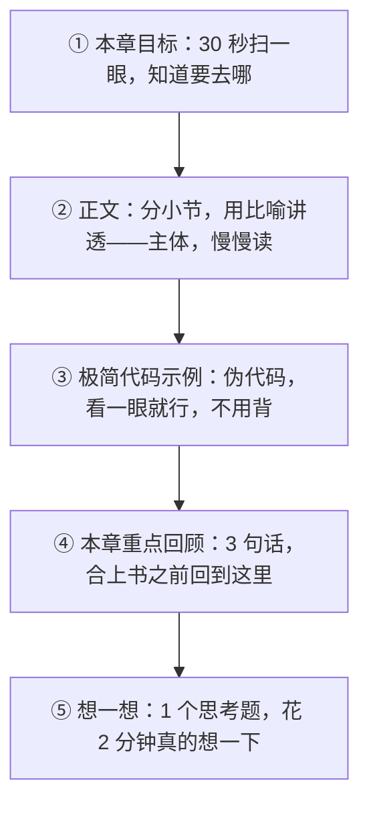

**关于「想一想」的思考题：**

我知道很多人会跳过它。但我要认真地告诉你：**这本书里真正让你「学会」的部分，是这些思考题，不是正文。**

正文是我讲给你听的，那是我的理解。思考题是你自己想的，那才是你的理解。

你不需要写出标准答案。只要在脑子里过一遍，甚至在纸上画两笔，效果就已经产生了。

**关于时间：**

每章正文设计成 **20–28 分钟**读完。如果你某章读了 40 分钟还没完，别慌——说明这章对你来说比较难，多花时间是正常的。但也别卡死：实在读不懂就先跳过去，往后再回头看，很多东西会在后面某一章突然「通了」。

---

### 四、关于书里的「伪代码」：一个重要的约定

这本书里会出现代码块，长得像这样：

```python
# 概念演示：判断今天要不要带伞
如果 天气预报说下雨:
    带上伞
否则:
    不带伞
```

**请注意三件事：**

#### 1. 这不是真正的 Python 代码

它是「**伪代码**」——一种故意写得很像人话的代码。真正的 Python 要写成这样：

```python
if weather == "rainy":
    take_umbrella()
else:
    pass
```

你看，真代码里有 `==`、`"`、`:`、缩进这些规矩。这些东西**不重要**，至少现在不重要。

#### 2. 为什么要用伪代码？

因为这本书的目标是让你**理解概念**，不是让你记住某门语言的写法。

打个比方：你要学开车，教练应该先跟你讲「踩油门车就走，踩刹车车就停」，而不是先让你背「离合器的机械结构图」。

伪代码就是「踩油门车就走」这一层。至于油门踏板是用什么合金造的——那是你选定某门语言之后才需要关心的事。

#### 3. 为什么用 Python 风格？

因为 Python 是目前**最接近伪代码的主流语言**。它的语法最少、最像英语，你将来如果真要上手写，从它开始阻力最小。

但请你一定记住：**这本书不会教你写 Python。** 它是一个「通用概念演示」，你在 JavaScript、Java、C++ 里学到的同一个概念，长得会不一样，但**骨子里是一回事**。

#### 伪代码的几个约定

为了让你看得舒服，全书统一这几条：

- 中文写的部分，表示「这里是概念，不是真正的语法」
- 缩进（前面空几格）表示「这几行属于上面那一行管着」
- `#` 后面的是注释，是写给人看的说明，计算机不看
- 全角括号、冒号混用没关系，能看懂就行

---

### 五、先让你见一眼：一段完整的「程序」长什么样

在结束这一章前，我给你看一段完整的、能跑的思路。别紧张，看不懂很正常，你只需要感受一下它的**节奏**：

```python
# 概念演示：帮小明算一算这个月攒了多少钱

# 第一步：把已知的东西记下来（这叫"变量"）
工资 = 8000
房租 = 2500
吃饭 = 1500
其他 = 800

# 第二步：算一算（这叫"运算"）
总支出 = 房租 + 吃饭 + 其他
剩余 = 工资 - 总支出

# 第三步：看情况办事（这叫"条件判断"）
如果 剩余 > 2000:
    显示 "这个月攒下了" + 剩余 + "元，不错！"
否则:
    显示 "这个月只剩下" + 剩余 + "元，要注意了。"

# 第四步：把一年的情况都算一遍（这叫"循环"）
对于 月份 in [1月, 2月, 3月, ...12月]:
    算一遍这个月的剩余
```

看出来了吗？这段「程序」其实就是在做四件事：

1. **记下一些数字**（变量）
2. **算一算**（运算）
3. **看情况办事**（判断）
4. **重复做**（循环）

**全世界的程序，不管多复杂，拆到底就是这四件事，加上后面你会学到的「打包」（函数）和「收纳」（数据结构）。**

就这么点东西。真的。

复杂的程序之所以看起来吓人，不是因为概念多，而是因为这些东西**被叠了很多层**。就像一栋摩天大楼，拆开看，材料就是钢筋、水泥、玻璃——但它能盖到 100 层。

这本书的任务，就是让你先看清「钢筋水泥玻璃」长什么样。

---

### 六、最后一个建议：别追求「学完」，追求「想通」

很多人读书有个习惯：追求读完。

我想建议你换个目标：**追求「想通」。**

具体怎么做？

- 读到某一段，如果你脑子里出现了「哦！原来是这样」——**停下来，享受三秒钟**。这是真的学会了。
- 如果读完了整章，脑子里一点波澜都没有——**回去重读一遍**，或者先跳过，过两天再看。
- 遇到不懂的比喻，**换成你自己的比喻**。比如我把变量比作「贴标签的盒子」，你觉得像「带名字的抽屉」更好，那就用抽屉。比喻不重要，你脑子里那幅画面才重要。

还有一件事：**这本书你不需要一口气读完。**

它设计成每天一章，53 天读完。你也可以先读第一关（本质）和第八关（路线），中间慢慢啃。看书没有标准姿势，适合你的就是对的。

好，现在正式开始。

---

### ✅ 本章重点回顾

1. **学编程不需要数学好、英语好或特别聪明**——它需要的是把事情拆细的能力、遇到报错不慌的心态，以及愿意较真的习惯，这些都是可以练出来的。

2. **全书 8 关递进**：先搞懂本质（2–8），再看历史（9–15），再学思维（16–22），再挑工具（23–36），最后上手和选路（37–53）——这个顺序是为了让你在写第一行代码时脑子里已经有地图。

3. **书里的代码是「伪代码」，是概念演示不是语言教程**——它故意写成人话，目标是让你理解「为什么这么做」，具体怎么写是你选定某门语言之后的事。

---

### 🤔 想一想

> 回想一下你日常生活中的某件重复做的事（比如每天早上出门前的流程、每周整理一次相册、每次点外卖的纠结过程）。
>
> **如果要你把它写成一份「让一个完全不了解你的人照着做也不会出错」的说明书，你会怎么写？你会漏掉哪些「你以为不用说但其实必须说」的步骤？**
>
> （这个练习的答案，就是下一章要讲的「编程的本质」。先自己想两分钟，再看第二章，效果会好很多。）

---

# 第一关　编程的本质

> 这一关只回答一个问题：编程到底是什么。
>
> 从「一份精确到变态的菜谱」讲到 CPU 怎么执行指令、程序怎么被拆成输入—处理—输出，最后落到「什么样的步骤算是好步骤」。

## 第 2 章 编程的本质：一份精确到变态的菜谱

> ## 🎯 本章目标
>
> 读完这一章，你应该能够：
> - 用一句话向别人解释「编程到底是什么」
> - 理解计算机「极其听话又极其死板」这个核心特性
> - 明白为什么程序里的每一个细节都必须写清楚
> - 知道「程序 = 数据 + 指令 + 顺序」这个公式

---

### 一、先做一个思想实验

假设你家里有个机器人助手，叫小铁。

小铁非常能干：它力大无穷，能一秒钟算完你算一天的账，能记住一整个图书馆的内容，而且从不喊累。

但它有个致命的特点：**它没有任何常识，也不会「看着办」。**

现在，你对小铁说：

> 「小铁，给我泡杯茶。」

小铁会怎么做？

它不会做。它会站在那里，等你给它更详细的指令。因为它不知道：

- 什么算「茶」？绿茶、红茶、奶茶、果茶？
- 茶叶放多少？
- 水温多少度？
- 泡多久？
- 用哪个杯子？
- 泡好了放哪儿？

你可能觉得「这也太笨了」。但请记住：**这就是计算机。**

#### 真正的对话应该是这样的

你必须这样说：

> 小铁：
> 1. 走到厨房，从左边第二个柜子里拿出一个马克杯
> 2. 从茶几上的铁盒里取出 3 克绿茶，放进杯子
> 3. 用水壶把水烧到 90 度
> 4. 把 200 毫升热水倒进杯子
> 5. 等 3 分钟
> 6. 把杯子端到我的书桌上

这样小铁才能干活。

**这就是编程的本质。**

> ### 💡 一句话定义
>
> **编程，就是把你想让计算机做的事，拆解成它不会误解的、一步一步的精确指令。**

说人话就是：**给一个极其听话但毫无常识的助手，写一份精确到变态的说明书。**

---

### 二、为什么计算机这么「死板」？

你可能会问：都 2026 年了，AI 都能写文章画画了，计算机怎么还这么死板？

这是个好问题，答案有两层。

#### 第一层：计算机的本质是「开关」

计算机最底层的东西，是几十亿个微小的电子开关，每个开关只有两种状态：**通电（1）** 或 **断电（0）**。

开关不会「差不多通电」，也不会「大概断电」。它要么是，要么不是。

这个特性往上传递，就决定了：**计算机处理的每一个信息，都必须是明确的、非此即彼的。**

你让它判断「这个人高不高」，它没法判断——因为「高」是模糊的。你必须告诉它：「身高大于 180 厘米算高。」

#### 第二层：这是优点，不是缺点

你可能会觉得死板是坏事。其实恰恰相反——**死板是计算机最宝贵的品质。**

想想看：

- 你让会计算账，他今天心情不好，算错了一个数 → 灾难
- 你让厨师做菜，他今天盐放多了 → 这盘菜毁了
- 你让计算机算 100 万次账，第 1 次和第 100 万次**一模一样准** → 这就是它的价值

**人会因为情绪、疲劳、注意力而失误；计算机不会。** 它唯一的「失误」来源，就是写指令的人没写清楚。

> ### 💡 一个重要的顿悟
>
> **程序出 bug（错误），几乎从来不是「计算机算错了」，而是「人没说清楚」。**
>
> 这个认知非常重要。它会让你在将来遇到报错时，第一反应是「我哪里没说清楚」，而不是「这破电脑又出问题了」。这两种反应，决定了你是越学越快，还是越学越痛苦。

---

### 三、程序 = 数据 + 指令 + 顺序

现在我们把「程序」这个东西拆开看看。任何一个程序，不管多复杂，都由三样东西组成：

#### 1. 数据（原料）

就是程序要处理的东西：数字、文字、图片、用户的名字、银行余额、视频文件……

类比做菜：**食材**。

#### 2. 指令（动作）

就是对数据做什么操作：加减乘除、比较大小、拼接文字、保存文件、显示出来……

类比做菜：**切、炒、煮、装盘**。

#### 3. 顺序（流程）

就是这些动作按什么顺序做。先放油还是先放菜？先烧水还是先放茶叶？

类比做菜：**菜谱的步骤顺序**。

> ### 📌 核心公式
>
> **程序 = 数据（原料） + 指令（动作） + 顺序（流程）**

这三样东西，缺一不可。

我给你举个反面例子。假设你想让程序「把两个数字加起来再除以 2」：

**错误示范（顺序错了）：**

```
先除以 2，再加起来
```

数据对，指令对，但顺序错了 → 结果完全不对。

**正确示范：**

```
先加起来，再除以 2
```

**新手最常犯的错误，90% 出在「顺序」上，而不是「指令」上。** 因为指令通常很简单（不就是加法嘛），但顺序需要你把整个流程想清楚。

这也是为什么本书第三关要用整整 7 章讲「编程思维」——那是关于「怎么把顺序想清楚」的学问。

---

### 四、一个完整的例子：自动判断要不要带伞

我们来写一个稍微完整点的程序思路。假设你想让计算机每天早上告诉你「今天要不要带伞」。

#### 第一步：想清楚需要什么数据

- 今天的天气预报（下雨 / 不下雨）
- 你今天要不要出门（出门 / 不出门）
- 你有没有伞（有 / 没有）

#### 第二步：想清楚要做什么判断

- 如果下雨 **且** 你要出门 → 带伞
- 如果不下雨 → 不带伞
- 如果下雨 **且** 你没伞 → 提醒买伞

#### 第三步：写成伪代码

```python
# 概念演示：要不要带伞

# 一、准备数据（原料）
天气预报 = "下雨"
今天出门 = 是
有伞 = 是

# 二、按流程判断（指令 + 顺序）
如果 今天出门 == 否:
    显示 "今天不出门，不用管伞的事。"
否则如果 天气预报 == "下雨":
    如果 有伞:
        显示 "今天下雨，记得带伞！"
    否则:
        显示 "今天下雨，但你没伞，建议买一把或打车。"
否则:
    显示 "今天不下雨，轻松出门。"

# 三、结束
```

#### 你看懂了吗？拆解一下

这段代码里包含了：

- **数据**：`天气预报`、`今天出门`、`有伞`
- **指令**：`显示`（把话说出来）、`判断`（比较）
- **顺序**：先判断出不出去门，再判断下不下雨，再判断有没有伞

注意到「嵌套」了吗？「有没有伞」这个判断，被包在「下不下雨」里面。这就是**顺序**的一种——有些判断要等前面的判断有结果了才轮到它。

#### 关键洞察

这个程序看起来在做「智能决策」，其实它只是在**机械地走流程**：

1. 看到第一条：今天出门吗？→ 是 → 往下走
2. 第二条：下雨吗？→ 下雨 → 往下走
3. 第三条：有伞吗？→ 有 → 说「记得带伞」

**计算机从头到尾不知道什么是「伞」，也不理解什么是「下雨」。** 它只是在对比一些符号，然后选择走哪条路。

这就是编程的真相：**表面上很聪明，骨子里很机械。所有的「智能」，都来自写程序的人把流程想得足够清楚。**

---

### 五、为什么「精确」这么难？

你现在可能会想：不就是把步骤写清楚嘛，有什么难的？

我告诉你为什么难：**因为你大脑会自动「脑补」，而计算机不会。**

#### 一个经典实验

请你现在在心里想一下「怎么煮一个鸡蛋」，然后把它写下来。

你写出来的可能是：

```
1. 锅里加水
2. 放进鸡蛋
3. 煮 10 分钟
4. 拿出来
```

现在，假设有个从没见过鸡蛋的外星人，严格按照你写的做。会发生什么？

- 加多少水？他可能加了 10 毫升，锅烧干了。
- 水要冷的还是热的？
- 鸡蛋是带壳放还是打碎了放？
- 「煮」是什么意思？火多大？
- 拿出来之后呢？放到碗里还是桌上？

**你漏掉的每一步，都是因为你的大脑自动脑补了「这还用说吗」。**

而编程的全部难点，就在于：**你要把那些「这还用说吗」的东西，全部说出来。**

#### 这就是为什么编程需要「细致」而非「聪明」

一个优秀的程序员，本质上是一个**脑补很少的人**——或者说，是一个能意识到自己在脑补、并且主动把脑补写下来的人。

这个能力是可以练的。练的方法就是：**写任何流程的时候，都假设读者是一个从没见过这件事的外星人。**

---

### 六、从「菜谱」到「程序」：三处关键差异

我知道你已经抓住「菜谱」这个比喻了。但为了不让它误导你，我要指出真实的程序跟菜谱的三个关键区别。

#### 差异一：程序会「跳来跳去」

菜谱是从第 1 步做到第 10 步，一路往下。

程序不是。程序会：

- **重复**：第 3 步到第 7 步，重复做 100 遍（这叫「循环」，第 42 章讲）
- **跳过**：如果鸡蛋是熟的，直接跳到第 9 步（这叫「条件分支」，第 41 章讲）
- **回头**：做完第 8 步，回到第 3 步再来一次

程序不是一条直线，更像一张**路线图**：有岔路，有环岛，有回头路。

#### 差异二：程序会「记住东西」

菜谱不需要记东西，做完就完了。

程序需要。它会记住：

- 用户刚才输入了什么
- 已经处理到第几个文件了
- 这是今天第几次登录

这些「记住的东西」，就是前面说的**数据**。程序在跑的过程中，数据会变，程序会**根据数据的变化做出不同的反应**。

这就是程序比菜谱「活」的地方：**它会根据情况改变自己的行为。**

#### 差异三：程序可以「打包复用」

菜谱里，「把水烧开」这个动作，如果出现 5 次，你就得写 5 遍。

程序里不需要。你可以把一段指令**打包**成一个东西，起个名字，比如叫「烧开水」。以后只要喊「烧开水」，它就执行那一段。

这个「打包」的东西，叫**函数**（第 43 章讲）。它是编程史上最重要的发明之一。

> ### 💡 提前剧透
>
> 你可能没意识到，但**「打包复用」这个想法，是区分「写代码」和「写程序」的分水岭**。
>
> 新手写的代码是一整条流水账；老手写的代码是一堆可以拼装的积木。这个转变，就是第三关「编程思维」要帮你完成的。

---

### 七、所以，到底什么是编程？

让我们回到最初的问题。现在你可以给出一个比「写代码」好得多的答案了：

> ### 🎯 编程的完整定义
>
> **编程 = 把一件想让计算机做的事，拆解成精确、无歧义、有顺序的步骤，并用一种计算机能懂的语言写下来。**
>
> 拆开看，它包含四个动作：
>
> 1. **理解需求**——到底要干什么？（这是最难的，也是最容易做错的）
> 2. **拆解步骤**——分成几步？先后是什么？
> 3. **消除歧义**——每一步都足够精确吗？有没有脑补？
> 4. **写成代码**——用某种语言把步骤写出来（这只是最后一步，也是最不像「思考」的一步）

**请注意第 4 步的位置：它是最后一步。**

很多人以为「编程 = 写代码」，其实**写代码只是把前三步的成果翻译出来**。真正花时间的、真正考验人的，是前三步。

这也是为什么有经验的程序员可能一天只写 50 行代码，却解决了大问题——因为他的时间花在「想清楚」上，而不是「敲键盘」上。

---

### ✅ 本章重点回顾

1. **编程的本质是「给一个毫无常识但极其听话的助手写精确到变态的说明」**——计算机不会看着办、不会脑补，你漏掉的每一步它都不会替你补上，而程序出 bug 几乎永远是「人没说清楚」而不是「机器算错了」。

2. **任何程序都由三样东西组成：数据（原料）+ 指令（动作）+ 顺序（流程）**——新手绝大多数错误出在「顺序」上而不是「指令」上，因为顺序需要你把整个流程想清楚。

3. **写代码只是编程四步里的最后一步**——理解需求、拆解步骤、消除歧义才是真正花时间和考验人的部分；程序比菜谱「活」在三点：会跳来跳去、会记住东西、可以打包复用。

---

### 🤔 想一想

> 假设你要给一个从没用过智能手机的外星人，写一份「怎么用微信给朋友发一条消息」的说明书。
>
> **请试着写下来，然后数一数：你一共写了多少步？其中哪几步是你一开始觉得「这还用说吗」但其实必须写的？**
>
> （如果你写出来超过 15 步，说明你已经开始有程序员的感觉了。）

---

## 第 3 章 计算机的大脑：CPU 是怎么「思考」的

> ## 🎯 本章目标
>
> 读完这一章，你应该能够：
> - 说清楚 CPU 在电脑里扮演什么角色
> - 理解「取指令 → 执行」这个永不停歇的循环
> - 明白为什么计算机「快」和「笨」是同一件事的两面
> - 理解「时钟频率」和「多核」到底是什么意思

---

### 一、先认识一下这台机器的主要零件

要理解编程，你得先知道你在给谁下指令。

我们把一台电脑拆开，从编程的角度看，最重要的就四个东西：

| 部件 | 它像什么 · 它负责什么 |
| --- | --- |
| CPU | 大脑 —— 执行指令，做运算和判断 |
| 内存 | 书桌 / 短期记忆 —— 正在用的东西摊在这里，一断电就没了 |
| 硬盘 | 书架 —— 长期存放，断电也还在 |
| 输入 / 输出设备 | 眼睛耳朵和手 —— 把外面的信息拿进来，把结果送出去 |

这一章我们只讲 **CPU**，它是整台机器的核心。内存和硬盘留到下一章。

---

### 二、CPU 是什么？

**CPU（中央处理器）** 是计算机的大脑。它的工作只有一件：**不停地执行指令。**

但请注意措辞：不是「思考」，是「执行」。

CPU 不会想「我要不要做这个」，也不会想「这样做对不对」。它就是一个**严格执行指令的机器**，一秒钟能执行几十亿条。

#### 一个比喻：厨房里的机器人厨师

想象一个厨师，他被关在一个小房间里，只能通过一张小窗口接单。

每一张单子上只写一个极小的动作，比如：

- 「把 3 号柜子里的盐拿出来」
- 「把 5 号柜子里的数字和 7 号柜子里的数字相加」
- 「把结果放回 5 号柜子」
- 「比较 5 号和 8 号柜子的数字，谁大」

这个厨师**极其快**——一秒钟能处理几十亿张单子。

但他有个特点：他**完全不知道自己在做什么菜**。他只看到一张张孤立的单子，做完一张扔掉，接下一张。

他不知道「我在做宫保鸡丁」。他只知道「现在要把盐拿出来」。

**这就是 CPU。**

#### 那「宫保鸡丁」这道菜在哪？

在你写的程序里。

你写的程序，最终会被翻译成一大堆这样的小单子（叫**机器指令**），排好队，一张张送到 CPU 面前。

CPU 从头到尾不知道「哦我在做一个计算器」，它只知道「现在执行第 1,000,001 号指令：把这两个数相加」。

**程序的「意义」，存在于写程序的人脑子里，以及最终看到结果的用户那里。CPU 自己完全不知道。**

---

### 三、CPU 的核心循环：取指 → 执行

CPU 干活的方式，是一个**永不停歇的三步循环**。这三步有个名字，叫**指令周期**（你可能听过更专业的说法：取指-译码-执行）。

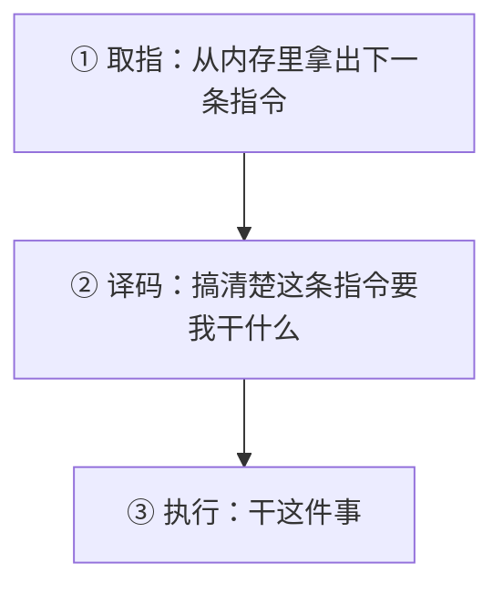

就这么简单。**现代 CPU 每秒钟把这个循环跑几十亿次。**

#### 用伪代码感受一下

```python
# 概念演示：CPU 的一生（极度简化版）

当 电脑开着:
    指令 = 从内存里取下一条指令
    搞清楚这条指令是什么意思
    执行它
    # 然后自动回到开头，再来一次
```

是的，CPU 的一生就是这个无限循环。**它从开机到关机，就只在做这件事。**

#### 一个重要的推论

这个循环给你一个极其重要的认知：

> **程序是一条一条被执行的，一次只执行一条。**

哪怕是最复杂的 3A 游戏、最庞大的人工智能模型，在 CPU 眼里，都是**一条接一条的小指令**。

没有「同时发生」，只有「快到看起来像同时发生」。

这个认知将来会救你很多次。比如当你的程序「看起来同时做了两件事但结果不对」时，你会知道：**根本没有同时，一定有先后顺序，只是你没看清是谁先谁后。**

---

### 四、「快」和「笨」是同一件事的两面

现在我们来解决一个你可能疑惑的问题：

> 既然 CPU 这么笨（只会一条条执行简单指令），为什么它能做那么厉害的事？

答案是：**因为它快。**

#### 一个计算题

假设一个最简单的判断（比如「这个数是不是大于 10」），CPU 需要大约 1 纳秒（十亿分之一秒）。

一秒钟，它能做 **10 亿次** 这样的判断。

现在假设你要在一万个人里找一个名字。人类大概要几秒钟。

CPU 呢？它用最笨的办法——**一个一个比对**——也就是一万次判断。用时：一亿分之一秒。

**它不需要聪明，因为它有时间优势到恐怖的程度。**

#### 这就是编程的一个重要启示

> **很多看起来需要「智能」的问题，实际上可以用「暴力」解决——只要够快。**

这句话是理解很多算法的关键。比如：

- 在 100 万个名字里找一个人 → 挨个比对（笨办法），因为 CPU 快，几毫秒就完了
- 但如果是在 100 亿个网页里找关键词 → 挨个比对就太慢了，必须想聪明办法

**什么时候用笨办法，什么时候必须想聪明办法**——这个判断力，就是算法能力。第 8 章和第 20 章会展开讲。

#### 反过来：CPU 的「笨」也是真的

我再强调一次 CPU 真的不会什么：

- 它**不会理解**「这张照片里有没有猫」（这是 AI 的事）
- 它**不会猜**你下一步想干什么
- 它**不会自动纠错**——指令错了它就错了，执行到底
- 它**不知道**自己执行的这一堆指令最终是要做一个计算器

所有「聪明」的部分，都是**人（写程序的人）提前想好、写进指令里的**。

---

### 五、时钟频率：CPU 的「心跳」

你可能听过「这个 CPU 是 3.5 GHz 的」。这是什么意思？

#### 比喻：节拍器

想象 CPU 跟着一个极其快速的节拍器干活。**每响一下，它走一步循环**（或者走循环里的一小步）。

**3.5 GHz 意味着：每秒响 35 亿下。**

所以：

- 时钟频率越高 → 每秒能执行的指令越多 → 越快
- 但频率不是唯一因素（等下说）

#### 为什么不能无限提高频率？

你可能会想：那做到 100 GHz 不就飞了？

不行。因为两个物理问题：

1. **发热**：晶体管每秒开关几十亿次会发热。频率越高，发热越恐怖。现在的 CPU 已经热到需要大风扇甚至水冷了。
2. **物理极限**：电信号在芯片里传播需要时间。当频率高到一定程度，一个节拍内电信号都来不及跑到芯片另一端。

这两个问题导致：**大约在 2005 年前后，CPU 频率就卡在 3–4 GHz 左右，十几年没大涨了。**

#### 那怎么继续变快？→ 多核

既然单个「厨师」的速度提不上去了，那就**多请几个厨师**。

这就是**多核 CPU**：

```
单核：  1 个厨师，每秒 35 亿次
四核：  4 个厨师，理论上一共 140 亿次
八核：  8 个厨师...
```

现代电脑基本都是 4 核、8 核、16 核。

#### 但多核有个陷阱

**不是所有任务都能分给多个厨师。**

比如你做一道菜：洗菜 → 切菜 → 炒菜。炒菜必须等切菜完成。你不能让 4 个厨师同时炒，因为锅里的东西还没切好。

这种「必须一步一步来」的任务，**多核帮不上忙**。

只有那种可以切成互不相关的几块的任务（比如同时处理 1000 张照片，每人分 250 张），多核才能发挥威力。

> ### 💡 这对你意味着什么？
>
> 将来你写程序时会有个概念叫「并发 / 并行」——就是让程序同时干多件事。
>
> 但它不是万能药。**能不能并行，取决于任务本身能不能拆开。** 这个判断，需要你理解任务的结构，而不是简单地说「用多线程就快了」。

---

### 六、CPU 内部的「工作台」：寄存器

最后讲一个小零件，它对理解编程很重要：**寄存器**。

#### 比喻：厨师手边的调料台

前面说厨师从「柜子」（内存）拿东西。但如果每拿一样东西都要走到柜子那边，太慢了。

所以厨师手边有个**极小的台面**，只能放几样东西，但**伸手就能拿到**。

这就是寄存器。

- **内存**（柜子）：能放很多，但拿起来慢一点
- **寄存器**（手边台面）：只能放几个，但快到飞起

#### 这跟编程有什么关系？

关系在于：**CPU 真正做运算时，操作的都是寄存器里的东西。**

所以「把两个数相加」这件事，实际上分了三步：

1. 从内存把第一个数搬到寄存器
2. 从内存把第二个数搬到寄存器
3. CPU 把两个寄存器里的数相加，结果放回某个寄存器

**你看，一个「加法」，底下是三个动作。**

这就是为什么我说：**CPU 只会做极小的动作。** 你写的一行代码，底下可能是几十个这样的小动作。

#### 那我需要关心寄存器吗？

**基本上不需要。**

因为现代编程语言和编译器（后面会讲）会自动帮你处理「什么时候把东西搬到寄存器」。

你只需要知道有这个东西存在，这样当你听到「这个程序内存占用太高」或者「这个值在寄存器里」这类说法时，不会一头雾水。

> ### 📌 一句话总结寄存器
>
> 寄存器是 CPU 手边那个「快但极小」的临时台面；你写的每一行代码，最后都会被拆成一堆「搬数据到台面 → 在台面上操作 → 搬回去」的微小动作。

---

### 七、串起来：一段代码是怎么被 CPU 执行的

现在我们把这一章串起来。假设你写了这么一行伪代码：

```python
结果 = 5 + 3
```

底下发生了什么？

1. **你写的代码**被翻译成机器指令（后面章节讲怎么翻译）
2. CPU 取第一条指令：「把数字 5 搬到寄存器 A」→ 执行
3. 取下一条：「把数字 3 搬到寄存器 B」→ 执行
4. 取下一条：「把 A 和 B 相加，结果放寄存器 A」→ 执行
5. 取下一条：「把寄存器 A 的值存到内存里某个位置，这个位置我们叫它『结果』」→ 执行
6. 继续取下一条指令（下一条是你程序的第二行）

**总共大约 4 条机器指令，耗时约 4 纳秒。**

而这 4 纳秒里，CPU 完全不知道「我在算 5+3」，更不知道「这个结果将来会显示在屏幕上让用户看到」。

它只是机械地搬数、加数、存数。

---

### ✅ 本章重点回顾

1. **CPU 是「只会执行指令、不理解意义」的极快机器**——它一生的全部内容就是「取指令 → 搞懂 → 执行 → 再来一次」的无限循环，每秒几十亿次；程序的意义存在于人和用户那里，不在 CPU 那里。

2. **程序是一条一条执行的，一次一条，没有真正的「同时」**——所有看起来同时发生的事情，都是因为太快而看起来像同时；这个认知将来能帮你排查大量诡异的 bug。

3. **CPU 的「快」和「笨」是一体两面**——它靠恐怖的速度用笨办法解决复杂问题，但当问题规模大到笨办法也扛不住时，就必须靠人想出聪明办法（算法）；多核能加速，但只对「能拆开的任务」有效。

---

### 🤔 想一想

> 假设你在一本 500 页的书里找一句你记得的话，但你不记得在哪一页。
>
> **你会用什么办法找？** 再想：**如果这本书有 5 亿页（比如整个互联网），你那个办法还行得通吗？如果不行，你会怎么改？**
>
> （第一个问题的答案对应「笨办法」，第二个对应「为什么需要算法」。这个问题会在第 8 章和第 20 章正式展开。）

---

## 第 4 章 内存、硬盘与操作系统

> ## 🎯 本章目标
>
> 读完这一章，你应该能够：
> - 分清「内存」和「硬盘」的区别，以及为什么这个区别很重要
> - 理解为什么「关掉程序再打开，东西就没了」
> - 知道操作系统在中间扮演什么角色
> - 理解「进程」是什么，以及为什么开太多程序会卡

---

### 一、两个柜子：内存和硬盘

上一章我们说 CPU 从「柜子」里拿东西。其实计算机里有两种柜子，它们的区别是整个计算机体系里最重要的区别之一。

#### 比喻：书桌 vs 书架

想象你在书房里工作：

- **书桌**：你正在看的书、正在写的稿纸、笔，都摊在桌上。伸手就能拿到。**但桌面就那么大。**
- **书架**：你所有的书都在书架上，几千本。要拿哪本，得起身走过去取。**慢，但容量大。**

对应关系：

| | 书桌 | 书架 |
|---|---|---|
| 计算机里 | **内存（RAM）** | **硬盘（SSD/HDD）** |
| 容量 | 小（8–32 GB） | 大（512 GB–数 TB） |
| 速度 | 极快 | 慢得多（比内存慢几十到几百倍） |
| 断电后 | **东西全没** | 东西还在 |
| 放什么 | 正在运行的程序和数据 | 所有文件、照片、系统 |

#### 最关键的三个差异

##### 差异一：速度差得离谱

从内存读一个数据：大约 **100 纳秒**。
从固态硬盘读一个数据：大约 **几十微秒**（是内存的几百倍慢）。
从机械硬盘读：更慢，可能 **十几毫秒**（是内存的十万倍慢）。

**这个差距有多大？**

打个比方：如果从内存取数据相当于「从桌面拿起一支笔」（1 秒），那么从硬盘取数据相当于「走去楼下便利店买一支笔」（几分钟）。

##### 差异二：断电后内存全清空

这是新手最容易困惑的点：

> **为什么我写了一半的文档没保存，电脑一关机就没了？**

因为文档在**内存**里。你按「保存」，它才被写到**硬盘**上。

内存是**临时工作台**，硬盘是**永久仓库**。

> ### ⚠️ 一个重要的编程启示
>
> 这个区别在编程里极其重要：**程序里的数据，默认都存在内存里，程序一结束就没了。**
>
> 如果你想让数据「留下来」，你必须**显式地把它写到硬盘上**（存文件、存数据库）。
>
> 这是第 45 章「文件读写」要讲的核心问题。很多新手写完程序，发现「昨天存的数据怎么没了」——就是因为只放在内存里没落盘。

##### 差异三：价格

内存贵，硬盘便宜。所以电脑都是「小内存 + 大硬盘」的配置。

---

### 二、为什么「开太多程序会卡」？

现在你可以回答这个日常问题了。

#### 场景

你开着浏览器（20 个标签页）、微信、音乐播放器、Word、还有个虚拟机。电脑开始卡了。

#### 原因

每个正在运行的程序，都要把自己和它的数据**放到内存（书桌）上**。

- 桌面（内存）就那么大
- 开的程序越多，桌面越挤
- 挤到一定程度，放不下了

这时候操作系统会用一个「应急办法」：把书桌上暂时不用的东西，**临时搬到硬盘上一个特殊区域**，等需要时再搬回来。

这个特殊区域叫**虚拟内存**（Windows 里叫「页面文件」）。

#### 为什么会「卡到几乎死机」？

因为硬盘比内存慢几百倍！

本来 CPU 伸手就能从桌面拿东西（100 纳秒），现在要跑去楼下便利店（几十微秒）。CPU 大部分时间都在等，看起来就是「卡住了」。

> ### 💡 生活验证
>
> 你可以验证这个理论：**电脑卡的时候，打开任务管理器（Windows）或活动监视器（Mac），看一下「内存」那一栏。** 如果显示内存压力大 / 交换空间被大量使用，那就印证了上面说的。
>
> 解决方法也很直接：**关掉不用的程序**（腾出桌面），或者加内存条（换个大桌子）。

---

### 三、操作系统：那个从不露面的大管家

现在登场一个你天天在用但从没注意过的角色：**操作系统**（Windows、macOS、Linux、Android、iOS）。

#### 操作系统是干嘛的？

如果没有操作系统，每个写程序的人都要自己搞定：

- 怎么让屏幕显示一个字？
- 怎么从键盘读用户输入？
- 怎么读硬盘上的文件？
- 怎么让网卡发出数据？
- 怎么让两个程序不打架？

**操作系统就是来包揽这些脏活累活的。**

#### 比喻：公司的行政总管

想象一栋办公楼里有几十家公司（程序）在办公。

如果没有物业管理：

- 每家公司要自己装电线、自己管电梯、自己决定谁用哪个会议室 →  chaos

有了物业管理（操作系统）：

- 电、水、电梯、会议室都由物业统一管
- 每家公司只需要说「我要用 3 号会议室」「帮我收个快递」
- 公司之间互不干扰

**操作系统就是这个物业。它做三件最重要的事：**

#### 职责一：管理硬件（让所有程序共享一台机器）

你的电脑只有一块 CPU、一块内存、一个屏幕。但有 20 个程序想用。

操作系统负责**分配**：

- 这个程序用 CPU 10 毫秒，然后换下一个
- 这块内存给 A 程序，那块给 B 程序，不许越界
- 屏幕这块区域给浏览器，那块给微信

**程序不需要知道电脑上还有别的程序。** 它以为自己独占整台机器——这是操作系统给它制造的「幻觉」。

#### 职责二：提供统一接口（让程序员不用管硬件细节）

这是操作系统对**程序员**最大的价值。

有了操作系统，程序员写「保存文件」时，不需要知道：

- 用户用的是三星硬盘还是西部数据
- 硬盘的接口是 SATA 还是 NVMe
- 数据存在第几个磁道第几个扇区

他只需要调用一句：**「把这个内容存成 `报告.txt`」**。

操作系统负责翻译成具体的硬件操作。

> ### 💡 这就是「抽象」的第一个例子
>
> 操作系统把「复杂的硬件细节」藏起来，只露出简单的接口。**这叫抽象**，是计算机科学里最重要的思想之一。第 18 章会专门讲它。
>
> 你现在只需要记住：**计算机的历史，就是一层一层往上加「抽象」的历史。** 每一层抽象都让上一层的活儿变简单。

#### 职责三：隔离和保护（防止一个程序搞垮整台机器）

你还记得 DOS 时代或者老电脑吗？一个程序崩溃，整台机器就蓝屏重启。

现代操作系统不会。因为每个程序都被关在自己的「隔离区」里：

- A 程序不能随便读 B 程序的内存
- A 程序不能直接操作硬件
- A 程序崩溃了，操作系统把它「杀掉」，其他程序照常运行

这就是为什么你的浏览器崩了，微信还能继续聊天。

---

### 四、进程：程序的「一次运行」

这里要引入一个重要概念：**进程**。

#### 程序和进程的区别

这两个词经常被混用，但它们是不同的东西：

- **程序**：躺在硬盘上的一堆文件（比如 `微信.exe`）。**静态的，不动的。**
- **进程**：程序被运行起来之后的那个「活着的东西」。**动态的，在跑的。**

#### 比喻：菜谱 vs 做菜

- **程序 = 菜谱**（写在纸上的步骤）
- **进程 = 正在照着菜谱做菜的那个过程**（锅里正在炒、火正在烧、菜正在变熟）

同一个菜谱，可以同时被两个厨师做 → 两个进程。
你电脑上的微信只能开一个，但记事本可以开 5 个 → 5 个进程，来自同一个程序。

#### 每个进程都有独立的「小世界」

操作系统给每个进程分配：

- 一块**专属的内存区域**（别人不许碰）
- 一个**CPU 时间配额**（轮流用 CPU）
- 一些**打开的文件**（比如这个进程打开了哪些文档）

**这就是为什么两个程序不会互相干扰，也解释了为什么一个程序崩溃不会带崩其他程序。**

#### 这跟编程的关系

将来你写程序时会遇到「多进程」「进程间通信」这些概念。你现在只需要知道：

> **你写的程序跑起来之后，就是操作系统眼里的一个进程。操作系统管着它的内存、它的 CPU 时间、它能碰哪些文件。**

你不需要自己管理这些——操作系统全包了。你只要知道它的存在，将来遇到「权限不足」「内存溢出」「端口被占用」这类问题时，能反应过来：**这是操作系统在管着我。**

---

### 五、串起来：打开一个程序，发生了什么？

我们来走一遍完整流程。假设你双击了桌面上的「计算器」图标：

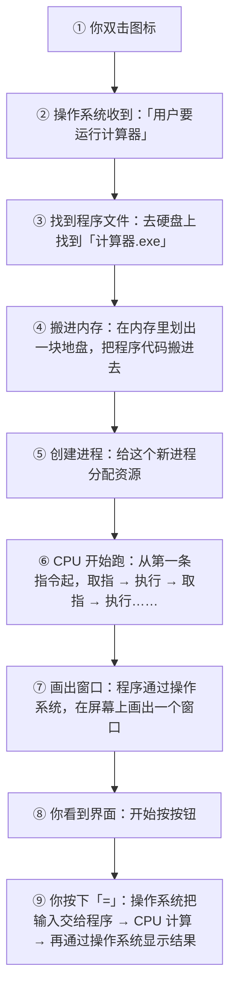

注意第 4 步：**程序必须先从硬盘被搬到内存，才能运行。**

这就是为什么：

- 打开 large 软件要等几秒（在搬数据）
- 内存不足时，程序打不开或者很慢（没地方搬了）

---

### 六、一张表总结这一章

| 概念 | 比喻 | 本质 | 关键特性 |
|---|---|---|---|
| **CPU** | 极快的机器人厨师 | 执行指令的芯片 | 快但笨，一条条执行 |
| **内存** | 书桌 | 临时工作区 | 极快、断电清空、容量小 |
| **硬盘** | 书架 | 永久存储 | 慢、断电保留、容量大 |
| **操作系统** | 物业总管 | 管理硬件、提供接口、隔离程序 | 让程序不用管硬件细节 |
| **程序** | 菜谱 | 硬盘上的静态文件 | 不动的 |
| **进程** | 做菜的过程 | 运行中的程序实例 | 有独立内存和资源 |

---

### ✅ 本章重点回顾

1. **内存是「书桌」、硬盘是「书架」**——内存快但断电清空、容量小；硬盘慢但永久保存、容量大；程序里的数据默认只在内存里，想留住必须显式写进硬盘（存文件/数据库）。

2. **操作系统是包揽脏活的「大管家」**——它管理硬件分配、给程序员提供统一接口（这就是「抽象」的实例）、并隔离各个程序，让它们互不干扰、一个崩溃不影响别人。

3. **程序是躺在硬盘上的静态文件，进程是它被运行起来后的「活着的实例」**——操作系统给每个进程分配独立的内存和 CPU 时间；开太多程序会卡，本质是内存（书桌）不够用，系统被迫用慢几百倍的硬盘来救急。

---

### 🤔 想一想

> 你正在用一个记事本软件写一份重要文档，写了一个小时还没保存。这时候：
>
> 1. 突然断电了 → 文档还在吗？为什么？
> 2. 记事本软件崩溃了（未响应被强制关闭）→ 文档还在吗？
> 3. 如果你点了「保存」，然后断电 → 文档还在吗？
>
> **请用「内存 vs 硬盘」的原理解释这三种情况的区别。**
>
> （提示：想想「文档的内容此刻在哪个柜子里」。如果你想明白了这一点，你已经理解了几乎所有软件「自动保存」功能存在的意义。）

---

## 第 5 章 输入 → 处理 → 输出：一切程序的通用骨架

> ## 🎯 本章目标
>
> 读完这一章，你应该能够：
> - 掌握「输入 → 处理 → 输出」这个万能骨架
> - 用这个骨架去拆解你见过的任何软件
> - 理解为什么「处理」是唯一需要你动脑的部分
> - 学会用这个骨架来构思你自己的第一个程序

---

### 一、一个能套住所有程序的骨架

我要给你一个工具。它简单到可能让你怀疑「这有什么用」，但我要告诉你：**这是整本书里最实用的一张图。**

不管你将来要写什么程序——一个计算器、一个网站、一个游戏、一个自动整理文件的脚本、甚至一个人工智能应用——它都长这样：

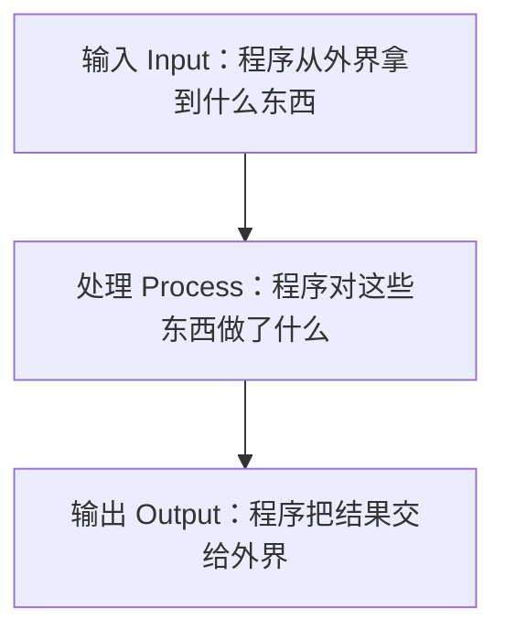

就这三块。

**输入**：程序从外界拿到什么东西
**处理**：程序对这些东西做了什么
**输出**：程序把结果交给外界

#### 用微波炉验证一下

微波炉是个「程序」吗？是，它里面有芯片在跑程序。

| 阶段 | 微波炉 |
|---|---|
| **输入** | 你按的「高火 3 分钟」按钮、门的开关状态、温度传感器的读数 |
| **处理** | 判断门是否关好 → 如果关好，开始计时 → 控制微波发射器工作 3 分钟 → 期间监控温度 |
| **输出** | 微波加热、转盘转动、倒计时显示、「叮」的一声 |

#### 再验证一个：微信发消息

| 阶段 | 微信发消息 |
|---|---|
| **输入** | 你打的字、你选的收件人、你点的「发送」按钮 |
| **处理** | 把文字打包 → 加上你的身份信息 → 通过网络发出去 → 服务器接收 → 找到收件人 → 推送 |
| **输出** | 你这边显示「已发送」，对方手机上弹出消息 |

#### 再验证一个：红绿灯

| 阶段 | 路口的红绿灯 |
|---|---|
| **输入** | 计时器、路口的车流量传感器、可能有行人按的按钮 |
| **处理** | 判断：南北方向绿灯走了 30 秒了吗？→ 到了就切换成黄灯 → 再切换红灯 → 东西方向变绿 |
| **输出** | 灯的颜色变化 |

**你试试看，你能找到一个「不符合这个骨架」的程序吗？**

你找不到。因为这个骨架不是某个人发明的规定，它是对「程序到底是什么」的一个**观察结果**：

> 程序存在的意义，就是**接收一些东西、做点变换、给出结果**。
>
> 一个既不接收、也不输出的程序，是没有任何意义的——它就像一台永远空转的发动机。

---

### 二、三块分别是什么？（详解）

#### 输入：程序怎么「感知」世界

程序自己什么都没有，它要知道点什么，必须从外面拿。常见来源：

| 来源 | 例子 |
|---|---|
| **用户键盘输入** | 你在搜索框里打的字 |
| **鼠标/触摸** | 你点的按钮、滑动的手势 |
| **文件** | 程序读取一个 Excel、一张图片、一个配置文件 |
| **网络** | 从服务器拉取天气数据、加载网页 |
| **传感器** | 手机的位置、加速度、光线；工厂的温度计 |
| **其他程序** | 一个程序调用另一个程序提供的接口 |
| **时间和系统状态** | 现在几点、今天是星期几、电量还剩多少 |

> ### 💡 一个重要的认知
>
> **没有输入，程序就只能做「每次都一样」的事。**
>
> 想想看：如果一个计算器程序没有任何输入，它能干什么？只能算一些写死的结果，那它就是个废铁。
>
> 正是输入的存在，才让程序能应对不同的情况。**程序的「智能」，很大程度上体现在它对不同输入做出不同反应**——而这，正是「处理」那一步要设计的。

#### 处理：唯一需要你动脑的部分

这是程序的核心，也是你作为程序员**真正要写的部分**。

处理可以是：

- 算个结果（加减乘除、统计、排序）
- 做个判断（要不要、是不是、够不够）
- 重复做一件事（处理 1000 个文件）
- 存取数据（把结果存起来，下次用）
- 调用别的程序帮忙（比如让地图服务算个路线）

**处理是一本书里要讲最多的部分。** 事实上，本书第三关（编程思维）、第六关（上手实践）讲的绝大部分内容，都是关于「处理」怎么设计。

#### 输出：程序怎么「影响」世界

处理完了，得把结果交出去，否则白干。常见形式：

| 形式 | 例子 |
|---|---|
| **显示在屏幕上** | 文字、图表、界面变化 |
| **声音** | 提示音、语音播报 |
| **写文件** | 生成一个报告、导出一张图片、保存游戏进度 |
| **发到网络** | 把消息发给服务器、上传照片 |
| **控制硬件** | 打开继电器、转动电机、点亮 LED |
| **返回给调用者** | 一个「函数」把结果交给程序的另一部分（第 43 章讲） |

---

### 三、为什么这个骨架这么有用？

你可能在想：这不就是把程序分成三段吗，有什么了不起？

它的价值在于：**当你不知道怎么开始写一个程序时，从这三段去问自己，就一定有头绪。**

#### 实战演示：构思一个程序

假设你想做一个「帮我整理下载文件夹」的小工具。你坐在电脑前，脑子一片空白，不知道从哪下手。

**用骨架问自己三个问题：**

##### 问题 1：输入是什么？

- 我的「下载」文件夹里的所有文件
- 每个文件的名字、类型、大小、修改日期

##### 问题 2：输出是什么？

- 一堆整理好的子文件夹（图片、文档、安装包、其他）
- 文件被移动到对应的文件夹里

##### 问题 3：处理是什么？（这是要想清楚的）

- 拿到所有文件（输入）
- 对每个文件：看它的后缀名
  - `.jpg` `.png` → 移到「图片」
  - `.pdf` `.docx` → 移到「文档」
  - `.dmg` `.exe` → 移到「安装包」
  - 其他 → 移到「其他」
- 如果目标文件夹不存在，先创建它
- 报告：一共整理了多少个文件（输出）

**你看，一个原本「不知道从哪下手」的任务，被拆成了三个清晰的问题。**

#### 这个骨架还能帮你发现「漏掉的东西」

继续上面那个例子。用骨架检查一下：

- 输入够吗？——好像够了，就是文件夹里的文件。
- 处理对吗？——等等，如果有个文件正在被使用，移动会失败！得处理这种情况。
- 输出完整吗？——要不要告诉用户整理结果？要不要记个日志？

**骨架让你不容易漏东西。** 这是它最大的实用价值。

---

### 四、一个更复杂的骨架：带「存储」的版本

真实世界的程序，往往比「输入→处理→输出」复杂一点。因为很多程序需要**记住东西**。

于是骨架升级成这样：

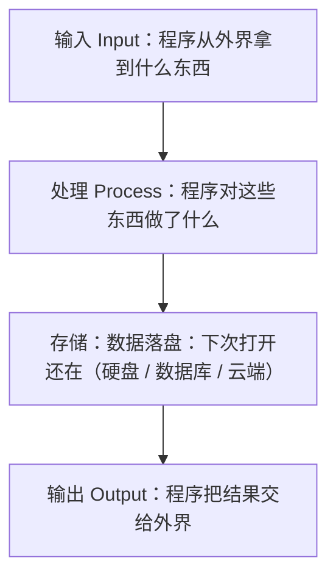

**存储**就是第 4 章讲的「硬盘」——程序把一些数据存下来，下次运行时还能用。

#### 例子：微信的登录状态

- **输入**：你输入账号密码
- **处理**：验证密码对不对
- **存储**：把「已登录」这个状态和你的身份信息存到硬盘上
- **输出**：登录成功，进入主界面
- **下次打开**：程序直接从「存储」里读到「已登录」→ 不用再输密码

**如果没有存储，你每次打开微信都要重新登录。** 这就是为什么「存储」这一块在现代程序里几乎是标配。

#### 存储的形式有很多

| 形式 | 适合存什么 |
|---|---|
| **普通文件** | 配置、日志、用户文档 |
| **数据库** | 大量结构化数据（用户信息、订单、消息记录） |
| **浏览器本地存储** | 网站记住你的偏好、购物车 |
| **云端** | 需要在多台设备间同步的数据 |

> ### 📌 记住这个升级版骨架
>
> **输入 → 处理 → 输出，加上一个「存储」挂在旁边。**
>
> 将来你分析任何软件，都可以用这四块去套。套不上，说明你还没看透它。

---

### 五、用伪代码写一遍完整骨架

让我们把骨架写成伪代码。这是你将来写任何程序时的「起手式」：

```python
# 概念演示：任何程序的通用骨架

# ===== 一、输入 =====
数据 = 从某处获取()          # 可以是用户输入、文件、网络...

# ===== 二、处理 =====
如果 数据 是有效的:
    结果 = 对数据做点什么(数据)
    保存到硬盘(结果)          # 存储
否则:
    结果 = "输入有问题"

# ===== 三、输出 =====
显示(结果)
```

就这五行。**所有程序，不管多复杂，都是这个骨架的放大版。**

#### 把它套到「整理文件夹」上

```python
# 概念演示：整理下载文件夹

# ===== 一、输入 =====
所有文件 = 读取文件夹("~/下载")

# ===== 二、处理 =====
对于每个 文件 in 所有文件:
    类型 = 看后缀名(文件)

    如果 类型 属于 ["图片"]:
        移动到(文件, "~/下载/图片")
    否则如果 类型 属于 ["文档"]:
        移动到(文件, "~/下载/文档")
    否则如果 类型 属于 ["安装包"]:
        移动到(文件, "~/下载/安装包")
    否则:
        移动到(文件, "~/下载/其他")

    计数 = 计数 + 1

# ===== 三、输出 =====
显示("整理完成，一共处理了 " + 计数 + " 个文件")
```

看出来了吗？**真实程序就是这个骨架，加上一点具体的细节。**

---

### 六、这个骨架还能帮你「读懂别人的程序」

骨架不只是用来写程序的，它还是**读程序的利器**。

当你拿到一段看不懂的代码，问自己三个问题：

1. **它的输入从哪来？**（先找这个，通常在代码开头）
2. **它的输出是什么？**（通常在结尾，或者 `return` 那一行）
3. **中间那段在做什么处理？**（这是难点，慢慢啃）

**先搞清楚输入和输出，中间的处理就成功了一半。**

因为输入输出通常很好找（一眼就能看到数据从哪进、到哪去），而中间的处理是最绕的。先看两头，再看中间——这是读代码的标准姿势，也是老手和新手的核心差别之一。

---

### ✅ 本章重点回顾

1. **一切程序都符合「输入 → 处理 → 输出」这个骨架**——输入是程序感知世界的方式（键盘、文件、网络、传感器），处理是唯一真正需要你动脑设计的部分，输出是程序影响世界的方式（屏幕、文件、网络、硬件）。

2. **当你不知道怎么开始写程序时，用骨架问自己三个问题就有头绪了**——它还帮你发现漏掉的情况（比如文件被占用怎么办），这是它最大的实用价值。

3. **真实程序通常还要加一块「存储」**（挂在处理的旁边），用来记住状态和数据；分析任何软件都可以用「输入/处理/输出/存储」四块去套，套不上说明你还没看透它。

---

### 🤔 想一想

> 挑一个你每天都在用的软件（比如抖音、地图导航、外卖 App、音乐播放器），试着用「输入 → 处理 → 输出（+存储）」四块把它拆开。
>
> **特别想一下：它的「存储」里存了什么？如果把这些存储全部清空，这个 App 会变成什么样？**
>
> （比如：如果抖音清空了你的观看历史，它的推荐会变成什么样？——这个问题能帮你理解「数据」才是现代软件的核心资产。）

---

## 第 6 章 0 和 1 的世界：计算机为什么只认识两个数

> ## 🎯 本章目标
>
> 读完这一章，你应该能够：
> - 理解为什么计算机用二进制而不是十进制
> - 知道比特、字节是什么，以及常见的单位换算
> - 理解文字、图片、声音是怎么变成数字的
> - 明白「编码」是什么，以及为什么会出现乱码

---

### 一、为什么是 0 和 1，而不是 0–9？

我们人类用十进制（0–9 十个数字），据说是因为有十根手指。那计算机为什么用二进制（只有 0 和 1）？

#### 原因：因为实现起来最简单可靠

计算机的底層是**电子电路**。要用电路表示一个数字，最直观的想法是：**用电压**。

- 0 伏特 = 0
- 1 伏特 = 1
- 2 伏特 = 2
- ...
- 9 伏特 = 9

**这个方案在现实中行不通。** 为什么？

因为电路不精确。你以为输出 5 伏特，实际可能是 4.8 伏特（电池电量下降、线路损耗、温度变化……）。

那 4.8 伏特是 5 还是 4？**分不清了。**

而且电压越高，元件越容易发热、越容易受干扰。

#### 二进制的优势：只需要分清「有」和「没有」

如果只用两档：

- **没电（0 伏）** = 0
- **有电（比如 5 伏）** = 1

那问题就简单多了：我只需要判断「电压是不是超过 2.5 伏」。

- 0.3 伏？→ 明显低于 2.5 → 是 0 ✓
- 4.8 伏？→ 明显高于 2.5 → 是 1 ✓
- 3.1 伏？→ 高于 2.5 → 是 1 ✓

**哪怕电压飘到 3 伏、4.9 伏，只要它还明显高于 2.5，就还是 1。** 容错空间巨大。

> ### 💡 一句话
>
> **用二进制不是因为二进制「更高级」，而是因为它「最抗干扰、最容易用电路实现」。**
>
> 这是一个典型的工程权衡：牺牲了表示的简洁（写起来长），换来了实现的可靠（不容易错）。

#### 顺便：这也是为什么计算机「非此即彼」

还记得第 2 章说的吗？计算机极其精确、不会「看着办」。

根源就在这里：**它的每一个最小单元，只有「有电」和「没电」两种状态，没有中间地带。**

---

### 二、二进制怎么表示数字？

我们知道十进制的 365 是什么意思：

```
365 = 3×100 + 6×10 + 5×1
    = 3×10² + 6×10¹ + 5×10⁰
```

二进制完全一样，只是把「10」换成「2」：

```
二进制 1011 = 1×2³ + 0×2² + 1×2¹ + 1×2⁰
            = 1×8  + 0×4  + 1×2  + 1×1
            = 8 + 0 + 2 + 1
            = 11（十进制）
```

**所以二进制的 1011 就是十进制的 11。**

#### 快速对照表（前几个）

| 十进制 | 二进制 |
|---|---|
| 0 | 0 |
| 1 | 1 |
| 2 | 10 |
| 3 | 11 |
| 4 | 100 |
| 5 | 101 |
| 6 | 110 |
| 7 | 111 |
| 8 | 1000 |
| 9 | 1001 |
| 10 | 1010 |

**规律**：二进制每多一位，能表示的范围翻倍。

- 1 位：能表示 0–1（2 个数）
- 2 位：0–3（4 个数）
- 3 位：0–7（8 个数）
- 8 位：0–255（256 个数）
- 32 位：0–42 亿多

> ### 📌 你需要记住这个吗？
>
> **完全不需要。** 我给你讲这个，不是为了让你会做二进制换算（你这辈子可能都不会手动算一次），而是为了让你明白：
>
> **「计算机里的所有数字，本质上都是一堆开关的组合。」**
>
> 这个认知会在你将来遇到「整数溢出」（数字太大装不下了）这类问题时帮到你。

---

### 三、比特与字节：计算机的最小单位

#### 比特（bit）

**一个 0 或 1，就是一个比特（bit）。** 这是计算机里最小的信息单位。

#### 字节（byte）

一个比特太小了，什么都表示不了。所以人们把 **8 个比特捆成一捆**，叫一个**字节（byte）**。

```
1 字节 = 8 比特
```

为什么是 8？历史原因，早期硬件设计的选择，后来成了标准。

**一个字节能表示 0–255（共 256 个不同的值）。** 这个数字你会反复见到。

#### 单位换算（日常会用到）

| 单位 | 大小 | 生活参照 |
|---|---|---|
| 1 Byte | 8 bit | 一个英文字母 |
| 1 KB | 1024 Byte | 一小段文字（约 500 汉字） |
| 1 MB | 1024 KB | 一张手机照片（2–5 MB） |
| 1 GB | 1024 MB | 一部标清电影（1–2 GB） |
| 1 TB | 1024 GB | 一块大硬盘 |

**注意：这里是 1024 而不是 1000。** 因为 1024 = 2¹⁰，计算机喜欢 2 的幂。

（顺便吐槽：硬盘厂商经常用 1000 来标容量，所以你买的「1TB 硬盘」在电脑里显示只有约 931 GB。这不是坑你，是两套标准。）

---

### 四、文字是怎么变成数字的？

这是本章最有意思的部分。

计算机只认识数字。那它怎么存「你好」这两个字？

**答案：给每个字符编个号。**

#### 方案：字符编码表

全世界的计算机厂商约定一张大表：

| 字符 | 编号 |
|---|---|
| A | 65 |
| B | 66 |
| a | 97 |
| 0 | 48 |
| 空格 | 32 |

这张表最早的版本叫 **ASCII**（美国信息交换标准代码），它只管英文字符和标点，一共 128 个。

所以「Hello」在计算机里其实是：

```
H(72) e(101) l(108) l(108) o(111)
```

存下来就是五个数字：72, 101, 108, 108, 111。

#### 中文怎么办？

ASCII 只有 128 个位置，装不下汉字（汉字有几万个）。

于是各国各搞各的编码：中国搞了 GB2312 / GBK，繁体地区搞了 Big5，日本搞了 Shift-JIS……

**结果就是灾难：** 一封用 GBK 写的中文邮件，发给用 Big5 的人，打开全是乱码。因为同一个数字在两张表里对应不同的字。

#### 救星：Unicode

后来有人想：干脆搞一张**包罗万象的大表**，把全世界所有文字都编进去。

这就是 **Unicode**。它给每个字符一个全球唯一的编号，叫「码点」。

比如：

- 「你」的 Unicode 编号是 U+4F60
- 「好」是 U+597D
- emoji 😀 是 U+1F600

**Unicode 解决了「编号混乱」的问题。**

#### 但还有个问题：怎么存？

Unicode 只是「编号表」，没规定「这些编号怎么存成字节」。

于是有了几种存储方案，最主流的是 **UTF-8**：

- 英文字符：1 个字节（跟 ASCII 兼容，很省）
- 中文字符：通常 3 个字节
- emoji：4 个字节

**UTF-8 现在是世界上最主流的编码**，网页、文件、数据库基本都用它。

#### 乱码是怎么产生的？

现在你可以解释了：

> **乱码 = 用错误的「编码表」去解读一串字节。**

就像你拿到一张写着「72 101 108 108 111」的纸条，如果按 ASCII 解读是「Hello」，如果按另一张表解读可能就是一堆鬼画符。

**文件本身没坏，只是被「翻译」错了。**

> ### 💡 实用建议
>
> 将来你写程序处理文本，如果遇到乱码，**99% 的情况是编码设置不一致**。
>
> 解决方案很简单：**统一用 UTF-8**。读文件、写文件、存数据库，全部显式指定 UTF-8，乱码问题基本就消失了。
>
> 这是老手的默认习惯，也是新手最容易踩的坑之一。

---

### 五、图片、声音、视频怎么变成数字？

既然文字能变成数字，其他东西也能。思路都一样：**找到一种用数字描述的规则。**

#### 图片：切成像素点，每个点记颜色

一张照片放大看，是无数个小方格，每个格子一个颜色。这叫**像素**。

```
一张 1920×1080 的照片 = 约 207 万个像素点
每个像素点的颜色用 3 个数字表示（红、绿、蓝，每个 0–255）
所以总共需要：207万 × 3 = 约 622 万个数字
```

**一张照片，本质上是 600 万个数字。**

（这就是为什么原始图片很大，需要压缩成 JPG、PNG——压缩就是想办法用更少的数字表达同样的画面。）

#### 声音：把波形切成片段，每个片段记高度

声音是空气的振动，画出来是一条波浪线。

**采样**就是：每隔一个极小的时间间隔（比如 1/44100 秒），测量一下波浪的高度，记下一个数字。

CD 音质：每秒采样 44100 次，每次记一个数字。

**一首 4 分钟的歌 = 4×60×44100 ≈ 1060 万个数字。**

#### 视频：一堆图片 + 声音

视频就是一秒钟显示 24–60 张图片，再加上声音。所以视频文件特别大。

#### 一切的共性

你会发现一个统一的模式：

> **把现实世界的东西（文字、图像、声音），用某种规则「采样」或「编号」，变成一串数字。**
>
> 这个过程叫 **数字化**（digitalization）。

**数字化的本质，是用「足够多的数字」去逼近一个连续的东西。** 采得越密（像素越多、采样率越高），还原得越真，但数据也越大。

---

### 六、这对编程意味着什么？

你可能会问：我又不是要造计算机，知道这些干嘛？

有三个实际用处：

#### 用处一：理解「为什么有数据类型」

既然在计算机眼里一切都是数字，那程序怎么知道某串数字是「数字 65」还是「字母 A」？

答案是：**程序必须提前记录「这串数据是什么类型」。**

这就是「数据类型」的由来（第 39 章会讲）。你现在知道了：**类型的本质，是给同一串 0 和 1 赋予不同的「解读方式」。**

#### 用处二：理解「精度」和「溢出」

- **整数溢出**：一个 32 位的空间最多装到约 21 亿。如果你往上加，超过了，就会「绕回去」变成负数。这不是 bug，是空间就这么大。
- **小数精度问题**：有些小数（比如 0.1）在二进制里是**除不尽的**！所以计算机里 `0.1 + 0.2` 算出来不是精确的 `0.3`，而是 `0.30000000000000004`。

> **这个坑你将来一定会遇到。** 记住原因：二进制表示小数的局限，不是计算机的错。

#### 用处三：理解「文件大小」和「性能」

- 为什么一张照片几 MB 而一段文字只有几 KB？→ 因为像素点多得多
- 为什么视频要压缩？→ 不压缩根本存不下、传不动
- 为什么程序读大文件慢？→ 字节多，搬运需要时间

---

### ✅ 本章重点回顾

1. **计算机用二进制不是因为更高级，而是因为「有电/没电」最容易用电路可靠实现**——中间地带越少，抗干扰能力越强；这也解释了为什么计算机天生「非此即彼、不会看着办」。

2. **一切信息都是数字化后的一串数字**——文字靠编码表（Unicode/UTF-8，乱码源于用错表解读），图片靠像素点颜色，声音靠波形采样；本质都是「用足够多的数字逼近连续的东西」。

3. **同一串 0 和 1 可以有不同的解读方式，这就是「数据类型」的由来**——而二进制的局限也带来了两个必踩的坑：整数溢出（空间不够绕回去了）和小数不精确（0.1+0.2≠0.3）。

---

### 🤔 想一想

> 假设你收到一个文件，用记事本打开是一堆乱码（比如 `锟斤拷` 或者 `????`）。
>
> **请列出三种可能造成乱码的原因，并说出你会怎么分别排查和修复。**
>
> （提示：想想第 4 节的「编码表」比喻——文件本身是一串字节，乱码只是「翻译错了」。想想谁在翻译、翻译时用了什么表。）

---

## 第 7 章 从想法到程序：一个需求诞生的全过程

> ## 🎯 本章目标
>
> 读完这一章，你应该能够：
> - 说清楚一个软件从「想法」到「能用」要经历哪些阶段
> - 理解为什么「想清楚需求」比「写代码」更花时间
> - 知道软件开发不是一次性的，而是不断迭代的
> - 破除「程序员就是坐在那里敲代码」的误解

---

### 一、一个常见的误解

外行眼里的软件开发是这样的：

```
有个想法 → 写代码 → 做出来了 → 完事
```

真实的软件开发是这样的：

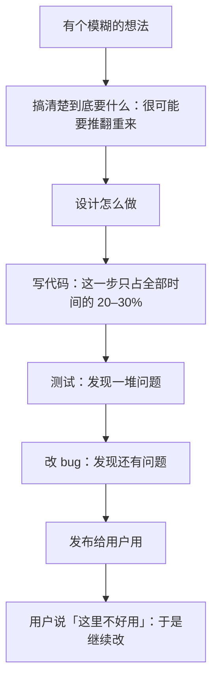

**关键认知：写代码只是中间的一小段。**

我接触过的真实项目里，程序员坐在那里敲代码的时间，通常只占工作时间的 **20%–40%**。其他时间花在哪了？

- 开会讨论「到底要做什么」
- 画流程图、设计结构
- 查资料、试方案
- 测试、改 bug
- 跟同事沟通、review 别人的代码

**这本书之所以要用整整 7 章讲「编程思维」，就是因为那 60%–80% 的「非写代码时间」，才是真正决定项目成败的地方。**

---

### 二、走一遍完整流程：以「记账小程序」为例

我们来完整地走一遍。假设你想做一个帮自己记账的小程序。

#### 阶段 1：需求——到底要什么？（最重要也最容易被跳过）

**最初的模糊想法**：「我想记一下我每个月花多少钱。」

现在开始追问自己：

| 追问 | 可能的答案 |
|---|---|
| 记什么？ | 日期、金额、类别（吃饭/交通/购物）、备注 |
| 怎么记？ | 命令行输入？还是做个界面？还是读支付宝账单文件？ |
| 要看到什么结果？ | 本月总支出？分类统计？跟上月对比？画个饼图？ |
| 数据存哪？ | 存本地文件？存数据库？ |
| 给谁用？ | 只有我一个人？还是家人也要用？ |
| 什么算「做完了」？ | 能记、能查、能看出分类统计 |

**看到没有？一个模糊想法，被追问出了 6 个必须回答的问题。**

> ### ⚠️ 新手最大的坑
>
> **跳过需求阶段，直接写代码。**
>
> 结果写到一半发现：「等等，我要不要支持多用户？」——如果要，整个数据结构要推翻重来。
>
> 或者做完了发现：「咦，我其实想要的是能自动读账单……」——白做。
>
> **在纸上花 30 分钟想清楚，能省掉后面 30 小时的返工。** 这是所有老手的共识。

#### 阶段 2：设计——怎么做？

需求清楚了，现在想「怎么做」。设计包括：

##### a. 数据怎么存（数据结构）

```
一条账目 = {
    日期: 2026-10-26,
    金额: 38.5,
    类别: "吃饭",
    备注: "午饭"
}
```

所有账目存成一个列表，写到一个文件里。

##### b. 功能有哪几块（模块划分）

1. 添加一笔账目
2. 查看所有账目
3. 按类别统计
4. 保存到文件 / 从文件读取

##### c. 界面长什么样（交互流程）

```
启动程序 → 显示菜单：
    1. 记一笔
    2. 查看全部
    3. 分类统计
    4. 退出
用户选 1 → 提示输入日期、金额、类别 → 保存 → 回到菜单
```

##### d. 有哪些「意外情况」要考虑（异常处理）

- 用户输入的金额是文字怎么办？
- 文件不存在怎么办？
- 用户输入了不存在的菜单选项怎么办？

**新手和老手的一个显著差别：老手在设计阶段就把异常情况想好了。**

#### 阶段 3：编码——写代码

现在才轮到真正写代码。

有了前面的需求和设计，**这一步其实是最「机械」的**——就是把设计翻译成代码。

```python
# 概念演示：记账程序的核心结构（极度简化）

# 一、输入：让用户记一笔
函数 记一笔():
    显示("日期？")
    日期 = 读取用户输入()
    显示("金额？")
    金额 = 读取用户输入()
    显示("类别？")
    类别 = 读取用户输入()

    新账目 = {日期: 日期, 金额: 金额, 类别: 类别}
    账目列表.添加(新账目)
    保存文件(账目列表)

# 二、处理：统计
函数 分类统计():
    统计表 = {}
    对于 每笔账目 in 账目列表:
        类别 = 每笔账目.类别
        统计表[类别] = 统计表[类别] + 每笔账目.金额
    返回 统计表

# 三、输出：显示菜单，等用户选择
当 用户没选退出:
    显示菜单()
    选择 = 读取用户输入()
    如果 选择 == "1": 记一笔()
    否则如果 选择 == "2": 查看全部()
    否则如果 选择 == "3": 显示(分类统计())
    否则如果 选择 == "4": 退出
```

**注意到了吗？这段代码的结构，就是第 5 章的骨架，加上第 43 章要讲的「函数」。**

#### 阶段 4：测试——真的能用吗？

写完了，跑一遍。你会发现：

- 输入金额时手滑打了「abc」→ 程序崩溃了
- 统计的时候发现某个类别没出现过，报了个错
- 存的文件第二次打开，内容乱码了

**这些都是正常的。** 没有哪个程序第一次就能跑通。

测试要做的事：

1. **正常情况**：输入正确的数据，看结果对不对
2. **边界情况**：金额是 0？负数？特别大？
3. **错误情况**：输入乱七八糟的东西，程序会不会崩？
4. **重复运行**：关掉再打开，数据还在吗？

#### 阶段 5：修 bug

测试发现的问题，一个个修。

修 bug 的过程通常是：

```
发现问题 → 复现它（让它稳定地再发生一次）
        → 定位（到底是哪一行的问题）
        → 修
        → 再测（确认修好了，且没搞坏别的）
```

这个过程第 21 章会专门讲。

#### 阶段 6：发布与迭代

程序能用之后，你开始真的用它记账。用着用着你会发现：

- 「要是能按月份筛选就好了」→ 加功能
- 「每次输日期好麻烦」→ 改成默认今天
- 「我想看看趋势图」→ 加图表

**于是又回到「需求 → 设计 → 编码」的循环。**

> ### 💡 一个重要的真相
>
> **软件从来没有「做完」的那一天，只有「暂时够用」的那一刻。**
>
> 微信做了十几年，每天都在改。Windows 做了几十年，还在更新。
>
> 这不是因为程序员不行，而是因为：**需求会变、用户会变、技术会变。**
>
> 接受这一点，你就不会对「我的程序怎么老是有要改的地方」感到焦虑了——那是常态。

---

### 三、「软件生命周期」的正式说法

把上面的流程规范化，业界叫它**软件开发生命周期（SDLC）**。常见模型有两种：

#### 模型一：瀑布模型（老派）

| 瀑布式：一条直线 | 迭代式：转圈 |
| --- | --- |
| 需求 → 设计 → 编码 → 测试 → 发布 | 需求 → 设计 → 编码 → 测试 → 发布一个能用的小版本 |
| 一条直线走到底，不回头 | 根据用户反馈改进，再发下一个版本 |
| 每一步都写清楚，进度好交代 | 早点拿到真实反馈，方向错了也来得及改 |

**问题**：如果需求一开始就想错了，走到最后才发现，代价巨大。

就像盖楼盖到 20 层才发现「电梯位置不对」——拆了重来。

#### 模型二：迭代 / 敏捷（现代主流）


**先做一个「能用的最小版本」，然后一圈一圈地改进。**

每一圈就叫一次**迭代**（iteration），通常一到四周。

**现代软件公司基本都用这种方式。** 它的好处是：

- 很快就能看到东西（哪怕很粗糙）
- 错了能早点发现
- 用户能早点参与进来

> ### 📌 一个对你有用的概念：MVP
>
> **MVP = Minimum Viable Product（最小可用产品）**
>
> 意思是：**先做出一个「刚好能用」的最小版本，赶紧拿去验证，别追求完美。**
>
> 比如你要做记账程序，第一版可以只有「记一笔 + 看总额」两个功能，连界面都没有。用起来觉得顺手，再加统计、再加图表。
>
> **MVP 思想对个人项目极其有用**——它能防止你陷入「准备三个月还没写出第一行代码」的泥潭。

---

### 四、这一章对你真正重要的三点

我知道你可能不会马上做项目，但这一章有三个认知会一直跟着你：

#### 认知一：需求不清是万恶之源

**绝大多数「写了半天白写」的悲剧，都源于需求没想清楚。**

以后无论做什么，先花时间回答：
- 到底要什么？
- 什么算做完？
- 有哪些情况要处理？

#### 认知二：先跑起来，再跑得好

不要追求第一次就写出完美的代码。

**先让它跑起来，哪怕很丑、很笨、有很多限制。** 跑起来的东西你可以改；跑不起来的东西你连改的机会都没有。

这是第 22 章「工程思维」的核心，也是所有老手的工作方式。

#### 认知三：写代码的时间占比，比你想象的低得多

如果你将来真的做了程序员，你会发现：

- 30% 时间在想「到底要做什么、怎么做」
- 25% 时间在写代码
- 25% 时间在测试和修 bug
- 20% 时间在沟通（开会、写文档、看别人的代码）

**所以「打字快」根本不是程序员的核心竞争力，「想清楚」才是。**

---

### ✅ 本章重点回顾

1. **写代码只占软件开发的 20%–40%，真正决定成败的是需求、设计、测试和沟通**——跳过需求直接写代码是新手最大的坑，纸上花 30 分钟想清楚能省掉 30 小时返工。

2. **完整流程是：需求 → 设计 → 编码 → 测试 → 修 bug → 发布 → 迭代，而且它是个圈不是一条线**——软件从来没有「做完」的那天，只有「暂时够用」的时刻。

3. **MVP 思想（先做出刚好能用的最小版本）能防止你陷入「准备三个月还没写代码」的泥潭**——先跑起来再跑得好，跑起来的东西才能改。

---

### 🤔 想一想

> 回想一下你生活或工作中某件「做了一半发现方向错了，只好推倒重来」的事（可能是装修、旅行计划、工作报告、甚至做一顿饭）。
>
> **请分析：当时如果多花 20 分钟在前面「想清楚需求」，能不能避免后面的返工？具体应该在开头问自己哪三个问题？**
>
> （把这三个问题写下来——它们会成为你将来做任何项目时的「开工三问」。）

---

## 第 8 章 算法的灵魂：好步骤与坏步骤

> ## 🎯 本章目标
>
> 读完这一章，你应该能够：
> - 说清楚「算法」到底是什么（它没那么神秘）
> - 理解为什么同一个问题可以有好几种解法
> - 建立「效率」的直觉——知道什么时候该在乎快慢
> - 明白为什么算法不是「数学难题」，而是「做事的方法」

---

### 一、算法不是什么高深的东西

很多人听到「算法」就紧张，觉得那是数学家才懂的东西。

**其实不是。**

> ### 💡 一句话定义
>
> **算法 = 解决某个问题的具体步骤。**

就这样。你每天都在用算法：

- 做早饭的流程 → 是个算法
- 你从家到公司的路线 → 是个算法
- 你整理衣柜的方法 → 是个算法
- 你在一堆文件里找一份合同 → 是个算法

**菜谱就是算法。导航路线就是算法。你妈教你挑西瓜的方法也是算法。**

只不过在计算机领域，算法这个词特指「能被翻译成代码、让计算机执行的步骤」。

#### 那为什么算法听起来这么难？

因为**有些算法确实很难**——那些是计算机科学家花了几十年来优化的顶尖成果（比如让 AlphaGo 下围棋的算法）。

但**日常编程里 95% 的算法都很简单**。你需要的不是高深数学，而是：

- 把步骤想清楚的能力
- 知道「有没有更省事的做法」的意识

---

### 二、同一个问题，不同的解法

我们用一个经典例子：**在一堆数字里找出最大的那个。**

#### 解法一：挨个看（笨办法，但有效）

思路：拿第一个数当「当前最大」，然后挨个跟后面的比，谁更大就换掉它。

```python
# 概念演示：找最大值

数字列表 = [3, 7, 2, 9, 5, 1, 8]

当前最大 = 数字列表[0]     # 先假设第一个最大

对于 每个数 in 数字列表:
    如果 每个数 > 当前最大:
        当前最大 = 每个数

显示("最大值是: " + 当前最大)
```

**这个办法要比较几次？** 7 个数，比较 6 次（跟自己不用比）。

如果是 100 万个数呢？比较约 100 万次。

**这个办法简单、可靠，永远不会错。**

#### 解法二：先排序，再取最后一个

思路：把所有数从小到大排好，最后一个就是最大的。

```python
# 概念演示：先排序再取最大

数字列表 = [3, 7, 2, 9, 5, 1, 8]
排好序 = 排序(数字列表)      # 得到 [1, 2, 3, 5, 7, 8, 9]
最大值 = 排好序[最后一个]
显示("最大值是: " + 最大值)
```

**这个办法对吗？对。但效率呢？**

排序 7 个数，内部可能要比较十几次。排序 100 万个数，可能要比较**上千万次**。

**而解法一只要 100 万次。**

> ### 📌 关键洞察
>
> **两个解法都能得到正确答案，但代价差了十倍甚至更多。**
>
> 这就是算法要研究的核心问题：**不是「能不能做出来」，而是「做出来要花多少代价」。**

#### 一个生活类比

假设让你在一本书里找「第 500 页」：

- **笨办法**：从第 1 页开始翻，翻到第 500 页 → 翻 500 次
- **聪明办法**：从中间翻开，看是第几页，如果小于 500 就往后翻一半，大于就往前翻一半 → 翻不到 10 次

这就是著名的**二分查找**。它跟「挨个翻」的差别，在书很薄时不明显，在书有几万页时就是天壤之别。

---

### 三、建立「效率」的直觉

你不需要学复杂的数学分析，但你需要建立一种**直觉**：什么时候该在乎效率，什么时候不用管。

#### 直觉一：小数据量，随便怎么搞都行

如果你要在 10 个名字里找一个，**用什么办法都无所谓**——计算机都能在百万分之一秒内做完。

**这时候应该选「最好写、最不容易写错」的办法，而不是最快的。**

> ### ⚠️ 新手常犯的错
>
> 在小数据上纠结效率，把代码写得又复杂又难懂，结果快了 0.001 秒，但多了三个 bug。
>
> **这是典型的「过度优化」，是新手进阶路上的一大陷阱。**

#### 直觉二：数据量一大，笨办法就会崩

关键的分界线在哪？给你几个参照：

| 数据规模 | 挨个查找的耗时感受 |
|---|---|
| 100 条 | 瞬间 |
| 1 万条 | 瞬间 |
| 100 万条 | 肉眼可见（零点几秒） |
| 1 亿条 | 明显变慢（几秒到几十秒） |
| 100 亿条（如全网搜索） | 完全不可行（笨办法彻底失效） |

**记住这个规律：数据量每增加 1000 倍，笨办法的耗时也大约增加 1000 倍。**

#### 直觉三：嵌套循环是「性能杀手」

这是一个特别实用的判断：

```python
# 危险信号：循环套循环

对于 每个A in 列表A:          # 假设 1000 个
    对于 每个B in 列表B:      # 假设 1000 个
        比较(A, B)            # 总共要比较 1000 × 1000 = 100 万次
```

**两层循环，复杂度是「乘」上去的。** 1000×1000 = 100 万。如果是三层循环，就是 10 亿——那就崩了。

**当你写代码时看到「循环套循环」，要警觉一下**：数据量会不会变大？如果会，这里将来可能就是瓶颈。

#### 直觉四：先做对，再求快

这是一条黄金准则：

> **第一步：先写出一个能跑、结果正确的版本（哪怕很慢）。**
> **第二步：测一下，看它是不是真的慢。**
> **第三步：如果确实慢，再想办法优化。**

**不要跳到第三步。** 因为绝大多数时候，你会发现「根本不慢，是我多虑了」。

这也是第 22 章「工程思维」的核心之一：**先跑起来，再跑得好。**

---

### 四、算法好坏怎么衡量？

业界用一个叫**时间复杂度**的东西（大 O 记法，写作 O(n)、O(n²) 这样）。

我**不打算教你算它**——那需要一点数学，而且你短期内用不上。我只给你三个最常见的「档位」，让你能看懂别人的讨论：

| 记法 | 含义 | 生活类比 | 代表算法 |
|---|---|---|---|
| **O(1)** | 不管数据多少，一次就搞定 | 直接翻到书签那一页 | 按编号取数组元素 |
| **O(n)** | 数据量翻倍，耗时也翻倍 | 从头到尾翻一遍 | 挨个查找 |
| **O(n²)** | 数据量翻倍，耗时变四倍 | 每个人都跟每个人握手 | 双重循环、简单排序 |

**从上到下，越来越慢。** 你的目标通常是：

- 能用 O(1) 就别用 O(n)
- 能用 O(n) 就别用 O(n²)
- 数据量小的时候，全都无所谓

> ### 📌 记住这句就够了
>
> **看到 O(n²) 就要想一想：数据量大了会不会炸？**
>
> 这是你在实际工作中最常用的一条判断。

---

### 五、算法思维的三个习惯

比起记住具体算法，更重要的是养成这三个习惯。它们会让你在将来面对任何问题时，都能想出还不错的解法。

#### 习惯一：先问「有没有现成的」

**绝大多数常见问题，前人已经解决过了，而且解决得比你好。**

- 要排序？→ 语言自带排序功能
- 要查找？→ 用现成的搜索库
- 要处理日期？→ 用现成的日期库

**高手的第一反应不是「我来写一个」，而是「有没有现成的」。**

这是第 36 章「包管理」和第 50 章「第三方库」要讲的核心思想：**不要重复造轮子。**

#### 习惯二：先想「最笨但正确的办法」

当面对一个新问题不知道怎么下手时：

**先想一个「一定能做出来，但可能很慢」的办法。**

为什么？

1. 它让你有了一个「保底方案」——至少能跑
2. 在写它的过程中，你会更理解问题
3. 往往想着想着，你就发现「哦，这里可以省一步」→ 优化自然就来了

**追求一步到位想出完美解法，是新手最常见的卡壳原因。**

#### 习惯三：拿纸笔画一画

这听起来很原始，但极其有效。

当你想不清楚一个流程时：

- 画几个方框代表步骤
- 画箭头表示顺序
- 拿一个具体的例子，手动走一遍流程

**我见过太多人盯着屏幕发呆，其实拿笔画两分钟就明白了。**

这不是因为画图有什么魔力，而是因为：**把脑子里的东西「外化」到纸上之后，你的大脑就能腾出空间来思考，而不是用来记忆。**

---

### 六、算法的「代价」不只是时间

最后补充一点：我们一直在说「快」，但算法的代价还有另一面——**空间**（内存占用）。

#### 时间 vs 空间的权衡

很多时候，你可以用「多占点内存」来换「跑得更快」。

**生活类比**：你要做一顿饭

- **省空间的做法**：做一道菜洗一次锅，洗了再用 → 省锅（空间），但慢（时间）
- **省时间的做法**：准备十个锅同时炒 → 快（时间），但占地方（空间）

**这就是经典的「时空权衡」**：要么花时间，要么花空间，往往不能两全。

#### 例子：查字典 vs 背下来

- 遇到不认识的字就查字典 → 省脑子（空间），但慢（时间）
- 把整本字典背下来 → 快（时间），但脑子要装很多（空间）

程序也是一样。将来你会遇到「缓存」这个概念——它的本质就是：**用内存空间换速度**。

> ### 💡 一个实用判断
>
> 现代计算机内存很大（8GB、16GB 很常见），所以**大多数时候，「用空间换时间」是划算的**。
>
> 但如果你处理的是超大数据（比如几 GB 的文件），就要反过来考虑了。

---

### ✅ 本章重点回顾

1. **算法就是「解决某个问题的具体步骤」——菜谱、导航路线都是算法**；它不神秘，日常编程里 95% 的算法都很简单，难点在于把步骤想清楚，而不是数学。

2. **同一个问题可以有多种解法，区别在「代价」**——建立效率直觉：小数据量随便搞（选最好写的），数据量大笨办法会崩，嵌套循环是性能杀手（O(n²) 要警惕）。

3. **黄金准则是「先做对，再求快」**——先写个能跑的正确版本，测了真的慢再优化；同时养成三个习惯：先找现成的、先想笨办法、拿纸笔画一画。

---

### 🤔 想一想

> 假设你有一个装着 1000 张照片的文件夹，里面有一张是你去年在海边拍的，但你不记得文件名了。
>
> **请说出两种不同的「找到它」的方法，并比较：哪种方法在 1000 张时更快？如果照片变成 100 万张，你那个方法还管用吗？**
>
> （提示：想想「挨个看」和「先想办法把范围缩小」这两种思路。后者就是所有高效算法的核心秘密：**想办法排除掉一大部分，只在剩下的里面找。**）

---

# 第二关　历史脉络

> 从织布机和差分机讲起，经过 ENIAC、汇编、高级语言、C 与 Unix，一直到开源、移动、云和 AI。
>
> 这一关不堆年份，讲的是每一次变化「为什么发生」。

## 第 9 章 前编程时代：织布机、差分机与第一位程序员

> ## 🎯 本章目标
>
> 读完这一章，你应该能够：
> - 理解「程序」这个概念比「计算机」早了整整一百年
> - 知道第一位程序员是谁，以及她为什么能预测到 AI
> - 明白编程的本质从一开始就是「设计步骤」，与机器无关
> - 建立对编程史的正确直觉：它是「想法」的历史，不是「机器」的历史

---

### 一、一个反直觉的事实

大多数人以为历史是这样的：

```
先发明计算机 → 然后才有了编程
```

**错了。真实的历史是反过来的：**

```
先有了"程序"的想法 → 过了一百年才有了能跑它的计算机
```

这不是文字游戏。这个顺序，藏着编程最深的秘密。

> ### 💡 本章的核心观点
>
> **编程的核心是「设计步骤」，而不是「操作机器」。**
>
> 如果编程只是操作机器，那它必须等机器发明之后才存在。但事实是：在没有任何计算机的时代，「程序」这个概念就已经诞生了——因为它本质上是人类思维的一种产物。

---

### 二、提花织布机：人类第一个「可编程设备」

时间回到 1804 年，法国里昂。

有个叫**约瑟夫·雅卡尔**（Joseph Marie Jacquard）的人，改进了织布机。

#### 织布机有什么难的？

你要在布上织出图案（比如一朵花），就得控制每一根经线什么时候抬起来、什么时候放下。

花纹越复杂，需要控制的线越多，操作越繁琐。传统做法是：找个人站在织布机旁边，按照图样一根一根手动提线。**慢得要死，而且极易出错。**

#### 雅卡尔的发明：用「打孔卡片」控制花纹

他的想法极其巧妙：

**把「哪些线该抬起来」这个信息，提前打在一张硬纸板上——打孔的地方，钩子能穿过去，线就抬起来；没打孔的地方，钩子被挡住，线不动。**

```
一张卡片 = 织布的一行
卡片上孔的分布 = 这一行的花纹
一串卡片连起来 = 一整块布的完整花纹
```

**这就是「程序」。**

- 想换个花纹？**换一套卡片**，不用改机器。
- 同一个机器，换不同的卡片，能织出完全不同的布。

#### 为什么这是革命性的？

因为它第一次实现了那个关键的分离：

> **「要做什么」（卡片上的信息） 和 「谁来做」（机器本身） 被分开了。**

这个分离，就是编程的灵魂。

**机器是通用的，信息是可换的。** 你今天用的电脑也是这样：同一台电脑，装不同的软件，就能干完全不同的事——这个思想的源头，是 1804 年的织布机。

#### 一个有趣的后续

这套打孔卡片技术，后来还被用在两个地方：

1. **自动钢琴**（19 世纪末）：打孔的纸卷控制琴键，一卷纸 = 一首曲子
2. **人口普查**（1890 年美国）：用打孔卡片统计人口，把原本要 8 年的工作缩短到 1 年

后者那台机器叫「制表机」，它的发明者叫**赫尔曼·霍尔瑞斯**，他后来创办了一家公司——这家公司几经改名，最后叫 **IBM**。

**IBM 的祖上，是织布机。**

---

### 三、巴贝奇的差分机与分析机：一个超前百年的天才

织布机是「存储程序」，但只能控制简单的花纹。真正提出「通用计算机」构想的，是个英国人：**查尔斯·巴贝奇**（Charles Babbage）。

#### 差分机：算数学表的机器

19 世纪初，航海、工程、金融都需要**数学用表**（对数表、三角函数表）。这些表是人手算的，错误百出——而一个错误可能导致船触礁、桥塌掉。

巴贝奇想：**能不能造个机器来算这些表？**

他设计的机器叫**差分机**，用齿轮和杠杆做加减法，能自动算出一系列数值。

**结果：没造出来。**

原因很现实：当时的机械加工精度不够，做不出他要求的零件；而且政府给的钱花光了，后续不给了。

#### 分析机：一个超越时代的构想

差分机失败后，巴贝奇提出了更疯狂的设想——**分析机**。

这个机器有多超前？它有现代计算机的全部核心部件：

| 分析机的部件 | 对应今天的 |
|---|---|
| **Store（仓库）** | 内存 |
| **Mill（磨坊）** | CPU（运算单元） |
| **打孔卡片输入** | 输入设备 |
| **打印机 / 打孔输出** | 输出设备 |
| **条件分支**（能根据中间结果跳到不同步骤） | if 判断 |

**最关键的：它是「通用」的。**

差分机只能算一种东西（多项式）。分析机理论上**能算任何东西**——只要你给它不同的卡片。

**这就是现代计算机的定义。** 巴贝奇在 1837 年就把它想清楚了，比真正的电子计算机早了 100 多年。

#### 为什么没造出来？

- 太超前了：需要的零件精度远超时代
- 太贵了：政府不买单
- 巴贝奇脾气不好，把赞助人都得罪了

**他到死都没看到自己的机器造出来。**

但思想是杀不死的。分析机的构想，通过一个人的笔，传到了后世。

---

### 四、爱达·洛芙莱斯：世界上第一位程序员

这个人就是**爱达·洛芙莱斯**（Ada Lovelace，1815–1852）。

她的身份很特殊：她是英国诗人**拜伦**的女儿。（她父亲拜伦是那个写「若我会遇见你，事隔经年」的浪漫诗人。她母亲为了避免她继承诗人的「疯狂」，从小让她学数学。）

#### 她做了什么？

1843 年，巴贝奇在意大利做了一场关于分析机的演讲。有人把它记下来发表了（法文）。

爱达（当时 27 岁）把它**翻译成了英文**——但她做的不只是翻译。

**她在译文后面加了三倍长的「注释」。** 其中一篇注释里，她写了一件事：

> 她为分析机写了一段**计算伯努利数**的完整步骤。

这段步骤，被认为是**人类历史上第一个计算机程序**。

#### 但真正厉害的不是「第一个程序」

真正厉害的是她在注释里写的另一段话。她说（大意）：

> **分析机并不能「创造」任何东西。它只能做我们告诉它去做的事。**
>
> 它没有任何「自作主张」的能力。它的价值在于：**它能处理符号，而不仅仅是数字。** 如果音符、字母这些关系能被表达出来，它就能「谱写任意复杂程度的乐曲」。

**这段话在 1843 年说出来，是惊人的。**

她准确地指出了两件事：

1. **机器不会思考**——它只执行指令（这正是第 2 章讲的「计算机很笨但很听话」）
2. **机器能处理任何能被符号化的东西**——不只是数字，还包括文字、音乐（这正是第 6 章「一切都是数字」的预言）

#### 她的预言与今天的 AI

更惊人的是，当别人问「机器能不能思考」时，她明确说：**不能。** 机器只能做被指示的事，它不会「自以为是在做什么」。

**180 年后，这句话依然是对的。**

哪怕是今天最先进的大语言模型，本质上仍然是：根据输入，按照训练出来的规则，一个接一个地生成输出。它不会「想要」做什么。

> ### 📌 关于「AI 会不会思考」的争论
>
> 这个问题今天吵得很凶。但爱达在 1843 年就给出了一个清醒的视角：
>
> **「机器能不能像人一样思考」和「机器能不能做出看起来像思考的结果」，是两个不同的问题。**
>
> 你可以坚持认为它不会思考，同时承认它的输出很有用。这两个判断不矛盾。

#### 她为什么值得被记住？

- 她在一个女性几乎不能接受高等教育的时代，成了数学家
- 她在计算机还没诞生时，就写下了第一个程序
- 她给出的「机器不会思考」的判断，180 年后依然成立

美国国防部后来把一门编程语言命名为 **Ada**，就是为了纪念她。

---

### 五、从这一章你能得到什么？

历史讲了这么多，关键收获是三条：

#### 收获一：编程是关于「设计步骤」的，不是关于「操作机器」的

雅卡尔的卡片、巴贝奇的构想、爱达的程序——**都是在没有任何电子计算机的时代完成的。**

因为它们本质上是在设计「步骤」，而步骤是可以用纸笔写下来的。

> **这对你的实际意义**：当你学编程遇到困难时，试试**把代码忘掉，先用中文把步骤写下来**。如果中文步骤写不清楚，换成任何语言都写不清楚。

#### 收获二：「通用机器 + 可换信息」这个分离，是计算机的第一原理

织布机的伟大之处不是它能织布，而是**同一台机器换套卡片就能织不同的布**。

你今天用的手机也是这样：同一个硬件，装不同的 App 就是不同的工具。

**这个思想，是所有软件存在的基础。**

#### 收获三：思想的寿命比机器长

巴贝奇的机器没造出来，爱达的程序没运行过。但他们的思想活到了今天。

**计算机科学是一门「思想先于实现」的学科。** 很多东西先在数学家的脑子里存在几十年，然后才被工程师造出来。

---

### ✅ 本章重点回顾

1. **「程序」比「计算机」早诞生一百年**——1804 年雅卡尔的提花织布机用打孔卡片控制花纹，第一次把「要做什么」（卡片）和「谁来做」（机器）分离开，这就是编程的灵魂；IBM 的祖上正是这套技术。

2. **巴贝奇的分析机在 1837 年就具备了现代计算机的全部核心结构**（内存/CPU/输入/输出/条件分支）而且是通用的——但它因加工精度和经费没造出来，思想却传了下来。

3. **爱达·洛芙莱斯写下了人类第一个程序，并准确预言「机器不会思考，只执行指令」**——这个判断在 180 年后的 AI 时代依然成立；她的故事告诉我们：编程的本质是设计步骤，而步骤是可以用纸笔写下来的。

---

### 🤔 想一想

> 雅卡尔织布机的核心创意是「把『要做什么』的信息，从机器本身里抽出来，变成可替换的卡片」。
>
> **请举出三个你日常生活中的「同一套东西 + 可换的信息 = 不同结果」的例子**（除了电脑装不同 App 之外）。
>
> （提示：想想厨房、音响、乐高、甚至你的大脑——「同一套设备，换个输入就换个结果」这种模式在哪儿还能看到？想出三个，你就真正理解了「通用机器」这个概念。）

---

## 第 10 章 电子计算机的黎明：ENIAC 与冯·诺依曼架构

> ## 🎯 本章目标
>
> 读完这一章，你应该能够：
> - 理解为什么会出现电子计算机（战争的迫切需求）
> - 知道「冯·诺依曼架构」是什么，以及为什么它统治至今
> - 理解「存储程序」这个革命性想法
> - 认识那些被历史遗忘的「人类计算机」

---

### 一、为什么突然就需要计算机了？

20 世纪上半叶，人类经历了两次世界大战。战争带来了一个极其迫切的计算需求。

#### 火炮射表问题

火炮要打得准，炮手需要一本**射表**：告诉你「在某个角度、用某种装药、打多远」。

射表的计算要考虑：炮弹重量、初速、空气阻力、风速、温度、地球自转……

**算一条弹道，人工要算几十个小时。**

而二战中，新炮型不断出现，每种都要重新算表。用人工算，一个炮型的表要算几个月——**等表算完，仗可能都打完了。**

#### 还有密码、原子弹

- **破译密码**：需要穷举大量组合
- **曼哈顿计划**（原子弹）：需要海量模拟计算

**需求极其迫切，人力完全不够。**

于是各国开始投入资源造「会算的机器」。

---

### 二、ENIAC：第一台通用电子计算机

1945 年，美国造出了 **ENIAC**（埃尼阿克）。

#### 它有多夸张？

| 参数 | 数值 |
|---|---|
| 电子管 | 约 18000 个 |
| 重量 | 约 30 吨 |
| 占地 | 约 170 平方米（一个大房子） |
| 耗电 | 约 150 千瓦 |
| 每秒计算 | 约 5000 次加法 |

对比一下你手上的手机：

- 重量：200 克
- 每秒计算：几十亿次

**你的手机比 ENIAC 快几百万倍，轻 15 万倍。**

#### 有个著名的传说

ENIAC 开机时，整个费城的灯会暗一下——因为它太耗电了。

这个说法有夸张成分，但耗电量确实恐怖。

#### 它有多难用？

**极其难用。**

ENIAC 没有「程序存储」的概念。要让它做一道新题，工程师必须：

1. 手动拔插几千根电缆
2. 拨动几千个开关
3. 这个过程可能要花**好几天**

**也就是说：编一个「程序」= 重新接线几天。**

你可以想象一下：每次想让手机换个功能，你要拆开它重新焊电路板——这就是早期编程。

---

### 三、冯·诺依曼的登场：一个改变一切的想法

就在 ENIAC 时代，有个匈牙利裔数学家叫**约翰·冯·诺依曼**（John von Neumann）参与了相关工作。

1945 年，他写了一份报告，提出了一个架构。这份报告的影响，怎么强调都不过分。

> ### 💡 核心想法：把程序也存进内存

之前的计算机（包括 ENIAC）：

- **数据**放在内存里
- **程序**靠外部接线/开关设定

冯·诺依曼说：**为什么不能把程序也放进内存里？**

程序和数据都是信息，都是 0 和 1，凭什么区别对待？

**如果程序也在内存里，那么：**

- 换程序 = 换内存里的内容 = 瞬间完成（不用重新接线！）
- 程序可以自己修改自己（虽然这通常不是好主意）
- 程序可以「读」数据，也可以「读」另一段程序

#### 冯·诺依曼架构的五大部件

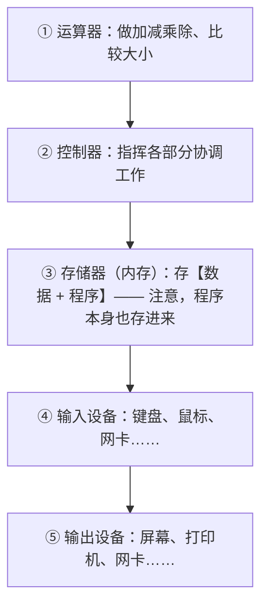

**这个架构，从 1945 年到现在，基本没变过。**

你手机里的芯片、你电脑里的 CPU、甚至智能手表——全都是冯·诺依曼架构。

> ### 📌 这是计算机史上最重要的一次「定调」
>
> 80 年过去了，处理器从电子管变成几纳米的晶体管，速度提升几十亿倍，**但基本架构还是冯·诺依曼画的那个图。**
>
> 在计算机领域，这是罕见的稳定性。大多数技术几年就过时了，而这个架构用了 80 年。

#### 为什么这个想法这么强？

因为它打通了「程序」和「数据」的界限：

- 程序可以像数据一样被复制、被读取、被传输
- 这才有了后来的：操作系统（也是程序，存在内存里）、编译器（程序读程序）、病毒（程序感染程序）……

**如果程序和数据是分开的，这些东西全都无法实现。**

---

### 四、被遗忘的「人类计算机」

讲历史有个容易犯的错：只记得造机器的人，忘了用机器的人。

ENIAC 时代有个群体，叫 **Computer（计算机）**——但当时这个词指的是**人**，而且是**女性**。

#### 她们是谁？

二战期间，大量男性上了战场，后方岗位空缺。于是军方招募了大批有数学背景的女性，让她们**用手摇计算机和纸笔，进行海量计算**。

她们的工作包括：

- 计算火炮射表
- 计算弹道轨迹
- 后来参与 ENIAC 的编程

#### ENIAC 的六位女程序员

ENIAC 造出来后，需要有人给它「编程」（就是前面说的拔插电缆）。

这个工作交给了六位女性：

**凯·麦克纳尔蒂、贝蒂·詹宁斯、贝蒂·斯奈德、玛琳·梅尔策、弗兰·比拉斯、露丝·利希特曼**

她们没有现成的说明书（因为没人做过这事），只能：

1. 看懂 ENIAC 的电路图
2. 想出怎么把数学问题翻译成接线方案
3. 手动接线、测试、debug

**她们实际上是世界上第一批真正的程序员。**

#### 为什么她们被遗忘了几十年？

因为在那个年代，「编程」被认为是**低级的文书工作**（跟打字、接线差不多），而「造机器」才是高级的engineering。

所以 ENIAC 发布会上，她们没被介绍；庆功宴上，她们没被邀请。

**直到几十年后，历史学家才把她们的贡献挖出来。**

> ### 💡 一个值得记住的教训
>
> 这个故事的教训不只是「要尊重女性」。它还有一个行业层面的启示：
>
> **一个新领域刚出现时，它的价值往往被低估。**
>
> 「编程」在 1945 年被看作「接线员的活儿」。今天它是个高薪职业。
>
> 类似的低估，今天也在发生——比如现在有人觉得「提示词工程不算技术」。历史告诉我们：**别急着给新事物定性。**

---

### 五、从这一章能提炼出什么？

#### 提炼一：需求驱动技术

电子计算机不是科学家在实验室里闲着无聊发明的——它是**战争逼出来的**。

技术史上，这种「需求倒逼」的模式反复出现：

- 战争 → 计算机、互联网（ARPANET 也是军用背景）
- 太空竞赛 → 集成电路小型化
- 游戏需求 → 显卡性能暴涨
- AI 需求 → GPU 和算力产业

**记住：技术不是凭空长出来的，它总是为了解决某个具体问题。**

#### 提炼二：「存储程序」是计算机史上最重要的一次开窍

把程序也当数据存储——这个想法简单到让人觉得「本来就应该是这样」，但在 1945 年它是个突破。

**很多伟大的创新，事后看都「理所当然」。** 这需要你想象「在它被提出之前，人们是怎么想的」——那时候程序是接线接出来的，跟数据是两码事。

#### 提炼三：硬件在变，架构没变

80 年来，硬件翻天覆地，但冯·诺依曼架构稳如泰山。

**这意味着：你在本书第一关学到的「CPU 取指执行」「内存/硬盘」「输入输出」，在未来几十年大概率依然成立。**

这是本书敢先讲原理再讲实践的底气：**原理变化慢，工具和语法变化快。**

---

### ✅ 本章重点回顾

1. **电子计算机是战争逼出来的**（火炮射表、密码破译、原子弹模拟），ENIAC 重达 30 吨、每秒 5000 次加法，但编个程序要手动拔插电缆好几天。

2. **冯·诺依曼的核心创举是「把程序也存进内存」**——程序和数据都是 0/1，没有区别；这让换程序变成瞬间的事，也让操作系统、编译器、甚至病毒成为可能；这个 1945 年的架构至今统治着所有计算机。

3. **ENIAC 的六位女程序员是世界上第一批真正的程序员**，她们在没有说明书的情况下从电路图推导出编程方法，却因「编程被视为低级文书工作」而被遗忘几十年。

---

### 🤔 想一想

> 冯·诺依曼的关键洞察是：「程序」和「数据」其实是一回事，都可以放在同一个地方。
>
> **你能想到这个洞察带来的一个「副作用」吗？**（提示：如果程序和数据存在一起，那一个「数据」有没有可能被当成「程序」来执行？）
>
> （这就是现代计算机安全领域最大一类漏洞的根源——想想你有没有听说过「缓冲区溢出」或者「SQL 注入」。它们的共同点，就是攻击者把「数据」伪装成了「指令」让计算机执行。）

---

## 第 11 章 机器语言与汇编：最硬核的年代

> ## 🎯 本章目标
>
> 读完这一章，你应该能够：
> - 理解「机器语言」长什么样，以及为什么没人愿意写
> - 知道汇编语言的改进在哪，以及它的局限
> - 理解「翻译」这个思想是编程史的主线
> - 明白为什么我们今天能写「人话一样的代码」

---

### 一、机器语言：直接写 0 和 1

有了冯·诺依曼架构，程序可以被存进内存了。但程序用什么写？

**最开始，只能用 0 和 1 写。**

因为 CPU 唯一认识的就是 0 和 1。每一条指令，都是一串二进制数字。

#### 一条真实的机器指令长什么样？

假设有台极简的计算机，它的一条指令是这样编码的：

```
10110000 01100001
```

这串数字的意思是：「把数字 97 放进一个叫 A 的寄存器」。

拆开看：

- `10110000` = 「把后面的数字放进寄存器 A」（这叫**操作码**）
- `01100001` = 数字 97（这叫**操作数**）

**一个完整的程序，就是这样一串又一串的数字。**

#### 用机器语言写个「1+1」有多痛苦？

大概是这个感觉（极度简化）：

```
10110000 00000001   ← 把 1 放进寄存器 A
00000100 00000001   ← 把 1 加到寄存器 A 上
10110010 00000010   ← 把结果存到内存地址 2
```

**三行数字，只做了个 1+1。**

现在想象一下，用这种方式写一个有 5000 行逻辑的程序。

#### 机器语言的四大痛苦

| 痛苦 | 说明 |
|---|---|
| **完全不可读** | 看一眼 `10110000` 你能知道它是干嘛的吗？不能。 |
| **极难修改** | 要插入一条指令，后面所有地址可能都要重算 |
| **极易出错** | 写错一个 0/1，程序行为完全不同，而且极难发现 |
| **完全不通用** | 这台机器的指令，换台机器就不认了 |

> ### 📌 一个真实的历史细节
>
> 早期程序员真的就是这么干的。他们把程序打在**打孔纸带**上（又是打孔！），然后通过读带机输入。
>
> 如果打错一个孔，整段程序就废了。有人形容那种感觉：「像在黑暗中绣花」。

---

### 二、汇编语言：第一次「说人话」

终于有人受不了了。

20 世纪 50 年代初，出现了**汇编语言**。

#### 核心改进：给操作码起个名字

与其写 `10110000`，不如写：

```
MOV A, 97
```

`MOV` 是 move（搬运）的缩写。这句话的意思是「把 97 搬到 A 里」。

**一下子就能看懂了。**

#### 对比一下

**机器语言：**

```
10110000 01100001
00000100 00000001
10110010 00000010
```

**汇编语言：**

```
MOV  A, 1      ; 把 1 放进 A
ADD  A, 1      ; A 加上 1
MOV  [2], A    ; 把 A 的值存到地址 2
```

**可读性提升了十倍不止。**

#### 汇编还带来了另一个重要改进：可以用「标签」

机器语言里，你要跳转到一个位置，必须写出那个位置的**具体内存地址**。

```
跳转到 地址 00010110
```

问题是：如果你在前面插入了几条指令，后面所有地址都变了，你得手动重算所有跳转地址。**这是噩梦。**

汇编让你用**标签**：

```
        MOV A, 1
循环开始:                 ; ← 这是个标签
        ADD A, 1
        JMP 循环开始       ; 跳到"循环开始"这个标签
```

**你不用关心它在内存的第几个字节。** 汇编器（翻译程序）会帮你算。

> ### 💡 这是「抽象」的又一次胜利
>
> 还记得第 4 章说的「抽象」吗？
>
> 汇编做的事就是：**把「具体的内存地址」抽象成「人类起的名字」。**
>
> 这就是计算机科学贯穿始终的主线：**每一代新技术，都在把上一代「必须关心的细节」藏起来。**

---

### 三、汇编器：第一个「翻译程序」

汇编语言 human 了，但 CPU 只认识 0 和 1。

所以需要一个程序，把汇编翻译成机器码。这个程序叫**汇编器**（assembler）。

```
你写的汇编代码  →  汇编器  →  CPU 能跑的机器码
(MOV A, 1)              (10110000 00000001)
```

**这是计算机史上一个里程碑：出现了「用程序来写程序」这件事。**

从这一刻起，程序员不再直接面对机器。他们面对的是一层「翻译层」。

#### 为什么这很重要？

因为它开启了一个模式，这个模式一直延续到今天：

```
高级的、人类友好的写法  →  某种翻译程序  →  机器能执行的东西
```

今天的 Python、JavaScript、Java，本质上还是这个模式，只是「翻译」的方式更多样了（编译、解释、虚拟机……第 24 章会讲）。

---

### 四、汇编语言的问题：它还是太贴近机器了

汇编是个巨大进步，但它有个根本局限：

**汇编指令和 CPU 指令是一一对应的。**

也就是说，你写一条汇编指令，对应 CPU 就执行一个微小动作。

#### 这意味着什么？

意味着你想做一件「稍微复杂点」的事，还是要写很多条指令。

比如「如果这个数大于 10 就显示一句话」这么简单的逻辑，汇编要写：

```
    CMP  A, 10        ; 比较 A 和 10
    JLE  跳过         ; 如果小于等于就跳走
    ; ... 这里要写调用显示功能的十几条指令 ...
跳过:
```

**复杂度和机器语言是同一量级的，只是可读性好了。**

#### 更致命的：完全不通用

汇编语言是**跟 CPU 绑定的**。

- Intel 的 CPU 有一套汇编指令
- ARM 的 CPU（手机用的）有另一套
- 老式的大型机又有别的

**你为 Intel 写的汇编，在 ARM 上完全跑不了，一个字都不认识。**

这是个大问题：程序无法在不同机器间移植。每换一种硬件，全部重写。

#### 还有一个问题：需要懂硬件

用汇编，你必须知道这台机器有几个寄存器、每个寄存器叫什么、内存怎么寻址、栈怎么组织……

**这要求每个程序员都是硬件专家。** 这显然没法普及。

---

### 五、一个关键的历史推动力：成本

讲到这里，我要点出一个非技术的关键因素。

20 世纪 50 年代，计算机硬件极其昂贵，而**程序员的时间相对便宜**（至少人们是这么认为的）。

所以当时的逻辑是：

> **让程序员去适应机器，而不是让机器去迁就程序员。**

反正机器那么贵，你就照着机器的脾气写吧。

**但后来这个账算过来了。**

随着计算机普及，程序员越来越多、越来越贵，而硬件（摩尔定律）越来越便宜。

于是逻辑反转了：

> **宁可让计算机多干点活（翻译、优化），也要让程序员写得舒服。**

**这个转变，是所有高级语言诞生的经济基础。**

> ### 📌 一个深刻的规律
>
> 回顾整个编程史，你会发现一条清晰的主线：
>
> **硬件越来越便宜 → 人力越来越贵 → 工具越来越「迁就人」**
>
> 从汇编到 C，从 C 到 Python，从手写代码到用 AI 助手——每一步都是这个规律在起作用。
>
> **理解这一点，你就能理解为什么现代语言越来越「简单」——不是因为人类变笨了，而是因为机器算力过剩，值得拿来换人的时间。**

---

### 六、汇编今天还有用吗？

你可能会问：既然这么难用，汇编是不是被淘汰了？

**没有，它还活着，只是退到了极小的领域。**

今天还在用汇编的场景：

| 场景 | 为什么必须用 |
|---|---|
| **操作系统内核的关键部分** | 有些操作只有汇编能表达（比如切换 CPU 模式） |
| **设备驱动** | 要直接操作硬件寄存器 |
| **极致性能优化** | 游戏引擎、视频编解码的核心循环，人工优化可能比编译器强 |
| **嵌入式/单片机** | 资源极少，容不下高级语言的运行时 |
| **逆向工程与安全** | 分析病毒、破解软件，看的就是汇编 |

**但 99.9% 的程序员，一辈子都不需要写汇编。**

#### 那你需要学汇编吗？

**不需要。**

但你需要知道它存在，以及知道一件事：

> **你写的每一行高级语言代码，最终都会变成类似汇编的东西。**
>
> 有些 bug（比如性能问题、内存问题）追到底层才能理解。到那时候，知道「底下有汇编这一层」就够了，不需要你会写。

---

### ✅ 本章重点回顾

1. **机器语言就是直接写 0 和 1**（如 `10110000 01100001` 表示「把 97 放进寄存器 A」），完全不可读、极难改、极易错、完全不通用——早期程序员真的是在打孔纸带上「黑暗中绣花」。

2. **汇编语言给操作码起了名字（MOV/ADD/JMP）并引入标签代替内存地址**，可读性提升十倍；但它的根本局限是「一条汇编 = 一个 CPU 微小动作」，且跟具体硬件绑定，换个 CPU 就完全跑不了。

3. **汇编器是第一个「用程序写程序」的翻译工具**，开启了「人类友好的写法 → 翻译程序 → 机器码」这个延续至今的模式；而推动高级语言诞生的真正动力是经济账：硬件越来越便宜、人力越来越贵，工具必须迁就人。

---

### 🤔 想一想

> 本章提到一条贯穿编程史的规律：**硬件越来越便宜，人力越来越贵，所以工具越来越「迁就人」**。
>
> **顺着这条规律想下去：未来的编程会变成什么样？** 具体地说：
> - 2035 年的程序员，可能还需要亲手写「循环」和「条件判断」吗？
> - 如果 AI 能帮你写代码，那程序员的价值会转移到哪里？
>
> （这个问题的答案，跟本书最后一章「路线与未来」遥相呼应。先自己想想，后面会有答案。）

---

## 第 12 章 高级语言革命：FORTRAN、COBOL 与 BASIC

> ## 🎯 本章目标
>
> 读完这一章，你应该能够：
> - 理解「高级语言」到底「高级」在哪
> - 知道编译器是怎么解决「通用性」问题的
> - 认识 FORTRAN、COBOL、BASIC 这三门里程碑语言各自解决了什么问题
> - 理解为什么会出现「针对不同用途的不同语言」

---

### 一、什么是「高级语言」？

先说清楚这个词。

> ### 💡 定义
>
> **高级语言 = 更接近人类思维方式、更远离机器细节的编程语言。**

「高级」不是说它更牛，是说它的**抽象层次更高**——离机器更远，离人更近。

#### 一个直观对比

假设要让计算机算 `1 + 2 + 3`，然后把结果存起来。

**机器语言**（大约）：
```
一堆 0 和 1
```

**汇编语言**（大约）：
```
MOV  A, 1
ADD  A, 2
ADD  A, 3
MOV  [100], A
```

**高级语言**（大约）：
```
结果 = 1 + 2 + 3
```

**看出区别了吗？**

- 汇编里，你必须关心「用哪个寄存器」「结果存到内存的哪个地址」
- 高级语言里，你只说「我要一个叫『结果』的东西，它等于 1+2+3」

**寄存器、内存地址这些细节，被藏起来了。**

> ### 📌 高级语言「高级」的三个标志
>
> 1. **不用关心硬件细节**（寄存器、内存地址、CPU 指令）
> 2. **一行代码能表达更多事**（一行高级语言 ≈ 几十条机器指令）
> 3. **更接近数学或自然语言的表达习惯**

---

### 二、编译器：让「通用」成为可能

高级语言好写，但 CPU 不认识。

所以需要一个翻译程序：**编译器**（compiler）。

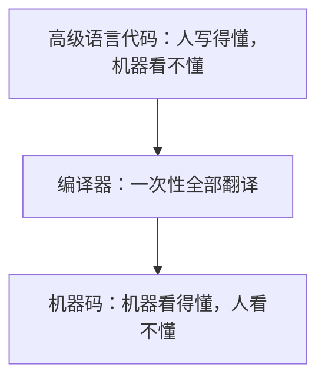

#### 编译器和汇编器有什么不同？

关键区别：**编译器不是「一一对应」的翻译**。

- **汇编器**：一条汇编 → 一条机器指令（1:1）
- **编译器**：一行高级语言 → 可能几十条机器指令（1:N），而且它会**重新组织和优化**

#### 编译器解决了一个致命问题：可移植性

还记得汇编的问题吗？换了 CPU 就跑不了。

编译器怎么解决？

**思路：同一份高级语言代码，用不同的编译器，翻译成不同 CPU 的机器码。**

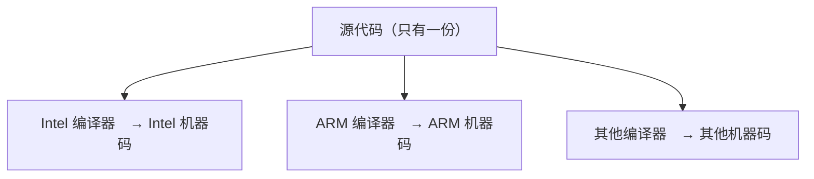

**源代码写一次，到处都能跑。**

这就是「可移植性」——它是高级语言最大的价值之一。

> ### ⚠️ 现实中的一点保留
>
> 理想很美好，现实有折扣。不同 CPU、不同操作系统之间的差异，不可能 100% 被编译器抹平。所以真实世界里，「能移植」往往要付出一些额外工作。
>
> 但相比汇编的「完全重写」，这已经是天壤之别了。

---

### 三、FORTRAN：科学计算的第一门高级语言

**时间**：1957 年
**公司**：IBM
**用途**：科学计算、工程计算

#### 背景：科学家不想学汇编

50 年代，使用计算机的主要是科学家和工程师。他们的需求是：**算数学题**。

但让他们去学寄存器、学二进制？他们只想算个矩阵乘法。

于是 IBM 的团队（带头人 John Backus）决定：**做一门让科学家能用数学公式直接写程序的语言。**

#### FORTRAN 的革命性在哪？

它的名字来自 **For**mula **Tran**slation（公式翻译）。

**它的核心卖点：你可以写长得像数学公式的代码。**

比如要算 `x = (a + b) * c`：

**汇编时代**（大约）：
```
MOV  A, a
ADD  A, b
MUL  A, c
MOV  x, A
```

**FORTRAN**：
```
X = (A + B) * C
```

**一模一样。**

科学家看到这个哭了——终于不用学计算机也能算题了。

#### 一个重要的副作用：编译器必须「够聪明」

有人当时怀疑：编译器生成的机器码，能有手写汇编快吗？

**答案是：通常能，甚至更快。**

因为编译器可以做很多人脑做不到的优化（重排指令、复用寄存器、消除冗余计算……）。

**这场争论（「编译出来的代码够不够快」）持续了十几年，最后编译器赢了。**

> ### 💡 这件事的意义
>
> 它证明了一件重要的事：**让机器多干活，来换取人的效率提升，是值得的。**
>
> 从那以后，这个方向就再没变过。

#### FORTRAN 今天还在用吗？

**还在。** 在气象预报、物理模拟、工程计算这些领域，大量老代码是 FORTRAN 写的，而且跑得很好。

它是最长寿的语言之一。

---

### 四、COBOL：为商业而生的语言

**时间**：1959 年
**推动者**：美国国防部 + 商业界
**用途**：商业数据处理

#### 背景：企业的问题跟科学家完全不同

科学家要算公式。企业要干什么？

- 记工资表
- 记库存
- 记客户信息
- 生成报表

**这些事的特点是：数据量大、逻辑简单、但要处理「记录」这种结构。**

#### COBOL 的特点：像英语句子

COBOL 的设计目标很明确：**让非程序员（会计、管理人员）也能看懂代码。**

所以它的语法故意写得很啰嗦、很像英语：

```cobol
ADD 100 TO ACCOUNT-BALANCE.
IF ACCOUNT-BALANCE IS LESS THAN 500
    DISPLAY "余额不足".
```

**是不是几乎能直接读懂？**

这就是设计意图：牺牲简洁，换取可读。

#### COBOL 的遗产：比你想象的大

你可能没听过 COBOL，但你可能被它影响过。

- **银行的核心系统**：大量还在跑 COBOL
- **保险、政府、航空订票系统**：大量 COBOL
- 有个统计说：全球 70% 以上的商业交易，背后都经过 COBOL 系统

#### 一个著名的「COBOL 危机」

2020 年疫情时，美国失业救济系统崩溃，各州紧急招 COBOL 程序员——因为系统太老，懂的人快退休了。

**这说明两件事：**

1. **老代码不会消失，它会一直跑下去**（只要还有人维护）
2. **技术债是真的存在的**（第 22 章会讲）

> ### 📌 一个反直觉的真相
>
> **在编程界，「新」不等于「有用」，「老」不等于「该死」。**
>
> COBOL 快 70 岁了，还在支撑着全球金融。而很多时髦的语言，十年后可能就没人用了。
>
> 你在第 31 章会看到更多关于「语言会不会过时」的讨论。

---

### 五、BASIC：让编程走进千家万户

**时间**：1964 年
**发明者**：两位达特茅斯学院的教授
**用途**：教学

#### 背景：编程应该人人可学

FORTRAN 给科学家，COBOL 给企业，但**普通人想学编程怎么办？**

当时的计算机又贵又大，只有大学和大公司有。

两位教授想：**能不能做一门语言，让大学生（不管什么专业）都能快速上手？**

于是有了 BASIC（Beginner's All-purpose Symbolic Instruction Code，初学者通用符号指令代码）。

#### BASIC 的特点：极简 + 交互

- 语法极少，一小时能学会基础
- **交互式**：你写一行，它立刻执行一行（不像 FORTRAN 要编译整批）

这让学习曲线变得非常平缓。

#### BASIC 的黄金时代：个人电脑

真正让 BASIC 火遍全球的，是 **1970–80 年代的个人电脑**。

- 早期的个人电脑（Apple II、Commodore 64 等）**开机就直接进 BASIC 环境**
- 你想让电脑干点啥，就得敲 BASIC
- 杂志上全是 BASIC 程序，读者抄下来输进电脑就能跑游戏

**整整一代人，是通过 BASIC 认识编程的。**

包括比尔·盖茨——他和保罗·艾伦的第一桶金，就是给 Altair 电脑写了个 BASIC 解释器，微软的起点。

#### BASIC 后来的演变

微软把它发展成 **Visual Basic**，加了图形界面开发能力。90 年代到 2000 年代初，Visual Basic 是企业内部工具开发的主力。

现在？基本退出了主流舞台。但它的遗产——「让编程变简单」——继续活在 Python 身上。

---

### 六、为什么会有这么多语言？

讲完这三门语言，你可能有个疑问：

> **为什么不能做一门「万能语言」，让大家都用？**

这个问题问得很好，答案也很关键。

#### 答案一：不同领域的思维方式不同

- **科学家**想的是「公式」 → FORTRAN
- **会计**想的是「记录和报表」 → COBOL
- **学生**想的是「快速看到结果」 → BASIC

**语言是思考的工具。** 不同领域的思考方式不同，工具自然也不同。

#### 答案二：设计就是取舍

你不可能让一门语言同时做到：

- 极快（贴近硬件）
- 极简单（新手友好）
- 极灵活（能表达任何结构）
- 极安全（不容易写错）

**想要 A 就会牺牲 B。** 所以不同语言选择了不同的取舍点。

> ### 📌 这是理解「语言差异」的钥匙
>
> **以后你看到任何一门新语言，先问：它做了什么取舍？**
>
> - C 牺牲了安全性和易用性，换来了极致性能和硬件控制
> - Python 牺牲了速度，换来了极致的简单和灵活
> - Java 牺牲了一些简洁，换来了稳定性和工程性
>
> **没有最好的语言，只有不同取舍的语言。** 这个认知会在第 32 章发挥作用。

#### 答案三：历史惯性

有些语言的存在，纯粹是因为「已经有人用了，而且用得很好」。迁移成本高到不值得。

**这也是为什么 COBOL 还活着。**

---

### ✅ 本章重点回顾

1. **高级语言「高级」在三点：不关心硬件细节、一行顶几十条机器指令、接近数学/自然语言**——它的核心价值是可移植性：同一份代码用不同编译器能生成不同 CPU 的机器码。

2. **FORTRAN（公式翻译，1957）、COBOL（像英语的商业语言，1959）、BASIC（教学与普及，1964）分别代表了三条不同的取舍路线**——它们证明「不同领域的思维方式需要不同的工具」。

3. **为什么不能只有一门语言？因为设计就是取舍**——不可能同时做到极快、极简、极灵活、极安全；看到任何语言先问「它做了什么取舍」，这是理解语言差异的钥匙。

---

### 🤔 想一想

> COBOL 已经快 70 岁了，至今仍在支撑全球大部分银行交易；而很多十年前很火的语言，现在已经没什么人用了。
>
> **如果让你判断：一门编程语言「活得久」的关键因素是什么？** 请列出你认为最重要的三个因素，并说明理由。
>
> （提示：想想「什么让替换它的成本变得很高」——技术因素？生态因素？人的因素？这个问题在第 31 章会有更完整的答案。）

---

## 第 13 章 C 语言与 Unix：一个「巧合」改变世界

> ## 🎯 本章目标
>
> 读完这一章，你应该能够：
> - 理解 C 语言为什么被称为「现代编程的基石」
> - 知道 Unix 操作系统为什么如此重要
> - 理解「可移植性」是怎么被真正解决的
> - 明白为什么今天你用的几乎所有软件都流淌着 C 的血

---

### 一、一个「副产品」的诞生

时间：1969–1972 年
地点：贝尔实验室（美国 AT&T 旗下的研究机构）
人物：**肯·汤普森**（Ken Thompson）和**丹尼斯·里奇**（Dennis Ritchie）

#### 故事的开始：想玩游戏

1969 年，肯·汤普森有台闲置的小型机。他想在这台机器上玩自己写的一个游戏（叫《Space Travel》，模拟太阳系航行）。

但当时的操作系统不好用，而且这台机器性能也不行。

**于是他决定：自己写个操作系统。**

这个决定，改变了整个计算机史。

#### 从「写一个系统」到「发明一门语言」

写操作系统要用什么语言？

当时的选择：

- **汇编**：能用，但换个机器就要重写，太痛苦
- **其他高级语言**：要么太慢，要么功能不够，要么不适合写系统

于是丹尼斯·里奇在汤普森早期的 B 语言基础上，做了改进，做出了 **C 语言**（1972 年左右）。

**然后他们用 C 重写了整个操作系统，这个系统叫 Unix。**

> ### 📌 这个「巧合」有多重要？
>
> 他们本来只是想玩游戏。结果顺手发明了：
>
> - **C 语言** —— 至今仍是所有主流语言的「祖师爷」
> - **Unix** —— 至今仍是一切服务器、macOS、Linux、Android 的鼻祖
>
> 这是计算机史上最著名的「无心插柳」。

---

### 二、C 语言做对了什么？

C 语言为什么能统治世界几十年？因为它找到了一个**近乎完美的平衡点**。

#### 平衡一：足够「高级」，又足够「底层」

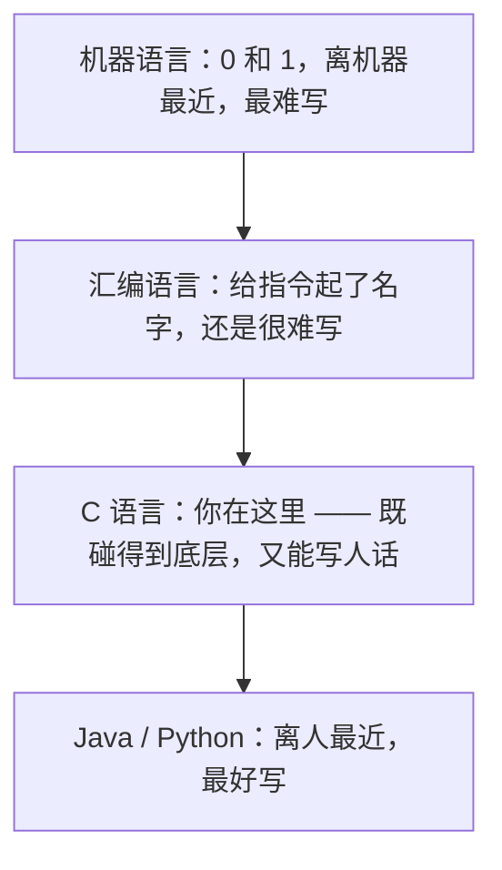

C 语言的特点：

**它比汇编好用得多：**

```c
// C 语言
if (a > b) {
    result = a;
} else {
    result = b;
}
```

**但它又保留了「直接操作内存」的能力：**

```c
// C 语言可以直接操作内存地址（这是它的杀手锏，也是它的危险之处）
int *p = &a;      // 拿到变量 a 的内存地址
*p = 100;         // 直接往那个地址写 100
```

**这种「能直接碰内存」的能力，让它能写操作系统、写驱动、写嵌入式——这些领域汇编之外没有别的语言能做到。**

#### 平衡二：语法极简，能力极强

C 语言的核心语法非常少。它的关键字（保留字）只有 **32 个**。

对比一下：

- C：32 个关键字
- Java：约 50 个
- C++：超过 90 个（还在增加）
- Python：约 35 个

**用极少的语法，表达极强的能力**——这是 C 的设计哲学，也是它优雅的地方。

#### 平衡三：可移植性真正落地

C 语言的可移植性策略极其聪明：

**它不试图抹平所有硬件差异，而是提供一个「薄薄的通用层」。**

具体做法：

```
你的 C 代码  →  针对每种机器的编译器  →  该机器的机器码
```

只要你不去碰那些「跟机器强相关」的东西，同一份 C 代码换个编译器就能在新机器上跑。

**这就是「一次编写，到处编译」**（Write once, compile anywhere）。

对比 Java 后来的口号「一次编写，到处运行」（Write once, run anywhere）——思路不同，但目标一样。

#### 平衡四：贴近硬件，所以快

C 编译出来的代码，效率接近手写汇编。

**这在 1970 年代是关键卖点**（当时硬件很弱），直到今天仍是它的核心优势。

---

### 三、Unix：一个影响了所有人的操作系统

#### Unix 做对了什么？

Unix 的成功不亚于 C 语言。它的设计哲学影响了后面所有操作系统。

##### 哲学一：一切皆文件

Unix 里，这些东西都可以通过「读文件、写文件」的方式操作：

- 普通文件 ✓
- 键盘、屏幕 ✓
- 打印机 ✓
- 网络连接 ✓
- 甚至另一个程序 ✓

**统一成一个接口**，程序员只需要学会「读/写」这一套操作。

> ### 💡 这是「抽象」的教科书案例
>
> 还记得第 4 章说的操作系统「提供统一接口」吗？Unix 把它做到了极致。
>
> 「一切皆文件」的意思是：**不管背后是硬盘、是键盘、还是网络，你都用同一套方式跟它打交道。**

##### 哲学二：小程序，各司其职，用管道连接

Unix 的设计者有个理念：

> **一个程序只做好一件事。要做复杂的事，把几个小程序串起来。**

比如「找出文件里包含『error』的行，数一数有几行」：

```bash
grep "error" log.txt | wc -l
```

- `grep`：找出包含 error 的行
- `|`（管道）：把前一个的输出，喂给后一个
- `wc -l`：数行数

**两个小程序，用一根管子连起来，完成了复杂任务。**

这种「组合小工具」的思想，至今仍是 Unix/Linux 的精髓，也是第 34 章「命令行」要讲的内容。

##### 哲学三：可移植的操作系统

用 C 写的Unix，可以移植到不同机器——这在 1970 年代是革命性的。之前的操作系统都是为特定机器定制的，换机器就要重写。

**Unix 证明了：操作系统也可以是「软件」，而不是「机器的一部分」。**

---

### 四、Unix 的家谱：你每天都在用它

Unix 后来分裂出几大支系。看看你认识几个：

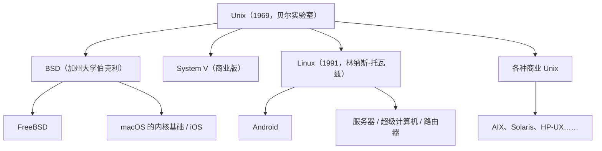

**你今天接触的几乎所有计算设备，都流淌着 Unix 的血：**

| 你在用的 | 它的血统 |
|---|---|
| **iPhone / Mac** | Unix（BSD 分支） |
| **Android 手机** | Linux（Unix 的后代） |
| **网站服务器** | 绝大多数跑 Linux |
| **智能电视/路由器** | 通常是 Linux |
| **超级计算机** | 几乎全部 Linux |

> ### 📌 一个震撼的事实
>
> **Windows 是唯一的主流例外。**
>
> 除了 Windows，你叫得出名字的所有操作系统，几乎都是 Unix 的后代或者受它深刻影响。
>
> 这不是巧合，是因为 Unix 的设计确实好——好到所有人都抄它。

---

### 五、C 语言的遗产：你每天都在用 C 写的东西

#### C 写出来的东西无所不在

| 软件 | 说明 |
|---|---|
| **Linux 内核** | 全部 C |
| **Windows 内核** | 大部分 C/C++ |
| **macOS / iOS 内核** | C + 汇编 |
| **Python 解释器** | C 写的（CPython） |
| **MySQL、PostgreSQL** | C |
| **Nginx、Apache** | C |
| **Git** | C |
| **几乎所有嵌入式设备** | C |

**也就是说：你用 Python 写的程序，是跑在一个用 C 写的解释器上的。**

#### C 的「后裔」语言

更重要的是，C 的语法影响了几乎所有后来的主流语言。看看这些语言的「长相」：

```c
/* C */
if (x > 0) {
    printf("正数");
}
```

```java
// Java
if (x > 0) {
    System.out.println("正数");
}
```

```javascript
// JavaScript
if (x > 0) {
    console.log("正数");
}
```

```csharp
// C#
if (x > 0) {
    Console.WriteLine("正数");
}
```

**看出来了吗？花括号 `{}`、if 的写法、分号——全都是一个模子。**

这个模子来自 C。所以这些语言被称为「C 家族语言」。

> ### 💡 这对你学编程意味着什么？
>
> **学会了 C 家族的语法风格，你学 Java、JavaScript、C#、Go、PHP 时，语法障碍会小很多。**
>
> 这就是为什么有人说「学 C 语言是打基础」——不一定是说你要用 C 工作，而是它的语法风格是所有主流语言的共同祖先。
>
> （但请注意：**Python 故意长得不像 C**，它用缩进而不是花括号。这一点在第 25 章会讲。）

---

### 六、C 语言的代价：自由是有代价的

讲了这么多好话，也得说说 C 的问题。

#### C 给了你极大的自由，也给了你极大的犯错空间

C 允许你直接操作内存地址。这很强大，但也意味着：

**你可以写出「把数据写到不属于你的内存里」这种代码。**

后果包括：

- 程序莫名其妙崩溃
- 数据被悄悄改坏
- **安全漏洞**——黑客可以利用这种错误，把恶意代码注入你的程序

**据统计，大量的软件安全漏洞（缓冲区溢出等），根源都是 C/C++ 的内存管理问题。**

#### 所以后来有了什么？

- **C++**：在 C 基础上加了很多安全机制（但保留了 C 的危险能力）
- **Java / C#**：干脆取消「直接操作内存」的能力，用「垃圾回收」自动管理内存
- **Rust**（2010 年代）：试图做到「既有 C 的性能，又没有 C 的危险」——这是近年最受关注的语言之一（第 28 章会讲）

**这一整条线索，都是为了解决 C 留下的那个问题：如何让程序员既能控制硬件，又不至于搬起石头砸自己的脚。**

---

### ✅ 本章重点回顾

1. **C 语言和 Unix 是「想玩游戏」的副产品**——1969 年肯·汤普森想玩游戏于是写操作系统，丹尼斯·里奇为写系统而发明 C；这个无心插柳造就了现代编程的两块基石。

2. **C 的成功在于找到了完美平衡**：足够高级（比汇编好用）又足够底层（能直接碰内存，所以能写操作系统）、语法极简（32 个关键字）、可移植（换编译器即可）、编译后极快。

3. **Unix 的「一切皆文件」和「小工具用管道组合」两大哲学影响了所有后来的系统**——除 Windows 外，你叫得出名字的操作系统（macOS/iOS/Android/Linux）几乎都是 Unix 后代；而 C 的语法风格是所有主流语言（Java/JS/C#/Go）的共同祖先。

---

### 🤔 想一想

> C 语言让你能直接操作内存地址，这既是它「能写操作系统」的原因，也是它「漏洞百出」的原因。
>
> **假设你要设计一门新语言，目标是「像 C 一样快，但不会写出内存错误」。你觉得可以怎么做？** 请说出两条可能的思路。
>
> （提示：一条思路是「运行时帮你管内存，出错就报错」——代价是什么？另一条思路是「在编译时就检查出所有可能的错误，不让你写出来」——这又有什么代价？这两个思路，分别对应 Java/C# 和 Rust 的做法。）

---

## 第 14 章 面向对象与互联网：Java、JavaScript、Python 登场

> ## 🎯 本章目标
>
> 读完这一章，你应该能够：
> - 理解「面向对象」是为了解决什么问题而出现的
> - 知道 Java、JavaScript、Python 各自诞生的背景和初衷
> - 明白为什么互联网时代需要新的语言
> - 理解「一次编写到处运行」是怎么做到的

---

### 一、先讲个问题：程序越来越大，管不住了

C 语言很成功，但到了 1980–90 年代，问题来了。

#### 软件规模的爆炸

早期的程序：几千行代码，一个人写。

后来的程序：几十万、几百万行，几十上百人一起写。

**规模一大，原来的写法就撑不住了。**

打个比方：

- 几千行代码 = 一篇长文章 → 一个人写没问题
- 几十万行 = 一套百科全书 → 必须分册、分章节、有索引、多人协作

#### 具体遇到什么问题？

假设你在写一个银行系统，里面有个概念叫「账户」。

**用 C 的写法：**

```c
// 账户的数据
struct Account {
    char name[50];
    double balance;
};

// 操作账户的函数
void deposit(struct Account* acc, double amount) {
    acc->balance += amount;
}

void withdraw(struct Account* acc, double amount) {
    if (acc->balance >= amount)
        acc->balance -= amount;
}
```

**问题在哪？**

数据和操作是**分开的**。任何人都可以写一段代码直接改 `acc->balance`，绕过所有检查：

```c
acc->balance = -999999;   // 谁也拦不住我！
```

**当几十万行代码里到处都是这种「直接改数据」的地方，你就没法保证正确性了。**

---

### 二、面向对象：把数据和操作「捆」在一起

1960 年代就有这个想法（Simula 语言），1970 年代成熟（Smalltalk），1990 年代成为主流（C++、Java）。

#### 核心想法极其简单

> **把「数据」和「能对这个数据做的操作」打包成一个整体，叫「对象」。**

回到账户的例子：

```python
# 概念演示：面向对象风格

账户 = {
    "姓名": "张三",
    "余额": 1000,

    # 操作被"包"在里面
    "存款": 函数(金额): 余额 = 余额 + 金额,
    "取款": 函数(金额):
        如果 余额 >= 金额:
            余额 = 余额 - 金额
        否则:
            报错("余额不足")
}
```

**现在，「余额」不能随便改了——你只能通过「存款」和「取款」这两个操作去改它。**

而「取款」里有检查，所以余额永远不会变成负数。

#### 三个关键词

| 概念 | 大白话 |
|---|---|
| **封装** | 把数据和对它的操作打包，对外只露出「能做什么」，藏起「怎么做的」 |
| **继承** | 新东西可以基于老东西扩展，不用从头写 |
| **多态** | 同一个操作，作用在不同对象上会有不同表现 |

第 47 章会详细讲。你现在只需要知道：**面向对象是为了「管住大规模代码」而诞生的组织方式。**

#### 一个生活比喻：汽车

- **封装**：你开车只需要知道「踩油门加速、踩刹车减速」。发动机怎么喷油、变速箱怎么换挡，被藏起来了。
- **继承**：「SUV」是一种「汽车」，它有汽车的全部特性，还多了「底盘高」。
- **多态**：踩油门这个动作，在 SUV 上、在跑车上、在卡车上，效果不一样——但你的操作是一样的。

**这就是为什么面向对象这么流行：它符合人类认识世界的方式。**

---

### 三、Java：为企业而生（1995）

#### 背景：Sun 公司想做「智能家电」

1990 年代初，Sun Microsystems 公司有个项目：给电视机顶盒、冰箱之类的家电写软件。

**遇到问题：家电的芯片五花八门，为每种芯片编译一次太麻烦。**

他们想要一种语言：**写一次，在任何设备上都能跑。**

（这个项目本身失败了，但语言活了下来——又一个无心插柳。）

#### Java 的核心创新：虚拟机

Java 的解法跟 C 不一样：

| C 的做法 | Java 的做法 |
| --- | --- |
| 源代码 → 编译器 → 本机机器码 | 源代码 → 编译器 → 字节码 → JVM |
| 只能在这台机器上跑 | 交给虚拟机，由它翻译成本机指令 |
| 换一种机器要重新编译 | 每种机器装一个虚拟机即可 |

**关键：字节码是统一的，虚拟机是分平台的。**

就像：

- 你写了一份**乐谱**（字节码）
- 各种乐器（不同机器上的虚拟机）都能照着演奏
- 你不需要为每种乐器重写乐谱

**这就是「一次编写，到处运行」（Write Once, Run Anywhere）。**

#### Java 还做了什么正确的事？

| 设计 | 解决的问题 |
|---|---|
| **取消指针**（不能直接操作内存） | 消灭了 C 的大部分内存安全问题 |
| **垃圾回收**（自动回收不用的内存） | 程序员不用手动管内存，少一大类 bug |
| **强类型**（类型检查严格） | 很多错误在编译阶段就被发现 |
| **丰富的标准库** | 开箱即用，不用自己造轮子 |

**这些设计让 Java 特别适合「大团队、长周期、要求稳」的企业项目。**

#### Java 的代价

- 语法啰嗦（写个「Hello World」都要写好几行）
- 运行速度比 C 慢（因为有虚拟机这一层）
- 启动慢、占内存

**但对企业来说，「稳」和「好维护」比「快」更重要。所以 Java 统治了企业后端二十多年。**

#### Java 今天在哪？

- 银行、保险、电信的核心系统
- 大型电商后端（阿里是 Java 重镇）
- **Android 应用开发**（历史上是 Java，现在主要是 Kotlin）
- 大数据生态（Hadoop、Spark 都是 Java/Scala）

---

### 四、JavaScript：10 天写出来的语言（1995）

这是编程语言史上最传奇的故事之一。

#### 背景：网景公司需要「让网页动起来」

1995 年，网景公司（Netscape）的浏览器占了大部分市场。他们想让网页不只是静态的文字——能不能在网页里跑点代码？

公司招了个叫**布兰登·艾克**（Brendan Eich）的人。

**据说他用了 10 天，写出了 JavaScript 的第一版。**

#### 为什么这么急？

因为当时有竞争压力。网景想尽快推出这个功能。

**10 天能做出什么质量的语言？**

坦白说，早期 JavaScript 有不少设计缺陷。著名的吐槽包括：

- 类型系统混乱（`"" == 0` 是 true，但 `"" === 0` 是 false）
- 一些反直觉的行为

**但它有一个致命的优势：它是浏览器里唯一能用的语言。**

#### 为什么这决定了它的命运？

1995 年之后，互联网爆发。所有公司都要做网页。

**要在网页里加交互？只能用 JavaScript。没有别的选择。**

这让 JavaScript 成了**世界上使用人数最多的编程语言之一**——不是因为它设计得好，而是因为它占据了唯一的位置。

> ### 📌 一个重要的历史教训
>
> **在技术领域，「位置」有时候比「质量」更重要。**
>
> JavaScript 不是最好的语言，但它是浏览器的唯一选择。这个「唯一性」让它赢了。
>
> 类似的故事还有：SQL（数据库的唯一通用语言）、Excel（表格的事实标准）。

#### JavaScript 后来的逆袭：Node.js

前 15 年，JavaScript 只能跑在浏览器里。

2009 年，**Node.js** 出现，把 JavaScript 带到了服务器端。

**结果：JavaScript 突然能写后端了。**

这意味着：**一个人可以用一门语言同时写前端（网页）和后端（服务器）。**

这是巨大的吸引力。JavaScript 从此成为真正的全栈语言。

#### 今天的 JavaScript

- **前端**：绝对统治地位（React、Vue、Angular 三大框架都是 JS）
- **后端**：Node.js 很流行
- **移动端**：React Native 可以写 App
- **桌面**：Electron 可以写桌面应用（VS Code 就是 Electron 写的）

**几乎没有它不涉猎的领域。**

---

### 五、Python：一个荷兰人的圣诞假期（1989）

#### 背景：吉多想要一门「能快速干活」的语言

1989 年圣诞节，荷兰程序员**吉多·范罗苏姆**（Guido van Rossum）闲着没事，想做一门新语言。

他的目标很明确：

> 做一门**语法简洁、容易读、让人能快速把想法变成代码**的语言。

（Python 这个名字来自他喜欢的喜剧团体 **Monty Python**，跟蟒蛇没关系——虽然图标是两条蛇。）

#### Python 的核心理念：可读性第一

Python 最革命性的设计：**用缩进来表示代码结构。**

对比一下「判断一个数是不是正数」：

**C / Java 风格：**
```c
if (x > 0) {
    printf("正数");
} else {
    printf("非正数");
}
```

**Python：**
```python
if x > 0:
    print("正数")
else:
    print("非正数")
```

**少了花括号，少了分号，代码必须整齐缩进。**

这个设计的聪明之处：**它强迫你写出整齐的代码**。因为不缩进就跑不起来。

> ### 💡 为什么这很重要？
>
> 程序员读代码的时间，远多于写代码的时间（比例大概是 10:1）。
>
> **所以「代码好不好读」比「代码好不好写」更重要。**
>
> Python 用语法强制保证了可读性。这是它最重要的设计哲学。

#### Python 为什么这么适合新手？

1. **语法接近英语**：`if x > 0: print("正数")` 几乎能直接读
2. **不用关心类型声明**：`x = 10` 就行，不用写 `int x = 10`
3. **交互式**：写一行执行一行，方便试验
4. **海量库**：想干什么都有现成的

#### Python 的两次爆发

**第一次（2000 年代）：科学计算和数据处理**
- NumPy、Pandas、Matplotlib 等库出现
- 科学家、数据分析师开始用 Python 替代昂贵的商业软件

**第二次（2010 年代至今）：人工智能**
- TensorFlow、PyTorch 等深度学习框架首选 Python
- AI 浪潮把 Python 推上了「最流行语言」的宝座

> ### 📌 Python 的成功揭示了一个规律
>
> **一门语言的命运，往往取决于它是否站在了正确的「风口」上。**
>
> Python 在 2010 年代之前一直不温不火。是 AI 的爆发把它推上了神坛。
>
> 这提醒我们：**选语言不只看语言本身，还要看它的生态在哪些领域最强。**（第 32 章会展开）

---

### 六、这三门语言代表了三条路

把这三门语言放在一起看，你会发现它们代表了三种不同的取舍：

| 语言 | 诞生初衷 | 核心取舍 | 最大优势 |
|---|---|---|---|
| **Java** | 跨平台、企业开发 | 牺牲简洁 → 换稳定和工程性 | 大团队协作、企业级可靠 |
| **JavaScript** | 网页交互 | 牺牲设计优雅 → 换「唯一位置」 | 浏览器垄断 + 全栈通吃 |
| **Python** | 快速开发、可读性 | 牺牲运行速度 → 换开发效率和可读性 | 上手快、库多、AI 首选 |

**没有谁更好，只有谁更适合某个场景。**

---

### ✅ 本章重点回顾

1. **面向对象是为「管住大规模代码」而生的**——把数据和操作打包成「对象」（封装），对外只露出能做什么、藏起怎么做；就像开车只需知道油门刹车，不必懂发动机。

2. **Java 用「虚拟机 + 字节码」实现了「一次编写到处运行」**，并取消指针、引入垃圾回收和强类型，特别适合大团队长周期的企业项目；代价是啰嗦、较慢。

3. **JavaScript 用 10 天写成、设计有缺陷，却因「浏览器唯一选择」而统治前端**，Node.js 之后更成为全栈语言；**Python 用缩进强制可读性、语法接近英语**，靠科学计算和 AI 两次风口登顶——它们的成功证明：语言的位置和生态，有时比设计本身更决定命运。

---

### 🤔 想一想

> JavaScript 的设计有明显缺陷，却成了使用人数最多的语言之一；而很多设计得更优雅的语言（比如 Haskell、Lisp）却始终小众。
>
> **除了「运气」之外，你认为一门语言能流行的关键非技术因素有哪些？** 请列出至少三个。
>
> （提示：想想你为什么用微信——是因为它技术最好吗？想想「已经有多少人在用」「有多少现成代码能用」「有多少教程和答案能搜到」「找工作时值多少钱」。这些因素加在一起，有个专门的词叫**生态**。）

---

## 第 15 章 开源、移动、云与 AI：编程的今天与明天

> ## 🎯 本章目标
>
> 读完这一章，你应该能够：
> - 理解开源运动如何改变了整个软件行业
> - 知道移动互联网、云计算、AI 分别给编程带来了什么变化
> - 理解「不要重复造轮子」是怎么成为现实的
> - 对「AI 会不会取代程序员」有一个自己的判断

---

### 一、开源：软件界的「共享菜谱」运动

#### 先讲一下背景：软件曾经是「保密」的

1970–80 年代，软件公司卖软件，卖的是**编译后的机器码**。

**你买到的是一个黑盒子：能用，但看不到里面怎么写的，也不能改。**

这在当时天经地义——就像你买了个微波炉，厂家不会给你电路图。

#### 有人不这么想

1983 年，MIT 有个程序员叫**理查德·斯托曼**（Richard Stallman），遇到了一件事：

他的打印机坏了，他想改一下打印机的驱动代码，让卡纸时自动发通知。但厂商不给源代码。

**他怒了。**

他的观点是：**软件使用者应该有「看、改、分享」软件的自由。**

于是他发起了 **GNU 项目**（目标是做一个完全自由的操作系统），并提出了 **Copyleft** 理念（一种巧妙的版权设计：你用了我的代码，你的代码也必须开源）。

后来「自由软件运动」演变成了更中性的说法：**开源（Open Source）**。

#### Linux：开源最伟大的胜利

1991 年，芬兰大学生**林纳斯·托瓦兹**（Linus Torvalds）在论坛上发了条消息：

> 「我在做一个（免费的）操作系统，只是个爱好，不会像 GNU 那么专业。」

这个「爱好」，就是 **Linux 内核**。

**他把它开源了，然后全世界 thousands of 程序员开始帮他一起写。**

结果：

- Linux 成了服务器领域的绝对霸主
- Android 基于 Linux
- 几乎所有超级计算机跑 Linux
- 路由器、智能电视、汽车……都跑 Linux

**一个 21 岁学生的「爱好」，成了全球数字基础设施的地基。**

> ### 💡 开源为什么能赢？
>
> 因为它解决了一个经济学问题：**重复劳动的巨大浪费。**
>
> 在开源之前，每家公司都要自己写操作系统、自己写数据库、自己写加密库——**这些是任何人都需要、但跟业务无关的东西**。
>
> 开源之后，**这些「地基」由全世界共同维护，大家免费使用，各自专注于自己的业务。**
>
> 这是人类协作方式的一次巨大进步。

#### GitHub：让协作变得容易

2008 年，**GitHub** 上线。它做了件简单但革命性的事：

**把开源协作变得极其容易**——点几下就能「fork」（复制别人的项目）、改、提交、「pull request」（请求合并回去）。

**从此开源从「少数人的理想」变成了「所有人的日常」。**

今天 GitHub 上有几亿个代码仓库。你写程序用到的绝大多数库，都在上面。

> ### 📌 这对你意味着什么？
>
> **你将来写程序，99% 的时间是在「用别人的代码」加「写自己的一小部分」。**
>
> 这就是第 36 章要讲的「包管理」和第 50 章的「第三方库」。
>
> 「不要重复造轮子」这句话，在开源时代才真正成了现实——因为轮子到处都是，还免费。

---

### 二、移动互联网：编程进入了口袋

2007 年，iPhone 发布。2008 年，Android 手机发布。

#### 这带来了什么变化？

**计算机从「桌上的一个箱子」变成了「口袋里的一块玻璃」，而且人手一个。**

影响是巨大的：

| 变化 | 结果 |
|---|---|
| 用户量级从「百万」到「十亿」 | 软件的商业价值暴涨 |
| 出现了「App」这种新形态 | 需要专门的移动开发技能 |
| 触屏、定位、摄像头、陀螺仪 | 全新的输入方式（第 5 章的「输入」丰富了） |
| 应用商店模式 | 分发方式彻底改变 |

#### 对编程语言的影响

- **Objective-C / Swift**：苹果生态
- **Java / Kotlin**：Android 生态
- **JavaScript**：借 React Native 等框架进入移动开发
- **Flutter（Dart 语言）**：跨平台方案

**移动端成了编程语言竞争的新战场。**

---

### 三、云计算：不用自己买服务器了

#### 以前：想做网站得先买服务器

2000 年代，你要做个网站，得：

1. 买一台服务器（几千到几万块）
2. 找个机房放着（托管费）
3. 请人维护（工资）
4. 用户多了要加机器（再买）

**门槛高，成本重。**

#### 云的出现：按需租用

2006 年，**亚马逊推出 AWS**（亚马逊云服务）。

核心想法：**把计算能力变成像水电一样的东西——按用量付费，随时开随时关。**

```
以前：买发电机（买服务器）
现在：用电，按度数付费（用云，按小时付费）
```

#### 这对编程意味着什么？

**部署方式彻底变了：**

- 以前：写程序 → 打包 → 装到服务器上 → 祈祷别出问题
- 现在：写程序 → 一条命令推到云上 → 自动扩容、自动备份、全球分发

**还催生了新概念：**

- **容器化（Docker）**：把程序和它的环境打包成一个「集装箱」，到哪都能跑
- **微服务**：把一个大程序拆成很多小服务，各自部署
- **Serverless**：连服务器都不用管，只写函数，按调用次数付费

**这些概念对新手来说是进阶内容，但你至少要知道：今天的软件开发，已经很少「自己买机器」了。**

---

### 四、AI 时代：编程正在被重新定义

这是当下正在发生的事，也是你最关心的部分。

#### 第一阶段：AI 辅助写代码

2021 年，GitHub Copilot 发布。2022 年底，ChatGPT 发布。

**现在你写代码时可以：**

- 写个注释，AI 帮你生成代码
- 选中一段代码，让 AI 解释它在干嘛
- 遇到报错，把错误信息丢给 AI，它告诉你原因
- 让 AI 帮你重构、加注释、写测试

**这不是概念，是今天无数程序员的日常。**

#### 这对新手意味着什么？

**好消息：学习门槛大幅降低了。**

以前你卡在一个 bug 上可能要查两小时。现在问 AI，30 秒有答案。

**但要警惕一个大坑：**

> ### ⚠️ 最大的风险：你「以为自己会了」，其实只是「复制了答案」
>
> AI 给你一段能跑的代码，你复制粘贴，程序跑通了，你很开心。
>
> **但你并没有理解它为什么能跑。**
>
> 这就是所谓的「**幻觉性胜任**」——感觉自己很厉害，实际上一遇到变化就抓瞎。
>
> **这就是为什么你仍然需要这本书。** AI 能给你代码，但给不了你「理解」。而理解，才是你将来能独立解决问题的东西。

#### 正确使用 AI 的方式

| ❌ 错误用法 | ✅ 正确用法 |
|---|---|
| 「帮我写个记账程序」→ 直接复制 | 「我要做个记账程序，我打算这样设计……帮我看看有没有问题」 |
| 报错了，把错误丢给 AI 要答案 | 先自己猜一下原因，再问 AI 验证 |
| AI 给的代码照抄 | 让 AI 解释每一行的作用，不懂就追问 |
| 用 AI 跳过学习 | 用 AI 加速学习（把不懂的概念让它换 5 种方式讲） |

> ### 💡 一句话原则
>
> **让 AI 当你的「私人教练」，不要让它当你的「枪手」。**
>
> 教练会教你怎么做；枪手替你做，你什么都没学到。

#### 第二阶段：AI 会不会取代程序员？

这是所有人都关心的问题。我给你一个诚实的分析。

**先看「程序员到底在干什么」（回顾第 7 章）：**

- 30% 理解需求和设计
- 25% 写代码
- 25% 测试和修 bug
- 20% 沟通协作

**AI 现在最擅长的是中间那 25%——「把明确的想法翻译成代码」。**

**但它不擅长：**

- 搞清楚用户到底想要什么（需求）
- 判断某个方案对这个业务合不合适（设计决策）
- 为代码的后果负责（出了事谁背锅？）
- 跟人沟通、说服、协调

**所以我的判断是：**

> **AI 不会取代程序员，但会取代「只会把想法翻译成代码」的人。**
>
> 程序员的价值，正在从「会写」转向「知道该写什么、为什么这么写、以及怎么判断写对了没有」。

**这对你的启示非常直接：**

- 不要只学语法（AI 最擅长语法）
- 要学**理解问题、设计方案、判断对错**（AI 不擅长这些）
- 学会**用 AI**（这是新的必备技能，就像当年学会用搜索引擎）

**这也是本书为什么把「原理」和「思维」放在最前面，把语法放在后面——因为语法最容易过时，也最容易被 AI 替代。**

---

### 五、一张时间线总结（1804 – 今天）

| 年代 | 关键事件 | 意义 |
|---|---|---|
| **1804** | 提花织布机 | 第一次「信息可换，机器通用」 |
| **1843** | 爱达写下第一个程序 | 编程思想诞生（早于计算机） |
| **1837–1871** | 巴贝奇的分析机 | 通用计算机构想（未建成） |
| **1945** | ENIAC + 冯·诺依曼架构 | 电子计算机 + 存储程序 |
| **1950s** | 汇编语言 | 第一次说人话 |
| **1957** | FORTRAN | 第一门高级语言 |
| **1959** | COBOL | 商业语言 |
| **1964** | BASIC | 编程普及 |
| **1969–72** | C 语言 + Unix | 现代编程基石 |
| **1980s** | 面向对象（C++） | 应对大规模软件 |
| **1991** | Linux | 开源运动的胜利 |
| **1995** | Java、JavaScript | 企业 + 互联网 |
| **1989–2000s** | Python 崛起 | 可读性与 AI 时代 |
| **2007** | 移动互联网 | 编程进入口袋 |
| **2006** | 云计算 | 算力变成水电 |
| **2022+** | AI 编程助手 | 编程正在被重新定义 |

---

### ✅ 本章重点回顾

1. **开源运动解决了「重复造轮子」的巨大浪费**——Linux 从一个大学生的爱好成长为全球数字基础设施的地基，GitHub 让协作变得人人可及；今天你写程序 99% 是在用别人的代码加自己的一小部分。

2. **移动互联网把计算机装进了口袋（用户从百万到十亿），云计算把算力变成了水电（按需付费）**——两者分别改变了软件的形态和部署方式。

3. **AI 最擅长「把明确想法翻译成代码」（编程的 25%），但不擅长需求、设计决策、担责和沟通**——所以「会写」在贬值，「知道该写什么、为什么写、怎么判断对错」在升值；用 AI 当教练，别当枪手。

---

### 🤔 想一想

> 本章说：AI 时代，程序员的价值正在从「会写代码」转向「知道该写什么、为什么这么写、怎么判断写对了没有」。
>
> **请你自己评估一下：你现在（读完第二关之后）具备这三种能力中的哪一个？最缺哪一个？**
>
> 再想一步：**在接下来第三关（编程思维，第 16–22 章）里，你会重点补上什么？**
>
> （把你的答案在心里说一遍。第三关就是专门来解决这个问题的——它是全书对你「以后能不能真正用好编程」最关键的一关。）

---

# 第三关　编程思维

> 这一关讲程序员的「内功」：分解、抽象、模式识别、算法思维、调试、工程思维。
>
> 它们跟具体语言无关，却决定你能不能把一个模糊的问题想清楚。

## 第 16 章 计算思维：编程的「内功」

> ## 🎯 本章目标
>
> 读完这一章，你应该能够：
> - 说清楚「计算思维」是什么，以及它为什么比语法重要
> - 理解「抽象」和「自动化」这两个核心动作
> - 明白为什么程序员的价值在于「想清楚」而不是「打字快」
> - 建立对第三关（16–22 章）的整体认识

---

### 一、一个问题：为什么很多人「学完语法还是不会编程」？

这是个真实而普遍的现象。

有人学完了 Python 的语法：变量、循环、函数、类……全都「知道」。

然后面对一个实际问题（比如「帮我把这 100 个 Excel 文件合并成一个」），**脑子一片空白**。

**为什么？**

因为他们学的是「词汇」，不是「造句能力」。

#### 类比：学英语

- 背了 3000 个单词 ≠ 能写文章
- 学完语法规则 ≠ 能写出好句子

**编程也是一样：**

- 记住 `for` 循环怎么写 ≠ 知道什么时候该用循环
- 记住 `if` 怎么写 ≠ 知道该怎么组织判断条件
- 记住函数怎么写 ≠ 知道该把哪些代码打包成函数

**语法是「词汇量」，计算思维是「写作能力」。**

第三关（第 16–22 章）要给你的，就是这个「写作能力」。

---

### 二、什么是计算思维？

这个词听起来很学术，其实很朴素。

> ### 💡 定义
>
> **计算思维 = 用计算机（或任何「机械执行者」）能处理的方式，来描述和解决问题的思维方式。**

关键在「用计算机能处理的方式」这几个字。

#### 它包含四个核心动作

学术界通常把计算思维拆成四步（这是周以真教授提出的经典框架）：

```
1. 分解（Decomposition）—— 把大问题拆成小问题
2. 模式识别（Pattern Recognition）—— 找出重复和规律
3. 抽象（Abstraction）—— 抓大放小，忽略无关细节
4. 算法设计（Algorithm Design）—— 设计出明确的步骤
```

**这四个动作，就是本关后六章的内容：**

| 动作 | 对应章节 |
|---|---|
| 分解 | 第 17 章 |
| 抽象 | 第 18 章 |
| 模式识别 | 第 19 章 |
| 算法设计 | 第 20 章 |
| （配套心态）调试思维 | 第 21 章 |
| （配套心态）工程思维 | 第 22 章 |

#### 一个贯穿的例子：组织一场婚礼

这不是编程问题，但完美展示计算思维。

##### 分解

「办婚礼」太大了，拆成：

- 场地
- 宾客名单与邀请
- 餐饮
- 流程安排
- 摄影
- 预算

每个还能继续拆（餐饮 → 订酒店/选菜单/确认人数/安排座位）。

##### 模式识别

发现「邀请」「确认」「提醒」这三个动作，对场地、餐饮、摄影都要做一遍。

→ 可以设计一个通用的「跟进流程」，套用到每一项上。

##### 抽象

你不需要知道酒店厨房怎么做菜。你只需要跟酒店确认：

- 几桌
- 每桌标准
- 有无忌口

**细节被藏起来了，你只面对接口。**

##### 算法设计

把这些写成明确的时间表：

```
T-90 天：订场地
T-60 天：发邀请
T-30 天：统计人数
T-7 天： 确认最终人数给酒店
T-1 天： 彩排
T-0 天： 婚礼
```

**看出计算思维的痕迹了吗？**

这就是计算思维。它**不是**编程专属的——它是一种**解决问题的通用方法**，只是特别适合拿来做编程。

---

### 三、计算思维的两个终极动作

如果要把计算思维压缩成两个动作，那就是：**抽象** 和 **自动化**。

#### 动作一：抽象（把现实问题变成可计算的形式）

现实世界是模糊的、连续的、充满例外的。

计算机需要的是：明确的、离散的、有规则的。

**抽象就是把前者变成后者。**

举例：「判断一封邮件是不是垃圾邮件」

**现实中的模糊描述**：「一看就是广告的、没用的邮件」

**抽象成可计算的形式**：

```
如果 满足以下任意两条：
    - 标题含"免费""中奖""限时"
    - 发件人不在通讯录里
    - 正文含超过 3 个外链
    - 含大量感叹号
则 判定为垃圾邮件
```

**你看，「是不是垃圾邮件」这个模糊判断，被转成了几个明确的、可检查的条件。**

**这就是抽象——它是编程中最难、也最体现功力的一步。**

#### 动作二：自动化（让机器替你重复执行）

抽象完之后，你得到了一套规则。

**自动化的意思是：把这套规则交给计算机，让它每次都执行，不用你盯着。**

这就是编程的价值所在：

> **你花一次时间把规则想清楚、写成代码，然后它就能被执行一百万次——而且每次都一样准。**

**这是杠杆。** 一个人的时间被放大了无数倍。

#### 为什么这两个动作是一体的？

- **只有抽象没有自动化**：你只是想清楚了，但还是得自己干 → 白想
- **只有自动化没有抽象**：你让机器执行了一堆没想清楚的步骤 → 得到一堆错误结果，还更快

**所以：先想清楚（抽象），再交给机器（自动化）。顺序不能反。**

---

### 四、程序员的真正产出是什么？

现在我可以回答一个你可能好奇的问题：**程序员到底在「生产」什么？**

表面上看，程序员生产「代码」。

**但更准确地说：程序员生产的是「一套被想清楚的规则」。**

代码只是这套规则的「载体」。

#### 一个有力的证据

业界有个共识：

> **一个优秀的程序员，可能一天只写 50 行代码，却解决了一个重要问题。**
>
> 而一个新手，可能一天写 500 行，却什么都没解决（甚至制造了新问题）。

**差别不在打字速度，在于那 50 行背后有多少思考。**

#### 这也解释了为什么「代码行数」是个糟糕的绩效指标

如果用「写了多少行代码」来考核程序员，会发生什么？

- 大家会故意把代码写长
- 会拒绝用现成的库（因为「自己写显得行数多」）
- 会拒绝删代码（虽然删掉冗余代码是好事）

**这就是为什么好的团队从不用代码行数考核。** 他们看的是：你解决了什么问题。

> ### 📌 给你的一句话
>
> **别追求「写得多」，追求「想得清楚」。**
>
> 如果一段代码能用 10 行写清楚，就别写 50 行。

---

### 五、计算思维是可以练的

好消息：计算思维不是天赋，是可以练出来的。

#### 怎么练？三个日常习惯

##### 习惯一：遇到重复的事，想「能不能自动化」

- 每天早上都要从三个网站复制数据到表格 → 能不能写个脚本？
- 每次都要手动重命名一堆照片 → 能不能写个脚本？
- 每周都要整理一次账单 → 能不能写个脚本？

**不需要真的写出来，光是「想一想」就在训练。**

##### 习惯二：描述任何流程时，练习「精确到没有歧义」

- 跟别人说路线时，试着说得像导航一样精确
- 写菜谱时，假设读者是个外星人
- 说明一个规则时，想想「有没有例外」

##### 习惯三：看到任何系统，试着拆它的「输入-处理-输出」

- 电梯：输入是楼层按钮和传感器，处理是调度算法，输出是电机动作
- 自动售货机：输入是投币和按键，处理是判断金额和库存，输出是出货和找零
- 红绿灯：第 5 章讲过

**这种「拆解癖」会慢慢内化成你的直觉。**

---

### 六、第三关的地图

这一关有七章，分成两组：

#### 组一：四个核心动作（技术层面）

| 章 | 内容 | 解决的问题 |
|---|---|---|
| 17 | 分解 | 问题太大，不知道从哪下手 |
| 18 | 抽象 | 细节太多，理不清主线 |
| 19 | 模式识别 | 重复劳动，代码越写越长 |
| 20 | 算法思维 | 能做但太慢，或者根本做不完 |

#### 组二：两个配套心态（心理层面）

| 章 | 内容 | 解决的问题 |
|---|---|---|
| 21 | 调试思维 | 遇到报错就慌，不知道怎么查 |
| 22 | 工程思维 | 追求完美，永远开不了工 |

**这七个东西加起来，就是「编程的内功」。**

语法是外功，容易学也容易忘。内功难学，但一旦有了，学任何语言都快。

---

### ✅ 本章重点回顾

1. **学完语法还是不会编程，是因为学的是「词汇」而不是「造句能力」**——语法是词汇量，计算思维是写作能力；后者才是本关要给的东西。

2. **计算思维 = 分解 + 模式识别 + 抽象 + 算法设计这四步，终极动作是「抽象」和「自动化」**——抽象是把模糊的现实问题变成明确的规则，自动化是把规则交给机器反复执行，两者顺序不能反。

3. **程序员真正生产的是「一套被想清楚的规则」，代码只是载体**——所以别追求写得多，追求想得清楚；计算思维可通过三个习惯训练：遇重复想自动化、描述力求无歧义、见系统就拆输入-处理-输出。

---

### 🤔 想一想

> 回想你工作或生活中一件「每周都要做、而且步骤基本固定」的事（比如周报、报销、整理照片、备份文件、统计某个数据）。
>
> **请试着用计算思维的四步把它过一遍：**
> - 它能分解成哪几步？
> - 里面有没有重复出现的模式？
> - 哪些细节可以「藏起来」不管？
> - 如果写成明确步骤，一共几步？
>
> （这个练习没有标准答案，但做完之后你会对「自动化」有真实的感受——这就是计算思维在起作用。）

---

## 第 17 章 分解：把大象装进冰箱

> ## 🎯 本章目标
>
> 读完这一章，你应该能够：
> - 掌握「分解」这个最基础也最实用的编程思维
> - 学会用「自顶向下」的方式拆解问题
> - 知道一个子问题拆到什么程度就可以停手
> - 理解为什么「分解」能力直接决定你能做多大的项目

---

### 一、为什么「分解」是第一步？

面对一个复杂问题，人类大脑有个致命限制：

> **工作记忆容量有限——你同时能记住并处理的东西，大约只有 7±2 个。**

这就是为什么「一想就乱」。

**分解的本质，就是把一个超出大脑容量的问题，拆成若干个脑子能装下的小问题。**

#### 一个经典笑话

> 问：把大象装进冰箱，总共分几步？
> 答：三步。打开冰箱门，把大象放进去，关上冰箱门。

这个笑话之所以好笑，是因为它「假装」解决了问题——第二步根本做不到。

**但它同时演示了分解的本质：把一件大事，切成若干个「看起来能做」的步骤。**

**好的分解，会让每一步都变成「我确实知道怎么做」的程度。**

---

### 二、怎么分解？自顶向下

标准方法叫**自顶向下**（Top-Down），也叫**逐步求精**。

#### 三步法

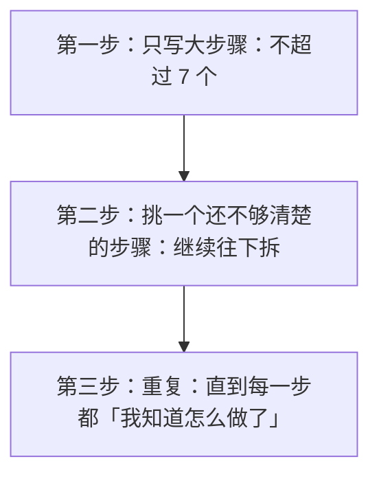

#### 实战演示：做一个「天气提醒」小程序

**需求**：每天早上自动看看天气，如果下雨就发消息提醒我带伞。

##### 第一次分解（大步骤）

```
1. 获取今天的天气
2. 判断是否下雨
3. 如果下雨，发送提醒
```

**只有三步，脑子完全装得下。**

##### 第二步：看看哪一步还不清楚

- 「获取天气」→ 不清楚。天气从哪来？
- 「判断是否下雨」→ 基本清楚
- 「发送提醒」→ 不清楚。发到哪？怎么发？

##### 拆「获取天气」

```
1. 获取今天的天气
    1.1 调用天气网站的接口，传入城市名
    1.2 拿到返回的数据（一堆文字）
    1.3 从里面找出"天气状况"这个字段
```

##### 拆「发送提醒」

```
3. 如果下雨，发送提醒
    3.1 组织提醒的文字："今天有雨，记得带伞"
    3.2 调用发消息的服务（比如微信推送、邮件、短信）
    3.3 确认发送成功
```

##### 再检查一遍

现在每一步是不是都「我知道怎么做了」？

- 「调用天气接口」→ 知道，用现成的库
- 「解析返回数据」→ 知道
- 「发微信消息」→ 嗯……可能还要再拆，但已经有明确方向了

**分解完成。**

#### 关键：什么时候停手？

这是个实用问题。答案是：

> **当你能把这一步直接翻译成代码（或者查出怎么翻译）时，就停手。**

不需要把每一步都拆到「原子级」。过度分解跟不分解一样浪费时间。

**经验法则**：一个子任务，如果你能在 30 分钟内做完或者查明白，就不用再拆了。

---

### 三、分解的三个常见错误

#### 错误一：拆得太粗（等于没拆）

```
1. 做个网站
```

这不是分解，这是把问题重写了一遍。

**检验标准**：这一步你能直接动手吗？如果不能，继续拆。

#### 错误二：拆得太细（浪费时间）

```
1. 获取天气
    1.1 建立网络连接
        1.1.1 创建 socket
        1.1.2 设置超时时间
        1.1.3 发起 TCP 连接
        ...
```

**你不需要拆到这个程度**——因为「建立网络连接」这种事，现成的库已经帮你做了。

**检验标准**：这一步是不是别人已经做好了，我只要调用就行？如果是，停手。

#### 错误三：拆错了（按「技术实现」而不是「业务逻辑」拆）

这是个隐蔽但严重的错误。

**错误示范**（按技术分层）：

```
1. 设计数据库
2. 写后端接口
3. 写前端页面
```

**问题在哪？** 这样拆，你得同时想着「登录功能」「查看天气功能」「提醒功能」这三件事在每一层怎么实现。**脑子还是乱的。**

**正确示范**（按功能拆）：

```
1. 登录功能
    1.1 输入账号密码
    1.2 验证
    1.3 记住登录状态
2. 查看天气功能
    ...
3. 提醒设置功能
    ...
```

**按功能拆的好处**：你做「登录」时，脑子里只有登录这一件事。做完一个，再想下一个。

> ### 💡 一条实用原则
>
> **先按「做什么」（功能）拆，不要按「怎么做」（技术层次）拆。**
>
> 功能拆完、做出来之后，再考虑技术上的组织（那是设计阶段的事）。

---

### 四、分解在代码里的体现：函数

分解不只是「想一想」——它会直接体现在代码结构上。

#### 分解的结果，就是函数

```python
# 概念演示：分解思维直接映射到代码

# 第一层分解：三个大步骤
函数 早上提醒():
    天气 = 获取天气("北京")          # 对应步骤 1
    是否下雨 = 判断是否下雨(天气)     # 对应步骤 2
    如果 是否下雨:
        发送提醒("今天有雨，记得带伞")  # 对应步骤 3

# 第二层分解：每个子步骤

函数 获取天气(城市):
    原始数据 = 调用天气接口(城市)
    天气状况 = 解析数据(原始数据)
    返回 天气状况

函数 判断是否下雨(天气状况):
    返回 天气状况.包含("雨") 或 天气状况.包含("雷")

函数 发送提醒(消息):
    调用推送服务(消息)
    记录日志("提醒已发送")
```

**看出来了吗？你脑子里的分解图，几乎一对一地变成了代码。**

这就是为什么「先想清楚再写代码」这么重要：**想得清楚，代码结构自然就清楚；想不清楚，写出来的代码必然是一团乱麻。**

#### 一个判断代码好坏的快捷方法

> **看它的函数名。**
>
> 如果函数名都是「处理数据」「第一步」「main2」这种——说明写代码的人没想清楚。
>
> 如果函数名是「获取天气」「判断是否下雨」这种——说明他想清楚了。

**好的分解，会产生好的命名；好的命名，让代码自己能解释自己。**

---

### 五、分解能力的三个层次

你可以用这个标准自测：

#### 层次一：能拆「步骤」（入门）

能把一件事拆成「先做什么、再做什么」。

大部分人经过练习都能做到。

#### 层次二：能拆「结构」（进阶）

不只是拆步骤，还能识别出「哪些东西是同一类的」「哪些步骤是同一模式」。

比如发现「获取天气」「发送提醒」都需要「调用外部服务」，于是把它们归为一类。

**这已经接近「设计」了。**

#### 层次三：能拆「变化」（高手）

能预判：「哪些部分将来可能会变？」

- 天气数据来源可能会换（今天用 A 家，明天用 B 家）
- 推送方式可能会加（今天发微信，明天加邮件）

**然后把这些「可能变的地方」隔离出来，让改动只影响一小块。**

**这是设计模式的起点**，也是资深工程师的核心能力。你暂时不需要掌握，但要知道它存在。

---

### 六、一个练习：拆解「自动记账」

我们来巩固一下。假设你要做第 7 章那个记账程序，但增加难度：

**需求**：自动从我支付宝和微信的账单文件里读取数据，分类统计，生成月度报表。

**请你先自己试着分解，再看下面的参考答案。**

（真的停一下，自己想 2 分钟。）

#### 参考答案

```
1. 读取账单文件
    1.1 找到下载文件夹里的账单文件
    1.2 读取支付宝账单（CSV 格式）
    1.3 读取微信账单（CSV 格式）
    1.4 把两种格式统一成同一种结构

2. 清洗数据
    2.1 去掉"交易关闭"这类无效记录
    2.2 统一金额的正负号（支出为负？还是收入为负？）
    2.3 统一日期格式

3. 分类
    3.1 根据商家名/备注判断类别
        3.1.1 含"美团""饿了么" → 餐饮
        3.1.2 含"滴滴""地铁" → 交通
        3.1.3 其他 → 待定
    3.2 待定的让用户手动指定（或标记为"其他"）

4. 统计
    4.1 按类别汇总金额
    4.2 计算总支出、总收入
    4.3 跟上月对比

5. 生成报表
    5.1 生成文字摘要
    5.2 生成图表（饼图/柱状图）
    5.3 保存到文件
```

**注意几个细节：**

- 第 1.4 步「统一格式」——这是关键。两种来源的格式不同，必须先归一，后面的处理才能统一。
- 第 3.2 步「待定」——承认有些情况判断不了，这是诚实的分解（新手常忘记考虑「判断不出来怎么办」）。
- 整个分解只有 5 大步，每步下面 2–4 小步。符合「不超过 7 个」的原则。

---

### ✅ 本章重点回顾

1. **分解的本质是把超出大脑容量（约 7±2 项）的问题，拆成脑子装得下的小问题**——方法是「自顶向下、逐步求精」：先写不超过 7 个大步骤，再挑不清楚的继续拆。

2. **三个常见错误：拆太粗（等于没拆）、拆太细（浪费时间，别人已做好的别拆）、按技术层次拆而不是按功能拆**——先按「做什么」拆，做完再考虑技术组织。

3. **分解的结果直接映射成代码里的函数**——想得清楚代码结构就清楚；判断代码好坏有个快捷方法：看函数名是「处理数据」还是「获取天气」。

---

### 🤔 想一想

> 假设你要做一个「帮我在网上比价」的工具：输入一个商品名，它去几个电商网站搜，把价格排序后告诉你哪家最便宜。
>
> **请用自顶向下法做两层分解**（第一层不超过 5 步，然后把其中一步再拆一层）。
>
> 特别想一下：**哪一步是你「不确定能不能做到」的？**（提示：电商网站会不会允许你自动去搜？这可能涉及法律和技术限制——发现这种「不确定」，正是分解的价值之一：它让你提前看到风险，而不是写到一半才发现做不了。）

---

## 第 18 章 抽象：抓大放小的艺术

> ## 🎯 本章目标
>
> 读完这一章，你应该能够：
> - 真正理解「抽象」是什么（这是全书最重要的概念之一）
> - 明白为什么计算机科学是「一层层抽象叠起来的」
> - 掌握「接口」这个核心思想
> - 知道怎么判断「抽象得好不好」

---

### 一、抽象是什么？

如果这本书只能让你记住一个概念，我希望是**抽象**。

因为它不只是编程的概念——它是**整个计算机科学的主线**，也是人类应对复杂性的唯一武器。

> ### 💡 定义
>
> **抽象 = 隐藏复杂的细节，只露出必要的部分。**

就这么简单。

#### 三个生活例子

##### 例子一：开车

你开车需要知道什么？

- 踩油门 → 加速
- 踩刹车 → 减速
- 打方向盘 → 转向

你**不需要**知道：

- 燃油怎么在气缸里爆炸
- 变速箱的齿轮比是多少
- ABS 怎么防止抱死

**汽车的「内部细节」被藏起来了，只露出一个简单的「接口」：油门、刹车、方向盘。**

这就是抽象。

##### 例子二：电灯开关

你按一下开关，灯亮了。

你不需要知道发电厂的涡轮机怎么转、电怎么通过电网传输、电流怎么让灯丝发光。

**开关就是抽象：它把整个电力系统藏在了墙后面。**

##### 例子三：菜单

你去餐厅，看菜单点「宫保鸡丁」。

你不需要知道这道菜怎么做、鸡丁切多大、火候几分。

**菜单就是厨房的「接口」。**

---

### 二、为什么抽象如此重要？

#### 原因：人的大脑装不下全部细节

我已经在第 17 章说过：工作记忆只有 7±2 个。

**但现实世界的复杂度，是这个数字的数百万倍。**

一台计算机有几十亿个晶体管。如果程序员要一个一个地管，**永远写不出任何有用的程序**。

**抽象让我们可以「站在某一层，假装下面不存在」。**

#### 一个有力的思想实验

假设你要写一个程序，在屏幕上显示一个字「A」。

**如果没有任何抽象**，你要做什么？

1. 决定用哪个像素点来画这个 A
2. 计算每个像素点的颜色值
3. 把颜色值写到显存的某个地址
4. 处理显卡的时序信号
5. 考虑电压、电流……

**这辈子都写不完。**

**有了抽象之后：**

```python
显示("A")
```

一行。

下面的几十层细节，全被藏起来了。

> ### 📌 这就是编程效率的来源
>
> **你之所以能在几小时内写出有用的程序，不是因为你厉害，是因为你站在了几十年积累的抽象之上。**
>
> 每一个 `显示()`、`读取文件()`、`发送网络请求()`，背后都是无数人花了几十年搭好的抽象层。

---

### 三、计算机是一层层抽象叠起来的

这是本章最重要的一张图。请仔细看：

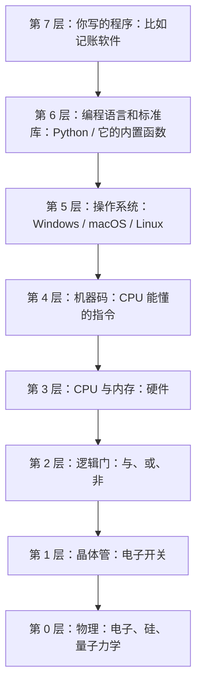

**每一层都把下一层的复杂性藏起来，给上一层提供简单的接口。**

#### 关键的洞察

**每一层的程序员，只需要理解自己这一层和下面一层的接口。**

- 写记账软件的人：理解 Python 就够了，不用管操作系统
- 写 Python 解释器的人：理解操作系统接口就够了（但要非常精通）
- 写操作系统的人：要理解 CPU 指令集和硬件
- 设计 CPU 的人：要理解逻辑门和电路
- 造晶体管的人：要懂量子力学（这是物理学家干的）

**没有人能掌握全部七层。** 也没人需要。

> ### 💡 这对你的意义
>
> **你不需要「从晶体管学起」。**
>
> 很多人觉得「我要先懂计算机原理、先学 C、先学汇编，才能学 Python」——这是错的。
>
> 你只需要站在第 6 层，理解第 6 层的接口（也就是「Python 怎么用」），就能干活。
>
> 底下的层，等你需要时再往下钻。**按需深入，而不是从头打通。**

---

### 四、接口：抽象暴露出来的那部分

抽象藏起了细节，但总要露出点什么，否则没法用。

**露出来的这部分，叫「接口」（interface / API）。**

#### 接口的三个要素

一个接口通常包含：

1. **名字**：这个操作叫什么（`获取天气`、`显示`、`保存文件`）
2. **输入**：需要给它什么（城市名、要显示的内容、文件名和内容）
3. **输出**：它会给你什么（天气状况、无、成功或失败）

#### 例子：一个「发送邮件」的接口

```
名字：发送邮件
输入：
    - 收件人地址
    - 标题
    - 正文
输出：
    - 成功 / 失败（失败时给出原因）
```

**只要知道这三样，你就能用它了。**

至于它内部是怎么连 SMTP 服务器、怎么握手、怎么加密、怎么处理重试——**你不需要知道，也不想知道。**

#### 好接口的特征

| 特征 | 说明 | 反例 |
|---|---|---|
| **简单** | 参数少，一眼看懂 | 一个函数要传 15 个参数 |
| **明确** | 名字准确表达做什么 | 叫 `handle()` 不知道处理啥 |
| **一致** | 相似的操作，风格一致 | 有时返回 true，有时返回 1，有时抛异常 |
| **不泄漏内部** | 不暴露实现细节 | 让你传「内部缓冲区大小」这种参数 |

> ### 📌 判断抽象好坏的标准
>
> **好的抽象，让你「不需要知道内部就能用」；坏的抽象，逼着你去读它的源码才知道怎么用。**
>
> 这个标准极其实用。当你用一个库觉得「这什么破玩意，不看源码根本不会用」——那就是个坏抽象。

---

### 五、抽象在编程中的三个具体体现

讲了这么多理论，看看抽象在代码里长什么样。

#### 体现一：函数（第 43 章详讲）

函数就是最基础的抽象工具。

```python
# 没有抽象：每次都要写一堆细节
结果1 = (价格1 * 数量1) + (价格1 * 数量1) * 0.06   # 加 6% 税
结果2 = (价格2 * 数量2) + (价格2 * 数量2) * 0.06
结果3 = (价格3 * 数量3) + (价格3 * 数量3) * 0.06

# 有抽象：把"算含税总价"这个细节藏起来
函数 算含税总价(价格, 数量):
    返回 (价格 * 数量) * 1.06

结果1 = 算含税总价(价格1, 数量1)
结果2 = 算含税总价(价格2, 数量2)
结果3 = 算含税总价(价格3, 数量3)
```

**「怎么算税」这个细节被藏起来了。** 如果税率改成 8%，只改一个地方。

#### 体现二：数据类型（第 39 章详讲）

数据类型也是抽象。

当你说「这是一个日期」时，你不需要知道它内部是存成「从 1970 年 1 月 1 日到现在经过了多少毫秒」还是「年月日三个数字」。

**你只需要知道：它能做「加一天」「比较早晚」「格式化成字符串」这些操作。**

#### 体现三：库和框架（第 36、50 章详讲）

这就是为什么现代编程这么依赖库：

- 你要处理 Excel？→ 用 `pandas`，不用自己解析 Excel 文件格式
- 你要做网页？→ 用 `React`，不用自己操作 DOM
- 你要训练 AI？→ 用 `PyTorch`，不用自己写反向传播

**每一个库，都是别人替你搭好的一层抽象。**

---

### 六、抽象不是免费的：三个代价

我讲了抽象这么多好处，也得讲它的代价。否则你会滥用。

#### 代价一：性能损失

每加一层抽象，通常都会损失一点性能。

**生活类比**：你点外卖（抽象层），比自己做（直接操作）慢，也贵。但你省了时间。

**在编程里**：

- 用高级语言（Python）比写 C 慢
- 用框架（React）比直接写 JS 慢
- 用 ORM（数据库抽象层）比直接写 SQL 慢

**大多数时候，这点性能损失无所谓**（回顾第 8 章：先做对，再求快）。

#### 代价二：失控感

抽象藏起了细节。当你需要「做一些这个抽象没预料到的事」时，会很痛苦。

**典型场景**：你用了一个框架，90% 的需求它都能满足，但剩下 10% 它的设计不支持。这时候你要么绕过它（丑陋），要么改它的源码（危险）。

**这就是为什么老手会说「不要过早抽象」**——当你还没看清需求的全貌时，抽象可能把你困住。

#### 代价三：学习成本

每一层抽象都要学。

- 学 Python：1 个月
- 学 Django（Python 的 Web 框架）：再 1 个月
- 学 React：再 1 个月
- 学各种工具链：再……

**这也是为什么新手会觉得「怎么要学的东西永远学不完」**——因为现代编程确实叠了很多层。

> ### ⚠️ 给新手的建议
>
> **不要试图一次学完所有层。**
>
> 先学一层，用它做出东西，有了成就感，再往上学或者往下钻。
>
> 「我要先把所有基础打牢再动手」——这是最常见的失败模式。

---

### 七、怎么练抽象能力？

#### 练习一：给任何东西找「三层」

看到任何系统，问自己：

- 它的**用户接口**是什么？（用户面对的是什么）
- 它的**内部实现**大概是什么？（猜一下）
- 它**隐藏了什么**？（用户不知道也不需要知道的）

比如电梯：

- 接口：楼层按钮、开关门按钮、显示屏
- 内部：调度算法、电机控制、安全传感器
- 隐藏：用户不知道电梯怎么决定先响应哪一层

#### 练习二：写代码时，给「一段逻辑」起名字

当你写了十几行代码干了一件事，**停下来，给它起个名字，包成函数。**

这个「起名字」的动作，就是在做抽象。

**如果你起不出好名字**，通常说明这段代码干的事不清晰——它可能该被拆成两段。

#### 练习三：读文档时，只看「接口」部分

用一个新库时，**先只看它能干什么（接口），不要看它怎么实现的**。

等你能用它做出东西了，再好奇地往下看。

---

### ✅ 本章重点回顾

1. **抽象 = 隐藏复杂细节、只露出必要部分；它是人类应对复杂性的唯一武器，也是整个计算机科学的主线**——你之所以几小时能写出程序，是因为站在了几十年的抽象之上。

2. **计算机是从晶体管到你的程序共 7 层抽象叠起来的，每层只给上层提供简单接口**——关键推论：**你不需要「从晶体管学起」，站在第 6 层理解 Python 接口就能干活，按需往下钻即可。**

3. **抽象的三个代价：性能损失、失控感（抽象不支持你的特殊需求时很痛苦）、学习成本**——所以不要过早抽象，也不要试图一次学完所有层；判断抽象好坏的标准是「不看内部能不能用」。

---

### 🤔 想一想

> 观察一个你每天都在用、但从没想过它内部构造的东西（比如电梯、自动售货机、扫码支付、导航 App、智能音箱）。
>
> **请回答三个问题：**
> 1. 它暴露给你的「接口」是什么？（你能操作的那几个按钮/选项）
> 2. 它隐藏了什么？（你不知道但也不需要知道的复杂部分）
> 3. **如果它把内部细节全部暴露出来**（比如电梯让你手动控制电机转速、售货机让你直接操作出货机构），会怎样？
>
> （第三问的答案，就是抽象存在的全部理由。）

---

## 第 19 章 模式识别：发现并消灭重复

> ## 🎯 本章目标
>
> 读完这一章，你应该能够：
> - 理解「模式识别」在编程里指的是什么
> - 掌握 DRY 原则（不要重复自己）
> - 知道什么时候该「抽象出模式」，什么时候不该
> - 理解循环和函数是怎么从「模式识别」里诞生的

---

### 一、什么是模式？

> ### 💡 定义
>
> **模式 = 重复出现的结构或规律。**

人脑天生擅长找模式——这是我们认识世界的方式。

- 你见过几只猫之后，就认识了「猫」这个模式（虽然每只猫长得不同）
- 你听过几首流行歌，就能听出「主歌-副歌-主歌-副歌」这个模式
- 你用过几个 App，就发现「登录-首页-个人中心」这个模式

**编程里的模式识别，就是：在重复的劳动中，找出那个「不变的结构」。**

---

### 二、编程里最常见的三种重复

#### 重复一：对一堆东西做同样的事 → 催生了「循环」

**场景**：你要给 100 个用户发一封邮件。

**不懂模式识别的写法**（伪代码，示意）：

```
发邮件给用户1
发邮件给用户2
发邮件给用户3
...
发邮件给用户100
```

**一百行。**

**识别出的模式**：「对列表里的每一个用户，执行『发邮件』这个动作」。

**于是有了循环：**

```python
# 概念演示：循环消灭重复

对于 每个用户 in 用户列表:
    发邮件给(每个用户)
```

**三行。**

> ### 📌 这就是循环的本质
>
> **循环不是「让计算机重复干活」这么简单——它是「把重复的模式抽象成了一个结构」。**
>
> 你识别出「对每个 X 做 Y」这个模式，然后用循环表达它。
>
> 第 42 章会详细讲循环，但你现在已经知道它为什么存在了。

#### 重复二：同一段逻辑在多处出现 → 催生了「函数」

**场景**：你的程序里有 5 个地方要算「含税总价」。

**不懂模式识别的写法**：每个地方都写一遍计算过程。

**问题**：税率一变，你要改 5 个地方。而且很可能漏改一个，导致程序出错。

**识别出的模式**：「算含税总价」这个逻辑，出现在 5 处。

**于是有了函数**（第 18 章的例子）：

```python
函数 算含税总价(价格, 数量):
    返回 (价格 * 数量) * 1.06
```

**改税率？只改这一处。**

#### 重复三：结构相似但不完全一样 → 催生了「参数」

**场景**：你要给三个用户发邮件，但内容略有不同。

```
发邮件("张三", "你的订单已发货")
发邮件("李四", "你的订单已发货")
发邮件("王五", "你的订单已发货")
```

**识别出的模式**：三行几乎一样，只有「名字」不同。

**于是把「变化的部分」抽出来当参数**：

```python
对于 每个名字 in ["张三", "李四", "王五"]:
    发邮件(名字, "你的订单已发货")
```

**这就是「参数」的价值：把「不变的结构」固定下来，把「变化的部分」留成可填的空。**

> ### 💡 一个普适的思路
>
> 面对重复代码，问自己：
>
> **「哪些是不变的？哪些是变化的？」**
>
> - 不变的 → 写死在结构里
> - 变化的 → 抽出来当参数
>
> 这个思路适用于循环、函数、类、配置文件……几乎所有抽象工具。

---

### 三、DRY 原则

业界有句名言：

> **DRY: Don't Repeat Yourself（不要重复自己）**

这是编程中最重要的原则之一。

#### DRY 的核心理由

重复的代码有两个致命问题：

##### 问题一：改一处要改多处

逻辑变了（税率改了），你要找出所有副本。

**找不全 = bug。**

##### 问题二：副本之间会「漂移」

今天你复制了 5 处。半年后，其中一处的逻辑被改了（比如加了个特殊处理），其他 4 处没改。

**现在这 5 处的行为不一致了，但没人知道。**

这是最难查的一类 bug。

#### 一个真实的惨案

有个经典的故事（很多公司都发生过类似的事）：

某公司的价格计算逻辑，被复制到了 17 个地方。

后来发现其中 2 个地方的计算结果和其他 15 个不一样——**已经错了两年，造成了巨额损失。**

**为什么没人发现？** 因为没人知道有 17 份副本。

**这就是重复代码的真正危险：它让「一致性」变成了一个无法保证的事。**

---

### 四、但不要过度：三次法则

讲了 DRY 的好处，现在讲它的陷阱。

#### 陷阱：过早抽象

新手学了 DRY 之后，容易走极端：

> 「这两段代码有点像，我得把它们抽象成一个函数！」

**但等你抽象完，发现需求变了，这两处要往不同方向演化——你的抽象反而成了枷锁。**

#### 三次法则（Rule of Three）

业界有个实用经验：

> **第一次遇到：直接写。**
> **第二次遇到：复制一下，忍一忍。**
> **第三次遇到：这时候你才真正看清了模式，再抽象。**

**为什么要等到第三次？**

因为：

- 出现两次，可能只是巧合
- 出现三次，说明它确实是稳定的模式
- 而且三次的经历，让你知道「变化的部分」到底是什么

#### 一个比喻

你见过一次长这样的动物，不知道是不是猫。
见过两次，还是不确定。
见过三次不同花色但都有「胡子、会喵、爱晒太阳」——**这时候你才真正认识了「猫」这个模式。**

**抽象也是一样：见得多了，才知道该怎么抽。**

> ### 📌 实践建议
>
> - **两次重复**：可以忍（但要在心里记一笔）
> - **三次重复**：必须抽
> - **如果抽取后经常要改**：说明抽错了，拆回去直接写（这叫「反抽象」，是完全正当的操作）

---

### 五、模式识别的更高形态：设计模式

当你积累了足够经验，会发现某些模式**在不同项目里反复出现**。

业界把这些反复出现的解决方案总结出来，叫**设计模式**（Design Patterns）。

#### 几个著名的例子（你只需要知道名字）

| 模式名 | 解决什么 |
|---|---|
| **单例模式** | 确保某个东西全局只有一个（比如一个程序只能有一个「配置管理器」） |
| **工厂模式** | 把「创建对象」的过程封装起来 |
| **观察者模式** | 一个东西变了，自动通知所有关心它的（比如公众号有新文章，所有订阅者收到推送） |
| **策略模式** | 把「可以替换的算法」抽出来，随时换（比如支付方式可以换支付宝/微信/银行卡） |

**你暂时不需要学它们。** 我要告诉你的是：

> **设计模式不是「背下来的套路」，而是「前辈们识别出的模式」。**
>
> 等你写够代码，你会自己「重新发现」它们——那时候你才会真正理解。
>
> 提前背诵设计模式，就像没谈过恋爱就背恋爱技巧手册——用不上，还可能用错。

---

### 六、怎么练模式识别？

#### 练习一：看到重复，先数数

- 出现 2 次？记住它，继续写
- 出现 3 次？停下来，抽出模式

**关键是「数数」这个动作**——很多人重复了 10 次都没意识到。

#### 练习二：问「变」与「不变」

看到几段相似的代码，问自己：

- 哪些部分是完全一样的？（不变）
- 哪些部分不同？（变化）
- 变化的部分，能不能变成参数？

#### 练习三：跨领域找模式

模式识别能力是通用的。练它的方式不限于编程：

- 读几本同类型的书，找出它们的共同结构
- 观察几家咖啡店的运营，找出共同模式
- 看几个 App 的注册流程，找出共同点

**这种「找共性」的思维，会迁移到编程里。**

---

### 七、一个完整例子：从重复到抽象

我们用一个完整例子收尾。

#### 起点：重复的代码

```python
# 处理苹果订单
总价 = 苹果单价 * 苹果数量
总价 = 总价 * 1.06
如果 会员: 总价 = 总价 * 0.9
显示("苹果订单总价：" + 总价)

# 处理香蕉订单
总价 = 香蕉单价 * 香蕉数量
总价 = 总价 * 1.06
如果 会员: 总价 = 总价 * 0.9
显示("香蕉订单总价：" + 总价)

# 处理橙子订单
总价 = 橙子单价 * 橙子数量
总价 = 总价 * 1.06
如果 会员: 总价 = 总价 * 0.9
显示("橙子订单总价：" + 总价)
```

**三段几乎一样。变化的部分：商品名、单价、数量。**

#### 第一步：抽成函数（消除重复逻辑）

```python
函数 算订单总价(商品名, 单价, 数量, 是否会员):
    小计 = 单价 * 数量
    含税 = 小计 * 1.06
    如果 是否会员:
        含税 = 含税 * 0.9
    返回 含税
```

#### 第二步：用循环（消除重复的调用）

```python
订单列表 = [
    {"商品": "苹果", "单价": 5, "数量": 3},
    {"商品": "香蕉", "单价": 3, "数量": 6},
    {"商品": "橙子", "单价": 4, "数量": 2}
]

对于 每个订单 in 订单列表:
    总价 = 算订单总价(订单.商品, 订单.单价, 订单.数量, 是否会员)
    显示(订单.商品 + "订单总价：" + 总价)
```

#### 第三步：还能再抽吗？

注意到「算订单总价」里面有三步：算小计 → 加税 → 打折。

**将来如果加「满减」「优惠券」「运费」，这个函数会越来越长。**

进阶的做法是把「加税」「打折」「满减」都抽成独立的「规则」，然后让它们组合。

**但记住三次法则——现在只有 3 个商品，不需要过度设计。** 等真有十几种优惠规则时，再重构。

**这就是「恰到好处的抽象」：抽到够用，留有余地。**

---

### ✅ 本章重点回顾

1. **模式识别 = 在重复中找出「不变的结构」**——三种常见重复分别催生了循环（对一堆东西做同样的事）、函数（同一逻辑多处出现）、参数（结构相似只有部分不同）。

2. **DRY 原则的理由不只是「少写代码」，而是「保证一致性」**——重复代码会「漂移」（一处改了其他没改），这是最难查的一类 bug；真实案例里 17 处副本错了 2 处，两年才被发现。

3. **遵循三次法则：第一次直接写，第二次忍一忍，第三次再抽象**——过早抽象会变成枷锁；抽取时问自己「哪些不变、哪些变化」，变化的抽成参数。

---

### 🤔 想一想

> 观察你自己的生活：你有没有「同一件事在不同地方重复做」的情况？
>
> 比如：每周都要填三张格式差不多的表格、每到一个新项目都要重新配置一遍同样的环境、每次写文档都要重新调一遍格式。
>
> **请找出一个例子，然后回答：**
> - 这里面「不变的部分」是什么？
> - 「变化的部分」是什么？
> - 如果把它抽象成一个「模板」或「流程」，你会怎么设计？
>
> （这就是 DRY 原则在编程之外的应用——它本质上是一种关于「效率」的思维方式，不只属于代码。）

---

## 第 20 章 算法思维：怎么「想出」一个解法

> ## 🎯 本章目标
>
> 读完这一章，你应该能够：
> - 掌握四种最实用的「想出算法」的思考方法
> - 知道面对陌生问题时从哪里下手（不再对着屏幕发呆）
> - 理解「先想笨办法」为什么是有效的策略
> - 建立「用具体例子手动推演」的习惯

> ### 📌 本章与第 8 章的区别
>
> 第 8 章讲了「算法是什么、怎么判断好坏」。
> 这一章讲的是更前置的问题：**面对一个问题，我怎么「想出」解法？**
>
> 这是从「评价」到「创造」的一步。

---

### 一、为什么很多人「知道语法却想不出解法」？

这是新手最典型的困境：

> 语法我都会，但给我一个问题，我坐在那里半小时，脑子里一片空白。

**原因不是语法不够熟，而是没有「思考的套路」。**

有经验的程序员脑子里有一套「思考工具箱」——面对问题，他们会按某个顺序尝试几种思路，总有一种能打开局面。

**这一章就是把这套工具箱交给你。**

---

### 二、方法一：先想「笨办法」（暴力法）

#### 核心思路

> **先想一个「一定能得出正确结果，但可能很慢」的办法。**

这是最重要的一条，也是新手最容易跳过的一条。

#### 为什么它有效？

三个理由：

1. **它给了你一个保底方案**——至少你能做出来，不会卡死
2. **写它的过程中，你会真正理解问题**——很多模糊的地方会变清晰
3. **优化往往在写的过程中自己浮现**——你写着写着就会发现「哦，这里不用每次都算一遍」

#### 实例：找出一堆数字里「出现次数最多」的那个

**笨办法**：

```
对于 每个数字:
    数一数它在整个列表里出现了几次
    记下来
最后看看哪个出现次数最多
```

这个办法慢（每个数字都要扫一遍全列表），但**一定对**。

**写出来之后，你可能会想到优化：**

```
只扫一遍列表，边扫边记：
    遇到一个数字，就在本子上给它记一笔
    最后看谁的记录最多
```

**这就是「哈希表计数」，是最优解之一。**

**注意这个顺序**：你是先有了笨办法，才想到优化。**直接想最优解，往往想不出来。**

> ### 💡 一句话
>
> **不要羞于写笨办法。所有好算法，最初都是笨办法。**

#### 什么时候笨办法就够了？

回顾第 8 章：数据量小的时候，笨办法完全够用。

**先写出来，测一下，真的慢再优化。** 大多数时候你会发现：根本不慢。

---

### 三、方法二：拿具体例子手动推演

#### 核心思路

> **不要在脑子里空想。拿一个具体的小例子，用手一步一步走一遍。**

这是我认为**最实用**的一条，胜过任何技巧。

#### 为什么有效？

因为人的抽象思维能力有限，但「跟着具体步骤走」的能力很强。

**你脑子里想「怎么排序」可能想不清楚，但给你 5 张扑克牌，你一定能把它们排好。**

**而你怎么排的，那个过程就是算法。**

#### 实例：「把一堆文件按修改时间排序」

对着这个问题发呆没用。拿 5 个具体文件来：

```
A.txt  2026-01-05
B.txt  2026-03-12
C.txt  2026-01-01
D.txt  2026-02-20
E.txt  2026-03-01
```

**现在手动排。** 你会怎么做？

一种做法（这就是「选择排序」）：

```
第 1 轮：扫一遍，找最早的 → C(01-01)，放第一位
    剩余：A B D E
第 2 轮：扫一遍，找最早的 → A(01-05)，放第二位
    剩余：B D E
第 3 轮：→ D(02-20)
第 4 轮：→ E(03-01)
第 5 轮：→ B(03-12)
```

**你看，你「手动排」的过程，写成步骤就是算法。**

把它翻译成伪代码：

```python
# 概念演示：选择排序（从你手动排扑克牌的过程翻译而来）

函数 排序(列表):
    结果 = []

    当 列表 不为空:
        最早的 = 找出列表里最早的(列表)    # 扫一遍
        结果.添加(最早的)
        列表.移除(最早的)

    返回 结果
```

**这不是什么高深算法——这就是你刚才用手做的事，写成了代码。**

#### 进阶：观察自己的手法，找出优化点

你手动排的时候，有没有想过更高效的方法？

比如「冒泡排序」（相邻两个比，大的往后挪）、「快速排序」（先挑一个中间值，小的放左边大的放右边，再各自排）……

**这些算法，本质都是「人类手工排序时的不同策略」。**

> ### 📌 核心方法
>
> **1. 拿一个小的具体例子**
> **2. 手动做一遍，注意自己每一步在干什么**
> **3. 把你「手上的动作」写成步骤**
> **4. 那就是算法**

这个方法能解决 80% 的「想不出解法」问题。

---

### 四、方法三：从「已知解法」改造

#### 核心思路

> **绝大多数新问题，都是某个经典问题的变体。**

所以：**先判断它「像」哪个已知问题，然后改造。**

#### 常见的「母问题」

| 母问题 | 典型变体 |
|---|---|
| **查找** | 在一堆东西里找某个 → 找最大/最小、找第 K 大的、判断是否存在 |
| **排序** | 排成一列 → 按多条件排、排完取前 N 个 |
| **遍历/搜索** | 走遍所有可能 → 迷宫、找路径、组合枚举 |
| **计数/统计** | 数一数 → 求频率、求总和、去重 |
| **匹配** | 找符合某种模式的东西 → 字符串匹配、模糊搜索 |
| **分治** | 大问题拆成相同的子问题 → 归并排序、二分查找 |

#### 实例：「找出两篇文章里共同的词」

发呆？先想想它像什么。

**它像「查找」**——判断 A 里的每个词，是不是也在 B 里。

于是：

```python
# 概念演示：找共同词

A的词集合 = 把文章A切成词的集合
B的词集合 = 把文章B切成词的集合

共同词 = []
对于 每个词 in A的词集合:
    如果 词 也在 B的词集合里:
        共同词.添加(词)
```

**问题解决。** 而且你会发现，「集合」这个数据结构天生就是干这个的（很多语言里直接有「求交集」的操作）。

**关键动作是：认出它像「查找」，而不是从零发明。**

> ### 💡 怎么积累「已知解法」？
>
> 你不需要背算法。你只需要：
>
> - 做过几十道练习
> - 或者——**用现成的库**
>
> 现实工作中，99% 的「找共同词」这类需求，都是调用现成的函数解决的，而不是自己实现。
>
> 所以**「认出问题类型」的能力，比「实现算法」的能力更值钱**——因为认出来之后，你就能找到现成的轮子。

---

### 五、方法四：换个角度看问题（建模转化）

#### 核心思路

> **如果正面硬上很难，试试把问题「转化」成另一个你已经会解的问题。**

这是最高级、也最能体现功力的方法。

#### 经典例子：一笔画问题

**问题**：给你一个图形，能不能「一笔画」出来（每条边只走一次，笔不离开纸）？

**正面硬上**：试遍所有走法？组合爆炸，做不了。

**转化**（数学家欧拉的做法）：

把图形抽象成「点」和「连接点的线」。然后发现规律：

> 能一笔画 ⟺ 这个图里，「连着奇数条线的点」只有 0 个或 2 个。

**一个看似要穷举的问题，被转化成了一个「数一数」的问题。**

这就是建模的力量。

#### 编程里的例子：「判断两个人是不是好友的好友」

**正面硬上**：遍历所有人的所有好友？数据量大时很慢。

**转化成图**：把人看成「点」，好友关系看成「连线」。问题变成「图里两点之间有没有长度不超过 2 的路径」→ 用图算法解决。

#### 怎么练这种转化能力？

说实话，这需要经验积累。但有个入手点：

> **问自己：这个问题里，什么是「东西」（点）？什么是「关系」（线）？什么是「属性」？**
>
> 把它画出来，往往就看清了。

---

### 六、一个通用的「解题流程」

把上面四种方法串成一个流程。以后遇到问题，按这个顺序走：

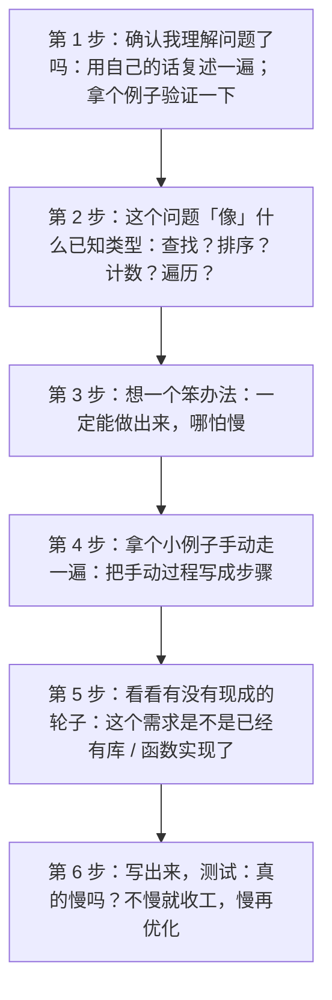

**注意第 5 步的位置**：它在实际工作中往往是最先该做的。

**很多新手花两小时自己实现一个算法，而实际上现成的库里一行就能调用。** 这是巨大的浪费。

> ### 📌 正确的顺序（工作中）
>
> 1. 先搜「有没有现成的」
> 2. 没有，再自己设计
>
> 而学习时，为了训练思维，可以反过来（先自己想，再对照现成的）。**你要清楚自己是在「学习」还是「干活」——这两种场景的最优策略是不同的。**

---

### 七、一个完整实战：从发呆到解法

我们用上面的流程走一遍完整案例。

#### 问题

> 给你一个文件夹，里面有 500 个文本文件。请找出「内容完全相同的文件对」（比如不小心复制出来的重复文件）。

#### 第 1 步：确认理解

「内容完全相同」——是指文件内容一模一样，不是文件名相同。

#### 第 2 步：像什么？

像「比较」和「分组」。要把内容相同的归为一组。

#### 第 3 步：笨办法

```
拿第 1 个文件，跟后面 499 个比一遍
拿第 2 个文件，跟后面 498 个比一遍
...
```

**比较次数**：约 500×500/2 = 12.5 万次。每次都要读两个文件的全部内容。

**慢，但能做。**

#### 第 4 步：手动推演 + 发现优化

拿 3 个文件手动做：

```
A: "hello"
B: "world"
C: "hello"
```

手动做法：A 和 B 比（不同），A 和 C 比（相同！记下来），B 和 C 比（不同）。

**优化灵感**：其实我不需要「两两比较」。我可以给每个文件算一个「指纹」（比如内容的哈希值），**指纹相同的就是重复文件**。

**这样只需要：每个文件算一次指纹（500 次），然后把指纹相同的归为一组。**

**从 12.5 万次比较，降到 500 次计算。**

#### 第 5 步：有现成的吗？

**有。** 几乎所有语言都有「计算文件哈希」的库（MD5、SHA256 等）。

所以实际代码大概是：

```python
# 概念演示：找重复文件

指纹表 = {}   # 指纹 → 文件列表

对于 每个文件 in 文件夹:
    指纹 = 计算哈希(文件内容)

    如果 指纹 不在 指纹表 里:
        指纹表[指纹] = [文件]
    否则:
        指纹表[指纹].添加(文件)

# 最后：哪些指纹对应多个文件，那些就是重复文件
对于 每个指纹, 文件列表 in 指纹表:
    如果 文件列表.长度 > 1:
        显示("这些文件内容相同：" + 文件列表)
```

#### 第 6 步：写出来测试

500 个文件，几秒钟跑完。

**回顾一下这个过程中用到的思维：**

- 先想笨办法（两两比较）→ 得到保底方案
- 手动推演小例子 → 发现「指纹」这个优化点
- 认出问题类型 → 分组
- 用现成的轮子 → 哈希函数

**这就是算法思维的完整运用。**

---

### ✅ 本章重点回顾

1. **方法一「先想笨办法」**：一定能做出来、写着写着会浮现优化、给你保底不至于卡死——不要羞于写笨办法，所有好算法最初都是笨办法。

2. **方法二「拿具体例子手动推演」是最实用的一招**——给 5 张扑克牌你一定能排好，你怎么排的写成步骤就是算法（选择排序就是这么来的）；观察自己的手法还能发现优化点。

3. **方法三认出「像什么已知类型」（查找/排序/计数/遍历）比自己发明更重要**——因为认出来就能找到现成轮子；工作中正确顺序是「先搜有没有现成的，没有再自己设计」。

---

### 🤔 想一想

> 用本章的「六步流程」处理这个问题：
>
> **你有一个记录了 10000 行交易数据的文件，每行是「日期,金额,商家」。请找出「单笔金额最大的那笔交易，以及它出现在哪一天」。**
>
> 请回答：
> 1. 你的**笨办法**是什么？
> 2. 它「像」什么已知问题类型？
> 3. 有**现成的轮子**可以用吗？（想想有没有现成的「求最大值」功能）
> 4. 如果数据量变成 10 亿行（内存装不下），你的办法还行吗？
>
> （第四问是想让你意识到：**当数据大到装不进内存时，问题性质会变**——那是「大数据」领域要解决的问题，也是为什么会有 Hadoop、Spark 这类工具存在。）

---

## 第 21 章 调试思维：与错误做朋友

> ## 🎯 本章目标
>
> 读完这一章，你应该能够：
> - 建立「报错是正常且有用」的心态
> - 掌握一套系统化的排错流程
> - 知道几种最实用的调试手法
> - 理解为什么「调试能力」是编程能力的真正分水岭

---

### 一、先破一个心结：报错不是你笨

新手最常有的挫败感来源：

> 「又报错了……我是不是不适合学编程？」

**我要非常明确地告诉你：**

> **报错是编程的常态，不是你的失败。**
>
> 专业程序员每天也要处理几十个错误。**区别在于：他们不慌，而且有一套处理流程。**

#### 一个真相

有经验的程序员和新手的核心差距，**不是「谁写的代码错误少」，而是「谁修错误快」**。

- 新手：遇到报错 → 慌 → 乱改一通 → 越改越错 → 崩溃
- 老手：遇到报错 → 读信息 → 定位 → 验证假设 → 修 → 确认

**这个流程是可以学的。** 这就是本章的内容。

#### 为什么报错其实是个好东西？

因为：**报错是计算机在跟你说话。**

它告诉你：「这里有问题，问题大概是这样，在第几行。」

**比报错可怕一万倍的是「不报错但结果不对」**——那种情况你连线索都没有。

> ### 💡 换个心态
>
> **把每个报错，当成计算机给你的一条免费线索。**
>
> 它没嫌你笨，也没嘲笑你。它只是说：「哥们，你这里写得不清楚，我再问你一次。」

---

### 二、错误的三种类型

排错的第一步，是搞清楚你遇到的是哪一类。

#### 类型一：语法错误（最容易）

**表现**：程序根本跑不起来，一运行就报错。

**原因**：你写的代码不符合语言规则（少个括号、拼错关键字、缩进错了……）。

**好消息**：这类错误**最容易修**，因为计算机会直接告诉你哪一行有问题。

**而且现代编辑器会实时标红**——你还没运行，它就画出来了。

**处理**：照着提示改就行。

#### 类型二：运行时错误（中等难度）

**表现**：程序跑起来了，但跑到一半崩了，报个错。

**常见原因**：

- 除以 0
- 访问了不存在的列表位置（比如列表只有 3 项，你要第 10 项）
- 把文字当数字来算
- 打开一个不存在的文件
- 网络连接断了

**好消息**：通常会告诉你「哪一行出的错」和「错误类型」。

**处理**：看错误信息里的行号，去看那一行，想想「这里的数据是什么」。

#### 类型三：逻辑错误（最难）

**表现**：程序能跑，不报错，**但结果不对**。

**例子**：

- 应该显示 100，显示了 99
- 排序排出来是乱的
- 明明条件满足了，却没有执行

**坏消息**：计算机不会告诉你哪里错了，因为它觉得自己在正确执行你写的（错误的）指令。

**这就是第 2 章说的**：程序出 bug，几乎永远是「人没说清楚」。

**处理**：这类错误**最难**，需要系统地排查。下面重点讲。

---

### 三、系统化排错流程（四步法）

这是本章最核心的内容。**遇到任何 bug，按这个顺序走：**

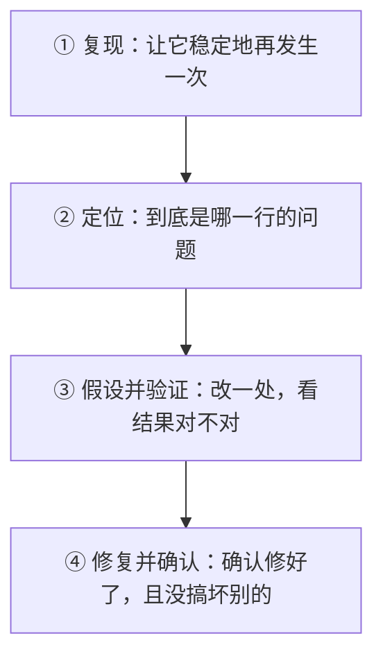

#### 第 ① 步：复现（让它稳定地再发生一次）

**目标**：找到「怎么做，它就一定出错」。

**为什么这步重要？** 因为如果你的 bug 是「偶尔出现」的，你根本没法验证自己有没有修好。

**做法**：

- 记下你刚才做了什么操作
- 重复一遍，看是不是又出错
- 如果能复现，就固定下这个「最小复现步骤」

**例子**：

> ❌「我的程序有时候会崩」→ 没法修
> ✅「输入金额的时候填负数，一点确定就崩」→ 可修

#### 第 ② 步：定位（缩小范围，找到出问题的那一行）

**目标**：把问题从「整个程序」缩小到「某一行」。

**核心手法：二分法（逐步缩小）**

假设程序有 100 行，结果不对。

```
1. 在第 50 行后面，把中间结果打印出来
2. 看看这里的结果对不对？
   - 不对 → 问题在前 50 行 → 去第 25 行再看
   - 对   → 问题在后 50 行 → 去第 75 行再看
3. 重复，几次就能锁定到某一行
```

**这是最快的定位方法**，比「从头一行一行看」快得多。

#### 第 ③ 步：假设并验证

**目标**：提出一个「为什么会错」的猜测，然后用实验证明它对不对。

**关键：一定要验证，不要猜完就改。**

**例子**：

> 假设：「我觉得是因为这里的数据类型不对，文字被当成了数字」
>
> 验证：在那一行前面打印一下这个值的「类型」，看看是不是文字
>
> - 如果确实是文字 → 假设成立，去修
> - 如果不是 → 假设错误，**换个假设重来**

> ### ⚠️ 新手最常犯的错：猜完就改
>
> 「我觉得是这里的问题」→ 改一下 → 跑 → 还是错 → 再改 → 还错 → 改了十处，代码乱七八糟，问题依旧。
>
> **这叫「随机修改法」，是最糟糕的调试方式。** 它不但低效，还会让你把本来对的代码改错。
>
> **正确做法：每次只改一处，改完立刻验证。**

#### 第 ④ 步：修复并确认

改完之后，要做三件事：

1. **确认原来的错误消失了**（跑一遍复现步骤）
2. **确认没搞坏别的功能**（跑一遍其他功能）
3. **想一想：同样的错误别处有没有？**（如果是因为复制代码，可能别处也有）

第 3 点经常被忽略。修完一个 bug，最好搜一下「同样的写法还在别处出现吗」。

---

### 四、五种实用的调试手法

#### 手法一：打印大法（最朴素、最有效）

**做法**：在关键位置把变量的值打印出来。

```python
# 概念演示：打印大法

显示("=== 进入计算函数 ===")
显示("输入的价格是:", 价格)
显示("输入的数量是:", 数量)

小计 = 价格 * 数量
显示("算出来的小计:", 小计)

总价 = 小计 * 1.06
显示("含税总价:", 总价)
```

**为什么有效？** 因为它让你「看见」程序内部发生了什么。程序的中间过程是看不见的，打印让它可见。

**这是老手也天天在用的方法。** 不要觉得它土——管用就行。

**技巧**：打印时带上变量名（不要只打印值），最好加个标记方便在输出里找。

#### 手法二：橡皮鸭调试法（听起来荒谬，但极有效）

**做法**：找一只橡皮鸭（或者任何东西，甚至一个同事），**对着它，把你的代码一行一行解释一遍**。

**为什么有效？**

因为你在「解释」的过程中，大脑被迫慢下来、一步步走。而 bug 往往就在你「自以为没问题」的那一步。

**经典场景**：

> 你跟同事说：「这段代码先读文件，然后……嗯……等等，这里应该先判断文件是否存在，我漏了。」

**你还没说完，自己就找到了 bug。**

**这是真实存在的现象，业界叫它「橡皮鸭调试法」。**

#### 手法三：对比法（跟「能跑的版本」对比）

**做法**：

- 找一个「之前能正常工作」的版本
- 对比现在和它有什么区别

**适用场景**：「昨天还好好的，改了点东西就不行了。」

**这就是为什么版本控制（Git，第 35 章）这么重要**——它让你随时能回到「还能跑的版本」去对比。

#### 手法四：最小化（删掉无关部分）

**做法**：把程序一点点删减，只留下「能触发 bug 的最小部分」。

**为什么有效？** 因为复杂的上下文会干扰判断。当你把问题缩小到 10 行代码时，bug 往往自己就跳出来了。

**这也是向别人求助时的正确姿势**——不要贴 500 行代码问「哪里错了」，而要贴 10 行能复现的最小例子。**你会发现，在最小化的过程中，你自己就找到了答案。**

#### 手法五：休息一下（认真的）

**做法**：卡了半小时以上，去喝杯水、走一圈、睡一觉。

**为什么有效？**

因为当你盯着一个问题时，大脑会陷入「思维定势」——反复沿着同一条（错误的）思路走。

**离开一下，大脑会「重置」，回来时往往一眼就看出问题。**

**这不是玄学，是有认知科学依据的。** 很多程序员都有「洗澡时/散步时突然想通」的经历。

---

### 五、怎么读懂错误信息？

新手最怕的是那一片红色的英文。我教你读它。

#### 一条典型错误信息的结构

```
File "记账.py", line 42, in 算总价
    total = price * count
TypeError: can't multiply sequence by non-int of type 'str'
```

**拆成四部分看：**

| 部分 | 含义 | 怎么用 |
|---|---|---|
| `File "记账.py", line 42` | 出错在**第 42 行** | 直接跳到那里 |
| `in 算总价` | 出错在**「算总价」这个函数里** | 知道是哪个功能出问题 |
| `total = price * count` | 出错的**那一行代码** | 看这一行在做什么 |
| `TypeError: can't multiply...` | **错误类型 + 原因** | 关键线索 |

#### 最后一行最关键

`TypeError: can't multiply sequence by non-int of type 'str'`

翻译成人话：

- `TypeError` = 类型错误（你把两个不该放在一起算的东西放一起了）
- `can't multiply` = 不能做乘法
- `by non-int of type 'str'` = 因为有个东西是文字（str），不是数字（int）

**结论**：`price` 或 `count` 里有一个是文字，不是数字。

**为什么是文字？** 大概是用户输入的时候拿到的是文字（比如 `"38"` 带引号），你忘了转成数字。

**搞定。**

#### 常见错误类型速查

| 错误名 | 含义 | 常见原因 |
|---|---|---|
| `SyntaxError` | 语法错误 | 少了括号/冒号、缩进错了 |
| `NameError` | 名字不存在 | 变量名拼错了、用了没定义的变量 |
| `TypeError` | 类型不对 | 把文字当数字算、把数字当列表用 |
| `IndexError` | 索引越界 | 列表只有 3 项，你要第 10 项 |
| `KeyError` | 键不存在 | 字典里没有这个 key |
| `FileNotFoundError` | 文件没找到 | 路径写错了 |
| `ZeroDivisionError` | 除以 0 | 除数可能是 0（常因边界情况没考虑） |
| `AttributeError` | 属性不存在 | 对象没有这个方法/属性 |

**你不需要背这个表**，只要知道：**错误类型名本身就是线索**，看到就去查一下。

#### 一个重要技巧：看「最下面」

报错信息往往很长（一堆「调用栈」）。

**秘诀：从最后一行看起。**

最后一行是「错误的本质原因」，上面那些是「它发生在哪个调用链条里」。**先读最后一行，通常就够了。**

---

### 六、调试能力的三个层次

#### 层次一：能照着错误信息改（入门）

语法错误、明显的运行时错误，看着提示改。

到这一步，你已经能自己写代码了。

#### 层次二：能系统地定位逻辑错误（进阶）

结果不对但不报错时，能用「打印 + 二分定位 + 假设验证」找到问题。

到这一步，你能独立完成项目了。

#### 层次三：能预防错误（高手）

不是等错误出现再去修，而是**在写代码时就减少错误的可能**。

手段包括：

- 写测试（自动检查代码对不对）
- 用类型检查工具
- 代码审查（让别人看你的代码）
- 在关键地方加「断言」（assert，明确声明「这里必须是什么」）

**这一层是职业程序员的日常。** 你暂时不需要，但要知道它的存在。

---

### ✅ 本章重点回顾

1. **报错是常态不是失败，专业程序员每天也处理几十个错误**——区别在「修得快慢」；报错其实是最好的情况（计算机给了你线索），最可怕的是「不报错但结果不对」。

2. **四步法：复现（让它稳定发生）→ 定位（二分法缩小到某行）→ 假设并验证（每次只改一处并验证）→ 修复并确认（含检查别处是否有同样问题）**——千万不要「猜完就改」的随机修改法。

3. **五大手法：打印大法、橡皮鸭调试法（对着鸭子解释代码，说着说着自己就发现 bug）、对比法、最小化、休息一下**；读错误信息从最后一行看起，错误类型名本身就是线索。

---

### 🤔 想一想

> 假设你写了个程序计算「班级平均分」，程序不报错，但结果明显不对（比如算出来 850 分，而满分是 100）。
>
> **请用本章的四步法，写出你的排查计划：**
> 1. 你会先去哪里看？（第一步做什么）
> 2. 你打算在哪几个位置「打印」中间结果？
> 3. 列出三个可能的假设（比如「是不是把总分当平均分了」「是不是少除了一次」……），并说出你会怎么验证每一个。
>
> （提示：这种「结果差了一个数量级」的错误，通常是**少除了一次、或者累加了不该累加的东西**。想想你会在哪一步发现它。）

---

## 第 22 章 工程思维：先跑起来，再跑得好

> ## 🎯 本章目标
>
> 读完这一章，你应该能够：
> - 理解「完美主义」为什么是编程学习的大敌
> - 掌握 MVP（最小可用产品）思想
> - 知道「技术债」是什么，以及怎么管理它
> - 建立「先做对，再做快，再做美」的优先级

---

### 一、一个普遍的学习悲剧

我见过太多这样的学习路径：

```
第 1 周：我要学编程！先看看该学什么语言
第 2 周：看了十篇对比文章，还是没决定
第 3 周：决定学 Python，开始找教程
第 4 周：这本教程说要先学数据结构，那本说要先做项目，我迷茫了
第 5 周：找到一套"完整路线图"，从计算机组成原理开始学
第 8 周：还在学二进制和内存地址
第 12 周：放弃了
```

**问题出在哪？**

不是不够努力，恰恰相反——**是太想「准备充分」了**。

> ### ⚠️ 核心问题
>
> **想「把所有基础打牢再动手」的人，几乎都放弃了。**
>
> 因为基础是打不完的，而且没有正反馈的路走不远。

这一章就是来解决这个问题的。

---

### 二、工程思维的第一原则：先跑起来

#### 原则表述

> **先做出一个「能跑」的版本，哪怕它很丑、很笨、限制很多。**

#### 为什么？

**三个理由：**

##### 理由一：跑起来的东西才能改进，跑不起来的东西只能想象

你脑子里有个「完美的程序」，但它只存在于脑子里。**你不把它写出来，它就永远是个幻想，而且你不知道自己的设计哪里有问题。**

而一个「很笨但能跑」的版本，是真实的。你可以测它、用它、发现它的毛病。

**真实的不完美，胜过想象的完美。**

##### 理由二：完成比完美更重要（心理层面）

人需要正反馈。

- 写完一个能跑的小程序 → 成就感 → 想继续
- 一直在「准备」→ 没有产出 → 怀疑自己 → 放弃

**维护动力，比追求质量更重要。** 尤其在学习的早期。

##### 理由三：需求会在使用中变清晰

你以为自己想要 A，做出来一半发现「其实我要的是 B」。

**越早做出东西，越早发现这个。** 这是巨大的时间节省。

#### 一个比喻：写文章

糟糕的做法：想好每一个句子再动笔 → 写不出第一段。

正确的做法：**先写一版烂草稿** → 然后改 → 再改 → 变好。

**几乎所有好文章都是改出来的，几乎所有好代码也是。**

> ### 📌 一句话
>
> **不要追求「第一次就写对」，追求「先写出来，然后改对」。**

---

### 三、MVP：最小可用产品

这是「先跑起来」原则的具体化。

> ### 💡 定义
>
> **MVP（Minimum Viable Product）= 能用得上的最小版本。**
>
> 「最小」：功能少到不能再少
> 「能用」：它确实能解决核心问题

#### 举例：做一个记账 App

**❌ 不是 MVP 的第一版：**

- 有漂亮的界面
- 支持多种货币
- 能同步云端
- 有图表分析
- 有预算提醒
- 能导出 Excel

（做这个要三个月，而且你可能做到一半就发现「我其实不需要预算提醒」）

**✅ MVP 版本：**

- 命令行里输入「金额 类别」
- 能显示「本月总支出」

**就两个功能。** 一天就能做完，而且当天就能开始用它记账。

**用了一周之后**，你才知道自己真正需要什么——那时候再加功能。

#### 怎么定义自己的 MVP？

问自己一个问题：

> **「如果只能保留一个功能，哪个是绝对不能少的？」**

那个就是 MVP 的核心。其他全是锦上添花。

#### MVP 的三个检验标准

做完第一版，问自己：

1. **它能解决我的核心问题吗？**（哪怕很笨拙）
2. **我现在就愿意开始用它吗？**
3. **如果它永远是这个样子，我还能接受吗？**

如果三个都是「是」，你的 MVP 就对了。

---

### 四、技术债：欠了要还，但可以「有计划地欠」

#### 什么是技术债？

> ### 💡 定义
>
> **技术债 = 为了快速完成而采取的「权宜之计」，将来要花额外成本去弥补。**

就像借钱：现在拿到钱（快速交付），将来要还利息（额外的返工成本）。

#### 常见的技术债

| 权宜之计 | 当时的好处 | 将来的代价 |
|---|---|---|
| 复制粘贴代码 | 快 | 改一处要改多处（第 19 章） |
| 变量叫 `a`、`b`、`temp` | 省得想名字 | 三个月后看不懂 |
| 不写注释 | 快 | 连自己都忘了为什么这么写 |
| 不处理异常 | 代码短 | 用户一输错就崩溃 |
| 硬编码（把值写死在代码里） | 简单 | 换个环境就要改代码 |

#### 关键认知：技术债不是「坏东西」

新手常以为「技术债 = 写烂代码」。不是。

> **技术债是一种「有意识的取舍」：我现在借时间，将来还。**

它跟「烂代码」的区别在于：**你是不是知道自己在欠债。**

- ✅ **好的技术债**：「我知道这里该抽象，但为了先上线，我先复制一份，我记在待办里，下周回来重构。」
- ❌ **坏的技术债**：「反正能跑就行。」（根本不知道自己欠了债）

#### 怎么管理技术债？

**三个实用做法：**

##### 做法一：记账（写下来）

在代码里留个标记，或者记在待办清单里：

```python
# TODO: 这里复制了算税的逻辑，等税率稳定后抽成函数
```

**哪怕不立刻修，记下来就已经赢了一半。**

##### 做法二：定期还（安排时间）

不要指望「以后有空再说」——以后永远没空。

**给自己定个规矩**：比如「每做完一个功能，花半天时间清理这个阶段欠的债」。

##### 做法三：区分「该还」和「不用还」

有些债**永远不用还**：

- 一个只用一次的小脚本，写得多烂都无所谓
- 一个马上要下线的功能，不值得重构

**判断标准**：这段代码将来还会被改吗？会 → 还债；不会 → 不用管。

> ### 💡 一个重要的判断
>
> **不要为了「代码漂亮」去重构「再也不会改的代码」。**
>
> 那是浪费时间。工程师的美德是「务实」，不是「洁癖」。

---

### 五、优先级：先做对，再做快，再做美

这是工程思维最实用的一条排序。

#### 三个阶段

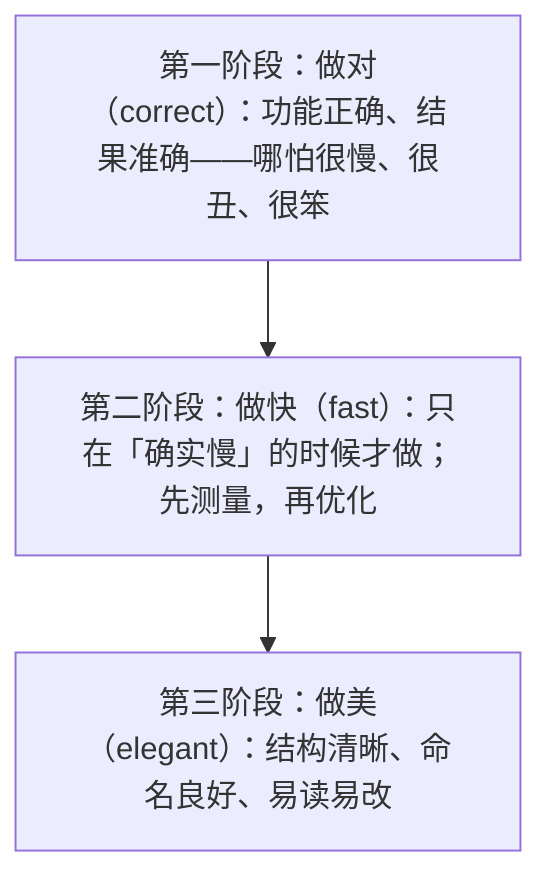

#### 为什么这个顺序？

##### 为什么「对」第一？

因为**一个跑得飞快但结果错误的程序，价值是零**（甚至是负数，因为它会让你做出错误决策）。

##### 为什么「快」第二，而且只在「确实慢」时才做？

回顾第 8 章：**过早优化是万恶之源。**

你可能花三天优化，快了 5 倍——但原本只要 0.1 秒，快了也感知不到。**这三天白花了。**

**正确做法**：先测，发现真的慢（比如要 10 秒），再优化。

##### 为什么「美」最后，但又「贯穿始终」？

这里有个微妙之处：

- **大结构上的「美」（好的命名、清晰的模块）其实很重要**，应该一开始就注意
- **细节上的「美」（一个函数能不能再短三行）可以往后放**

**我的建议**：

- 命名、结构：一开始就认真对待（成本很低，收益很大）
- 极致优雅、设计模式、性能优化：**等确认这段代码会被长期维护再说**

---

### 六、工程思维的三个日常习惯

#### 习惯一：小步前进，每步验证

**不要写 200 行代码再运行。** 写 20 行，跑一下，确认对了，再写下一个 20 行。

**为什么？** 因为 20 行里找 bug 容易，200 行里找 bug 是噩梦。

**这跟第 21 章的「最小化」是同一个道理。**

#### 习惯二：保存「能跑的版本」

在做一个大的改动之前，**先把当前能跑的版本保存下来**（复制一份，或者用 Git 提交一次）。

**这样即使改崩了，你也能退回去。**

这是第 35 章 Git 的核心价值之一。

#### 习惯三：记录「为什么」

代码注释最重要的不是写「这行做了什么」（代码本身就写着），而是写**「为什么这么做」**。

```python
# ❌ 没用的注释
结果 = 价格 * 1.06      # 价格乘以 1.06

# ✅ 有用的注释
结果 = 价格 * 1.06      # 加 6% 增值税（2026 年税率，政策变动时需更新）
```

**三个月后，你会感谢自己写了「为什么」。**

---

### 七、给「完美主义者」的三条解药

如果你发现自己有「总想准备充分再动手」的倾向，试试这三条：

#### 解药一：设定「最烂版本」目标

不是「我要做出一个好东西」，而是：

> **「我要做出一个『能用的最烂版本』，今天之内。」**

允许它丑、允许它笨。**先把「完成」这件事练习成习惯。**

#### 解药二：用时间盒强制推进

给自己定死时间：「这个功能我只花 2 小时，2 小时后不管做成什么样，都要有个能跑的东西。」

**时间到了就停。** 你会发现，2 小时做出的「不完美版本」，比 8 小时追求完美却没做完的版本有价值得多。

#### 解药三：接受「重构是正常的」

不要觉得「返工 = 我前面白做了」。

**重构不是失败，是正常工作方式。** 所有软件都是这么做出来的（回顾第 7 章）。

**你第一版做得糙没关系，第二版改好就行。**

---

### ✅ 本章重点回顾

1. **「先跑起来」是工程思维第一原则**——真实的不完美胜过想象的完美；完成比完美更重要（维护动力）；越早做出东西越早发现需求其实是错的；不要追求第一次写对，追求先写出来再改对。

2. **MVP = 能用得上的最小版本**——问自己「只能保留一个功能，哪个绝对不能少」；做完 MVP 就开始用，用了一周才知道真正需要什么。

3. **技术债是「有意识的取舍」不是烂代码**——关键是知道自己欠了债（记 TODO）、定期还、并区分「该还」和「不用还」（再也不会改的代码不必重构）；优先级永远是**先做对、再做快（确实慢才优化）、再做美**。

---

### 🤔 想一想

> 请你现在就想一个「你一直想做但还没动手」的小项目（可以是个记账脚本、一个自动整理照片的工具、一个提醒小程序，什么都行）。
>
> **然后回答：**
> 1. 它的 **MVP** 是什么？（只能保留一个功能，你选哪个？）
> 2. 你觉得做出这个 MVP 需要多久？（诚实估计，然后**把这个时间除以 3**——因为你会低估）
> 3. **今天你能为它做的「最小的第一步」是什么？**（小到 15 分钟能完成的那种——比如「新建一个文件，写下三行伪代码」）
>
> （想清楚第三问之后，**真的去做它**。这是整本书里最有可能改变你的一道题。）

---

# 第四关　语言动物园

> 语言到底是什么、编译型和解释型差在哪、主流语言各自擅长什么、排行榜该怎么看。
>
> 这一关走完，你手里会有一张自己的选型地图。

## 第 23 章 编程语言是什么：人类与计算机之间的翻译层

> ## 🎯 本章目标
>
> 读完这一章，你应该能够：
> - 说清楚编程语言在「人机之间」扮演什么角色
> - 理解一门语言的三个组成部分：词汇、语法、语义
> - 明白「标准库」为什么是一门语言的重要组成部分
> - 理解为什么换语言时「概念不变，写法变」

---

### 一、语言是「翻译层」

回到最根本的问题：**编程语言到底是什么？**

> ### 💡 一句话
>
> **编程语言是「人类」和「计算机」之间的一层翻译。**

#### 三方关系图

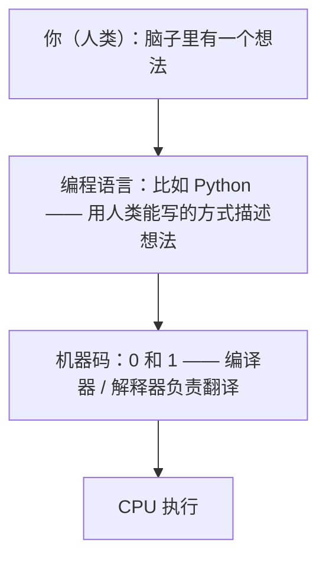

**编程语言存在的唯一理由：人类写不了 0 和 1，但 CPU 只认 0 和 1。**

所以它必须同时满足两边：

- **对人类友好**：好读、好写、好改
- **对机器可翻译**：规则明确、没有歧义

**这两个要求经常打架。** 对人越友好的写法，往往越难翻译成高效的机器码（需要更复杂的翻译程序）。

**这就是为什么有这么多语言——它们在这个天平上选了不同的位置。**

---

### 二、一门语言由哪几部分组成？

就像自然语言（汉语、英语）有「单词、语法、成语词典」一样，编程语言也有对应的三层。

#### 第一层：词汇（关键字 + 标识符）

##### 关键字（保留字）

语言自己占用的词，有特殊含义，你不能拿来当变量名。

比如：`if`、`else`、`for`、`while`、`return`、`class`、`function`……

**这些词数量很少**：

- C：32 个
- Python：约 35 个
- Java：约 50 个

**好消息：你只需要认识几十个关键字，就能读任何一门语言的代码。**

##### 标识符（你自己起的名字）

变量名、函数名、类名……这些由你决定。

`价格`、`user_name`、`calculateTotal`、`账户列表` 这些都是标识符。

**起名字是编程里最难的事之一**（这是个著名的玩笑，但也是真的）。第 49 章会讲命名。

#### 第二层：语法（规则）

语法规定「词汇怎么组合才是合法的」。

就像汉语说「我吃饭」合法，「饭吃我」不合法（虽然你能听懂，但语法上主谓宾错了）。

**编程的语法规则极其严格**——因为第 2 章说过，计算机不会「猜」你的意思。

##### 语法差异的例子

同一个「如果 x 大于 0 就显示一句话」，不同语言：

**C / Java / JavaScript / C# 风格**（花括号派）：
```
if (x > 0) {
    print("正数");
}
```

**Python 风格**（缩进派）：
```python
if x > 0:
    print("正数")
```

**Ruby 风格**：
```ruby
if x > 0
    puts "正数"
end
```

**做的事完全一样，写法不同。**

> ### 📌 重要的认知
>
> **语法是最表面的东西，也是最容易学的部分。**
>
> 学会 `if` 在 Python 里怎么写，10 分钟就够了。但学会「什么时候该用 if、判断条件怎么设计」——那是第 16–22 章的事，值钱得多。
>
> **这也是为什么 AI 最容易替代语法，最难替代思维。**

#### 第三层：语义（含义）

语法规定「这么写合不合法」，语义规定「这么写是什么意思」。

**有个经典的例子：**

```c
// C 语言
if (x = 5) { ... }
```

**语法上**：合法（能编译通过）。

**语义上**：这是个 bug！

因为 `=` 是「赋值」（把 5 放进 x），不是「比较」（判断 x 是不是等于 5）。

**写这段代码的人想写的是 `==`（比较），但写成了 `=`（赋值）。**

后果：`if` 的条件永远为真（因为赋值成功返回真），大括号里的代码永远执行。

**这类 bug 极其隐蔽**——语法没错，能跑，但行为完全不对。这正是第 21 章说的「逻辑错误」。

**后来很多语言改进了设计**（比如 Python 里赋值不能写在 if 条件中），就是为了消灭这类陷阱。

#### 第四层（容易被忽略）：标准库

这是很多人忽略的部分，但对「一门语言好不好用」影响巨大。

> ### 💡 标准库是什么？
>
> **语言自带的一套「常用工具箱」**，你不用自己写，直接调用就行。

比如：

- 数学运算（开方、取绝对值、随机数）
- 文字处理（查找、替换、分割）
- 日期时间（算两个日期相差几天）
- 文件读写
- 网络请求
- 数据结构（列表、字典、队列……）

**为什么标准库这么重要？**

因为**你写程序 80% 的代码，都是在做这些「通用操作」**。

- 标准库丰富 → 你写很少的代码就能干很多事
- 标准库贫乏 → 什么都得自己写

**Python 受欢迎的一大原因，就是它的标准库极其丰富**（业界称它「自带电池」batteries included）。

> ### 📌 选语言时的一个实用判断
>
> **不要只看语法好不好看，要看「我要做的事，它有没有现成的库」。**
>
> 这在数据科学、AI 领域特别明显：Python 赢不是因为语法最好，而是因为 NumPy、Pandas、PyTorch 这些库太强了。

---

### 三、为什么会有几百种语言？

现在世界上大约有几百到上千种编程语言（活跃的有几十种）。

**为什么不能统一？**

第 12 章讲过一部分（不同领域思维不同、设计是取舍、历史惯性）。这里补充两个视角：

#### 视角一：不同的「编程范式」

除了语法不同，语言还有**思维方式**的差别。这叫「编程范式」。

| 范式 | 核心思路 | 代表语言 |
|---|---|---|
| **命令式** | 一步一步告诉计算机怎么做 | C、Pascal |
| **面向对象** | 把世界看成「对象」的集合 | Java、C++、Python |
| **函数式** | 把计算看成「函数之间的变换」 | Haskell、Lisp、Scala |
| **声明式** | 只说「我要什么」，不说「怎么做」 | SQL、HTML |

**大多数现代语言是「混合范式」**（比如 Python 既支持面向对象，也支持一些函数式写法）。

**范式比语法更深层**——它影响你「怎么思考问题」。

> 好消息：**你作为初学者，不急着选范式。** 先从命令式/面向对象入手（这是最主流的），其他的以后再说。

#### 视角二：语言是「设计作品」，有作者的品味

每门语言都反映了设计者的价值观：

- **C**：相信程序员，给最大自由，最小干预
- **Java**：不相信程序员会自觉，用严格规则约束你
- **Python**：相信「可读性最重要」，用语法强制你写整齐
- **Go**：相信「简单胜于聪明」，故意不加复杂特性
- **Rust**：相信「安全可以靠编译器保证」，宁可让编译变慢

**所以「最好用的语言」是主观的**——它取决于你的价值观和你要做的事。

---

### 四、换语言时，什么变了、什么没变？

这是本章最实用的一节。

假设你学会了 Python，现在要学 JavaScript。**你会经历什么？**

#### 会变的（大约 20%）

| 变的 | 说明 | 适应时间 |
|---|---|---|
| **语法写法** | `if` 怎么写、循环怎么写、函数怎么定义 | 几天 |
| **关键字** | `def` vs `function`、`None` vs `null` | 几天 |
| **标准库名字** | 读文件、发请求的函数叫什么 | 一两周（查文档） |
| **工具链** | 怎么安装、怎么运行、怎么打包 | 一两周 |

**这些加起来，一两周就能适应。**

#### 不会变的（大约 80%）

| 不变的 | 说明 |
|---|---|
| **编程思维** | 分解、抽象、模式识别、调试（第 16–22 章） |
| **核心概念** | 变量、条件、循环、函数、数据结构、异常处理 |
| **程序骨架** | 输入 → 处理 → 输出 → 存储 |
| **设计原则** | DRY、可读性、先跑起来再优化 |
| **调试方法** | 打印、二分定位、假设验证 |

**这些占 80%，而且完全通用。**

> ### 📌 这就是为什么本书先讲原理
>
> **学会了那 80%，换语言的成本只有 20%。**
>
> 反过来，**如果你只学了某一门语言的语法（那 20%），换语言时等于从零开始。**
>
> 这就是为什么那么多「学完 Python 语法」的人，换个语言还是不会——**他们学的只是那 20%。**

#### 一个比喻

学编程语言，像学开车：

- **会变的部分**：不同车的方向盘位置、挡位、按钮布局 → 开几天新车就熟了
- **不变的部分**：油门刹车怎么配合、怎么看后视镜、怎么判断车距、交规 → **这些才是核心**

**先学「不变的那部分」，是投入产出比最高的学习策略。**

---

### 五、语言之争：为什么网上总在吵？

你一定见过这类争论：

> 「Python 是最好的语言！」
> 「Java 才是工业级！」
> 「PHP 是世界上最好的语言」（这是个经典梗）
> 「JavaScript 统一天下」
> 「Rust 才是未来」

#### 为什么吵不出结果？

因为**他们在用不同的标准评价**：

- 说 Python 最好的人，标准是「上手快、写得快」
- 说 Java 最好的人，标准是「工程稳、好维护」
- 说 C 最好的人，标准是「性能极致、控制力强」
- 说 Rust 最好的人，标准是「又快又安全」

**他们的标准不同，所以永远吵不拢。**

#### 正确的问法

不要问「哪门语言最好」，要问：

> **「对于『我要做的这件事』，哪门语言最合适？」**

**举个例子：**

| 我要做的事 | 合适的选择 |
|---|---|
| 快速做个数据分析 | Python |
| 做个网页 | JavaScript |
| 给银行写核心系统 | Java |
| 写操作系统/驱动 | C / Rust |
| 做个 iPhone App | Swift |
| 做个 Android App | Kotlin |
| 做个跨境电商网站后端 | Java / Go / Node.js |
| 训练一个 AI 模型 | Python |

**没有通用答案，只有「针对场景的答案」。**

第 32 章会给一张完整的对照表。

---

### ✅ 本章重点回顾

1. **编程语言是人与计算机之间的翻译层**，必须同时「对人友好」和「对机器可翻译」——这两个要求经常打架，不同语言在天平上选了不同位置，这就是语言众多的根源之一。

2. **一门语言 = 词汇（几十个关键字 + 你起的标识符）+ 语法（组合规则）+ 语义（真正含义）+ 标准库（自带工具箱）**——语法最表面也最好学（10 分钟学会 if 怎么写），标准库的丰富程度极大影响一门语言好不好用。

3. **换语言时只有 20% 会变（语法、关键字、库名、工具链），80% 不变（编程思维、核心概念、程序骨架、设计原则、调试方法）**——所以先学那 80% 是投入产出比最高的策略；语言之争吵不出结果，因为大家评价标准不同，正确问法是「对我这件事哪门最合适」。

---

### 🤔 想一想

> 假设你已经用 Python 写了半年程序，现在公司要求你改用 Java 开发一个新项目。
>
> **请列出：**
> 1. 你会遇到哪些「不适应」？（想想那 20% 会变的东西，至少列 4 条）
> 2. 有哪些能力是**直接可以带过去**的？（想想那 80% 不变的东西，至少列 4 条）
> 3. 你觉得**多久能上手** Java？（给个诚实的估计，并说明理由）
>
> （如果你答完发现「不适应的都是写法，能带走的都是思维」——恭喜，你已经理解了本章的精髓。）

---

## 第 24 章 两对关键概念：编译型 vs 解释型，静态 vs 动态

> ## 🎯 本章目标
>
> 读完这一章，你应该能够：
> - 分清「编译型」和「解释型」的区别，以及各自的优劣
> - 分清「静态类型」和「动态类型」的区别
> - 理解为什么这个分类不是非黑即白
> - 知道这些区别对你写代码有什么实际影响

> ### 📌 为什么要学这一章？
>
> 因为这两对概念，是**所有编程语言对比文章里出现频率最高的词**。
>
> 看懂它们，你就能自己读懂任何语言的特性介绍，不用听别人瞎吹。

---

### 一、第一对：编译型 vs 解释型

这一对讲的是：**你的代码，是怎么变成机器能执行的指令的？**

#### 编译型：先全部翻译好，再执行

**流程**：

| 编译型（以 C 为例） | 解释型（以 Python 为例） |
| --- | --- |
| 源代码（main.c） | 源代码（main.py） |
| ↓ 编译器：一次性全部翻译 | ↓ 解释器：读一行、翻译一行、执行一行 |
| 可执行文件（机器码） | （不生成独立的可执行文件） |
| ↓ 运行：直接跑机器码 | ↓ 直接出结果 |

**类比：翻译一本书**

你要把一本中文书给美国人看。

**编译型的做法**：先把整本书翻译成英文，印刷出来，然后美国人直接读英文版。

**特点**：

- 翻译要花时间（编译慢）
- 但翻译完之后，读起来飞快（运行快）
- 而且翻译一次，可以印很多本，给很多人读

**代表语言**：C、C++、Go、Rust、Swift

#### 解释型：边翻译边执行

**流程**：


**类比：同声传译**

你说话，翻译官一句一句地翻给美国人听。

**特点**：

- 不用等（写完立刻能跑）
- 但每次执行都要重新翻译一遍（运行稍慢）
- 而且用户必须装这个「翻译官」（解释器）才能运行

**代表语言**：Python、JavaScript、Ruby、PHP

#### 对比表

| | 编译型 | 解释型 |
|---|---|---|
| **运行速度** | 快（直接跑机器码） | 较慢（每次都要翻译） |
| **启动速度** | 快 | 慢一点（要先启动解释器） |
| **改代码后** | 要重新编译 | 直接跑，立刻看到效果 |
| **分发** | 给用户一个可执行文件 | 用户必须装解释器 |
| **跨平台** | 要为每种平台编译一次 | 有解释器就能跑 |
| **报错时机** | 编译时就能发现一批错误 | 跑到那一行才发现 |

#### 一个重要的实际感受

**解释型语言的「开发体验」更好。**

为什么？因为「改一行 → 立刻跑 → 看结果」这个循环快。

这对学习极其重要——**你试错的成本低，学得就快。**

这也是 Python 适合初学者的原因之一（虽然它的运行速度慢得多）。

#### 但这个分类不是绝对的！

**现代语言往往两者兼有。** 比如：

- **Java**：先编译成「字节码」（不是机器码），然后由虚拟机**边解释边执行**（热点代码还会被编译成机器码优化）
- **Python**：虽然是解释型，但会先编译成一种中间形式（`.pyc` 文件），然后执行
- **JavaScript**：现代引擎（V8）会把热点代码**即时编译**成机器码（JIT 技术）

> ### 📌 正确的理解
>
> **不要纠结「这门语言是编译型还是解释型」这种二分法。**
>
> 更准确的看法是：**它处在「纯编译」和「纯解释」这条光谱的哪个位置。**
>
> 而且现代语言都在往中间靠——既要开发体验好，又要运行快。

---

### 二、第二对：静态类型 vs 动态类型

这一对讲的是：**变量的类型，什么时候确定？**

#### 先回顾：什么是「类型」？

第 6 章讲过：计算机里一切都是 0 和 1，同一串数据可以有不同的解读方式。

**「类型」就是告诉程序：这串数据应该按什么方式解读。**

常见类型：

- 整数（`42`）
- 小数（`3.14`）
- 文字（`"你好"`）
- 真假（`真` / `假`）
- 列表、字典……

#### 静态类型：类型必须提前声明，且不能变

**写法示例**（Java 风格）：

```java
int count = 10;           // 声明：count 是整数
count = "hello";          // ❌ 编译就报错！不能把文字放进整数变量
String name = "张三";      // 声明：name 是文字
```

**特点**：

- 你必须**提前声明**每个变量是什么类型
- 类型一旦确定，**不能改**
- 类型不匹配 → **在编译/写代码时就会报错**

**类比：贴了标签的储物柜**

你有个柜子，上面贴了「只放鞋子」。你要往里放书？不行，规矩不允许。

#### 动态类型：类型不用声明，随时可以变

**写法示例**（Python 风格）：

```python
count = 10          # 不用声明，它就是整数
count = "hello"     # ✅ 可以！现在它变成文字了
count = [1, 2, 3]   # ✅ 又变成列表了
```

**特点**：

- 不用声明类型
- 同一个变量可以一会儿是数字，一会儿是文字
- 类型错误只有在**运行到那一行**时才会暴露

**类比：万能收纳盒**

这个盒子什么都能放。方便，但你可能会忘记里面放的是什么。

#### 对比表

| | 静态类型 | 动态类型 |
|---|---|---|
| **写代码** | 要多写类型声明，啰嗦 | 简洁 |
| **错误发现时机** | 早（编译/编辑时） | 晚（运行时） |
| **代码量** | 多 | 少 |
| **上手难度** | 稍高（要先理解类型） | 低 |
| **重构（大改）安全感** | 高（编译器帮你检查） | 低（要自己测） |
| **代表语言** | Java、C、C++、Go、Rust、Swift | Python、JavaScript、Ruby、PHP |

#### 哪个更好？这是个有争议的问题

**动态类型派说：**

- 写得快，代码短
- 灵活，适合快速试验
- 新手友好（不用先理解「类型」这个概念）

**静态类型派说：**

- **很多 bug 在写代码时就被发现了**，不用等到运行
- 改大项目时，编译器帮你检查所有地方，不容易漏
- 代码自带「文档」（看到 `int count` 就知道它是数字）

#### 一个真实的对比场景

假设你有个函数，接收「用户年龄」。

**动态类型（Python）：**

```python
函数 计算折扣(年龄):
    返回 年龄 * 0.1        # 如果传进来的是文字 "25"，这里会出问题
```

你传 `"25"`（文字）进去，程序不报错，但算出来的结果很奇怪（文字乘以小数，可能变成重复 25 次之类）。

**静态类型（Java）：**

```java
int 计算折扣(int 年龄) {
    return 年龄 * 0.1;
}
```

你传文字进去？**编译都过不了**，直接告诉你错了。

**这就是静态类型的核心价值：把「运行时才发现的错误」提前到「写代码时就发现」。**

#### 现代趋势：两边在融合

有意思的是，最近十几年两边在互相借鉴：

- **静态类型语言**加入了「类型推断」（不用你写类型，编译器自己猜）：
  ```go
  // Go 语言：不用写类型，编译器自己推断
  count := 10     // 编译器知道这是整数
  ```
- **动态类型语言**加入了「可选的类型标注」（你想写就写，不写也行）：
  ```python
  # Python 的类型提示（可选）
  def 计算折扣(年龄: int) -> float:
      return 年龄 * 0.1
  ```

**趋势是：默认简洁，需要严格时可以严格。** 这是比较理想的方案。

---

### 三、这两对概念是独立的！

**新手最容易搞混的一点：这两对概念没有任何关系。**

你可能会以为「编译型 = 静态类型」，**错了**。

看这个对照表：

| 语言 | 编译 or 解释 | 静态 or 动态 |
|---|---|---|
| **C** | 编译 | 静态 |
| **Java** | 编译+虚拟机 | 静态 |
| **Go** | 编译 | 静态 |
| **Python** | 解释 | **动态** |
| **JavaScript** | 解释(JIT) | **动态** |
| **Ruby** | 解释 | 动态 |

看起来像是「编译=静态」，对吧？但看看这个：

- **C 是编译 + 静态** ✓
- **Python 是解释 + 动态** ✓
- 但是……**有没有「编译 + 动态」或者「解释 + 静态」的？**

有的。而且更重要的是：**这两对概念回答的是两个完全不同的问题：**

| 问题 | 对应概念 |
|---|---|
| 「代码怎么变成机器指令？」 | 编译 vs 解释 |
| 「变量的类型什么时候确定？」 | 静态 vs 动态 |

**它们可以任意组合。**

> ### 📌 记住这个区分
>
> 以后看到有人说「Python 是解释型所以类型随便变」——**这是错的**。
>
> 「解释型」说的是执行方式，「动态类型」说的是类型系统。**Python 恰好两者都是，但这是两件事。**

---

### 四、这些概念对你有什么实际影响？

讲了这么多理论，落到实际：

#### 影响一：报错的时机和方式

- **静态 + 编译型**（Java、Go）：你写完代码，还没运行，编辑器就标红了 → 早期发现错误
- **动态 + 解释型**（Python、JS）：你要运行到那一行才会发现 → 需要更依赖测试

**对你的实际影响**：用动态语言时，**更要养成「小步验证」的习惯**（第 22 章）——写一点就跑一下。

#### 影响二：运行速度

编译型通常更快。但**这对你早期学习几乎没影响**。

你的小程序，Python 跑 0.01 秒 vs C 跑 0.0001 秒——**你根本感觉不到差别**。

**等你真的遇到「慢到不能忍」的情况，再去考虑性能。**

#### 影响三：怎么运行你的程序

- **编译型**：写完要「构建」（build），生成可执行文件，再运行
- **解释型**：写完直接运行

**解释型的「反馈循环」更短**，学习体验更好。

#### 影响四：怎么分发给别人的程序

- **编译型**：给用户一个 `.exe`，双击就能跑（用户不用装任何东西）
- **解释型**：用户必须装 Python 环境才能跑你的 `.py` 文件

**这是个实际的麻烦。** 如果你想把程序给别人用，解释型语言需要额外打包（有工具可以做，比如 PyInstaller）。

---

### ✅ 本章重点回顾

1. **编译 vs 解释回答「代码怎么变成机器指令」：编译型先全部翻译再跑（快但改完要重编译），解释型边翻译边跑（开发反馈快，但用户要装解释器）**——现代语言大多两者兼有（Java 字节码+虚拟机、JS 的 JIT），这是个光谱不是二分。

2. **静态 vs 动态回答「类型什么时候确定」：静态要提前声明且不能改（错误早发现、重构安全），动态不用声明随时可变（简洁灵活、错误晚暴露）**——两边在融合：静态语言加类型推断，动态语言加可选类型标注。

3. **这两对概念完全独立，可以任意组合**——「Python 是解释型所以类型随便变」是错的，那是两件事；实际影响主要是报错时机、运行速度、运行方式和分发方式四点。

---

### 🤔 想一想

> 假设你要写一个「控制心脏起搏器」的程序（这东西出错会出人命），和一个「帮自己整理照片」的小脚本。
>
> **这两个场景，你会分别倾向于静态类型还是动态类型？编译型还是解释型？请说明理由。**
>
> （提示：想想「错误发现的时机」有多重要——起搏器的程序，你希望错误在什么时候被发现？是「编译时」还是「运行时病人身上」？这个思考能帮你理解为什么银行、航空、医疗这些领域偏爱静态类型语言。）

---

## 第 25 章 Python：零基础之友与万能瑞士军刀

> ## 🎯 本章目标
>
> 读完这一章，你应该能够：
> - 说清楚 Python 为什么特别适合初学者
> - 知道 Python 最强的领域是什么，最弱的又是什么
> - 理解「库生态」为什么是 Python 最大的护城河
> - 判断「我要做的事适不适合用 Python」

---

### 一、Python 是什么？

**一句话**：Python 是一门**语法极简、库极其丰富、什么都沾一点**的语言。

#### 基本档案

| 项目 | 内容 |
|---|---|
| **诞生** | 1989 年（吉多·范罗苏姆），1991 年发布 |
| **类型** | 解释型、动态类型 |
| **语法风格** | 缩进派（用缩进而非花括号），接近英语 |
| **当前地位** | 长期位居最流行语言前三（常年前二） |
| **最强领域** | 数据分析、人工智能、自动化脚本、科学计算 |
| **最弱领域** | 手机 App、操作系统、极致性能场景 |

---

### 二、为什么它特别适合零基础？

#### 理由一：语法接近人话

看一个对比。「打印 1 到 5」：

**Java：**
```java
public class Main {
    public static void main(String[] args) {
        for (int i = 1; i <= 5; i++) {
            System.out.println(i);
        }
    }
}
```

**Python：**
```python
for i in range(1, 6):
    print(i)
```

**Java 要 7 行（还带一堆看不懂的词：public、static、void、String[]），Python 要 2 行。**

对新手来说，这个差别是巨大的——因为**你看得懂自己在写什么**。

#### 理由二：不用先理解一堆概念

用 Java 写第一个程序，你必须先理解：什么是类、什么是 main 方法、什么是 `String[] args`……

**这些概念对新手来说是天书。**

用 Python 写第一个程序：

```python
print("你好，世界")
```

**一行。没有需要解释的东西。**

#### 理由三：错了马上能看到

Python 是解释型，你可以：

- 写一行，立刻执行，看结果
- 在交互式环境里试验各种写法
- 不用等编译

**这个「快速反馈」对学习太重要了。**

#### 理由四：报错信息相对友好

Python 的报错会告诉你哪一行、什么错，而且社区里几乎任何错误都能搜到答案。

**新手遇到问题能自己解决，这是能不能坚持下来的关键。**

---

### 三、Python 的真正王牌：库生态

语法简单只是入门容易。**Python 真正的护城河是它的库。**

#### 什么叫「库」？

> **库 = 别人写好的、能直接调用的代码集合。**

你想做的事，99% 有人已经做过了，而且做得比你好，还免费。

#### Python 在各个领域的「王牌库」

| 领域 | 王牌库 | 它能干什么 |
|---|---|---|
| **数据分析** | Pandas | 像操作 Excel 一样操作百万行数据 |
| **数值计算** | NumPy | 高速矩阵运算（科学计算的基础） |
| **画图** | Matplotlib / Seaborn | 画各种统计图表 |
| **人工智能** | PyTorch / TensorFlow | 训练神经网络 |
| **机器学习** | scikit-learn | 各种经典算法，开箱即用 |
| **网页抓取** | requests / BeautifulSoup | 自动从网页拿数据 |
| **网站后端** | Django / Flask / FastAPI | 搭网站、写接口 |
| **自动化办公** | openpyxl / python-docx | 操作 Excel、Word |
| **自动化操作** | Selenium / Playwright | 自动操控浏览器 |
| **图像处理** | Pillow / OpenCV | 处理图片、做计算机视觉 |

**这意味着什么？**

意味着你想做的事，**往往只需要几十行代码**——因为最难的那些部分，别人已经做好等你调用了。

#### 举个例子：读取一个 Excel 文件并统计

**不用库**：你要自己解析 Excel 的文件格式（这是个极其复杂的二进制格式，几千页文档）。

**用 Pandas**：

```python
import pandas as pd

数据 = pd.read_excel("销售数据.xlsx")
print(数据.groupby("地区")["销售额"].sum())
```

**三行。**

**这就是「库生态」的力量，也是 Python 最难被替代的地方。**

> ### 📌 一个重要的判断
>
> **选语言时，「有没有现成的库」常常比「语法好不好」重要十倍。**
>
> 因为语法你一周能学会，而一个成熟的库是几千人年的积累——你不可能自己写一个出来。

---

### 四、Python 适合做什么？

#### 强项（强烈推荐用 Python）

##### 1. 数据处理与分析

从 Excel 里整理数据、清洗数据、做统计分析、画图表。

**这是 Python 最经典的应用。** 很多财务、运营、市场人员学 Python，就是为了这个。

##### 2. 自动化脚本

- 批量重命名文件
- 自动下载整理资料
- 自动填表、自动发邮件
- 定时备份

**「把重复的手工活自动化」——这是普通人学编程最大的收益来源。**

##### 3. 人工智能与机器学习

这个不用多说。现在所有主流 AI 框架的首选语言都是 Python。

**如果你想了解/使用 AI，Python 几乎是必选。**

##### 4. 网站后端

Django、Flask、FastAPI 都是成熟的框架。Instagram 早期就是 Django 写的。

**能做，但在这个领域 Java、Go、Node.js 也很强，Python 没有绝对优势。**

##### 5. 快速验证想法（原型）

因为写得快，Python 特别适合「先做个东西验证一下想法可行不可行」。

#### 弱项（不太适合用 Python）

##### 1. 手机 App

Python 基本不做 iOS/Android 原生开发。有跨平台方案（Kivy、BeeWare），但很小众。

**要做手机 App，请选 Swift（苹果）或 Kotlin（安卓），或者跨平台方案 Flutter/React Native。**

##### 2. 操作系统、驱动、嵌入式

Python 运行在解释器上，太「重」了，而且不能直接操作硬件。

**这些领域是 C 和 Rust 的地盘。**

##### 3. 极致性能场景

比如：

- 高频交易（每微秒都值钱）
- 大型 3A 游戏的引擎
- 每秒处理百万请求的服务器

Python 太慢了（比 C 慢几十到上百倍）。

**不过有个折中办法**：性能关键的部分用 C/Rust 写，然后用 Python 调用。**很多高性能的 Python 库就是这么做的**（NumPy 底层是 C 和 Fortran）。

##### 4. 大型、超长期的商业系统

动态类型 + 灵活语法，在几十人协作、维护十年的项目里，容易积累问题。

**这不是说不能用**（很多大公司在用），只是相比 Java/C# 要多花些精力在规范和测试上。

---

### 五、Python 的三个常见误解

#### 误解一：「Python 很简单，所以是玩具语言」

**错。** Python 简单的是**语法**，不是**能力**。

- NASA 用 Python 做航天数据分析
- Google 从一开始就大量用 Python
- Instagram、Spotify、Netflix 的后端大量使用 Python
- 几乎所有 AI 研究都用 Python

**简单是设计目标，不是能力上限。**

#### 误解二：「Python 太慢，学它没有前途」

**错。** 两个反驳：

1. **「慢」是相对的**。你的程序如果只跑几秒，Python 和 C 的差别你根本感知不到。
2. **大部分「慢」的场景，瓶颈不在语言**。可能是算法差、数据库查询慢、网络延迟……**优化这些比换语言有效得多。**

**而且真遇到性能瓶颈，可以用 C 扩展、用 NumPy 向量化、换 PyPy……办法很多。**

#### 误解三：「学了 Python 就够用了」

**这个要看情况。**

Python 确实能覆盖很多场景。但如果你要做手机 App、做高性能服务、做前端网页，还是需要别的语言。

**好消息**：如果你把本书的「那 80%」学好了，再学第二门语言会很快（回顾第 23 章）。

---

### 六、Python 的一个「坑」：版本问题

这里有个实用的提醒。

Python 有两个大版本：**Python 2** 和 **Python 3**。

- **Python 2**：2020 年已停止维护
- **Python 3**：现在的主流

**新手唯一需要注意的：确保你装的是 Python 3**（现在默认都是）。

你搜资料时如果看到 `print "hello"`（没有括号）这种写法，那是 Python 2 的古老写法，**别学它**。

Python 3 的正确写法是 `print("hello")`。

> **这是个典型的「搜到过时资料」的坑。** 第 36 章会讲怎么避免这类问题。

---

### 七、一个判断：你该选 Python 吗？

给你一个简单的判断标准。

#### 选 Python，如果：

- ✅ 你是零基础，想尽快做出能用的东西
- ✅ 你要处理数据（Excel、表格、统计）
- ✅ 你想做自动化（批量处理、省时间）
- ✅ 你对 AI 感兴趣
- ✅ 你不确定自己要做什么，想先试试水

#### 暂时不选 Python，如果：

- ❌ 你明确要做 iPhone App → Swift
- ❌ 你明确要做安卓 App → Kotlin
- ❌ 你明确要做大型 3A 游戏 → C++
- ❌ 你要进某家明确用 Java 的大厂做后端 → Java

**注意这些「不选」的前提都是「你已经有明确目标」。**

> ### 💡 对大多数零基础读者
>
> **如果你不确定，选 Python 是风险最低的选择。**
>
> 因为它上手快、用途广、资料多。即使将来发现它不适合你的最终方向，**你用它学到的编程思维是通用的**（第 23 章的 80%）。

---

### ✅ 本章重点回顾

1. **Python 适合零基础的四个理由**：语法接近人话（Java 要 7 行它要 2 行）、不用先理解类/main 等概念、解释型反馈快、报错友好且答案好搜。

2. **Python 真正的护城河是库生态**——Pandas（Excel 级数据处理）、NumPy（数值计算）、PyTorch（AI）、requests（抓网页）等王牌库让「最难的活别人已做好」；选语言时「有没有现成库」比「语法好不好」重要十倍。

3. **强项**：数据分析、自动化脚本、AI、网站后端、快速原型；**弱项**：手机 App、操作系统/嵌入式、极致性能、超大型长期系统；三个误解要纠正——简单不等于玩具、慢在多数场景无感、但 Python 也不是万能的。

---

### 🤔 想一想

> 请列出三件你生活或工作中「重复、费时、规则固定」的事（比如：每周整理一次报销单据、每月把几个表格合并成一份报告、每天从某网站复制数据）。
>
> **然后想一想：这三件事里，有没有哪件是 Python 能帮你自动化的？** 你觉得最难的部分会是什么？
>
> （提示：想想 Pandas 能处理表格、requests 能抓网页、openpyxl 能操作 Excel。如果你能想到一件「值得一试」的事，那你就已经找到了学 Python 的真实动力——这比任何「要坚持学习」的口号都管用。）

---

## 第 26 章 JavaScript：互联网的世界语

> ## 🎯 本章目标
>
> 读完这一章，你应该能够：
> - 理解 JavaScript 为什么能成为「使用人数最多的语言之一」
> - 知道它的「前后端通吃」是怎么实现的
> - 理解为什么它的设计有争议却无法被替代
> - 判断什么时候该用它

---

### 一、一个传奇的诞生故事

第 14 章讲过：**JavaScript 是布兰登·艾克在 1995 年用 10 天写出来的。**

这个「10 天」的出身，既成就了它，也困扰了它。

#### 当时发生了什么？

1995 年，网景公司的浏览器是市场霸主。他们意识到：**网页不能只是静态的文档，应该能交互。**

比如：你填个表单，点提交，网页应该能立刻检查「邮箱格式对不对」，而不用等服务器返回。

**这个需求需要一个能在浏览器里跑的语言。**

艾克的任务就是做这个。时间很紧。

#### 为什么叫「JavaScript」？

**这其实是个营销操作。**

当时 Java 正火得不行。网景想蹭热度，于是把这门新语言命名为「JavaScript」。

**但它跟 Java 没有任何关系。** （就像「熊猫」和「猫」没什么关系一样。）

这个命名造成了二十多年的混淆，至今还有人以为它俩是一家。

---

### 二、它为什么赢？

#### 原因一（决定性）：它是浏览器里唯一的选择

这是最重要的原因。

从 1995 年到现在，**想在网页里跑代码，你几乎只能用 JavaScript。**

期间有过各种挑战者：

- Java Applet（已死）
- Flash 的 ActionScript（已死）
- VBScript（已死）
- WebAssembly（还在，但定位不同，是给 C/C++/Rust 用的补充）

**结果就是：全世界所有做网页的人，都必须会 JavaScript。**

这个「强制垄断」让它成了世界上使用者最多的语言之一。

> ### 📌 一个重要的规律
>
> **在技术世界里，「占据一个必经位置」比「技术更好」更有决定性。**
>
> JavaScript 不是设计得最好的语言（它有很多著名的坑），但它是浏览器的唯一选择。这就够了。

#### 原因二：Node.js 把它带出了浏览器

2009 年，Ryan Dahl 做了件大事：**把 Chrome 的 JS 引擎（V8）拿出来，让它能在服务器上跑。**

这就是 **Node.js**。

**意义极其重大：**

```
之前：JavaScript 只能写网页（前端）
之后：JavaScript 也能写服务器（后端）
```

**这意味着：一个人可以用一门语言做完整个项目。**

对初学者和小团队来说，这是巨大的吸引力——**你不用同时学两门语言。**

#### 原因三：生态爆炸

Node.js 带来了 **npm**（Node Package Manager）——一个巨大的代码仓库。

现在 npm 是世界上最大的软件包仓库，有几百万个包。

**你想干什么，几乎都能找到现成的包。**

#### 原因四：它无处不在

今天的 JavaScript 能写：

| 领域 | 工具 |
|---|---|
| **网页前端** | React、Vue、Angular（三大框架） |
| **服务器后端** | Node.js + Express / Nest.js |
| **手机 App** | React Native、Ionic |
| **桌面应用** | Electron（VS Code、Slack、Discord 都是它写的） |
| **小程序** | 微信小程序等（逻辑层） |
| **游戏** | 各种 H5 游戏引擎 |
| **甚至 AI** | TensorFlow.js |

**几乎没有它不涉猎的领域。**

---

### 三、JavaScript 的设计争议

讲了这么多好话，也得说说它的问题。**这能帮你理解为什么网上那么多人吐槽它。**

#### 著名的「坑」

JavaScript 有些反直觉的行为，经常被拿来开玩笑：

```javascript
// 这些在 JavaScript 里都是 true（是的，你没看错）
"" == 0           // 空字符串等于 0？
"0" == 0          // 文字"0"等于数字 0？
[] == false       // 空数组等于 false？
null == undefined // 这个还算合理

// 但空数组不等于空数组？
[] == []          // false！

// 加法和"加法"
1 + 1      // 2（数字相加，正常）
1 + "1"    // "11"（数字加文字，变成文字拼接）
"5" - 3    // 2（减法又会把文字转成数字）
```

**这些行为的根源**：早期设计太匆忙，为了「容错」做了很多自动类型转换，结果产生了大量反直觉的行为。

**好消息**：现代 JavaScript 已经在改进，而且有很多工具（比如 TypeScript、ESLint）能帮你避开这些坑。

> ### 💡 一个务实的看法
>
> **JavaScript 的「坑」确实存在，但它们大多是可以规避的。**
>
> 而且说实话：**90% 的工作时间里，你不会碰到那些奇葩行为。**
>
> 不要因为「听说它有很多坑」就害怕——那些坑在真实开发中出现的频率，比网上的段子低得多。

#### 救星：TypeScript

2012 年，微软推出了 **TypeScript**。

**它是什么？** 简单说：**JavaScript + 静态类型**。

```typescript
// TypeScript
function 计算总价(价格: number, 数量: number): number {
    return 价格 * 数量;
}

计算总价(10, "abc")   // ❌ 编辑器直接标红，类型不对
```

**TypeScript 代码会被「编译」成普通 JavaScript 再运行。**

它的价值：把第 24 章讲的「静态类型的好处」带给了 JavaScript。

**今天，几乎所有新的大型前端项目都用 TypeScript。** 它已经成了事实标准。

---

### 四、JavaScript 适合做什么？

#### 强项

##### 1. 网页前端（绝对统治）

这是它的主场。**想做网页，就必须用它**，没有选择。

##### 2. 全栈开发

一个人用一门语言搞定前后端，对创业公司和小团队极具吸引力。

##### 3. 需要「实时」的应用

比如聊天、协作文档、在线游戏——Node.js 的异步模型很适合这类场景。

##### 4. 跨平台 App

用 React Native 可以用 JS 写 iOS 和安卓 App（虽然性能和原生有差距）。

##### 5. 桌面应用

Electron 让你用网页技术写桌面软件（VS Code 就是最好的例子）。

#### 弱项

##### 1. 计算密集型任务

比如视频编码、大规模数值计算、AI 训练。

**原因**：JS 是单线程的（同一时刻只能做一件事），而且性能不如编译型语言。

（虽然现在有 Worker 和 WebAssembly 能缓解，但天然不擅长。）

##### 2. 大型后端系统的「工程性」

Node.js 能写后端，但在**超大型、需要长期维护的企业系统**里，Java/Go 的静态类型和成熟生态还是有优势。

（这也是为什么很多公司「前端用 JS，后端用 Java」。）

##### 3. 对「严谨性」要求极高的场景

金融核心系统、航空控制……这些领域不会选 JS。

---

### 五、JavaScript vs Python：新手应该选哪个？

这是最常见的问题之一。给你一个直接的对比：

| 维度 | Python | JavaScript |
|---|---|---|
| **语法友好度** | 更好（更接近人话） | 稍差（花括号、分号、各种坑） |
| **上手速度** | 更快 | 稍慢 |
| **必须学的场景** | 数据处理、AI | **做网页（唯一选择）** |
| **就业面** | AI/数据/自动化/后端 | 前端（需求巨大）、全栈 |
| **能做什么** | 很广，但不做前端 | 很广，前后端通吃 |
| **运行速度** | 较慢 | 较快（JIT 优化） |
| **库生态** | 数据/AI 最强 | Web/前端最强，npm 全球最大 |

#### 我的建议

> **如果你的目标是「做网站/做 App/做前端」→ 学 JavaScript（没得选）。**
>
> **如果你的目标是「处理数据/自动化/AI/或者不确定」→ 学 Python。**
>
> **如果你想「什么都能做一点」→ 两个都可以，先学一个再说。**

**好消息是：先学哪个都不亏。** 因为它们的核心概念是通用的（第 23 章的 80%）。

**我的个人建议是：零基础先学 Python**（语法更友好，学习曲线更平缓），**之后如果做网页再补 JavaScript**。

---

### 六、关于「前端」这个词

顺便解释一个你一定会遇到的词。

#### 前端 vs 后端

| | 前端 | 后端 |
|---|---|---|
| **是什么** | 用户看得见的部分 | 用户看不见的服务器部分 |
| **在哪跑** | 你的浏览器/手机里 | 远程服务器上 |
| **主要做什么** | 界面、交互、展示 | 数据处理、存储、业务逻辑 |
| **主要语言** | JavaScript（必须） | Java/Python/Go/Node.js 等 |

**类比餐厅：**

- **前端** = 餐厅的装修、菜单、服务员的礼貌（顾客直接体验的部分）
- **后端** = 厨房、仓库、采购、账本（顾客看不到，但决定能不能上菜）

**JavaScript 是唯一能「通吃」两端的语言**（借助 Node.js）。

---

### ✅ 本章重点回顾

1. **JavaScript 赢在「占据必经位置」而非设计最好**——它是浏览器里唯一能跑的语言，所有做网页的人必须用它；Node.js（2009）把它带出浏览器，实现前后端通吃。

2. **它的设计有著名的坑**（`"" == 0` 为 true、`1 + "1"` 得 `"11"`），源于 10 天赶工时的自动类型转换；现代解法是用 **TypeScript**（JS + 静态类型），已成大型前端项目事实标准。

3. **强项：网页前端（绝对统治）、全栈、实时应用、跨平台 App、Electron 桌面应用；弱项：计算密集型、超大型后端工程性、高严谨场景**；新手选 Python 还是 JS，取决于你要做网页（选 JS）还是数据/AI/自动化（选 Python）。

---

### 🤔 想一想

> JavaScript 用 10 天写成、设计有明显缺陷，却成了世界上使用人数最多的语言之一。
>
> **请从「非技术因素」的角度，列出它成功的四个原因。** 然后想一想：
>
> **在你自己的职业或学习选择里，有没有类似的情况——「占据一个必经位置」比「本身做得最好」更重要？**
>
> （这个问题超出了编程本身。但它的答案是真实的：有时候选择「站在哪个位置」，比「练到多强」更能决定结果。）

---

## 第 27 章 Java 与 C#：企业级开发的栋梁

> ## 🎯 本章目标
>
> 读完这一章，你应该能够：
> - 理解为什么大企业偏爱 Java/C# 这类语言
> - 知道「企业级」这个词到底意味着什么
> - 理解 Java 和 C# 的关系与区别
> - 判断什么场景下该用它们

---

### 一、先理解「企业级」是什么意思

你可能听过「Java 是企业级语言」这种说法。**「企业级」到底是什么意思？**

它不是「更高级」的意思。它有具体的含义：

#### 企业级项目的特点

| 特点 | 具体说明 |
|---|---|
| **规模大** | 几十万到几千万行代码 |
| **人多** | 几十到几百个程序员一起写 |
| **周期长** | 要维护 5 年、10 年甚至更久 |
| **人员流动** | 写代码的人会离职，新人要接手 |
| **要求稳** | 崩溃一小时可能损失几百万 |
| **要改** | 需求永远在变，代码要能改得动 |

**这些特点，决定了它需要的语言特性。**

#### 什么语言适合企业级项目？

不是「跑得快」，也不是「写得短」，而是：

1. **严格**（减少低级错误）
2. **明确**（新人能看懂别人的代码）
3. **稳定**（十年后还能跑）
4. **生态成熟**（有现成的框架、工具、解决方案）
5. **好招人**（会的人多）

**Java 和 C# 就是为这些需求设计的。**

---

### 二、Java：企业后端的二十年王者

#### 基本档案

| 项目 | 内容 |
|---|---|
| **诞生** | 1995 年，Sun Microsystems（后被 Oracle 收购） |
| **特点** | 静态类型、编译成字节码、跑在 JVM（虚拟机）上 |
| **口号** | 「Write Once, Run Anywhere」（一次编写，到处运行） |
| **最强领域** | 大型企业后端、金融系统、大数据 |
| **现状** | 长期位居流行榜前三，存量代码极其庞大 |

#### 为什么企业爱它？

##### 理由一：稳定到「无聊」

Java 有个特点：**它非常保守**。

新功能加得很慢，而且极其注重「向后兼容」——**十年前写的 Java 代码，今天还能在新版本上跑**。

对企业来说，这太重要了。你写了个银行系统，不希望三年后语言升级，全部代码要重写。

> ### 💡 一个反直觉的观点
>
> **在企业级开发里，「无聊」是优点。**
>
> 新兴语言很酷、写法很炫，但可能三年后就不流行了，或者breaking change 一堆。
>
> 企业要的是「十年不变」。

##### 理由二：静态类型 + 强大的 IDE

Java 是静态类型，这让 IDE（开发工具）能提供极强的支持：

- 你写错类型，立刻标红
- 你打 `对象.`，它自动列出所有可用的方法
- 你要改名，一键改所有地方，不会漏
- 重构（大改结构）有工具保障

**在几十万行代码里，这些能力是救命的。**

##### 理由三：生态极其成熟

Java 在企业领域积累了二十多年，什么都有：

| 需求 | 现成方案 |
|---|---|
| Web 框架 | Spring（事实标准） |
| 数据库访问 | MyBatis、Hibernate |
| 微服务 | Spring Cloud、Dubbo |
| 大数据 | Hadoop、Spark、Flink |
| 消息队列 | Kafka、RocketMQ |
| 构建工具 | Maven、Gradle |
| 测试 | JUnit |

**你要解决的任何企业问题，几乎都有成熟的 Java 方案。**

##### 理由四：好招人

因为 Java 用了二十多年，会的人极多。

**对企业来说，「这个岗位好招人」是很实际的考虑。**

#### Java 的代价

| 代价 | 说明 |
|---|---|
| **啰嗦** | 写个简单功能也要写很多「样板代码」 |
| **启动慢** | JVM 启动要时间（对微服务不太友好） |
| **占内存** | 比 C/Go 吃内存 |
| **学习曲线** | 概念多（类、接口、泛型、注解、Spring 全家桶……） |

**所以近几年 Java 在「新项目」里的份额有所下降**，被 Go、Node.js 等抢走了一部分。但**存量系统依然极其庞大**——这意味着 Java 程序员的需求长期存在。

#### Java 今天在哪？

- **金融、银行、保险**：绝对主力
- **大型电商**：阿里是 Java 重镇
- **企业信息化系统**（ERP、CRM）
- **大数据**：Hadoop 生态
- **Android 开发**：历史上是 Java，现在主流是 Kotlin

---

### 三、C#：微软的 Java

#### 它跟 Java 是什么关系？

**简单说：C# 是微软做的「Java 的改进版」。**

历史是这样的：

1. 1990 年代末，微软有个叫 J++ 的 Java 实现，做得很成功
2. Sun 公司起诉微软（说它违反了 Java 的许可）
3. 微软输了，不能用 Java 了
4. **于是微软自己做了一门「类似 Java 但更好」的语言 → C#（2000 年）**

**所以 C# 和 Java 长得非常像。** 会其中一个，另一个看几天就能上手。

#### C# 相比 Java 的优势

| 方面 | C# 的优势 |
|---|---|
| **语法更现代** | 加新特性更快（属性、LINQ、异步等，都比 Java 早） |
| **IDE 更强** | Visual Studio 是公认最强的 IDE 之一 |
| **游戏开发** | **Unity 引擎用 C#**，这是 C# 的一大杀手锏 |

#### C# 的特点：跟微软生态绑定

**以前**：C# 只能在 Windows 上跑（这是它最大的限制）。

**现在**：微软做了 .NET Core（后来就叫 .NET），**跨平台了**，Linux/Mac 也能跑。

**但它的主场仍然是 Windows 生态**：

- 企业内部系统（很多公司是 Windows 环境）
- Windows 桌面软件
- **游戏开发（Unity）** ← 这是最出圈的用途

#### C# 最强领域

| 领域 | 说明 |
|---|---|
| **游戏开发** | Unity 引擎用 C#，大量手游、独立游戏用它 |
| **企业信息系统** | 尤其 Windows 环境下的公司 |
| **Windows 桌面应用** | WPF、WinForms |
| **Web 后端** | ASP.NET |

#### 该学 Java 还是 C#？

**看你的目标：**

- 想进大厂做后端/进金融行业 → **Java**（岗位更多）
- 想做游戏（尤其 Unity） → **C#**
- 在微软技术栈的公司 → **C#**
- 不确定 → **Java**（生态更大、岗位更多）

**再次强调：它俩太像了，学一个之后另一个很容易转。**

---

### 四、这一类的共同特点：「严肃稳重派」

把 Java 和 C# 放一起看，你会发现它们代表了一种共同的价值观：

#### 价值观：宁可啰嗦，也要稳

**对比一下同一个功能：**

**Python（自由派）：**
```python
名字 = 用户["姓名"]
```

**Java（严肃派）：**
```java
String 名字 = 用户.get姓名();
// 还要提前定义「用户」这个类，定义 getName 方法，
// 处理 null 的情况，声明返回类型……
```

**Python 3 行的事，Java 可能要 30 行。**

**但那 30 行换来的是：**

- 类型错了？编译时就报错
- 用户是空的？编译器提醒你处理
- 新人接手？看得懂每个变量是什么类型
- 改代码？IDE 帮你检查所有受影响的地方

**这就是「严肃稳重派」的逻辑：用前期的啰嗦，换后期的安心。**

#### 什么情况下这个取舍是划算的？

- ✅ 代码要活 10 年 → 划算
- ✅ 几十个人协作 → 划算
- ✅ 出错代价极高（金融、医疗）→ 划算
- ❌ 就你一个人写个周末小工具 → 不划算
- ❌ 还在探索需求、朝令夕改 → 不划算

> ### 📌 一个实用的判断
>
> **项目越大、活得越久、人越多 → 越该选「严肃」的语言。**
> **项目越小、越临时、越是探索 → 越该选「自由」的语言。**
>
> 这不是哪个语言更好的问题，是**匹配场景**的问题。

---

### 五、一个你可能没想到的用途：Java 是很多人的「饭碗」

从求职角度说几句实在话。

#### Java 岗位的特点

- **数量巨大**：几乎所有中大型公司都有 Java 岗位
- **需求稳定**：存量系统要维护，新人要补上
- **薪资中等偏上**：不如 AI 算法岗顶，但很稳
- **竞争也大**：学的人多

#### 如果你考虑就业

**Java 是「稳妥」的选择**：岗位多、稳定、不太会突然消失。

**但它不是「最性感」的选择**：如果你追求最新最酷的技术，可能会觉得它无聊。

> ### 💡 一句实话
>
> **选技术栈时，「能不能找到工作」和「学起来有没有意思」经常是矛盾的。**
>
> 没有标准答案。你要问自己：我学编程是为了什么？（第 51、52 章会帮你回答这个问题。）

---

### ✅ 本章重点回顾

1. **「企业级」= 规模大、人多、周期长、人员流动、要求稳、需求常变**——它需要的不是「跑得快」而是「严格、明确、稳定、生态成熟、好招人」。

2. **Java 赢在「稳定到无聊」（十年前代码今天还能跑）、静态类型带来强大 IDE 支持、生态极其成熟（Spring/Hadoop/Kafka 等）、好招人**；代价是啰嗦、启动慢、占内存、学习曲线陡。

3. **C# 是微软因官司不能做 Java 后自研的「改进版 Java」，两者高度相似**；C# 强在语法更现代、Visual Studio 最强、以及 **Unity 游戏开发**这一杀手锏；两者代表「严肃稳重派」价值观——用前期啰嗦换后期安心，匹配「大而久」的项目。

---

### 🤔 想一想

> 假设有两个项目：
>
> **A**：你一个人周末写个小工具，帮自己批量重命名照片。
> **B**：一个银行的核心交易系统，要 50 个人开发两年，之后维护 15 年，出错一次可能损失千万。
>
> **请分别选出你觉得合适的语言（Python / Java / C），并说明：**
> - 你在选型时最看重什么因素？
> - 这两个项目里，「写代码快」和「出错少」哪个更重要？
> - 如果让你用 Java 写 A，或用 Python 写 B，会有什么问题？
>
> （这个练习能帮你建立「选型是匹配场景」的直觉——这是第 51 章的预演。）

---

## 第 28 章 C / C++ / Rust：贴近硬件的三兄弟

> ## 🎯 本章目标
>
> 读完这一章，你应该能够：
> - 理解为什么还需要「贴近硬件」的语言
> - 分清 C、C++、Rust 三者的关系和区别
> - 理解 Rust 想解决什么问题，以及它的代价
> - 知道什么场景必须用这类语言

---

### 一、为什么还需要「底层语言」？

你可能会想：既然 Python 这么好用，为什么还要 C 这种又难又危险的语言？

**三个原因：**

#### 原因一：性能

有些场景，性能差一点就不行：

| 场景 | 为什么必须快 |
|---|---|
| **游戏引擎** | 每秒要渲染 60 帧，每帧只有 16 毫秒 |
| **操作系统内核** | 所有程序都跑在它上面，它慢整台机器都慢 |
| **数据库** | 每秒处理几十万次查询 |
| **高频交易** | 晚一微秒可能就亏钱 |
| **视频编解码** | 4K 视频一秒钟的数据量巨大 |

**Python 比 C 慢几十到上百倍。** 在这些场景里，这个差距就是「能用」和「不能用」的区别。

#### 原因二：直接控制硬件

有些事，只有能直接操作内存和硬件的语言才能做：

- 操作系统内核（要管理内存、要切换 CPU 模式）
- 设备驱动（要读写硬件寄存器）
- 嵌入式/单片机（内存可能只有几 KB）
- 虚拟机、解释器（要管理内存分配）

**高级语言把这些能力藏起来了，所以做不了这些事。**

#### 原因三：没有「运行时」

Python、Java 这类语言运行时需要一个「解释器/虚拟机」——**它本身就是个程序，占内存、要启动时间**。

**C 编译出来的是纯粹的机器码，没有这些负担。**

在资源受限的设备上（比如一块 20 块钱的单片机），这很重要。

---

### 二、C：老当益壮的基石

第 13 章讲过它的历史，这里补充「今天」的视角。

#### C 的本质

> **C 就是「可移植的汇编语言」。**

它给你汇编级别的控制力（能直接碰内存），同时保留了高级语言的可读性和可移植性。

#### C 今天用在哪？

| 领域 | 例子 |
|---|---|
| **操作系统内核** | Linux、Windows、macOS 的内核 |
| **嵌入式/单片机** | 家电、汽车、医疗设备里的芯片 |
| **数据库** | MySQL、PostgreSQL、SQLite |
| **编程语言的实现** | Python 解释器（CPython）、PHP、Ruby |
| **基础设施** | Nginx、Redis、Git |
| **音视频编解码** | FFmpeg |

**一句话：所有「看不见但支撑一切」的东西，大多是 C 写的。**

#### C 的危险

C 给你完全的自由，包括**搬石头砸自己脚的自由**：

```c
// 这些在 C 里都能编译通过，但都是灾难
int arr[3] = {1, 2, 3};
arr[10] = 99;           // 越界写入！可能改坏了别的内存

int *p;                 // 未初始化的指针
*p = 5;                 // 往一个随机地址写数据！

char buf[10];
strcpy(buf, "这是一段很长的文字...");  // 缓冲区溢出！
```

**这些问题的特点：**

- 编译时不报错
- 运行时可能不崩溃（悄悄改坏了别的数据）
- 几个月后才以「莫名其妙的错误」的形式暴露
- **而且常常是安全漏洞**（黑客可以利用它们注入恶意代码）

> ### 📌 一个惊人的事实
>
> 业内估计：**大约 70% 的严重安全漏洞，来自内存安全问题**（缓冲区溢出、用后释放等）。
>
> 而这些问题的根源，正是 C/C++ 的「完全信任程序员」设计。

---

### 三、C++：给 C 加上「抽象能力」

#### 它跟 C 什么关系？

**C++ 是 C 的扩展**（1980 年代，Bjarne Stroustrup）。

最初叫「C with Classes」（带类的 C）——**在 C 基础上加了面向对象**。

后来加了越来越多：模板、STL 标准库、异常处理、智能指针、lambda……

**今天的 C++ 是个极其庞大的语言。**

#### C++ 的优势：零成本抽象

这是 C++ 的核心设计理念：

> **你可以用高级的抽象写法，但编译出来跟手写底层代码一样快。**

**"零成本"的意思是**：你用了抽象，但不付出运行时的性能代价。

#### C++ 用在哪？

| 领域 | 为什么用 C++ |
|---|---|
| **游戏引擎** | Unreal Engine、Unity 的底层 → 要极致性能 |
| **大型游戏** | 3A 游戏几乎都是 C++ |
| **高频交易** | 微秒级延迟要求 |
| **浏览器引擎** | Chrome 的 Blink、Firefox 的 Gecko |
| **数据库** | MongoDB、部分 MySQL 存储引擎 |
| **AI 框架底层** | PyTorch、TensorFlow 的核心计算部分 |
| **办公软件** | Office、Adobe 系列 |
| **自动驾驶** | 实时性要求极高 |

#### C++ 的问题：太复杂了

**C++ 可能是现存最复杂的编程语言。**

- 语法特性多得离谱（连老手都不敢说全会）
- 有无数种「实现方式」，各有各的坑
- 编译错误信息极其难懂（尤其涉及模板时）
- 学习曲线极其陡峭

**业界的共识**：C++ 需要**好几年**才能真正掌握。

> ### ⚠️ 给新手的建议
>
> **不要从 C++ 开始学编程。**
>
> 不是因为它不好，而是因为你要同时学两件事：
> 1. 编程本身（已经够难了）
> 2. C++ 的无数语法细节和内存管理
>
> **先学 Python 把「编程」学会，如果将来需要，再学 C++。** 那时候你会发现容易得多。

---

### 四、Rust：想终结内存安全问题的挑战者

#### Rust 想解决什么？

**核心问题**：能不能有一门语言，**既像 C/C++ 一样快，又不会写出内存错误？**

这个问题困扰了业界几十年。之前的答案是：

- **用 Java/C#/Go**？→ 安全了，但有垃圾回收，性能有损耗，且不能做底层
- **继续用 C/C++**？→ 快，但漏洞百出

**Rust 说：我两个都要。**

#### Rust 的核心创新：所有权系统

这是 Rust 最独特、也是最难学的部分。我用大白话讲：

##### 比喻：借书规则

想象一个图书馆，有这些规则：

1. **每本书在任意时刻，只能有一个「所有者」**
2. 你可以把书**借给别人看**（借用），但借出去期间你不能改它
3. 或者你可以**借给别人改**（可变借用），但这时候**别人都不能看**
4. 所有者不要这本书了，书就被销毁

**这些规则在编译时就检查。** 违反规则？编译不通过。

##### 这解决了什么？

```
数据竞争（两个地方同时改同一块内存）→ 规则 3 禁止，编译报错
用已经释放的内存              → 所有权规则禁止，编译报错
内存泄漏（忘了释放）           → 所有者离开作用域自动释放
```

**关键：这些检查发生在「编译时」，不是运行时。**

**所以运行时没有任何额外开销 → 性能和 C 一样快。**

#### Rust 的代价：学习曲线极其陡峭

**Rust 的学习曲线是出了名的陡。**

新手最常遇到的体验：

> 「我就想写个简单的程序，编译器为什么一直不让我过？！」

**原因**：Rust 的所有权规则非常严格，你的写法如果它可能判断有风险，就拒绝编译。

**业界有个著名的说法**：「跟 Rust 编译器搏斗」（fighting the borrow checker）。

#### 那为什么还有这么多人学它？

因为**它真的有效**：

- Rust 连续多年在开发者调查里位居「最受欢迎语言」榜首（注意是「受欢迎」，不是「使用最多」）
- **微软、谷歌、亚马逊都在用它重写关键系统**
- Linux 内核已经开始接受 Rust 代码（这是个里程碑）
- 研究表明，用 Rust 重写能消灭大量内存安全漏洞

**趋势判断**：Rust 不会取代 C/C++（存量太大），但**在新项目里，它的份额在稳步上升**。

#### Rust 用在哪？

| 领域 | 例子 |
|---|---|
| **系统工具重写** | 用 Rust 重写传统的 C 工具（ripgrep、fd、bat 等） |
| **浏览器组件** | Firefox 的部分组件 |
| **操作系统** | Linux 内核开始接受；Redox OS |
| **区块链** | 很多新公链用 Rust |
| **云服务基础设施** | AWS、Cloudflare 用它写高性能组件 |
| **命令行工具** | 大量新兴 CLI 工具 |

---

### 五、三兄弟对比

| | C | C++ | Rust |
|---|---|---|---|
| **诞生** | 1972 | 1983 | 2010（2015 正式版） |
| **核心特点** | 极简、完全信任程序员 | C + 海量抽象特性 | 内存安全 + 零成本抽象 |
| **性能** | 极致 | 极致 | 极致（同级） |
| **内存安全** | ❌ 靠人 | ⚠️ 有工具但靠人 | ✅ 编译器保证 |
| **学习难度** | 中（语法简单但坑多） | **极高** | **极高**（前期） |
| **生态成熟度** | 极成熟 | 极成熟 | 成长中 |
| **适合** | 内核、嵌入式、基础设施 | 游戏引擎、高性能应用 | 系统级新项目、安全敏感 |

#### 一句话总结三者

- **C**：最小、最老、最基础，做什么都行但全靠自觉
- **C++**：在 C 上堆了 40 年的特性，功能最强也最复杂
- **Rust**：用「编译时严格检查」换「运行时又快又安全」，是未来的方向之一

---

### 六、你需要学它们吗？

#### 大概率不需要（至少现在不需要）

对零基础的你：

> **不要从 C/C++/Rust 开始学。**
>
> 它们会让你在学「编程」的同时，还要跟内存管理、编译错误搏斗。**这是双重地狱。**

#### 什么情况下需要？

等你满足以下任一条件：

- ✅ 你已经用 Python 之类做出东西了，想了解底层
- ✅ 你要做游戏引擎、操作系统、嵌入式
- ✅ 你的程序真的慢到不能忍，需要优化关键部分
- ✅ 你对「计算机到底怎么工作」有强烈好奇

**到那时候再学，你会发现容易得多**——因为你只需要学「内存管理」这一件事，编程思维你已经有了。

> ### 💡 一个推荐路径
>
> 如果你将来想深入底层，推荐的路线是：
>
> **Python（学会编程）→ C（理解内存和底层，语法简单）→ 需要的话再 C++ / Rust**
>
> 先学 C 而不是 C++，因为 C 语法极简，你能把精力集中在「内存」这个概念上，而不是被 C++ 的语法海洋淹死。

---

### ✅ 本章重点回顾

1. **还需要底层语言的三个理由**：极致性能（游戏引擎每帧只有 16 毫秒）、直接控制硬件（内核/驱动/嵌入式）、没有运行时开销（单片机资源极少）。

2. **C 是「可移植的汇编」，支撑着所有看不见的基础设施；但它完全信任程序员，内存错误导致约 70% 的严重安全漏洞**；C++ 在 C 上堆了 40 年特性，功能最强也最复杂（学习曲线陡峭，不建议入门）。

3. **Rust 用「所有权系统」在编译时就消灭内存错误，做到既快又安全**——代价是学习曲线极陡（跟编译器搏斗），但微软/谷歌/亚马逊都在用，Linux 内核已接受 Rust，是新项目的重要方向；新手建议路线：Python → C →（需要时）C++/Rust。

---

### 🤔 想一想

> Rust 的做法是：**宁可让你在「编译时」多花时间跟编译器较劲，也要保证「运行时」不出错。**
>
> **请举出一个你生活中的类似例子**——某种制度或工具，它让你「事前」多花力气，但避免了「事后」的严重后果。
>
> （比如：手术前的核对清单、飞机起飞前的检查表、合同的法律审核、重要文件发送前的二次确认……想想这些「事前麻烦」换来了什么。）
>
> 想明白这个类比，你就理解了 Rust 的设计哲学，也能理解为什么有些人爱它、有些人恨它。

---

## 第 29 章 其他值得知道的语言：Go、Swift、Kotlin 与专用语言

> ## 🎯 本章目标
>
> 读完这一章，你应该能够：
> - 认识 Go、Swift、Kotlin 这三门「新一代主流语言」各自解决什么问题
> - 了解 PHP、Ruby、R、MATLAB 等专用语言的定位
> - 理解「为一件事专门设计的语言」的价值
> - 建立「语言地图」的完整感

---

### 一、Go：为「云时代」而生的语言

#### 诞生背景

**2009 年，Google 出品。**

Google 当时遇到的问题：

- 有成千上万台服务器
- 用 C++ 写服务太慢（开发慢、编译慢）
- 用 Java 又太重（启动慢、占内存、语法啰嗦）
- 用 Python 又太慢（性能不够）

**他们想要一门语言：写起来像 Python 一样简单，跑起来像 C 一样快，还天生支持多核并发。**

于是有了 Go（也叫 Golang）。

#### Go 的三个核心特点

##### 特点一：语法极简（故意的）

Go 的关键字只有 **25 个**（比 C 还少）。

**这是故意的。** Go 的设计者认为：**语言特性越少，团队里的代码风格越统一。**

有个著名的说法：Go 是「一门你在一个下午就能学完的语言」。

（学会语法 ≠ 用好它，但语法确实简单。）

##### 特点二：天生支持并发（这是它的杀手锏）

现代服务器都是多核的。但传统语言写「同时做多件事」很麻烦。

**Go 把它做成了语言的一等公民：**

```go
// 概念演示：Go 的并发有多简单
go 下载文件(url)      // 加个 go 关键字，就开一个新的"协程"去跑
go 处理数据(数据)
// 主程序继续往下走，不用等它们
```

**就一个 `go` 关键字。**

对比其他语言，你要管理线程、锁、线程池……**复杂得多。**

**这就是 Go 在云服务、微服务领域大受欢迎的原因。**

##### 特点三：编译极快、部署简单

- Go 编译速度极快（大型项目几秒钟）
- 编译出来是**一个独立的二进制文件**——不用装任何依赖，拷到服务器就能跑

**这对运维来说太爽了。** （对比 Java 要装 JVM，Python 要装解释器。）

#### Go 用在哪？

| 领域 | 说明 |
|---|---|
| **云原生/微服务** | Docker、Kubernetes 都是 Go 写的 |
| **网络服务** | 高并发 API、网关、代理 |
| **命令行工具** | 很多现代 CLI 工具 |
| **分布式系统** | etcd、Consul |
| **区块链** | 部分公链 |

**一句话：Go 是「云时代的基础设施语言」。**

#### 该学吗？

**如果你做后端/云服务，Go 是个很好的第二语言**（学完 Python 之后）。

它的岗位在增长，而且薪资不错。

---

### 二、Swift：苹果生态的现代语言

#### 诞生背景

**2014 年，苹果出品。**

之前开发 iOS/Mac 应用，主要用 **Objective-C**——一门 1980 年代的语言，语法相当古怪。

苹果受不了了，做了 Swift 来替代它。

#### 特点

- **语法现代、安全**（吸收了很多现代语言的优点）
- **快**（编译型，性能接近 C）
- **跟 Objective-C 兼容**（老代码还能用）

#### 用在哪？

**主要就是苹果生态：**

- iPhone / iPad App
- Mac 应用
- Apple Watch、Apple TV 应用

**出了苹果生态，Swift 几乎不用。** （虽然它开源了，也有服务器端尝试，但很小众。）

#### 该学吗？

**只在你明确要「开发 iPhone App」时学。**

否则不用管它。

---

### 三、Kotlin：Android 的现代选择

#### 诞生背景

**2011 年，JetBrains 出品**（就是做 IntelliJ IDEA 那家公司）。

背景跟 Swift 类似：Android 开发原本用 Java，但 Java 在安卓上有很多痛点（啰嗦、空指针问题等）。

**2017 年，谷歌宣布 Kotlin 成为 Android 开发的官方推荐语言。**

#### 特点

- **完全兼容 Java**（可以混着用，老项目能平滑迁移）
- **语法比 Java 简洁得多**（同样的功能，代码量少 30–40%）
- **空安全**（在类型系统层面消灭了「空指针异常」这个经典 bug）

#### 用在哪？

- **Android App 开发**（现在的主流）
- 服务器端（也能写后端，但主要用途还是安卓）

#### 该学吗？

**只在你明确要「开发安卓 App」时学。**

---

### 四、专用语言：为一件事而生的工具

除了「通用语言」，还有一类语言是**为特定领域设计的**。它们在该领域极其高效，出了领域就没人用。

#### PHP：网页时代的功臣

**定位**：专门用来写网站后端。

**历史地位**：极其重要。

- **Facebook 最初是 PHP 写的**
- **WordPress（全球约 40% 的网站）是 PHP**
- Wikipedia 曾经是 PHP

**为什么现在名声不好？**

因为 PHP 早期设计有很多问题（不一致的函数命名、混乱的类型处理……）。

**但它有个无可比拟的优势：部署极其简单。** 一个文件扔到服务器上就能跑。

**这让它统治了中小网站二十年。**

**现状**：份额在下降（被 Node.js、Python、Go 抢），但**存量极其庞大**——大量网站还在跑 PHP。

#### Ruby：程序员幸福感的追求

**定位**：一门追求「写代码爽」的语言。

**口号**：「让程序员快乐」（Matz，设计者的原话）。

**代表作**：**Ruby on Rails** 框架——它重新定义了 Web 开发（「约定优于配置」的思想影响了后来所有框架）。

**曾经的辉煌**：2005–2015 年间，无数创业公司用 Rails（Twitter 早期、GitHub、Shopify、Airbnb）。

**现状**：热度下降，但在某些领域依然活跃（Shopify 是最大的 Ruby 公司之一）。

#### R：统计学家的语言

**定位**：专门为统计分析和数据可视化设计。

**特点**：

- 统计分析功能极其强大（各种检验、模型，一行搞定）
- 画图能力一流（ggplot2 是公认的画图神器）
- **语法对程序员来说有点怪**（它是为统计学家设计的，不是为程序员）

**用在哪**：学术界、生物统计、金融分析、数据科学（跟 Python 竞争）。

**现状**：在数据科学领域，Python 的份额越来越大，但 R 在学术界依然稳固。

**要学吗？** 除非你要做学术研究/专业统计，否则**学 Python 更划算**（用途广得多）。

#### MATLAB：工程师的计算器

**定位**：数值计算与仿真。

**用在哪**：

- 大学工科教学（线性代数、信号处理、控制理论）
- 工程仿真（Simulink）
- 学术研究
- 汽车、航空航天的设计验证

**特点**：矩阵运算极其方便，工具箱丰富，但**贵**（商业软件），且出了工程领域很少用。

#### Lua：嵌入别人的程序里

**定位**：一门极小的脚本语言，专门用来**嵌入到其他程序里**。

**用在哪**：

- **游戏**：《魔兽世界》的插件、很多游戏的逻辑层
- **Redis**：可以写 Lua 脚本
- **Nginx**：OpenResty 用 Lua 扩展
- 各种需要「给用户留个脚本接口」的软件

**特点**：小、快、容易嵌入，但生态小。

---

### 五、还有一类：你可能听过但不用管的

为了让你有个完整的地图，列出一些**你只需要「知道名字」就行**的语言：

| 语言 | 定位 | 你要不要管 |
|---|---|---|
| **Scala** | 运行在 JVM 上的现代语言，大数据（Spark）用 | 做大数据再说 |
| **Perl** | 老牌脚本语言，曾经的「文本处理之王」 | 基本不用管（除非维护老代码） |
| **Haskell** | 纯函数式语言，学术界的宠儿 | 好奇可以看看，工作中极少 |
| **Lisp / Clojure** | 函数式，括号满天飞 | 同上 |
| **Dart** | Google 出的，配合 Flutter 做跨平台 App | 想用 Flutter 再说 |
| **Julia** | 为科学计算设计，想兼顾 Python 的易用和 C 的速度 | 小众但有趣 |
| **Solidity** | 写区块链智能合约 | 做 Web3 再说 |
| **Zig** | 新兴的系统语言，想挑战 C | 太新，观望 |
| **Elixir** | 高并发，运行在 Erlang 虚拟机上 | 特定场景 |
| **COBOL** | 银行老系统（第 12 章讲过） | 除非你进银行维护老系统 |

**看到这么多语言不用慌。** 记住第 23 章那句话：**它们 80% 是相通的。**

---

### 六、语言世界的「生态位」地图

把这些语言按「应用领域」整理，就是一张完整的地图：

| 领域 | 主流选择 | 备选 |
|---|---|---|
| **网页前端** | JavaScript/TypeScript | （没别的选择） |
| **网页后端** | Java / Python / Go / Node.js / PHP | C# / Ruby |
| **手机 App** | Swift（iOS）、Kotlin（安卓） | Flutter(Dart)、React Native(JS) |
| **数据分析** | Python / SQL | R |
| **人工智能** | Python | （几乎唯一选择） |
| **自动化脚本** | Python | Shell、PowerShell |
| **游戏** | C++（引擎）、C#（Unity） | Lua（脚本层） |
| **系统/嵌入式** | C / Rust | C++ |
| **云服务/微服务** | Go / Java | Rust、Node.js |
| **企业信息系统** | Java / C# | Python |
| **数据库查询** | SQL | — |
| **区块链** | Rust / Go / Solidity | — |

**这张表在第 32 章会整合成更完整的形式。**

---

### ✅ 本章重点回顾

1. **Go 是「云时代的基础设施语言」**——Google 出品，语法极简（25 个关键字）、天生支持并发（一个 `go` 关键字）、编译快且部署只需一个二进制文件；Docker/Kubernetes 都是它写的。

2. **Swift 和 Kotlin 分别是苹果和安卓生态的现代语言**，都为了替代老旧语言而生（Objective-C / Java 在移动端的痛点）；**只在明确做对应平台 App 时才需要学**。

3. **专用语言为一件事而生**：PHP（网页，存量巨大）、Ruby on Rails（开发体验）、R（统计）、MATLAB（工程仿真）、Lua（嵌入其他程序）——它们在各自领域极强，出了领域很少用。

---

### 🤔 想一想

> 本章介绍了十几门语言。你可能会有点 overwhelmed（信息过载）。
>
> **请做一个练习：从这些语言里，挑出「跟你最相关的一门」和「最不相关的一门」，各说明三个理由。**
>
> （比如：「最相关的是 Python，因为①我要处理 Excel 表格 ②我对 AI 好奇 ③它是零基础最友好的；最不相关的是 Solidity，因为①我不做区块链 ②……」）
>
> 这个练习的作用是：**让你从「语言太多不知道学哪个」的焦虑中，回到「我到底要干什么」这个根本问题上。** 第 51 章会正式回答它。

---

## 第 30 章 SQL、HTML/CSS：它们算编程语言吗

> ## 🎯 本章目标
>
> 读完这一章，你应该能够：
> - 理解「声明式」和「命令式」的区别
> - 知道 SQL 是什么，为什么它这么重要
> - 理解 HTML/CSS 为什么「不算」编程语言（以及为什么这个争论没意义）
> - 知道这些「类语言」在编程世界里扮演什么角色

---

### 一、一个常见的争论

网上经常有人争论：

> 「HTML 是编程语言吗？」
> 「SQL 算不算编程？」
> 「会 HTML/CSS 能叫程序员吗？」

**这些争论其实没什么意义，但它们背后有一个真正重要的概念。**

这个区别就是：**命令式 vs 声明式**。

---

### 二、命令式 vs 声明式

#### 命令式（Imperative）：告诉它「怎么做」

**这是你熟悉的那种编程。**

你一步一步告诉计算机：先做什么、再做什么、遇到什么情况怎么办。

**类比：给厨师的详细菜谱**

```
1. 拿一个碗
2. 打两个鸡蛋进去
3. 用筷子顺时针搅拌 30 秒
4. 加半勺盐
5. 继续搅拌 10 秒
...
```

**每一步都是「动作指令」。**

**代表**：C、Python、Java、JavaScript……

#### 声明式（Declarative）：告诉它「我要什么」

**你不说怎么做，只说你要什么结果。**

至于怎么实现，由系统自己决定。

**类比：在餐厅点菜**

```
"我要一份宫保鸡丁，不要辣"
```

**你没说怎么切鸡丁、火候几分、先放什么后放什么。** 你只说了「我要什么」，厨房自己搞定。

**代表**：SQL、HTML、CSS

#### 对比一下

**任务：找出所有「年龄大于 18 岁的用户」**

**命令式（Python 风格）：**
```python
结果 = []
对于 每个用户 in 用户列表:
    如果 用户.年龄 > 18:
        结果.添加(用户)
显示(结果)
```

（我告诉它：**遍历每一个，检查，符合条件的加进去**）

**声明式（SQL）：**
```sql
SELECT * FROM 用户 WHERE 年龄 > 18;
```

（我只说：**我要年龄大于 18 的用户**。怎么找，数据库自己想办法）

**看出区别了吗？**

---

### 三、SQL：跟数据库对话的语言

#### SQL 是什么？

**SQL = Structured Query Language（结构化查询语言）**

**用途**：跟数据库「说话」——存数据、查数据、改数据。

#### 为什么它这么重要？

因为**几乎所有程序都要存数据**，而存数据绝大多数用数据库。

**不管你用什么语言写程序（Python/Java/JS），只要涉及数据持久化，你几乎一定会用到数据库，也就几乎一定会碰到 SQL。**

> ### 📌 一个重要的判断
>
> **SQL 可能是「投入产出比最高」的一门语言。**
>
> 学它只需几天（基础语法很少），但：
> - 它几乎在任何技术栈里都用得上
> - 它在数据分析岗位是必备技能
> - 它几十年没变过（1970 年代发明，至今仍是标准）——**学了不过时**

#### SQL 长什么样？

```sql
-- 查数据（最常用）
SELECT 姓名, 年龄 FROM 用户 WHERE 城市 = '北京' ORDER BY 年龄 DESC;

-- 插入数据
INSERT INTO 用户 (姓名, 年龄) VALUES ('张三', 25);

-- 改数据
UPDATE 用户 SET 年龄 = 26 WHERE 姓名 = '张三';

-- 删数据
DELETE FROM 用户 WHERE 姓名 = '张三';
```

**看出来了吗？它几乎就是英语句子。**

- `SELECT ... FROM ... WHERE ...` = 「从……里选出……，条件是……」
- `INSERT INTO ... VALUES ...` = 「往……里插入……值……」

**这就是为什么它这么好学。**

#### 一个重要的思维差异

写 SQL 时，你的思维方式要转变：

**不再是「一步一步做」，而是「描述我要的结果集」。**

比如「统计每个城市的用户数量，只要用户数超过 100 的城市」：

```sql
SELECT 城市, COUNT(*) AS 用户数
FROM 用户
GROUP BY 城市
HAVING COUNT(*) > 100
ORDER BY 用户数 DESC;
```

**你没写「怎么遍历、怎么计数、怎么排序」**——你只描述了结果。**数据库自己会想办法高效地做出来**（它可能用索引、可能并行……你不用管）。

---

### 四、HTML / CSS：它们是什么？

#### HTML：描述「结构」

**HTML = HyperText Markup Language（超文本标记语言）**

**它的作用：描述一个页面上「有什么东西、它们之间是什么关系」。**

```html
<h1>我的博客</h1>
<p>这是我的第一篇文章。</p>
<ul>
    <li>第一点</li>
    <li>第二点</li>
</ul>
```

翻译：

- `<h1>` = 一级标题（大标题）
- `<p>` = 段落
- `<ul>` = 无序列表，`<li>` = 列表项

**它不描述「怎么做」，只描述「有什么」。**

#### CSS：描述「样式」

**CSS = Cascading Style Sheets（层叠样式表）**

**它的作用：描述这些东西「长什么样」。**

```css
h1 {
    color: blue;
    font-size: 32px;
}

p {
    line-height: 1.8;
    color: #333;
}
```

翻译：

- 所有 `h1` 标题：蓝色，32 像素大
- 所有段落：行高 1.8 倍，深灰色

**你没说「怎么画出一个蓝色的字」**——你只说了「我要蓝色」，浏览器自己画。

#### 为什么它们「不算」编程语言？

**关键原因：它们没有「逻辑」。**

编程语言能做这些事：

- 条件判断（如果……就……）
- 循环（重复做某事）
- 变量和计算
- 函数

**HTML 和 CSS 基本做不到这些。** 它们是「标记语言」和「样式描述语言」。

**打个比方：**

- 编程语言 = 一份**可以包含判断和循环的菜谱**
- HTML = 一张**菜名清单**（有什么菜）
- CSS = 一份**摆盘说明**（菜长什么样）

#### 但这个争论真的不重要

我要给你一个务实的看法：

> **「HTML 算不算编程语言」这个问题，没有任何实际意义。**
>
> 它不影响你能不能用它做出东西，也不影响找工作（没人因为「HTML 不算编程语言」就不招你）。
>
> **网上争这个的人，多半是在寻找优越感。**

**重要的是**：如果你要做网页，**HTML + CSS + JavaScript 三件套必须都会**。缺一个都做不出完整的网页。

#### 一个有趣的发展

现代 CSS 其实已经加入了一些「编程」的能力（变量、计算、一些条件逻辑）。所以这条界线在模糊。

**再次说明：纠结定义没意义，看它能干什么就行。**

---

### 五、还有哪些「声明式」的东西？

理解了这个概念，你会发现它到处都是：

| 东西 | 声明的是什么 |
|---|---|
| **SQL** | 我要什么数据 |
| **HTML** | 页面上有什么 |
| **CSS** | 东西长什么样 |
| **正则表达式** | 我要匹配什么样的文字模式 |
| **配置文件**（YAML/JSON/TOML） | 程序的参数是什么 |
| **Dockerfile** | 我的运行环境是什么样的 |
| **Excel 公式** | 这个单元格的值是什么 |

**发现共同点了吗？**

**它们都是「描述结果/状态」，而不是「描述步骤」。**

> ### 💡 一个实用的认知
>
> 现代软件开发的一个重要趋势是：**能声明的就别命令。**
>
> 因为声明式的东西通常：
> - 更短、更好懂
> - 更少出错（你不用管细节）
> - 系统可以自己优化
>
> 所以你会看到 Kubernetes 用 YAML 声明「我要几个副本」，Terraform 声明「我要什么样的服务器」——**这些都不是传统编程，但它们是现代开发的重要组成。**

---

### 六、回到那个问题：我该学什么？

如果你要做网页：

> **HTML + CSS + JavaScript，三个都要。** 争论哪个「算编程」没有意义，缺一个都做不出东西。

如果你要处理数据：

> **SQL 是必学的**，重要程度可能仅次于你的主语言。

如果你只是想入门编程：

> **先专注 Python（或其他通用语言）**。SQL 和 HTML 等你真的需要时再学，**它们都不难，几天就能上手**。

---

### ✅ 本章重点回顾

1. **命令式 vs 声明式是本章的核心区分**——命令式告诉计算机「怎么做」（一步步指令），声明式只说「我要什么」（SQL/HTML/CSS/配置文件都是后者）。

2. **SQL 可能是投入产出比最高的语言**：语法近似英语（`SELECT...FROM...WHERE`）、几天能学会、几乎任何技术栈都用得上、1970 年代至今不过时；思维要从「一步步做」转成「描述我要的结果集」。

3. **HTML 描述结构、CSS 描述样式，它们基本没有「逻辑」（判断/循环/变量），所以通常不算编程语言**——但这个争论毫无实际意义，做网页三件套缺一不可；现代趋势是「能声明就别命令」。

---

### 🤔 想一想

> 请判断下面这些是「命令式」还是「声明式」，并说明理由：
>
> 1. 一份宜家家具的**组装说明书**（第一步拧螺丝 A，第二步……）
> 2. 你在餐厅跟服务员说「**我要一份七分熟的牛排，配黑椒汁**」
> 3. 你给朋友发的一条**导航路线**（「往前 200 米，然后右转……」）
> 4. 你在购物网站上**筛选**「价格 100–500 元、评分 4 星以上、包邮」
> 5. 你写的**购物清单**（牛奶、鸡蛋、面包）
>
> （答案：1 命令、2 声明、3 命令、4 声明、5 声明。想明白这些，你就真正理解了这对概念——而且你会发现：**日常生活中声明式其实更常见，因为人类更喜欢说「我要什么」。**）

---

## 第 31 章 语言排行榜与「过时焦虑」

> ## 🎯 本章目标
>
> 读完这一章，你应该能够：
> - 正确解读各种编程语言排行榜（不被标题党误导）
> - 理解为什么「语言会不会过时」这个焦虑多半是多余的
> - 知道「最受欢迎」和「使用最多」的区别
> - 建立对技术潮流的健康心态

---

### 一、那些排行榜到底在排什么？

你可能见过这些：

- **TIOBE 排行榜**：每月更新，经常看到「Python 第一！」「某某语言跌出前十！」
- **GitHub Octoverse**：基于 GitHub 上的代码提交量
- **Stack Overflow 开发者调查**：问开发者「你最喜欢/最常用的语言」
- **Redmonk 排行榜**：结合 GitHub 和 Stack Overflow 数据

**这些榜单经常给出不一致的结论，为什么？**

因为**它们衡量的东西完全不同。**

#### 几个关键区别

| 榜单 | 实际衡量什么 | 注意点 |
|---|---|---|
| **TIOBE** | 搜索引擎里该语言名字的搜索量 | **受「讨论热度」影响大**，不代表实际使用量 |
| **GitHub Octoverse** | GitHub 上的提交/PR 数 | 偏向开源项目，不反映企业闭源项目 |
| **SO 调查「最常用」** | 开发者自报在用 | 反映真实使用情况 |
| **SO 调查「最受欢迎」** | 开发者说「我喜欢/想继续用」 | **反映满意度，不反映使用量** |

#### 最重要的一个区分

> ### 📌 「最受欢迎」≠「使用最多」
>
> 举个例子（这是真实存在多年的现象）：
>
> - **JavaScript 的使用量常年第一**（因为做网页必须用）
> - **但 Rust 常年位居「最受欢迎/最想继续用」榜首**
>
> **为什么？**
>
> 因为很多人「不得不用」JavaScript（工作所需），但「真心喜欢」Rust（设计得好）。
>
> **这就像：上班通勤坐地铁的人最多，但大家最想开的车可能是保时捷。**

#### 所以看排行榜要注意什么？

**三句话：**

1. **看趋势，不看绝对排名**（第 3 名和第 5 名没有本质区别）
2. **看「最常用」来判断就业机会**，看「最受欢迎」来判断技术口碑
3. **不要看单月数据**（波动大，可能是某个新闻事件导致的）

---

### 二、标题党是怎么制造的？

你肯定见过这类文章：

> 「震惊！Java 跌出前三，XX 语言崛起！」
> 「Python 即将被淘汰？」
> 「2026 年最值得学的语言，第一名竟然是……」

**这些文章的套路：**

#### 套路一：制造「淘汰」焦虑

比如某语言从第 2 掉到第 4，就写成「暴跌！要凉了？」

**实际情况**：从第 2 到第 4，使用量可能只变了 1%，而且**绝对量可能还在增长**（只是别人增长更快）。

#### 套路二：混淆「新」和「好」

「2026 年最新语言！」→ 新不等于好，也不等于有岗位。

**很多新语言三五年后就消失了。**

#### 套路三：用排行榜卖课

这是最常见的动机。标题越耸动，点击越多，课程越好卖。

> ### ⚠️ 一个判断标准
>
> **看到「XX 语言要凉了」的文章，先问：这篇文章最后是不是在卖课/卖书/引流？**
>
> 如果是，那它的观点就不可信——**它需要你焦虑，你焦虑了它才有生意。**

---

### 三、语言真的会「过时」吗？

这是新手最普遍的焦虑。我给你一个直接的答案：

> ### 💡 答案
>
> **语言会「变冷」，但很少会「死掉」。而你学到的能力不会过时。**

#### 事实一：主流语言极其长寿

看看这些语言的年龄：

| 语言 | 诞生年 | 2026 年的状态 |
|---|---|---|
| **C** | 1972 | 依然极其重要（54 岁） |
| **SQL** | 1974 | 依然是不可替代的标准（52 岁） |
| **C++** | 1983 | 依然强势（43 岁） |
| **Python** | 1991 | 最流行之一（35 岁） |
| **Java** | 1995 | 存量巨大（31 岁） |
| **JavaScript** | 1995 | 网页唯一选择（31 岁） |
| **COBOL** | 1959 | 银行还在用（67 岁） |

**看出规律了吗？**

**一门语言一旦被广泛使用，就会活很久。** 因为：

- 有大量代码要维护（不可能重写）
- 有大量人会用它
- 有成熟的生态（库、工具、教程）

**这些构成了巨大的「惯性」。**

#### 事实二：真正「死掉」的语言是什么样的？

通常只有两种情况：

1. **从未流行过**（大多数语言根本没起来过）
2. **被平台抛弃**（比如 Flash 的 ActionScript——Adobe 宣布停止支持，它就真死了）

**而已经流行的语言，几乎不会死。**

> ### 📌 一个有力的证据
>
> **COBOL 已经 67 岁了，语法古老到被吐槽「像英语写作」，但全球银行系统还在跑它。**
>
> 2020 年美国疫情，各州紧急招募 COBOL 程序员（第 12 章讲过）。
>
> **如果 COBOL 都没死，你学的 Python/Java/JavaScript 在未来 10–20 年肯定还在。**

#### 事实三：即使语言凉了，你的能力还在

这是最重要的一点。

假设（纯属假设）十年后 Python 不流行了，你改学另一门语言：

**你要花多久适应？**

回顾第 23 章：**80% 是不变的，只有 20% 的写法要变。**

- 编程思维 → 通用 ✓
- 程序骨架（输入-处理-输出）→ 通用 ✓
- 调试方法 → 通用 ✓
- 设计原则 → 通用 ✓
- 语法写法 → **要重新学（一两周）**

**所以真正的风险不是「语言过时」，而是「你只学了语法没学思维」。**

> ### 💡 一句话
>
> **学 Python 的语法，你得到的是「会用 Python」；**
> **学编程思维 + Python 语法，你得到的是「会编程」。**
>
> 前者有价值，后者不过时。**这就是为什么本书前 22 章都在讲思维。**

---

### 四、那要不要追「新语言」？

#### 追新的诱惑

「学最新的语言，抢占先机！」

这个想法有诱惑力，因为：

- 新语言往往设计更现代
- 早期掌握者可能获得稀缺优势
- 听起来很酷

#### 追新的风险

1. **它可能活不下来**（大多数新语言会消失）
2. **资料少、坑多、没人能帮你**（遇到问题搜不到答案）
3. **岗位极少**（学完了找不到工作）
4. **生态不成熟**（什么都得自己写）

#### 一个平衡的建议

> ### 📌 我的建议：70/30 法则
>
> **用 70% 的精力学一门成熟的主流语言**（Python/Java/JavaScript……），
> **用 30% 的精力关注新趋势**（看看 Rust/Go 在干什么，了解它们解决什么问题）。
>
> 这样你既不会因为追新而「学了个寂寞」，也不会被时代落下。

**而且，关注新趋势最好的方式不是「去学它」，而是「理解它为什么出现」**——因为那个「为什么」才是真正有价值的知识。

比如：

- Rust 为什么出现？→ 因为内存安全问题太严重了
- Go 为什么出现？→ 因为云时代需要简单的高并发
- TypeScript 为什么出现？→ 因为大项目需要类型安全

**理解了这些「为什么」，你就理解了技术演进的逻辑**——这比会写某门新语言值钱得多。

---

### 五、怎么处理「选择焦虑」？

最后，给你几条实用的心态建议。

#### 建议一：选一门，然后停止比较

**最浪费时间的行为：在「选哪个语言」上反复横跳三个月。**

真相是：**对初学者来说，主流语言之间的差别，远小于「学」和「不学」的差别。**

**你选 Python 和选 JavaScript，三个月后的差别很小。你选了但没学，和选了并学了的差别巨大。**

> **一句话：选定一门，学满三个月再说。**

#### 建议二：不要频繁换

学两周 Python，看到「Java 岗位多」就换 Java；学两周 Java，看到「AI 火」又换 Python……

**这是最典型的失败模式。**

**每换一次，你都回到了起点。** 三个月换了四个语言 = 你什么都没学会。

#### 建议三：把「学语言」和「做东西」绑定

不要「学完 Python 再做项目」，要「为了做某个项目而学 Python」。

**有目标的学习，比「系统学完」高效得多**，也不容易放弃。

#### 建议四：接受「永远有新东西」

这是程序员的职业常态：**技术永远在变，你永远学不完。**

**接受这一点，反而会让你放松。**

因为既然学不完，那就**按需学**——用到什么学什么，而不是试图「全部掌握」。

> ### 💡 一个老手的真实状态
>
> 有十年经验的程序员，也不是「什么都会」。
>
> 他们的真实状态是：**基础扎实 + 知道去哪儿找答案 + 上手新东西快。**
>
> **「什么都会」是不可能的，「什么都能很快学会」才是真本事。**

---

### ✅ 本章重点回顾

1. **排行榜衡量的东西各不相同**：TIOBE 看搜索量（受讨论热度影响）、GitHub 看开源提交、SO 调查分「最常用」（看就业）和「最受欢迎」（看口碑）——**「最受欢迎」≠「使用最多」**，看趋势别看绝对排名。

2. **语言会变冷但很少死掉**：C(54岁)、SQL(52岁)、COBOL(67岁) 都还活着，因为大量存量代码+大量使用者+成熟生态构成巨大惯性；真正死掉的只有「从未流行过」和「被平台抛弃」两类。

3. **真正的风险不是语言过时，而是只学语法没学思维**——换语言只有 20% 要重学；建议 **70/30 法则**（70% 精力学成熟主流语言，30% 关注新趋势的「为什么」）；最浪费时间的是在选型上反复横跳，选定一门学满三个月再说。

---

### 🤔 想一想

> 请诚实地回答自己三个问题：
>
> 1. **你在「选哪门语言」这件事上，已经花了多少时间？**（搜攻略、看对比、问人……）如果超过两周，说明你该停止比较了。
> 2. **你有没有过「学两周 A 语言，又换 B 语言」的经历？** 如果有，是什么让你换的？换完之后结果如何？
> 3. **如果现在告诉你「不管选哪个，三个月后你都能做出东西」，你会怎么选？**
>
> （第三问的答案，就是你真正该做的选择。把它写下来，然后从下一章开始执行。）

---

## 第 32 章 主流语言对比总表：一张图看懂怎么选

> ## 🎯 本章目标
>
> 读完这一章，你应该能够：
> - 用一张表快速定位「我要做的事该用什么语言」
> - 理解每一门语言的「性格」
> - 掌握几个实用的选型原则
> - 为第 51 章「如何选择第一门语言」做好准备

---

### 一、先给每门语言画个「性格像」

在给表格之前，我想用「人」来比喻这些语言。这比干巴巴的参数好记。

| 语言 | 性格比喻 | 一句话 |
|---|---|---|
| **Python** | 一位耐心的**老师** | 「别急，我让你最快看懂自己在做什么。」 |
| **JavaScript** | 一个**八面玲珑的中间人** | 「哪儿都有我，网页上没我不行。」 |
| **Java** | 一位**穿西装的资深经理** | 「规矩很多，但交给我你放心，我稳。」 |
| **C#** | 微软家的**精英工程师** | 「我跟 Java 很像，但我还会做游戏。」 |
| **C** | 一位**老派工匠** | 「我给你全部自由，也让你承担全部后果。」 |
| **C++** | 一位**百科全书式的老教授** | 「我什么都会，但你得花十年才能听懂我。」 |
| **Rust** | 一位**严格的教练** | 「现在你会骂我，但将来你会感谢我。」 |
| **Go** | 一位**极简主义的工程师** | 「少即是多，简单才能可靠。」 |
| **Swift** | 苹果园里的**园丁** | 「我只在苹果的地盘上工作，但我在那儿最优秀。」 |
| **Kotlin** | 安卓世界的**革新者** | 「我是 Java 的升级版，更简洁更安全。」 |
| **PHP** | 一位**功勋老兵** | 「我撑起了大半个互联网，虽然现在年轻人不太提起我。」 |
| **SQL** | 一位**档案管理员** | 「你不用来教我怎么找，你告诉我找什么就行。」 |
| **R** | 一位**统计学家** | 「在我的领域我无敌，出了领域我有点懵。」 |

---

### 二、核心参数对比表

这是本章的主表。建议你截图保存。

| 语言 | 类型 | 静态/动态 | 上手难度 | 运行速度 | 主要用途 | 就业需求 |
|---|---|---|---|---|---|---|
| **Python** | 解释 | 动态 | ⭐ 很容易 | 较慢 | 数据/AI/自动化/后端 | 很高 |
| **JavaScript** | 解释(JIT) | 动态 | ⭐⭐ 较易 | 较快 | **网页前端（唯一）**/后端 | 很高 |
| **TypeScript** | 编译到 JS | 静态 | ⭐⭐⭐ 中等 | 同 JS | 大型前端项目 | 很高 |
| **Java** | 编译+JVM | 静态 | ⭐⭐⭐⭐ 较难 | 快 | 企业后端/金融/大数据 | **极高** |
| **C#** | 编译+.NET | 静态 | ⭐⭐⭐⭐ 较难 | 快 | 企业系统/**游戏(Unity)** | 高 |
| **Go** | 编译 | 静态 | ⭐⭐ 较易 | 很快 | 云服务/微服务/基础设施 | 增长中 |
| **C** | 编译 | 静态 | ⭐⭐⭐⭐ 较难 | **极快** | 系统/嵌入式/内核 | 中（专） |
| **C++** | 编译 | 静态 | ⭐⭐⭐⭐⭐ 很难 | **极快** | 游戏引擎/高性能 | 中高（专） |
| **Rust** | 编译 | 静态 | ⭐⭐⭐⭐⭐ 很难 | **极快** | 系统级新项目/安全敏感 | 增长中 |
| **Swift** | 编译 | 静态 | ⭐⭐⭐ 中等 | 快 | **iOS/Mac 应用** | 中（专） |
| **Kotlin** | 编译+JVM | 静态 | ⭐⭐⭐ 中等 | 同 Java | **Android 应用** | 中（专） |
| **PHP** | 解释 | 动态 | ⭐⭐ 较易 | 较慢 | 网站后端（存量巨大） | 中 |
| **SQL** | 声明式 | — | ⭐ 很容易 | — | **数据库查询** | **必备** |
| **R** | 解释 | 动态 | ⭐⭐⭐ 中等 | 较慢 | 统计分析/学术 | 中（专） |

> **注**：「上手难度」指零基础到「能写出有用的小程序」的难度；「就业需求」是中国市场的大致情况。

---

### 三、按「我要做什么」查表

这是最实用的一张表。**找到你想做的事，直接看推荐。**

| 我想做…… | 首选 | 备选 | 备注 |
|---|---|---|---|
| **完全不确定，先入门** | Python | JavaScript | 先学起来最重要 |
| **处理 Excel / 分析数据** | Python | SQL | Pandas 是神器 |
| **搞人工智能 / 机器学习** | Python | — | 几乎唯一选择 |
| **自动化重复工作** | Python | Shell | 省时间的神器 |
| **做网页（前端）** | JavaScript/TS | — | **没有选择，必须 JS** |
| **做网站后端** | Python / Java / Go | Node.js / PHP | 看团队和规模 |
| **做 iPhone App** | Swift | Flutter(Dart) | — |
| **做安卓 App** | Kotlin | Flutter(Dart) | — |
| **同时做 iOS 和安卓** | Flutter / React Native | — | 跨平台方案 |
| **做游戏** | C#（Unity）/ C++ | — | 手游多用 Unity |
| **进大厂做后端** | Java | Go | 岗位最多 |
| **做云服务/微服务** | Go | Java / Rust | Go 增长快 |
| **写操作系统/驱动** | C / Rust | — | 极专业 |
| **做嵌入式/单片机** | C | Rust | 资源受限 |
| **数据库查询/分析** | SQL | — | 几天学会，终身受用 |
| **做学术研究/统计** | R / Python | MATLAB | 看领域习惯 |
| **做区块链** | Rust / Go / Solidity | — | 需要时再学 |

---

### 四、选型的五个实用原则

看完表，我再给你几条「决策原则」。当你面临选择时用得上。

#### 原则一：先看「有没有现成的库」

这是最容易被忽略、但最重要的一条。

> **你要做的事，这门语言有没有成熟的库？**

比如你要做 AI：

- Python：PyTorch、TensorFlow —— 成熟到不行
- Java：有一些，但远不如 Python

**这时候语法漂不漂亮根本不重要，生态决定一切。**

#### 原则二：看「跟你一起干活的人/社区用什么」

如果你加入一个团队，用他们用的。

如果你自己学，看你想进的领域主流用什么。

> **不要逆流而动。** 不是因为别的语言不好，而是因为「跟主流一致」能让你更容易找到答案、找到人帮忙、找到工作。

#### 原则三：小项目选「写得快」，大项目选「改得动」

- **周末小工具** → Python（写得快最重要）
- **要维护十年的系统** → Java/C#/Go（严格性和工具链更重要）

**回顾第 27 章的「严肃稳重派」。**

#### 原则四：不要为了「性能」提前选难的语言

新手常问：「我想做游戏，是不是要学 C++？」

**不一定。** 问自己：

- 你的游戏现在需要极致性能吗？
- 还是你只是想先做个小游戏玩玩？

**大多数时候，先用简单的语言做出来，遇到性能瓶颈再优化。**

#### 原则五：第一门语言的目标不是「用一辈子」

**你的第一门语言，最重要的任务是：让你学会编程。**

它可能是 Python，也可能是 JavaScript。**选一个能让你坚持学下去的，比选「最正确」的更重要。**

**因为学会之后，第二门语言会容易得多。**

---

### 五、几个常见问题的直接回答

我把新手最常问的几个问题，在这里一次性回答。

#### Q1：「我应该学几门语言？」

**入门阶段：一门，学透。**

不要同时学 Python 和 Java。你会两门都学不好，而且概念混淆。

**等你能用第一门语言做出完整的东西了，再考虑第二门。**

#### Q2：「Python 和 Java 到底选哪个？」

- 想快速做出东西 / 做数据 / 做 AI / 自动化 → **Python**
- 想进大厂做后端 / 做企业级系统 → **Java**

**都行。选一个开始，比纠结三个月强。**

#### Q3：「前端和后端哪个更适合我？」

- 喜欢「看得见的效果」，喜欢设计和交互 → **前端**
- 喜欢「逻辑和结构」，喜欢处理数据和规则 → **后端**

**不确定？先学 Python 做后端逻辑，之后想做网页再补前端。**

#### Q4：「学编程需要学数学吗？」

**绝大多数方向不需要**（第 1 章讲过）。

**例外**：AI 算法研究、图形学、密码学、游戏引擎物理——这些需要。

#### Q5：「英语不好能学吗？」

**能。** 关键字就几十个，反复出现就记住了。

**但英语好确实有帮助**（能直接读官方文档、能搜到更多答案）。**这是个「加分项」不是「门槛」。**

#### Q6：「我 30 岁/40 岁了，还能学吗？」

**能。**

编程不是体育，不吃青春饭。我见过 40 岁转行成功的例子不少。

**关键不是年龄，是你能不能接受「从笨拙开始」。**

---

### 六、第四关总结：你现在有了什么？

第四关（第 23–32 章）结束了。你现在应该具备：

1. **一张完整的语言地图**——知道有哪些语言、各自擅长什么
2. **判断能力**——看到一门新语言，能问出「它做了什么取舍」
3. **选型直觉**——知道「匹配场景」比「哪个最好」重要
4. **抗焦虑能力**——不再被排行榜和标题党牵着走

**这些是你未来做技术决策的基础。**

**接下来第五关（第 33–36 章），我们离开「语言」，去看程序员手里还有哪些工具。**

---

### ✅ 本章重点回顾

1. **核心参数表已经给出上手难度、运行速度、主要用途、就业需求四个维度的对比**——Python 最容易上手且用途最广，Java 就业需求极高，C/C++/Rust 极快但难学，SQL 是必备技能。

2. **按「我要做什么」查表是最实用的方法**——做网页前端只能用 JS，做 AI 几乎只能用 Python，做 iOS 用 Swift，做安卓用 Kotlin，进大厂后端用 Java，云服务用 Go。

3. **五个选型原则**：先看有没有现成库（最重要）、看社区/团队用什么、小项目选写得快大项目选改得动、不要为性能提前选难的语言、第一门语言的目标是「学会编程」而非用一辈子。

---

### 🤔 想一想

> 请用本章的「按我要做什么查表」，回答这个问题：
>
> **如果你现在就要开始学编程（假设你还没开始），你会选哪门语言？为什么？**
>
> 请写出：
> 1. 你的**目标**（你想用编程做什么？哪怕很模糊也行）
> 2. 你选的语言
> 3. **至少两个理由**（参考本章的选型原则）
>
> （把答案写下来。这个答案会在第 51 章被重新检视——到时候你可能会对它有新的想法，因为那时候你已经知道得更多了。）

---

# 第五关　工具箱

> 编辑器与 IDE、命令行、Git 与 GitHub、包管理与 AI 助手。
>
> 这四样东西，是你之后每天都要打交道的工具。

## 第 33 章 编辑器与 IDE：你的数字工作台

> ## 🎯 本章目标
>
> 读完这一章，你应该能够：
> - 分清「编辑器」和「IDE」的区别
> - 知道 VS Code 为什么是当前的绝对主流
> - 理解为什么「工具选择」没那么重要（但有个好工具很重要）
> - 知道几个能立刻提升效率的功能

---

### 一、写代码到底用什么？

这是新手问的第二个问题（第一个通常是「学哪门语言」）。

**答案**：
- 如果你是**零基础入门**：用 **VS Code**
- 如果你做 **Java**：用 **IntelliJ IDEA**
- 如果你做 **C#**：用 **Visual Studio**
- 如果你做 **iOS**：用 **Xcode**

**其他情况，一律 VS Code。**

这一章我主要讲 VS Code，顺带说清「编辑器 vs IDE」的区别。

---

### 二、编辑器 vs IDE

#### 编辑器（Editor）

**本质**：一个「专门用来写代码的记事本」。

**它做这些事：**

- 语法高亮（不同类型的代码显示不同颜色）
- 自动缩进
- 括号自动配对
- 基本的查找替换

**代表**：VS Code、Sublime Text、Vim、Notepad++

**特点**：轻量、启动快、什么语言都能写。

#### IDE（Integrated Development Environment，集成开发环境）

**本质**：一个「全套开发工具包」。

**除了编辑器有的功能，它还集成：**

- 编译器/解释器（一键运行）
- 调试器（能一行一行执行，看变量变化）
- 项目管理
- 代码重构工具（一键改名、一键提取函数）
- 版本控制集成
- 数据库工具
- 可视化界面设计器

**代表**：IntelliJ IDEA（Java）、Visual Studio（C#）、Xcode（苹果）、PyCharm（Python）

**特点**：强大、重、启动慢、通常针对特定语言。

#### 对比表

| | 编辑器 | IDE |
|---|---|---|
| **启动速度** | 快 | 慢（几秒到几十秒） |
| **占资源** | 少 | 多 |
| **多语言支持** | 好（装插件就行） | 通常专注一两种 |
| **开箱即用** | 要配置 | 装好就能用 |
| **智能程度** | 靠插件 | 原生很强 |
| **适合** | 多语言、轻量任务 | 大型项目、单一语言深耕 |

#### 但现代 VS Code 模糊了这条界线

**VS Code 严格说是编辑器，但装上插件之后，它几乎有了 IDE 的全部能力。**

这就是它统治市场的原因：**既有编辑器的轻快，又有 IDE 的强大。**

---

### 三、VS Code：当前的事实标准

#### 它是什么？

**微软出品的免费代码编辑器**（2015 年发布）。

**它在开发者调查里常年占据「最常用开发工具」第一名**，份额超过 70%。

#### 为什么它这么流行？

##### 理由一：免费 + 跨平台

Windows、Mac、Linux 都能用，而且完全免费。

##### 理由二：启动快，但功能强

启动只要一两秒，但通过插件能支持任何语言。

##### 理由三：插件生态极其丰富

有几十万个插件。你想干什么，基本都有插件。

##### 理由四：微软持续投入

每月更新，不断加新功能。

#### 新手最该装的几个插件

如果你要写 Python：

| 插件 | 作用 |
|---|---|
| **Python**（微软官方） | 语法高亮、智能提示、调试 |
| **Chinese (Simplified)** | 中文界面（如果需要） |
| **Code Runner** | 一键运行代码 |
| **GitLens** | 增强 Git 功能（第 35 章） |

如果你要写网页：

| 插件 | 作用 |
|---|---|
| **Live Server** | 改代码，浏览器自动刷新 |
| **Prettier** | 自动格式化代码 |
| **ESLint** | 帮你找出代码问题 |

**不要装太多插件**——会让编辑器变慢，也会让你分心。

**先装最必要的一两个，用到什么再装什么。**

---

### 四、几个立刻能提升效率的功能

不管你用什么工具，这几个功能一定要知道。它们能省你大量时间。

#### 功能一：语法高亮（这是最基础的）

不同类型的代码显示不同颜色：

- 关键字一个颜色
- 字符串一个颜色
- 注释一个颜色
- 变量一个颜色

**价值**：让你一眼看出结构，也能立刻发现「哦这里少了个引号」（因为后面的颜色都变了）。

#### 功能二：自动补全

你打 `pri`，它提示 `print`；你打个变量名前缀，它列出所有匹配的变量。

**价值**：

- 少打字
- **少拼错**（拼写错误是新手最频繁的 bug 来源）
- **不用记函数名**（记不住就打个开头让它提示）

#### 功能三：实时报错（Lint）

**你还没运行，它就标出了错误。**

比如：

- 变量没定义 → 红色波浪线
- 括号不匹配 → 标红
- 类型不对 → 提示

**价值**：把第 24 章说的「静态类型的好处」部分提前了——**不用等到运行才发现低级错误**。

#### 功能四：一键运行

不用打开命令行敲命令，点一下就跑。

**对新手极其友好**——少一道门槛。

#### 功能五：调试器（进阶但值得知道）

**它能让程序「慢下来」，让你看到每一步发生了什么。**

具体能力：

- **断点**：在某一行设个「暂停标志」，程序跑到那里就停
- **单步执行**：一行一行地执行
- **查看变量**：随时看每个变量当前的值

**这比第 21 章的「打印大法」强大得多**（虽然打印大法依然管用）。

> ### 💡 什么时候用调试器？
>
> 当你遇到「逻辑错误」（不报错但结果不对），而且打印几下没看出来时，**就该用调试器了**。
>
> 它能让你像看慢动作回放一样，看清楚程序每一步在干什么。

#### 功能六：全局搜索

在几十个文件里找某个词、某个函数名。

**价值**：大型项目里没有这个简直是灾难。

---

### 五、一个重要的提醒：别在工具上花太多时间

我必须给你一个警告。

#### 「工具党」陷阱

有一类人（新手居多）会陷入这种状态：

```
第 1 天：研究哪个编辑器最好
第 2 天：装编辑器，挑主题（配色）
第 3 天：挑字体
第 4 天：装插件，配置快捷键
第 5 天：又换了个编辑器试试
第 10 天：配置还没弄完，一行代码没写
```

**这是巨大的浪费。**

> ### ⚠️ 一条硬性原则
>
> **花在「配置工具」上的时间，不要超过 30 分钟。**
>
> 装好 VS Code，装一两个必要插件，**然后立刻开始写代码**。
>
> 剩下的配置，**等你真的觉得「这里不顺手」时再去调**。

#### 为什么？

因为**工具是为写代码服务的，不是目的**。

一个用记事本写代码但写了 100 小时的人，比一个配置了 100 小时工具但没写代码的人，强一百倍。

> ### 📌 关于「主题和字体」
>
> 我知道深色主题很酷，字体很讲究。这些确实能提升幸福感。
>
> **但请在写完第一个能跑的程序之后，再去折腾它们。** 作为对自己的奖励。

---

### 六、顺便说说：程序员为什么爱用「深色主题」？

你可能会好奇：为什么电影里的程序员，屏幕都是黑底绿字？

**不只是为了酷（虽然确实酷）。**

**实际原因：**

1. **减少眼睛疲劳**：在暗环境下，深色背景更舒服（很多程序员工作到深夜）
2. **对比度**：深色背景上，彩色代码更醒目
3. **历史惯性**：早期显示器就是黑底荧光字，这个审美延续下来了

**你要用浅色主题也完全可以**，纯属个人偏好。

---

### 七、还有一个你可能没想到的工具：纸和笔

最后推荐一个「非数字工具」。

**在写代码之前，先拿纸笔把思路画出来。**

第 20 章讲过「拿具体例子手动推演」，纸笔是它的最佳载体。

**为什么纸笔有效？**

- 它慢，所以逼你想清楚
- 它自由，你可以画箭头、画框、随便涂
- 它没有干扰（不会弹出通知）

**很多资深程序员的桌上都有便签和笔记本。** 这不是复古，是真的有用。

---

### ✅ 本章重点回顾

1. **编辑器是「写代码的记事本」，IDE 是「全套开发工具包」**——现代 VS Code 通过插件模糊了这条线：既有编辑器的轻快，又有 IDE 的强大，因此占据 70%+ 市场。

2. **六个必知功能**：语法高亮（一眼看出少个引号）、自动补全（少拼错、不用记函数名）、实时报错（不用运行就发现低级错误）、一键运行、调试器（断点+单步+看变量，对付逻辑错误的终极武器）、全局搜索。

3. **⚠️ 硬性原则：配置工具的时间不超过 30 分钟**——「工具党」（挑编辑器/主题/字体/插件耗十天却没写一行代码）是巨大的浪费；工具是手段不是目的。

---

### 🤔 想一想

> 请诚实估计：你有没有过「为了做一件事，先把工具准备到完美」的经历？
>
> （比如：想跑步，先花两周研究跑鞋和运动手表；想学画画，先花一周挑画笔和画板；想写日记，先花三天挑本子和笔……）
>
> **结果如何？那件事做成了吗？**
>
> 如果答案是「工具买齐了，事没做成」——那你已经理解了本章最重要的提醒：**完成比准备重要。** 写代码也一样，先写起来。

---

## 第 34 章 命令行：黑窗口里的超能力

> ## 🎯 本章目标
>
> 读完这一章，你应该能够：
> - 克服对「黑窗口」的恐惧，理解它是什么
> - 掌握 10 个最常用的命令
> - 理解为什么程序员离不开命令行
> - 知道什么时候该用图形界面，什么时候该用命令行

---

### 一、先克服恐惧

很多人对命令行的第一印象是：

> 「一个黑色的窗口，绿色的字在闪，看起来像黑客电影……好吓人，我肯定学不会。」

**我要告诉你：命令行一点都不神秘，它只是「另一种跟计算机说话的方式」。**

#### 两种方式对比

**图形界面（GUI）**：你用鼠标点图标、点菜单。

**命令行（CLI）**：你用键盘打字下命令。

**本质完全一样——都是告诉计算机「做什么」。**

#### 一个比喻

想象你要让助理去拿一份文件：

**图形界面方式**：指着文件柜说「这个，这个，对，就这个」。

**命令行方式**：说「去 A 柜第二层，拿编号 2026-10 的文件夹」。

**前者直观，后者精确。**

#### 为什么它看起来吓人？

因为它**不给你任何提示**——你不知道能打什么命令，打错了也没人提醒你，只有一个冷冰冰的错误信息。

**这跟现代 App 的「处处引导」完全相反。**

**但一旦你记住十来个命令，它就会变得极其高效。**

---

### 二、为什么程序员离不开命令行？

既然图形界面这么友好，为什么程序员还要用黑窗口？

#### 理由一：有些事只能用命令行做

很多强大的工具**根本没有图形界面**：

- Git 的高级操作
- 服务器管理（服务器通常没有显示器）
- 很多开发工具的构建命令
- 自动化脚本

**你不做这些事？没关系。但等你做到了，命令行是必经之路。**

#### 理由二：它快得多

**场景**：把 500 个文件名里的「IMG」改成「照片」。

**图形界面**：选中 500 个文件，逐个重命名（或者找个批量重命名软件）。

**命令行**：一行命令，一秒完成。

#### 理由三：它能「组合」

第 13 章讲过 Unix 的哲学：**小程序，用管道连起来。**

```bash
# 找出日志里所有含 error 的行，数一数有多少条
grep "error" app.log | wc -l
```

**一行命令，完成了「搜索 + 统计」两件事。** 图形界面做这个要打开软件、导入、筛选、看统计……好几步。

#### 理由四：它能自动化

命令行命令可以写进脚本，**定时自动执行**。

比如「每天凌晨 3 点自动备份数据库」——这在图形界面下很难实现。

#### 理由五：远程操作服务器

你要管理一台在云上的服务器（没有显示器）。

**只能通过命令行远程连过去操作。**

这是云计算时代的基本技能。

---

### 三、十个必会命令

下面这些命令，学会就够了。我会用大白话解释每一个。

#### 先说几个概念

- **当前目录**：你「现在所在」的文件夹
- **路径**：文件或文件夹的位置（比如 `/Users/张三/文档/报告.txt`）
- **终端/Terminal**：那个黑窗口程序本身

#### 命令 1：`pwd` —— 我在哪儿？

**pwd = print working directory（打印当前工作目录）**

```
$ pwd
/Users/张三/文档
```

**作用**：告诉你现在在哪个文件夹里。

**什么时候用**：迷路的时候。

#### 命令 2：`ls` —— 这里有什么？

**ls = list（列出）**

```
$ ls
报告.txt  照片  下载  音乐
```

**作用**：列出当前文件夹里有什么。

**常用变体**：

```
ls -l      # 显示详细信息（大小、修改时间）
ls -a      # 显示隐藏文件（以点开头的）
```

#### 命令 3：`cd` —— 去别的地方

**cd = change directory（切换目录）**

```
cd 文档          # 进入"文档"文件夹
cd ..            # 回到上一级文件夹
cd ~             # 回到自己的家目录
cd /             # 去根目录
```

**作用**：在不同文件夹之间移动。

**这是用得最多的命令。**

#### 命令 4：`mkdir` —— 建个新文件夹

**mkdir = make directory**

```
mkdir 我的项目
```

**作用**：创建一个新文件夹。

#### 命令 5：`touch` —— 建个新文件

```
touch 笔记.txt
```

**作用**：创建一个空文件。

#### 命令 6：`cp` —— 复制

**cp = copy**

```
cp 报告.txt 报告备份.txt      # 复制文件
cp -r 照片 照片备份           # 复制文件夹（要加 -r）
```

#### 命令 7：`mv` —— 移动 / 重命名

**mv = move**

```
mv 报告.txt 文档/报告.txt     # 移动到文档文件夹
mv 旧名字.txt 新名字.txt      # 重命名（同一个操作）
```

**注意**：在命令行里，「移动」和「重命名」是同一个命令。

#### 命令 8：`rm` —— 删除

**rm = remove**

```
rm 不要的文件.txt
rm -r 不要的文件夹
```

> ### ⚠️ 严重警告
>
> **命令行删除的文件，不进回收站，直接消失，无法恢复！**
>
> 这是命令行最危险的地方。**用 `rm` 之前，一定要确认路径写对了。**
>
> 有个著名的悲剧命令（**千万不要试**）：
> ```
> rm -rf /        # 强制删除根目录下所有东西
> ```
> 这会删掉你整个系统。网上很多人拿它开玩笑，但它是真的会毁掉一切。

#### 命令 9：`cat` / `less` —— 看文件内容

```
cat 报告.txt        # 直接把文件内容全部显示出来
less 大文件.txt     # 分页显示（内容多时用这个，可以上下翻）
```

#### 命令 10：`grep` —— 在文件里搜文字

```
grep "error" app.log      # 在日志里找含 error 的行
grep -r "密码" 项目/      # 在整个项目文件夹里递归搜索
```

**这是极其强大的命令**。程序员天天用它找东西。

#### 两个额外的救命命令

```
man 命令名        # 查看某个命令的说明手册（manual）
命令名 --help    # 查看命令的简单用法

# 还有最重要的：
上下方向键        # 调出之前用过的命令（不用重新敲）
Tab 键           # 自动补全路径/文件名（能省一半打字）
```

> ### 💡 Tab 键是你的好朋友
>
> **打文件名时，打前两个字母，按 Tab，它会自动补全。**
>
> 这既省时间，又**避免打错文件名**。一定要养成习惯。

---

### 四、Shell 是什么？

你可能听过 bash、zsh、PowerShell 这些词。

**它们都是「Shell」**——就是那个「接收你打的命令、然后去执行」的程序。

**类比**：命令行窗口是「电视」，Shell 是「电视台」。你看到的内容由电视台决定，但电视只是个显示器。

| 系统 | 默认 Shell |
|---|---|
| **macOS** | zsh（以前是 bash） |
| **Linux** | bash（通常是） |
| **Windows** | PowerShell（还有 CMD） |

**对新手来说，你不需要关心用哪个 Shell**——上面那十个命令在大多数 Shell 里都一样。

**唯一要注意的**：Windows 的命令跟 Mac/Linux 有些不同（比如列文件是 `dir` 不是 `ls`）。

> ### 💡 Windows 用户的建议
>
> 如果你用 Windows，推荐装 **Windows Terminal** + **WSL**（Windows 的 Linux 子系统），这样你就能用跟 Mac/Linux 一样的命令，网上的教程也能直接照抄。
>
> 或者简单点：用 **PowerShell**，它也能用 `ls`、`cd` 这些常见命令。

---

### 五、什么时候用命令行，什么时候用图形界面？

不是所有事都要用命令行。给你一个实用的判断：

#### 用图形界面的场景

- ✅ 日常办公（写文档、看视频、浏览网页）
- ✅ 管理少量文件（复制几个照片）
- ✅ 需要「预览」的操作（看图片、看 PDF）
- ✅ 你不熟悉的操作

#### 用命令行的场景

- ✅ **批量操作**（处理几百个文件）
- ✅ **远程操作服务器**
- ✅ **运行开发工具**（编译、测试、部署）
- ✅ **自动化**（写脚本定时执行）
- ✅ **精确搜索**（在项目里找某个词）

> ### 📌 一条简单的原则
>
> **做一次的事，用图形界面；重复很多次的事，用命令行。**
>
> 而且——**命令行和图形界面不冲突**。你完全可以平时用图形界面，需要时打开终端敲一行命令。

---

### 六、一个真实例子：感受命令行的威力

**任务**：在一个项目文件夹里，找出所有包含「TODO」这个标记的文件，看看有哪些待办事项。

**图形界面做法**：

1. 打开文件管理器
2. 搜索「TODO」
3. 但搜索可能很慢，而且不支持某些文件类型
4. 或者打开编辑器的全局搜索

**命令行做法**：

```bash
grep -rn "TODO" .
```

**一秒钟，列出所有文件和行号。**

**再加个花活**——只统计有多少个 TODO：

```bash
grep -rn "TODO" . | wc -l
```

**这就是「组合」的力量**（第 13 章讲过的管道）。

---

### 七、给新手的建议

#### 建议一：不要死记命令

**用多了自然记住。** 常用的就那几个，不常用的查一下就行。

**我自己也经常查**——这不是丢人的事。

#### 建议二：先学会「不害怕」

**命令行的最大障碍是心理上的。**

你要知道：**打错命令通常不会有灾难性后果**（除了 `rm`）。最多是提示「command not found」或者「没有权限」。

**大胆试。** 大不了重来。

#### 建议三：用 Tab 补全，用方向键调历史

这两个小技巧能让你的命令行体验好一倍。

#### 建议四：不需要「精通」

**你这一章的目标不是成为命令行高手。**

你只需要：

- 知道它是什么
- 会 `cd`、`ls` 这几个基本命令
- 将来需要时知道该搜什么

**这就够了。**

---

### ✅ 本章重点回顾

1. **命令行只是「用打字代替点击」的另一种交互方式**，不神秘；程序员离不开它是因为：有些工具只有命令行版、批量操作快得多、能用管道组合、能自动化、能远程管理服务器。

2. **十个必会命令**：`pwd`（我在哪）、`ls`（有什么）、`cd`（去哪）、`mkdir`（建文件夹）、`touch`（建文件）、`cp`（复制）、`mv`（移动/重命名）、`rm`（删除，**不进回收站，慎用**）、`cat`/`less`（看内容）、`grep`（搜文字）；外加 Tab 补全和上下方向键调历史。

3. **简单原则：做一次的事用图形界面，重复很多次的事用命令行**——两者不冲突；新手不必死记也不必精通，知道它是什么、会几个基本命令、需要时知道搜什么就够了。

---

### 🤔 想一想

> 假设你要做这件事：**把「下载」文件夹里所有 `.jpg` 图片，移动到一个新建的「图片」文件夹里。**
>
> **请分别描述你会怎么用图形界面做，以及你会怎么用命令行做**（命令行的写法可以查，重点是说出思路）。
>
> 然后想一想：**如果文件不是 20 个而是 2000 个，哪种方式更现实？**
>
> （命令行的思路大概是：`mkdir 图片` 然后 `mv *.jpg 图片/` ——那个 `*` 叫「通配符」，意思是「所有 .jpg 文件」。感受一下：一行命令处理 2000 个文件，跟手动拖拽 2000 次的差别。）

---

## 第 35 章 Git 与 GitHub：程序员的时光机与朋友圈

> ## 🎯 本章目标
>
> 读完这一章，你应该能够：
> - 理解 Git 解决的是什么问题（以及为什么它这么重要）
> - 掌握 commit / branch / merge 三个核心概念
> - 分清 Git 和 GitHub 的区别（这是很多人搞混的）
> - 知道最基本的几个 Git 操作

---

### 一、Git 解决什么问题？

先讲一个你一定会遇到的场景。

#### 没有 Git 的悲惨生活

你在写一个报告，于是文件夹里出现了这些文件：

```
报告.doc
报告_修改版.doc
报告_修改版2.doc
报告_最终版.doc
报告_最终版_final.doc
报告_最终版_final_真的最终版.doc
报告_最终版_final_真的最终版_改.doc
```

**是不是很眼熟？**

**问题在哪？**

- 你不知道哪个是最新版
- 你不敢删（万一要找回某段话）
- 你想对比两版的差别，只能一个个打开看
- 团队协作时，这个混乱会成倍放大

#### Git 的答案：给整个项目拍快照

**Git 的做法：**

你在关键节点「拍一张照片」保存下来。每张照片记录：

- 那一刻所有文件的内容
- 谁拍的
- 什么时候
- 一句话说明（「加了登录功能」）
- 跟上一张照片比，改了什么

**之后你可以：**

- 随时回到任何一张照片的状态
- 看看任意两张照片之间改了什么
- 知道「这行代码是谁在什么时候改的，为什么改」

> ### 💡 一句话
>
> **Git 是程序员的「时光机」和「后悔药」。**

---

### 二、三个核心概念

Git 有很多概念，但你只需要先理解三个。

#### 概念一：提交（commit）= 拍一张快照

**commit（提交）** 就是「保存一个版本」。

```bash
git add .                          # 把改动加入"待提交区"
git commit -m "完成了登录功能"      # 拍快照，并写一句说明
```

**什么时候该 commit？**

> **每完成一个「有意义的小进展」，就提交一次。**

比如：

- 写完一个函数 → commit
- 修好一个 bug → commit
- 改完一处样式 → commit

**不要攒着。** 攒一个月才提交一次，就失去了 Git 的意义。

**commit 的说明怎么写？**

- ❌ `修改`、`更新`、`改了一下`（等于没写）
- ✅ `修复登录时密码错误提示不显示的问题`

**好的说明，是三个月后的你给现在的你写的信。**

#### 概念二：分支（branch）= 平行宇宙

这是 Git 最强大的概念，也是新手最困惑的。

**分支是什么？**

想象你在写小说。主线剧情写到第 10 章，你想试试「如果主角在这里死了会怎样」。

**你不会直接在原文上改**（万一写砸了，还得改回来）。

**你会复制一份，在副本上试着写。** 这就是分支。

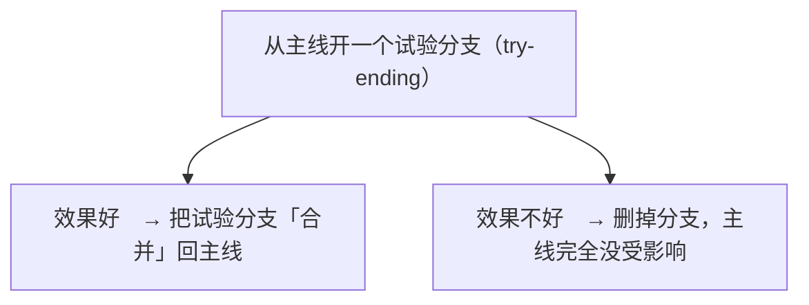

**如果试验效果好** → 把试验分支「合并」回主线
**如果效果不好** → 删掉分支，主线完全没受影响

**这就是分支的价值：让你放心大胆地尝试，不用担心搞坏主线。**

#### 分支在实际工作中的用法

专业团队的标准做法：

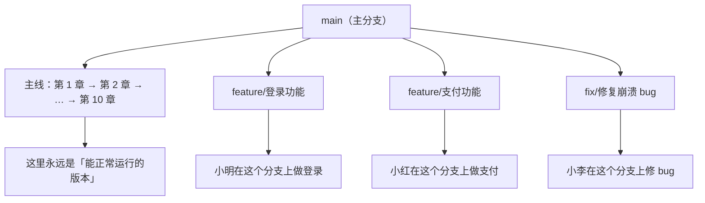

**每个人在自己的分支上干活，互不干扰。做完了再合并回 main。**

**这就解决了「多人同时改同一个项目」的混乱问题。**

#### 概念三：合并（merge）= 把分支的成果合回主线

```bash
git checkout main          # 切回主分支
git merge feature/登录功能  # 把登录功能分支合并进来
```

**如果两个人改了同一个文件的同一行** → 会**冲突**（conflict）。

Git 不知道该听谁的，会标出来让你手动决定。

**冲突不可怕**，它是正常现象。解决它只是「看一下两边分别改了什么，选一个（或者手动合并）」。

---

### 三、Git vs GitHub：很多人搞混了

**这两个是完全不同的东西。**

| | Git | GitHub |
|---|---|---|
| **是什么** | 一个**软件**（版本控制系统） | 一个**网站**（代码托管平台） |
| **装在哪** | 你自己的电脑上 | 远程服务器上 |
| **能离线用吗** | 能 | 不能 |
| **谁做的** | 林纳斯·托瓦兹（Linux 之父） | GitHub 公司（现属微软） |
| **比喻** | 相机（拍照的工具） | 相册网站（存照片、分享的地方） |

**简单说：**

> **Git 是你电脑上的版本管理工具；GitHub 是把这些版本传到网上，用来备份和协作的平台。**

**GitHub 的替代品还有**：GitLab、Gitee（国内码云）、Bitbucket。

**在中国**，因为网络原因，很多人也用 **Gitee**。

---

### 四、为什么 Git 这么重要？

#### 理由一：它是「后悔药」

你改了代码，改崩了，想回到昨天的版本？

**一条命令的事。**

没有 Git？那就只能凭记忆改回来（可能改不回去了）。

#### 理由二：它是团队协作的基础

**没有 Git，多人协作基本不可能。**

（想象 20 个人同时改同一个文件夹里的文件，那是什么场面。）

#### 理由三：它是找工作的基本技能

**几乎所有技术岗位都要求会用 Git。**

**这是面试必问、入职必备的技能。**

#### 理由四：它让「尝试」变得安全

有了分支，你可以放心大胆地试着改代码。改砸了？删掉分支就行。

**这对学习极其重要**——你敢动手试了。

#### 理由五：它是开源世界的枢纽

全世界的开源项目都在 GitHub 上。你要用别人的代码、参与开源、展示自己的作品，都要通过它。

---

### 五、最常用的操作（够用版）

你不需要学完 Git 的所有命令。下面这些够你用很久：

```bash
# 一、开始：把 Git 引入你的项目
git init                    # 在当前文件夹初始化 Git

# 二、日常：保存版本（这个循环你会用一辈子）
git status                  # 看看现在改了哪些文件（超常用）
git add .                   # 把所有改动加入待提交区
git commit -m "说明"         # 提交（拍快照）

# 三、查看历史
git log                     # 看看过去提交的历史
git log --oneline           # 简洁版（推荐）

# 四、后悔药
git checkout 文件名          # 撤销这个文件的改动（回到上次提交的状态）
git reset --hard 版本号      # 整个项目回滚到某个版本（谨慎！）

# 五、分支
git branch                  # 看看有哪些分支
git branch 新分支名          # 创建新分支
git checkout 分支名          # 切换到某个分支
git merge 分支名             # 把某个分支合并到当前分支

# 六、连接远程仓库（GitHub）
git remote add origin 仓库地址
git push                    # 把本地的提交推送到 GitHub（备份/分享）
git pull                    # 从 GitHub 拉取别人的最新改动
git clone 仓库地址           # 把别人的项目整个下载到本地
```

**记住前四个就够你开始用了。**

---

### 六、一个重要的习惯：`.gitignore`

有个文件叫 `.gitignore`，它的作用是：**告诉 Git 哪些文件不要跟踪。**

**为什么需要它？**

因为项目里有些文件不该被提交：

- 密码、密钥（**极其重要！提交上去就泄露了**）
- 依赖包（几万个文件，没必要）
- 编译生成的临时文件
- 个人配置文件

**例子**（Python 项目的 `.gitignore`）：

```
# 不要提交这些
__pycache__/
*.pyc
.env          ← 存放密码的文件，绝对不能提交！
venv/
.DS_Store
```

> ### ⚠️ 一个真实的惨案
>
> 经常有人不小心把**数据库密码、云服务的密钥**提交到公开的 GitHub 仓库。
>
> 几分钟内就会有机器人扫描到，然后用你的密钥去挖矿——**你可能因此损失几千到几十万。**
>
> **所以：任何密钥、密码、token，永远不要提交。放进 `.gitignore`。**

---

### 七、Git 的学习曲线（以及怎么跨过去）

坦诚地说：**Git 是有学习曲线的。** 它的概念（工作区、暂存区、HEAD、rebase……）对新手不友好。

**但我要给你一个务实的建议：**

#### 不要试图「学完 Git 再用」

**先用起来。** 就三个命令：

```bash
git add .
git commit -m "说明"
git status
```

**用这三个命令开始做你的项目。** 遇到需要别的（分支、回滚、推送）时，再去查。

**这样你会自然地学会它**，而不是在概念里淹死。

#### 新手常见困惑的解答

| 困惑 | 解答 |
|---|---|
| 「`add` 和 `commit` 为什么要分两步？」 | `add` 是「挑选要拍进去的文件」，`commit` 是「按下快门」。给你一个确认的机会。 |
| 「我 commit 之后发现写错了说明怎么办？」 | 可以改（`git commit --amend`），但别改已经推送出去的。 |
| 「提交历史很乱，怎么办？」 | 新手不用管。**历史乱一点不影响功能。** 等你有经验了再学整理。 |
| 「分支太多会乱吗？」 | 会。所以用完的分支及时删掉。 |
| 「我怕把项目搞坏」 | **Git 的好处就是几乎搞不坏。** 只要 commit 过，就能找回来。大胆试。 |

---

### ✅ 本章重点回顾

1. **Git 解决「版本混乱」问题**（报告_final_真的最终版.doc 那种噩梦），给整个项目拍快照，是程序员的时光机和后悔药；最常用的循环是 `git status` → `git add .` → `git commit -m "说明"`。

2. **三个核心概念**：commit（拍快照，每完成一个小进展就提交）、branch（平行宇宙，让你放心试验、多人互不干扰）、merge（合并回主线，冲突是正常现象）。

3. **Git 是软件（工具），GitHub 是网站（平台），两者完全不同**；`.gitignore` 极其重要——**密码/密钥/token 永远不要提交**，否则会被机器人扫描盗用造成巨额损失；学习建议是「先用起来，需要时再查」，不要试图学完再用。

---

### 🤔 想一想

> 假设你写了一个程序，改着改着把它改崩了，而且你不记得自己改了哪些地方。
>
> **1. 如果你之前每次小进展都 commit 过，你会怎么恢复到「还能跑」的状态？**
> **2. 如果你一次都没 commit 过呢？**
>
> 再想一个更实际的问题：
>
> **3. 你愿意为了「将来可能的后悔」，现在养成每完成一小步就 commit 的习惯吗？**（诚实回答——如果你觉得麻烦，那很正常；但请你至少在「做大改动之前」commit 一次，这是最低限度的保险。）

---

## 第 36 章 包管理与 AI 助手：站在巨人肩膀上

> ## 🎯 本章目标
>
> 读完这一章，你应该能够：
> - 理解「包管理器」是什么，以及为什么它是现代编程的核心
> - 知道怎么安全地引入第三方库
> - 掌握正确使用 AI 编程助手的方法
> - 避开「幻觉性胜任」这个大坑

---

### 一、包管理：不要重复造轮子

#### 先讲一个道理

第 19 章讲过 DRY 原则。第 15 章讲过开源。

**这两个结合，就有了「包管理」——现代编程最重要的基础设施之一。**

#### 什么是「包」？

> **包（package / library）= 别人写好的、你能直接拿来用的代码。**

也叫「库」「依赖」「模块」。

#### 一个震撼的对比

假设你要「读取一个 Excel 文件，算出每个地区的销售总额」。

**从零开始写：**

1. 学习 Excel 文件格式（.xlsx 其实是个压缩包，里面是 XML）
2. 解析 XML
3. 处理日期格式、合并单元格、公式……
4. 大概要写几千行代码，还可能有 bug

**用现成的包：**

```python
import pandas as pd

数据 = pd.read_excel("销售.xlsx")
print(数据.groupby("地区")["销售额"].sum())
```

**三行。**

**这就是「不要重复造轮子」的真实含义——不是一句口号，是实实在在的几千行 vs 三行。**

---

### 二、包管理器是什么？

#### 问题：手动管理包太麻烦

早期的做法是：去网上找到库的压缩包 → 下载 → 解压 → 放到项目里 → 祈祷版本兼容。

**问题来了：**

- 这个库自己又依赖另外 3 个库 → 你也要下载那 3 个
- 那 3 个又各依赖……（这叫「依赖地狱」）
- 版本冲突：A 库要 1.0 版，B 库要 2.0 版，冲突了
- 更新麻烦

#### 包管理器的答案：自动化

**你只要说「我要这个库」，它自动：**

1. 找到它
2. 下载
3. 把它依赖的所有东西也下载好
4. 解决版本冲突
5. 装到正确位置

**各语言的包管理器：**

| 语言 | 包管理器 | 仓库 |
|---|---|---|
| **Python** | pip / conda / poetry | PyPI |
| **JavaScript** | npm / yarn / pnpm | npmjs.com（全球最大） |
| **Java** | Maven / Gradle | Maven Central |
| **Go** | go modules | — |
| **Rust** | cargo | crates.io |
| **C#** | NuGet | — |
| **Ruby** | gem | RubyGems |

#### 最常用的样子

```bash
# Python：装一个叫 requests 的库（用来发网络请求）
pip install requests

# JavaScript：装 lodash
npm install lodash
```

**就一行。**

---

### 三、怎么选一个靠谱的包？

既然有几十万个包，怎么知道哪个该用？

#### 五个判断标准

##### 1. 是否还在维护？（最重要）

**看最后一次更新时间。**

- 三个月内有更新 → 活跃 ✓
- 三年没更新 → 谨慎（但不一定不能用，成熟的工具也可能稳定到不需要改）

##### 2. 有多少人用？

- **下载量**：npm/PyPI 页面上会显示
- **GitHub 星标数**：几千星以上通常是靠谱的

**用的人多 = 遇到问题容易搜到答案。**

##### 3. 文档好不好？

一个包就算功能再强，文档糟糕也会让你痛苦不堪。

**看它有没有清晰的「快速开始」教程。**

##### 4. 有没有活跃的社区？

- GitHub 上 issue 有没有人回复
- Stack Overflow 上相关问题多不多

##### 5. 依赖多不多？

**依赖越少越好。** 一个包依赖 100 个其他包，意味着：

- 安装慢
- 更容易出冲突
- 安全风险更大

#### 一个重要的安全提醒

> ### ⚠️ 不要随便装来路不明的包
>
> 包管理器上的代码是**可以直接在你电脑上执行的**。
>
> 有过真实案例：有人发布了一个名字很像常用库的「恶意包」（比如把 `requests` 拼成 `reqeusts`），等你装了之后偷你的密码。
>
> **防范措施：**
> - 装之前确认名字拼对
> - 优先装大家都用的、星标多的
> - 不要在不信任的地方复制安装命令

---

### 四、AI 编程助手：你的新同事

现在讲当下最热门的部分。

#### 它们能做什么？

现在的 AI 编程助手（GitHub Copilot、Cursor、ChatGPT、Claude、通义灵码等）能：

| 能力 | 说明 |
|---|---|
| **生成代码** | 你描述要什么，它写出来 |
| **解释代码** | 你贴一段看不懂的代码，它解释 |
| **找 bug** | 你贴报错信息，它分析原因 |
| **重构** | 「帮我把这段代码改得更清晰」 |
| **写测试** | 自动生成测试代码 |
| **写文档/注释** | — |
| **转译** | 「把这段 Python 改成 JavaScript」 |

**这些能力是真实的，而且每天都在变强。**

#### 它们带来的巨大好处

##### 好处一：学习门槛大幅降低

以前你卡在一个 bug 上可能要搜两小时。**现在问 AI，30 秒。**

**这对初学者是巨大的福音。**

##### 好处二：它是最好的「私人教师」

**你可以让它：**

- 「用一个完全不同的比喻再解释一遍」
- 「我是 10 岁小孩，请用最简单的语言解释」
- 「给我举个例子」
- 「我这样理解对不对？」

**这种「无限耐心、随叫随到、可以反复追问」的老师，历史上从未有过。**

##### 好处三：消灭了大量机械劳动

样板代码、格式化、写注释、写重复的测试……这些 AI 都很快。

**你可以把精力放在真正需要思考的地方。**

---

### 五、最大的陷阱：幻觉性胜任

现在讲风险。这是本章**最重要**的部分。

#### 什么是幻觉性胜任？

> **你拿到 AI 给的代码，复制粘贴，跑通了，你觉得自己会了。**
>
> **但你并没有理解它。**

这就是「幻觉性胜任」（illusion of competence）——**感觉自己很厉害，实际上一遇到变化就抓瞎。**

#### 为什么这很危险？

**三个后果：**

##### 后果一：你能跑通，但改不动

需求稍微一变（比如「再加个条件」），你就不知道改哪里。

**因为你不知道代码的结构。**

##### 后果二：出了 bug 你不会修

AI 给的代码，在某个边界情况下会出错。**你不知道为什么，因为你不理解它。**

##### 后果三：你会卡在「中等难度」

简单的（AI 直接给）能做，复杂的（需要你自己设计）做不了。

**你的能力上限被锁死了。**

#### 怎么避免？四条规则

##### 规则一：先自己想，再看 AI 的答案

**遇到问题时：**

1. 先自己想 5 分钟，甚至试着写一下
2. 卡住了，再看 AI 的答案
3. **对比：它跟我哪里想得不一样？为什么？**

**这个「对比」的过程，就是真正的学习。**

##### 规则二：让 AI 解释，而不是只给代码

❌ 「帮我写个排序函数」→ 复制走人

✅ 「帮我写个排序函数，**并且逐行解释它在做什么**」

**然后你要真的看懂每一行的解释。看不懂就追问。**

##### 规则三：追问「为什么」

AI 给了答案之后，继续问：

- 「为什么用这种方法，而不是另一种？」
- 「如果数据量很大，这个方案还行吗？」
- 「有没有更简单的写法？」

**这些问题会让你理解得更深。**

##### 规则四：定期「不用 AI」练习

**偶尔关掉 AI，纯靠自己写一个小东西。**

你会立刻发现自己的真实水平。

**这是难受但极其有价值的自检。**

---

### 六、正确使用 AI 的「姿势」对比表

| 场景 | ❌ 错误用法 | ✅ 正确用法 |
|---|---|---|
| **写代码** | 「写个记账程序」→ 直接用 | 「我要做记账，我打算这样设计……帮我看看有没有问题」 |
| **遇报错** | 把错误丢给 AI 要答案 | 先自己猜原因 → 问 AI 验证我的猜测对不对 |
| **看不懂** | 跳过 | 「请用三种不同的比喻解释这个概念」 |
| **学概念** | 让它直接给代码 | 「先讲原理，再给最简单的例子，然后让我自己试一版」 |
| **做完之后** | 结束 | 「我这样写有什么问题？还能怎么改进？」 |

> ### 💡 一句话原则（再强调一次）
>
> **让 AI 当你的私人教练，不要让它当枪手。**
>
> 教练教你做，你学会了；
> 枪手替你做，你什么都没学到。

---

### 七、一个重要的判断：AI 时代还要学基础吗？

**要，而且更要学。**

#### 理由

AI 能给你代码，**但它不能替你：**

1. **判断这段代码对不对**（你得有判断力）
2. **知道该让它写什么**（你得理解问题）
3. **发现它在胡说八道**（AI 会「幻觉」，编造不存在的函数、过时的 API）
4. **为结果负责**（出了事是你担责，不是 AI）

**这些能力，全部建立在「你懂基础」之上。**

> ### 📌 一个精准的比喻
>
> **AI 就像一个极其熟练但完全不了解你业务的实习生。**
>
> 你给它非常明确的指令，它能做得又快又好。
>
> 但如果你自己都不清楚要什么，**你没法给它明确的指令**——它只能瞎猜，而你看不出它猜错了。
>
> **所以：你的水平越高，AI 对你的加成越大。**
>
> 对高手，AI 是 10 倍效率放大器；对完全不懂的人，AI 是「看起来能跑的黑盒子」。

---

### 八、第五关总结

第五关（第 33–36 章）讲完了工具箱。你现在知道：

| 工具 | 它解决什么 |
|---|---|
| **编辑器/IDE** | 写代码的效率（高亮、补全、报错、调试） |
| **命令行** | 批量操作、远程管理、自动化 |
| **Git** | 版本管理、后悔药、团队协作 |
| **包管理器** | 用别人的代码，不重复造轮子 |
| **AI 助手** | 加速学习和开发（但要当教练用，别当枪手） |

**这些工具加起来，构成了「现代程序员的工作方式」。**

**你可能注意到了：这些工具里，没有一个跟「某门语言的语法」有关。**

**再次印证了那句话：工具是会变的，但核心能力和思维方式是通用的。**

**接下来第六关（第 37–46 章），我们终于要动手写代码了。**

---

### ✅ 本章重点回顾

1. **包管理器让你「说一句我要这个库」，它自动下载+处理依赖+解决版本冲突**（Python 用 pip、JS 用 npm）——这让「几千行代码」变成「三行」，是「不重复造轮子」从口号变成现实的原因。

2. **选包看五点**：是否还在维护、多少人用（下载量/星标）、文档好不好、社区活不活跃、依赖多不多；**⚠️ 不要装名字可疑的包**（有真实的「恶意包」偷密码案例）。

3. **AI 助手最大的陷阱是「幻觉性胜任」**——复制粘贴跑通了以为自己会了，实则改不动、修不了 bug、能力被锁死；四条规则：先自己想再看答案、让 AI 解释而非只给代码、追问为什么、定期不用 AI 自检；**你的水平越高，AI 的加成越大**。

---

### 🤔 想一想

> 请诚实地回忆一次你「用 AI 解决了问题但没搞懂原理」的经历（如果有的话）。
>
> **然后回答：**
> 1. 那个问题现在让你**再做一遍**，你还能做出来吗？
> 2. 如果需求**稍微变一点**（比如加个条件、换个数据源），你能改吗？
> 3. 你当时**省下的时间**，后来有没有以别的形式「还回去」？（比如之后遇到类似问题又要重新问一遍）
>
> （这个自我检视很重要。如果三个答案都不乐观——别自责，这是绝大多数人的状态。只要从现在开始，每次用 AI 时多问一句「为什么」，情况就会改变。）

---

# 第六关　上手实践

> 从搭环境开始，把变量、类型、运算符、条件、循环、函数、列表与字典、文件读写一路走完。
>
> 最后一章会做一个能真正跑起来的命令行小工具。

## 第 37 章 开工：搭建你的第一个编程环境

> ## 🎯 本章目标
>
> 读完这一章，你应该能够：
> - 在自己的电脑上装好 Python 和 VS Code
> - 写出并运行第一行代码
> - 理解「写代码 → 运行 → 看到结果」这个循环
> - 知道遇到问题该去哪里找答案

> ### 📌 从本章开始的重要约定
>
> 从这一章到第四十六章，你会看到大量代码示例。
>
> **它们都是「概念演示」，不是 Python 教程。**
>
> 我会用最接近人话的写法，目的是让你理解**概念本身**。真正的 Python 写法可能略有不同（更多符号、更严格），但**背后的道理完全一样**。
>
> 你在别的语言里学到的同一个概念，写法不同，但**骨子里是一回事**。

---

### 一、安装 Python

#### 三步走

##### 步骤 1：下载

打开 Python 官网：**https://www.python.org**

点 Downloads，它会自动推荐适合你系统的版本。

**注意**：确保是 **Python 3.x**（现在都是，比如 3.12、3.13）。

> ### ⚠️ 一个提醒
>
> **不要下载 Python 2。** 它 2020 年就停止维护了。
>
> 如果你搜到的教程里有 `print "hello"` 这种不带括号的写法，那是 Python 2 的老古董写法，别学。

##### 步骤 2：安装

双击安装包，一路点「继续」。

**⚠️ 有一个关键选项：安装界面的第一个选项「Add Python to PATH」一定要勾上！**

（Windows 用户特别注意这个。没勾的话，后面在命令行里敲 `python` 会提示「找不到命令」。）

##### 步骤 3：验证

打开命令行（第 34 章），输入：

```bash
python --version
```

如果显示 `Python 3.13.x` 之类的版本号，**恭喜，装好了**。

如果提示「找不到命令」，说明 PATH 没配好——**搜一下「Python 安装后提示找不到命令」**，这是最常见的坑，网上答案很多。

#### Mac 用户注意

Mac 自带一个 Python 2（很老）。你装了新版本之后：

- 用 `python3` 命令来调用新版
- 用 `pip3` 来装包

**这是个历史遗留的麻烦，照着做就行。**

---

### 二、安装 VS Code

#### 三步走

1. 打开 **https://code.visualstudio.com**
2. 下载，安装
3. 打开后，装这个插件：**Python**（微软官方出的，搜索「Python」第一个就是）

**其他插件先别装**（第 33 章说过，别在工具上耗太久）。

---

### 三、你的第一行代码

现在，我们来写那个仪式感十足的程序。

#### 步骤 1：建个文件夹

在你喜欢的地方（比如桌面），建个文件夹叫 `我的代码`。

**为什么？** 因为以后你的程序会越来越多，有个专门的地方管理，不容易丢。

#### 步骤 2：新建文件

打开 VS Code → 文件 → 新建文件。

输入这一行：

```python
print("你好，编程世界")
```

**然后保存**，命名为 `hello.py`，放在刚才那个文件夹里。

**（`.py` 是 Python 文件的后缀，必须加）**

#### 步骤 3：运行

有几种方式：

**方式一（最简单）**：点击 VS Code 右上角的「运行」按钮（三角形图标）。

**方式二**：在文件上点右键，选「在终端中运行 Python 文件」。

**方式三（命令行）**：打开终端，`cd` 到那个文件夹，然后输入：

```bash
python hello.py
```

#### 步骤 4：看到结果

```
你好，编程世界
```

**🎉 恭喜！你写出了人生第一个程序。**

---

### 四、这一行代码在说什么？

别小看这一行。它包含了编程最基本的骨架。

```python
print("你好，编程世界")
```

拆开看：

| 部分 | 是什么 | 说明 |
|---|---|---|
| `print` | **函数名** | 一个现成的「功能」，它的作用是「把东西显示在屏幕上」 |
| `(` `)` | 调用标志 | 表示「用一下这个功能」 |
| `"你好，编程世界"` | **参数（数据）** | 你要它显示的内容 |

**用第 5 章的骨架看：**

- **输入**：这句话的内容（写死在代码里）
- **处理**：几乎没有（就是把内容传过去）
- **输出**：显示在屏幕上

**用第 18 章的抽象看：**

- `print` 是一个**接口**
- 你不需要知道它内部是怎么把文字画到屏幕上的（那涉及操作系统、显卡驱动……）
- **你只知道它的名字、输入、输出** → 这就是抽象的力量

---

### 五、「写代码 → 运行 → 看结果」循环

这是你接下来所有学习的**核心节奏**。

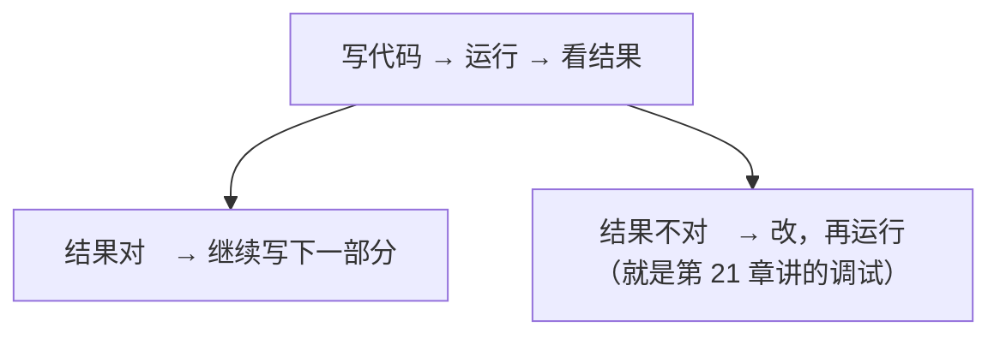

**这个循环越快，你学得越快。**

这就是为什么我一直强调「解释型语言对新手友好」（第 24 章）——**你改一行，立刻能看到结果**。

#### 一个重要的技巧：别怕试

**你现在的地位是：一台你自己的电脑，怎么搞都不会爆炸。**

所以：

- 改改数字看看会怎样
- 故意写错看看报错长什么样
- 试试把引号去掉会怎样
- 试试 `print(1 + 1)` 会输出什么

**「试」是你最好的老师。** 每一个「咦？怎么会这样」的时刻，都是真正的学习。

---

### 六、两种写代码的方式

#### 方式一：写文件（.py 文件）

就是你刚才做的：写成一个文件，然后运行整个文件。

**适合**：正式的程序、要保存下来的东西。

#### 方式二：交互式（REPL）

打开命令行，输入 `python`，你会看到：

```
>>> 
```

然后你可以一行一行地输入代码，**输一行执行一行**：

```
>>> print("你好")
你好
>>> 1 + 1
2
>>> 名字 = "张三"
>>> print(名字)
张三
```

**这就是「交互式环境」**（REPL：Read-Eval-Print Loop，读取-执行-打印-循环）。

**它适合什么？**

**试验！** 当你不确定某个写法对不对时，在这里试一下，立刻知道结果。

> ### 💡 强烈建议你习惯用它
>
> **「不确定这行代码会输出什么？在交互式里试一下」**——这是个极好的习惯。
>
> 比写在文件里再运行快得多，也让你敢于试验。

**退出交互式**：输入 `exit()` 或者按 `Ctrl+D`（Mac）/ `Ctrl+Z`（Windows）。

---

### 七、遇到问题时怎么办？

你一定会遇到问题。这不是「如果」，是「一定」。

**关键是：你会不会自己找答案。**

#### 找答案的正确姿势

##### 第一招：读懂错误信息

第 21 章讲过。**从最后一行看起，错误类型名就是线索。**

##### 第二招：复制错误信息去搜索

**这是最有效的一招。**

操作：

1. 复制报错的最后一行
2. 粘到搜索引擎（Google / Bing / 百度）
3. **去掉跟你项目相关的具体名字**（比如你的文件名、变量名），只留通用的错误部分

**为什么这招这么有效？**

因为**你遇到的问题，99% 别人已经遇到过并且问过了**。

程序员有句话：**「程序员的核心技能不是写代码，是搜索。」**

##### 第三招：问 AI

把错误信息和你的代码一起贴给 AI。

**但记住第 36 章的原则**：让它解释，别只让它给答案。

##### 第四招：查官方文档

**这是最权威的来源**，但通常写得比较「干」，不适合新手。

**什么时候用**：当你想搞清楚某个功能的准确用法时。

#### 搜索的一个小技巧

加上关键词能大幅提高命中率：

- ❌ `python 报错` （太宽泛）
- ✅ `python TypeError can't multiply sequence by non-int`
- ✅ `python 读取 excel 文件 报错 PermissionError`

**英文搜索通常结果更好**（技术内容的英文资料多得多）。

---

### 八、给完全零基础的你：几条保命建议

#### 建议一：代码一定要自己敲一遍

**不要复制粘贴，不要只看。**

我知道书上（包括本书）的代码你都能看懂。**但「看懂」和「会写」是两回事。**

**大脑和手指是两套记忆。** 你必须让手指也记住。

#### 建议二：允许自己写出「丑」代码

你的第一个程序会很笨拙。那很正常。

**所有程序员的代码，回看三个月前写的都觉得丑。** 这是进步的证据。

#### 建议三：每天写一点，比一周写一次强

**编程是技能，不是知识。** 技能需要频率，不是单次时长。

每天 30 分钟，好过周末突击 5 小时。

#### 建议四：遇到卡住，先休息

第 21 章讲过。**卡半小时以上，去走走。**

---

### ✅ 本章重点回顾

1. **安装 Python 要勾上「Add Python to PATH」，装 VS Code 后只需装官方 Python 插件**（别在插件上耗时间）；第一行代码 `print("你好，编程世界")` 包含了编程最基本的骨架：函数（print）+ 参数（内容）→ 输出。

2. **核心节奏是「写代码 → 运行 → 看结果」的循环**——循环越快学得越快；**交互式环境（命令行输入 `python` 进入）是试验神器**，不确定某行代码会输出什么就在这里试。

3. **遇到问题：读懂错误信息（看最后一行）→ 复制错误去搜索（去掉具体名字）→ 问 AI → 查文档**；程序员的核心技能是搜索；**代码一定要自己敲一遍**（看懂≠会写），每天写一点胜过周末突击。

---

### 🤔 想一想

> 现在，请你真的去做这几件事（不是想一想，是做）：
>
> 1. 装好 Python 和 VS Code
> 2. 写出并运行 `print("你好，编程世界")`
> 3. **在交互式环境里试一试这些，看看分别输出什么**：
>    - `print(1 + 1)`
>    - `print("1" + "1")`
>    - `print(10 / 3)`
>    - `print("你好" * 3)`
>    - `print(2 > 5)`
>
> （先猜，再运行，看看猜对了几个。**猜错的那些特别有价值**——它们暴露了你的直觉跟计算机行为的差距，记住它们。）

---

## 第 38 章 变量：给信息贴上标签

> ## 🎯 本章目标
>
> 读完这一章，你应该能够：
> - 理解变量是什么（用一个忘不掉的比喻）
> - 知道怎么给变量起好名字
> - 理解「赋值」和「等于」的区别（这是新手的经典困惑）
> - 知道变量为什么是编程最基础的概念

---

### 一、变量是什么？

> ### 💡 核心比喻：贴了标签的盒子
>
> **变量 = 一个盒子，里面装着数据，盒子外面贴了张标签（名字）。**
>
> 你要用数据的时候，不用记「数据在哪」，只要说「给我那个叫『年龄』的盒子」就行。

#### 为什么需要它？

**因为没有变量，你就得直接跟内存地址打交道。**

回忆第 4 章：内存里的数据都有地址（像 `0x7fff5a3c` 这种）。

**没有变量的写法**（想象一下）：
```
把数字 25 存到地址 0x7fff5a3c
把地址 0x7fff5a3c 里的值取出来，加上 1，再存回去
```

**有变量的写法**：
```python
年龄 = 25
年龄 = 年龄 + 1
```

**变量名就是「给内存地址起了个人能记住的名字」。**

**这就是第 18 章说的抽象——把「内存地址」抽象成「人类起的名字」。**

---

### 二、怎么用变量？

#### 创建变量（专业说法叫「赋值」）

```python
# 概念演示：创建变量

年龄 = 25
姓名 = "张三"
是否会员 = 真
价格 = 19.9
```

**就这么简单：名字 = 值**

**注意**：这里的 `=` 不是数学里的「等于」！

#### ⚠️ 关键区分：`=` 是「赋值」，不是「等于」

这是新手最经典的困惑，我必须讲清楚。

**数学里**：`x = 5` 表示「x 等于 5」，是个**陈述**（事实）。

**编程里**：`x = 5` 表示「**把 5 放进名为 x 的盒子里**」，是个**动作**。

**证据：**

```python
# 这在数学里是荒谬的
x = x + 1

# 但在编程里完全正常！
```

**为什么？**

因为编程里的 `=` 是动作：「把右边算出来的结果，放进左边的盒子里」。

所以 `x = x + 1` 的意思是：

1. 先看右边：`x + 1`（把 x 现在的值取出来，加 1）
2. 再把结果放进 x 这个盒子

**执行前 x=5，执行后 x=6。**

> ### 📌 记住这个读法
>
> 看到 `a = b`，**不要读「a 等于 b」，要读「把 b 放进 a」**。
>
> 这个读法能帮你避开无数的困惑。

#### 那「判断相等」用什么？

用 `==`（两个等号）。

```python
如果 年龄 == 18:        # 判断：年龄是不是等于 18
    显示("刚好成年")

年龄 = 18               # 赋值：把 18 放进「年龄」这个盒子
```

**记住：**
- `=` ：放进去（动作）
- `==` ：是不是相等（判断）

**把这两个搞混，是新手最常见的 bug 之一**（第 23 章讲过 C 语言里 `if (x = 5)` 那个经典陷阱）。

---

### 三、变量是可以变的

**「变量」这个名字本身就说明了它的特点：它会变。**

```python
# 概念演示：变量会变

余额 = 1000
显示(余额)          # 1000

余额 = 余额 - 200   # 花了 200
显示(余额)          # 800

余额 = 余额 + 500   # 又存了 500
显示(余额)          # 1300
```

**盒子还是那个盒子，里面的东西换了。**

#### 变量甚至可以装不同类型的东西

在 Python 这类动态类型语言里（第 24 章）：

```python
东西 = 100          # 现在装的是数字
东西 = "你好"        # 现在装的是文字（可以！）
东西 = [1, 2, 3]    # 现在装的是列表（也可以！）
```

**这是「动态类型」的特点。**

**但我要给你一个忠告：**

> ### ⚠️ 虽然能这么做，但请不要这么做
>
> **一个变量，最好从头到尾只装同一种类型的东西。**
>
> 为什么？因为三个月后的你（或者别人）看到 `东西` 这个变量，会不知道它现在是数字还是文字。
>
> **这会让代码变得极难理解和维护。**

**好的习惯**：变量的类型保持稳定。要装别的东西，**换个新名字**。

---

### 四、起名字的艺术

**这是本章最实用的部分。**

#### 为什么命名这么重要？

因为有句话说得好：

> **「计算机科学中只有两件难事：缓存失效，和给东西起名字。」**（这是个名言）

**虽然它是半开玩笑，但命名确实是最被低估的技能。**

#### 坏名字 vs 好名字

| ❌ 坏名字 | ✅ 好名字 | 为什么 |
|---|---|---|
| `a`、`b`、`x` | `年龄`、`总价` | 看名字就知道装的是什么 |
| `data` | `用户列表` | 具体 |
| `temp` | `临时文件名` | temp 是什么的临时？ |
| `flag` | `是否已登录` | 明确表达「是什么状态」 |
| `num` | `订单数量` | 什么的数量？ |
| `zhangsan` | `当前用户` | 别用具体的人名（万一换了人呢） |

#### 三条命名原则

##### 原则一：名字要说明「是什么」，不是「怎么用」

- ❌ `列表1`（这是第一个列表？还是装 1 的列表？）
- ✅ `待办事项`

##### 原则二：不要怕长

- ❌ `n`（看不出是什么）
- ✅ `本月新增用户数`（长，但一眼就懂）

**现代编辑器有自动补全**（第 33 章），长名字不会让你多打多少字。

##### 原则三：保持一致的风格

常见风格：

- **下划线式**（Python 常用）：`user_name`、`total_price`
- **驼峰式**（Java/JS 常用）：`userName`、`totalPrice`

**选一种，然后整份代码保持一致。** 混用会让人看着难受。

#### 命名的两个禁忌

**禁忌一：不要用语言的关键字**

比如 `if`、`for`、`class`、`print`——这些词有特殊含义，不能当变量名。

**禁忌二：不要用拼音和英文混着来**

- ❌ `yonghu_list`（不伦不类）
- ✅ 要么全拼音 `yonghu`（不推荐），要么全英文 `user_list`（推荐）

**如果你英语不好**：用中文变量名也完全可以（Python 支持中文变量名），或者用拼音——**但要在整个项目里保持一致**。

**一致性 > 具体用哪种风格。**

---

### 五、变量在哪儿「活着」？（作用域初探）

这里有个重要的概念，我简单提一下（后面第 43 章会细讲）。

#### 问题：变量在哪都能用吗？

**不是。**

```python
# 概念演示：变量有"地盘"

函数 算账():
    小计 = 100          # ← 这是在"函数内部"创建的
    显示(小计)

算账()
显示(小计)              # ❌ 报错！小计 在这里不存在
```

**为什么？**

因为 `小计` 是在函数「内部」创建的，它是**局部变量**——只在那个函数里有效。

**类比**：你在自己办公室抽屉里放的东西，出了办公室就找不到了。

#### 「作用域」是什么？

> **作用域 = 一个变量能被使用的范围。**

- **局部变量**：只在某个函数/代码块内有效
- **全局变量**：整个程序都能用

#### 为什么要这样设计？

**因为这样能避免「名字冲突」。**

想象一下：如果所有变量都是全局的，你写了个 `总数`，别人也写了个 `总数`——**冲突了，而且极难排查**。

有了作用域，**每个函数可以有自己的 `总数`，互不干扰。**

> ### 💡 一个实用建议
>
> **尽量用局部变量，少用全局变量。**
>
> 全局变量会让代码变得难以理解和修改（任何地方都可能改它，出问题了你不知道是哪儿改的）。
>
> 这是「封装」思想的体现（第 18 章）：**把东西限制在需要它的最小范围内**。

---

### 六、一个完整的例子

把这一章串起来：

```python
# 概念演示：变量综合示例 —— 计算一次购物

# 一、准备数据（用变量存起来）
商品名 = "机械键盘"
单价 = 299
数量 = 2
会员折扣 = 0.9

# 二、计算（变量会变）
小计 = 单价 * 数量
应付 = 小计 * 会员折扣

# 三、输出
显示("商品：" + 商品名)
显示("单价：" + 单价 + " × " + 数量)
显示("应付：" + 应付 + " 元")

# 四、变量可以更新
余额 = 1000
余额 = 余额 - 应付
显示("付款后余额：" + 余额 + " 元")
```

**注意这些细节：**

- 每个变量都有**说明性的名字**（`单价` 而不是 `a`）
- `余额 = 余额 - 应付` 用的是**赋值**（不是等于）
- 变量在计算过程中**被更新**

---

### ✅ 本章重点回顾

1. **变量 = 贴了标签的盒子，本质是把「内存地址」抽象成人能记住的名字**（抽象的又一次胜利）；核心是 **`=` 是「赋值」（把右边放进左盒）而不是「等于」**，判断相等用 `==`。

2. **变量会变（名字就说明了这点）；动态类型语言里同一个变量能装不同类型，但请不要这么做**——保持类型稳定，否则三个月后你不知道它装的是什么。

3. **命名的三条原则：说明「是什么」而非「怎么用」、不要怕长（有自动补全）、保持风格一致**；两个禁忌：别用关键字、别拼音英文混用；**作用域**让同名变量在不同函数中互不干扰，**尽量用局部变量少用全局**。

---

### 🤔 想一想

> 请看这段代码，说出每一行执行后 `x` 的值是多少：
>
> ```python
> x = 10
> x = x + 5
> x = x * 2
> x = x - 10
> x = x / 5
> ```
>
> **然后回答：**
> 1. 最终 `x` 是多少？（自己算，不要运行）
> 2. **这五行代码里，有几次是「赋值」？有几次是「判断相等」？**
> 3. 如果我把第 2 行写成 `x + 5`（不赋值），会怎样？
>
> （第三问的答案是关键：**`x + 5` 算出了一个结果，但你没把它放进任何盒子，所以它立刻就消失了。** 这就像你在草稿纸上算了个数，然后没记下来就扔了纸。）

---

## 第 39 章 数据类型：数字、文字与真假

> ## 🎯 本章目标
>
> 读完这一章，你应该能够：
> - 认识编程里最基本的几种数据类型
> - 理解为什么「类型」是必要的
> - 知道不同类型能做不同的事
> - 理解类型转换（以及它带来的坑）

---

### 一、为什么需要「类型」？

回忆第 6 章：计算机里一切都是 0 和 1。

**同一串 0 和 1，可以解读成不同的东西。**

比如 `01000001` 这串：

- 当**整数**解读 → 65
- 当**字符**解读 → 字母 `A`

**所以程序必须知道：「这串数据，我该按什么方式解读？」**

**这个「解读方式」就是类型。**

> ### 💡 一句话
>
> **类型 = 数据的「身份」——它是什么，能对它做什么。**

---

### 二、四种最基本的类型

几乎所有编程语言都有这四种。学会它们，你就掌握了 90% 的日常需求。

#### 类型一：整数（int）

**是什么**：没有小数部分的数字。

```python
年龄 = 25
订单数 = 1000
温度 = -5
```

**能做什么**：加减乘除、比大小、取余数。

#### 类型二：小数（float）

**是什么**：带小数点的数字。

```python
价格 = 19.9
圆周率 = 3.14159
折扣 = 0.85
```

**能做什么**：跟整数一样，但**有精度问题**（等下讲）。

#### 类型三：字符串（string / str）

**是什么**：文字。

```python
姓名 = "张三"
地址 = "北京市朝阳区"
消息 = "你好，世界"
```

**注意**：文字要用引号包起来（单引号双引号通常都行）。

**为什么要有引号？**

因为要区分「数字 123」和「文字 123」：

```python
数字 = 123        # 能拿来做数学运算
文字 = "123"      # 这是三个字符，不能做加法（做了会变成 "123123"）
```

**能做什么**：拼接、截取、查找替换、转大小写、算长度……

#### 类型四：布尔值（bool）

**是什么**：只有两个值——**真（True）** 和 **假（False）**。

```python
是否成年 = 真
是否已付款 = 假
是否下雨 = 真
```

**这是最简单的类型，但极其重要**——因为它是「判断」的基础（第 41 章）。

**布尔值从哪来？**

通常是「比较」的结果：

```python
年龄 = 20
是否成年 = 年龄 >= 18      # 结果是「真」
是否退休 = 年龄 >= 60      # 结果是「假」
```

---

### 三、类型是「能做什么」的说明书

这个视角很重要：**类型决定了你能对这个数据做什么操作。**

| 类型 | 能做的事 | 不能做的事 |
|---|---|---|
| **整数/小数** | 加减乘除、比大小 | 拼接（`"你好" + 123` 会出问题） |
| **字符串** | 拼接、截取、查找 | 做数学运算（`"10" - 3` 通常报错） |
| **布尔** | 且/或/非（逻辑运算） | 当数字用（虽然有些语言允许，但不该这么做） |

#### 一个真实的坑

```python
# ❌ 这会出问题
年龄 = "25"        # 注意：这是文字（带引号）
明年 = 年龄 + 1     # 报错！文字不能跟数字相加

# ✅ 正确
年龄 = 25          # 数字
明年 = 年龄 + 1     # 26
```

**这个坑有多常见？**

极其常见。尤其是**从用户输入或文件读取数据时**——那些来的通常都是文字。

```python
# 用户输入的一律是文字！
输入 = 读取用户输入()      # 用户输入了 "25"，拿到的是文字 "25"
结果 = 输入 + 1            # ❌ 报错

# 要先转成数字
数字输入 = 转成整数(输入)   # 现在变成数字 25 了
结果 = 数字输入 + 1         # ✅ 26
```

> ### 📌 记住这条规则
>
> **从「外部」进来的数据（用户输入、文件、网络），几乎都是文字。**
>
> **要用它做计算，必须先转成数字。**

---

### 四、类型转换

既然类型这么重要，就需要能在类型之间转换。

#### 常见的转换

```python
# 概念演示：类型转换

# 文字 → 数字
转成整数("25")        # 得到数字 25
转成小数("3.14")      # 得到数字 3.14

# 数字 → 文字
转成文字(25)          # 得到 "25"
转成文字(3.14)        # 得到 "3.14"

# 数字 → 布尔
转成布尔(0)           # 假（0 表示假，非 0 表示真）
转成布尔(1)           # 真
```

#### 转换会失败

```python
转成整数("abc")       # ❌ 报错！"abc" 不能变成数字
转成整数("")          # ❌ 报错！空字符串也不能
```

**这就是为什么第 22 章说要「处理异常」**（第 48 章会讲）：

```python
# 安全的做法
尝试:
    数字 = 转成整数(用户输入)
    显示("你输入的是：" + 数字)
如果失败:
    显示("请输入一个有效的数字")
```

---

### 五、两个你一定会遇到的坑

#### 坑一：小数的精度问题

**这个坑非常著名。**

```python
# 在几乎所有编程语言里：
0.1 + 0.2
# 结果不是 0.3！
# 而是 0.30000000000000004
```

**为什么？**

因为**有些小数在二进制里是除不尽的**。

就像十进制里「1/3 = 0.3333...」除不尽一样，**二进制里 0.1 也是除不尽的**（它是个无限循环小数）。

所以计算机只能存一个「近似值」，加起来的误差就暴露了。

**怎么应对？**

| 场景 | 做法 |
|---|---|
| **一般计算** | 不用管，误差小到无所谓 |
| **显示给用户** | 四舍五入到需要的位数再显示 |
| **比较是否相等** | **不要用 `==`！** 用「两者差值小于一个很小的数」来判断 |
| **涉及钱** | **极其重要**：用「分」做单位（整数运算），或者用专门的精确小数类型 |

> ### ⚠️ 关于钱的重要提醒
>
> **永远不要用浮点数（小数）来算钱。**
>
> 正确做法：把「元」转成「分」，用整数算。
>
> ```
> ❌ 19.9 + 0.1        （小数，可能有误差）
> ✅ 1990 + 10 = 2000  （以"分"为单位的整数，精确）
> ```
>
> 或者用语言提供的「精确小数」类型（Python 里有 `Decimal`）。

#### 坑二：字符串和数字的「+」

```python
# 数字 + 数字 = 加法
1 + 1           # 2

# 文字 + 文字 = 拼接
"你好" + "世界"   # "你好世界"

# 数字 + 文字 = ？
1 + "1"         # ❌ 在 Python 里会报错
```

**在 Python 里会报错**（这是好事，让你早点发现）。

**但在 JavaScript 里**：`1 + "1"` 得到 `"11"`（它把 1 转成文字再拼接）。

**这就是第 26 章说的「JavaScript 的坑」之一**——它的自动类型转换太激进，导致反直觉的行为。

> ### 💡 一个好习惯
>
> **在拼接文字和数字时，显式地把数字转成文字。**
>
> ```python
> 年龄 = 25
> 显示("我今年" + 转成文字(年龄) + "岁")    # 明确、安全
> ```
>
> 不要依赖语言的「自动转换」——不同语言行为不同，容易出 bug。

---

### 六、还有哪些类型？

除了上面四种，你还会很快遇到这些：

| 类型 | 说明 | 例子 |
|---|---|---|
| **列表（list）** | 一串有序的数据 | `[1, 2, 3]`、`["苹果", "香蕉"]` |
| **字典（dict）** | 键值配对的数据 | `{"姓名": "张三", "年龄": 25}` |
| **None / null** | 「什么都没有」 | 表示空、未设置 |
| **日期时间** | 专门处理时间 | `2026-10-26 14:30` |

**列表和字典是第 44 章的内容**，它们极其重要。

**关于「None / null」**：

这是个特殊的类型，表示「没有值」。

```python
收货地址 = 无      # 用户还没填收货地址
```

**它跟「空字符串」不同：**

- `""` = 有值，值是空的文字
- `无` = 根本没有值

**这是新手常混淆的地方，也是很多 bug 的来源**（「空指针异常」这个经典 bug 就跟它有关）。

---

### 七、动态类型 vs 静态类型（回顾）

第 24 章讲过，这里从「类型」的角度再强化一次。

**动态类型**（Python、JavaScript）：

```python
x = 10        # x 是数字
x = "你好"     # 现在 x 是文字了（可以）
```

**优点**：灵活，写代码快
**缺点**：类型错误要等到运行时才发现

**静态类型**（Java、C、Go）：

```java
int x = 10;     // 声明 x 是整数
x = "你好";     // ❌ 编译就报错
```

**优点**：错误早发现，改大项目时安全感强
**缺点**：啰嗦

**Python 的折中方案（类型提示）**：

```python
# 可以写类型，但不是强制的
def 计算(价格: float, 数量: int) -> float:
    return 价格 * 数量
```

**这让你既能享受动态类型的简洁，又能在需要时获得静态类型的好处。**

---

### ✅ 本章重点回顾

1. **类型 = 数据的身份（它是什么、能对它做什么）**——因为同一串 0/1 可以有不同的解读方式；四种基本类型是整数、小数、字符串（文字，要加引号）、布尔（真/假，是判断的基础）。

2. **从外部（用户输入/文件/网络）进来的数据几乎都是文字，做计算前必须先转成数字**；转换可能失败（`转成整数("abc")` 报错），所以要处理异常。

3. **两个必踩的坑**：① 小数精度问题（`0.1+0.2 ≠ 0.3`，因为二进制除不尽；**算钱要用「分」做单位的整数**）；② 数字+文字的行为因语言而异（Python 报错是好设计，JS 会静默拼接），**拼接时显式转换，别依赖自动转换**。

---

### 🤔 想一想

> 假设你在写一个程序，让用户输入年龄，然后判断「是否成年（≥18）」。
>
> ```python
> 输入 = 读取用户输入()      # 用户输入了 20
> 是否成年 = 输入 >= 18
> ```
>
> **这段代码会有什么问题？为什么？**
>
> 再想想：
> 1. `读取用户输入()` 拿到的是什么类型？
> 2. `"20" >= 18` 会怎样？（在 Python 里会报错；在 JS 里会先转成数字再比较，碰巧能工作——但这是运气）
> 3. **正确的写法应该是什么？**
>
> （这道题涵盖了本章两个最重要的知识点：外部数据都是文字、要先转换。这是真实开发中最常见的 bug 来源之一。）

---

## 第 40 章 运算符与表达式：程序的算术课

> ## 🎯 本章目标
>
> 读完这一章，你应该能够：
> - 掌握编程里常用的运算符
> - 理解「表达式」是什么
> - 理解运算符优先级（以及为什么最好用括号）
> - 理解布尔逻辑（且、或、非）

---

### 一、什么是运算符和表达式？

#### 表达式

> **表达式 = 能「算出一个值」的东西。**

```python
1 + 1              # 是个表达式，值是 2
年龄 + 1           # 是个表达式，值取决于「年龄」
价格 * 数量 * 0.9   # 是个表达式
"你好" + "世界"     # 是个表达式，值是 "你好世界"
```

**变量本身也是表达式**（它的值就是它装的东西）。

#### 运算符

> **运算符 = 用来「操作数据」的符号。**

```python
1 + 1     # + 就是运算符
```

---

### 二、算术运算符（做数学）

这些你都认识：

| 符号 | 含义 | 例子 |
|---|---|---|
| `+` | 加 | `5 + 3` → 8 |
| `-` | 减 | `5 - 3` → 2 |
| `*` | 乘 | `5 * 3` → 15 |
| `/` | 除 | `6 / 3` → 2 |
| `%` | **取余数** | `7 % 3` → 1 |
| `**` | 乘方 | `2 ** 3` → 8 |

#### 重点讲两个

##### 取余数 `%`（新手最容易忽略但极有用）

**它算的是「除法剩下的部分」。**

```
7 ÷ 3 = 2 余 1    →  7 % 3 = 1
10 ÷ 5 = 2 余 0   →  10 % 5 = 0
9 ÷ 4 = 2 余 1    →  9 % 4 = 1
```

**有什么用？** 三个最常见的用途：

**用途一：判断能不能整除**

```python
如果 数字 % 2 == 0:
    显示("这是偶数")
否则:
    显示("这是奇数")
```

**用途二：循环「轮转」**

```python
# 比如让三个东西轮流显示（0, 1, 2, 0, 1, 2...）
第几个 = 计数 % 3
```

**用途三：把数字限制在某个范围内**

（这在游戏、动画里很常用。）

##### 除法 `/` 的一个陷阱

```python
7 / 2        # 得到 3.5（小数）
7 // 2       # 得到 3（整除，只保留整数部分，向下取整）
```

**不同语言行为不同：**

- Python 3：`7 / 2` = 3.5（符合直觉）
- 一些老语言（如 C、Java 的整数除法）：`7 / 2` = 3（**砍掉小数部分**）

**这是个经典的新手坑**：你以为会得到 3.5，结果得到 3，然后算出来的东西全错了。

> ### 💡 防范方法
>
> **做除法时，确保至少有一个数是小数。**
>
> ```python
> 7.0 / 2      # 这样更安全
> ```

---

### 三、比较运算符（做判断）

**它们的结果都是「布尔值」（真或假）。**

| 符号 | 含义 | 例子 |
|---|---|---|
| `==` | 等于 | `5 == 5` → 真 |
| `!=` | 不等于 | `5 != 3` → 真 |
| `>` | 大于 | `5 > 3` → 真 |
| `<` | 小于 | `5 < 3` → 假 |
| `>=` | 大于等于 | `5 >= 5` → 真 |
| `<=` | 小于等于 | `5 <= 4` → 假 |

> ### ⚠️ 再次强调
>
> **判断相等用 `==`（两个等号），赋值用 `=`（一个等号）。**
>
> 把这两个写反，是新手最常见的 bug 之一。

#### 比较也能用在文字上

```python
"苹果" == "苹果"      # 真
"苹果" == "香蕉"      # 假
"abc" < "abd"        # 真（按字母顺序比较）
```

**注意**：文字的大小写通常是有区别的（`"A" != "a"`）。

---

### 四、逻辑运算符（组合判断）

这三个极其重要，是第 41 章「条件判断」的基础。

#### 三个基本操作

| 运算符 | 含义 | 大白话 |
|---|---|---|
| `且`（and） | 两个都为真，结果才真 | 「不仅要……还要……」 |
| `或`（or） | 至少一个为真，结果就真 | 「要么……要么……（或者都行）」 |
| `非`（not） | 取反 | 「不是……」 |

#### 「且」（and）

**只有两边都是真，结果才是真。**

| A | B | A 且 B |
|---|---|---|
| 真 | 真 | **真** |
| 真 | 假 | 假 |
| 假 | 真 | 假 |
| 假 | 假 | 假 |

**生活例子**：「我有钱 **且** 有時間」→ 才能去旅行。

```python
如果 余额 >= 100 且 是会员:
    显示("可以享受会员折扣")
```

#### 「或」（or）

**只要有一个是真，结果就是真。**

| A | B | A 或 B |
|---|---|---|
| 真 | 真 | **真** |
| 真 | 假 | **真** |
| 假 | 真 | **真** |
| 假 | 假 | 假 |

**生活例子**：「用支付宝 **或** 微信支付都行」。

```python
如果 支付方式 == "支付宝" 或 支付方式 == "微信":
    显示("支付成功")
```

> ### ⚠️ 一个常见的误解
>
> **编程里的「或」是「包容性或」**——两者都满足也算真。
>
> 而日常中文里的「或」有时是「二选一」（比如「你要咖啡或茶？」通常只能选一个）。
>
> **区别就在这里。** 如果想表达「二选一且不能都选」，要写得更复杂。

#### 「非」（not）

**把真变假，假变真。**

```python
如果 非 已登录:
    显示("请先登录")
```

**等价于**：

```python
如果 已登录 == 假:
    显示("请先登录")
```

**第一种写法更优雅**（也更推荐）。

---

### 五、运算符优先级（以及为什么该用括号）

#### 问题

```python
2 + 3 * 4
```

**是 (2+3)×4 = 20，还是 2+(3×4) = 14？**

**答案：14**（跟数学一样，乘法优先于加法）。

#### 优先级规则（常见）

从高到低：

1. `()` 括号
2. `**` 乘方
3. `*`、`/`、`%` 乘除取余
4. `+`、`-` 加减
5. 比较运算符（`>`、`<`、`==`……）
6. `非`（not）
7. `且`（and）
8. `或`（or）

**你要背这个表吗？**

**不需要。**

> ### 💡 我的强烈建议
>
> **不确定就加括号。**
>
> ```python
> # ❌ 靠记忆优先级
> 结果 = 价格 * 数量 + 运费 * 2
>
> # ✅ 加括号，意图明确
> 结果 = (价格 * 数量) + (运费 * 2)
> ```
>
> **括号的代价是几个字符，收益是「永远不会因为优先级搞错」。**
>
> 而且——**读代码的人也能一眼看懂你的意图**。

**这一点也不「菜鸟」。资深程序员也大量使用括号**，因为他们知道：**代码是给人读的。**

#### 布尔表达式尤其要加括号

```python
# ❌ 容易看错
如果 年龄 > 18 且 是会员 或 是管理员:

# ✅ 意图明确
如果 (年龄 > 18 且 是会员) 或 是管理员:
```

**这两个的意思完全不同！** 加了括号才不会误解。

---

### 六、赋值运算符的简写

有个很常用的简写，你会天天见到：

```python
# 完整写法
计数 = 计数 + 1

# 简写（完全等价）
计数 += 1
```

**同理：**

```python
总数 += 10      # 等价于 总数 = 总数 + 10
余额 -= 50      # 等价于 余额 = 余额 - 50
价格 *= 0.9     # 等价于 价格 = 价格 * 0.9
```

**这个简写极其常见**（尤其在循环里计数）。

**看到 `+=` 不要懵，它就是「自己加上」的意思。**

---

### 七、一个综合例子

把这一章的东西用起来：

```python
# 概念演示：算一笔订单的钱

# 数据
单价 = 89
数量 = 3
运费 = 12
是会员 = 真
优惠券金额 = 20

# 计算（注意括号让意图清晰）
商品小计 = 单价 * 数量
应付金额 = 商品小计 + 运费

# 会员打 9 折（注意：只对商品打折，运费不打折）
如果 是会员:
    应付金额 = (商品小计 * 0.9) + 运费

# 满 200 才能用优惠券
如果 应付金额 >= 200:
    应付金额 -= 优惠券金额

# 输出
显示("商品小计：" + 商品小计)
显示("应付金额：" + 应付金额)

# 判断是否为偶数（展示取余数的用法）
如果 数量 % 2 == 0:
    显示("购买数量是偶数")
否则:
    显示("购买数量是奇数")
```

**这段代码用到了：**

- 算术运算（`*`、`+`、`-=`）
- 比较运算（`>=`、`==`）
- 逻辑判断（`如果`）
- 取余数（`%`）
- 括号（明确优先级）

---

### ✅ 本章重点回顾

1. **表达式 = 能算出一个值的东西；运算符 = 操作数据的符号**；算术运算符里 **`%`（取余数）最容易被忽略但极有用**（判断整除、循环轮转、限制范围）；**除法要注意**：有些语言的整数除法会砍掉小数。

2. **比较运算的结果是布尔值（真/假），判断相等用 `==` 不是 `=`**；**逻辑三兄弟**：`且`（两边都真才真）、`或`（一边真就真，是「包容性或」）、`非`（取反）。

3. **不用背优先级——不确定就加括号**，布尔表达式尤其如此（`A且B 或 C` 加不加括号意思完全不同）；`+=`、`-=`、`*=` 是「自己加上/减去/乘上」的简写，极其常见。

---

### 🤔 想一想

> 假设你要写一个「判断某年是不是闰年」的程序。
>
> **闰年的规则是**：
> - 能被 4 整除，**并且**不能被 100 整除；**或者**
> - 能被 400 整除
>
> （比如 2000 年是闰年，1900 年不是，2024 年是）
>
> **请用本章学到的运算符，把这个规则写成一个布尔表达式。**
>
> 提示：用 `%` 判断整除（能被 4 整除 = `年份 % 4 == 0`），用「且」「或」组合，**并且一定要加括号**。
>
> 写出来之后，用 2000、1900、2024、2023 这四个年份验证一下你的表达式对不对。
>
> （这道题综合了取余数、比较、逻辑运算、括号四个知识点。它是经典的编程入门练习题——如果你能独立写对，说明这一章你真的掌握了。）

---

## 第 41 章 条件判断：教计算机做选择

> ## 🎯 本章目标
>
> 读完这一章，你应该能够：
> - 掌握 `如果...否则`（if/else）的写法
> - 理解多条件判断（`否则如果`）
> - 知道嵌套判断的用法和陷阱
> - 理解为什么「判断」是程序「变聪明」的关键

---

### 一、为什么需要条件判断？

回忆第 2 章：程序是「给计算机的步骤说明书」。

**如果只有顺序执行**，程序就只能做「每次都一样」的事——那它就是个计算器，不是软件。

**条件判断让程序「看情况办事」。**

> ### 💡 核心价值
>
> **条件判断是程序「看起来有智能」的第一个来源。**
>
> 回顾第 3 章：CPU 其实一点都不智能，它只是机械地执行。
>
> 但有了条件判断，**同一个程序面对不同输入，会走不同的路径**——从外部看，它就像「在做决策」。

#### 生活中的条件判断

```
如果 下雨:
    带伞
否则:
    不带伞
```

```
如果 余额 >= 商品价格:
    购买成功
否则:
    显示("余额不足")
```

**这就是条件判断的本质：根据某个条件的真假，选择走哪条路。**

---

### 二、基本写法：如果 / 否则

#### 最简单的形式

```python
# 概念演示：最简单的判断

年龄 = 20

如果 年龄 >= 18:
    显示("你已成年")
```

**结构：**

```
如果 条件:
    条件为真时做的事
```

**注意缩进**——缩进表示「这几行属于那个判断里面」。

（这就是 Python 用缩进而非花括号的原因，第 25 章讲过。）

#### 加上「否则」

```python
年龄 = 15

如果 年龄 >= 18:
    显示("你已成年")
否则:
    显示("你还未成年")
```

**结构：**

```
如果 条件:
    条件为真时做的事
否则:
    条件为假时做的事
```

**两条路必走一条，不会都走，也不会都不走。**

#### 只有「否则」里要做的事？

有时候你只在条件**不成立**时需要做什么：

```python
# ❌ 啰嗦的写法
如果 已登录:
    什么都不做（空着不好）
否则:
    显示("请先登录")

# ✅ 更好的写法：用「非」
如果 非 已登录:
    显示("请先登录")
```

---

### 三、多条件：否则如果（elif）

#### 问题：如果有三种以上的情况呢？

比如成绩分级：

- 90 分以上：优秀
- 80–89：良好
- 60–79：及格
- 60 以下：不及格

#### 写法

```python
# 概念演示：多条件判断

分数 = 85

如果 分数 >= 90:
    显示("优秀")
否则如果 分数 >= 80:
    显示("良好")
否则如果 分数 >= 60:
    显示("及格")
否则:
    显示("不及格")
```

**关键理解：它是「从上往下检查，命中第一个就停」。**

**执行过程**（分数=85）：

1. `分数 >= 90`？85 >= 90 → 假 → 往下
2. `分数 >= 80`？85 >= 80 → **真** → 执行「良好」，**然后结束判断**
3. 后面的不再检查

> ### ⚠️ 顺序极其重要！
>
> 如果把顺序写反了：
>
> ```python
> 如果 分数 >= 60:        # ← 85 分在这里就命中了
>     显示("及格")
> 否则如果 分数 >= 80:    # ← 永远到不了这里
>     显示("良好")
> ```
>
> **85 分会被判成「及格」，因为第一个条件就命中了。**
>
> **规则：条件要从「最严格」到「最宽松」排列。**

#### 另一种写法（各自独立的判断）

如果条件之间**没有包含关系**，可以用多个独立的 `如果`：

```python
# 这两个条件是独立的，都要检查
如果 是会员:
    显示("享受会员价")

如果 余额 < 100:
    显示("余额偏低，建议充值")
```

**区别：**

- `否则如果` 链：**只执行一个**（命中即停）
- 多个独立 `如果`：**每个都会检查**，可能多个都执行

**判断用哪个**：问自己「这些情况会不会同时发生？」

- 成绩分级（互斥，只可能是其中一种）→ `否则如果`
- 会员折扣 + 余额提醒（可同时）→ 多个独立 `如果`

---

### 四、嵌套判断

判断里面还可以有判断。

#### 例子

```python
# 概念演示：嵌套判断

年龄 = 25
有身份证 = 真

如果 年龄 >= 18:
    显示("已成年")
    如果 有身份证:
        显示("可以办理业务")
    否则:
        显示("请先办理身份证")
否则:
    显示("未成年，需要监护人陪同")
```

**结构：**

```
如果 条件A:
    如果 条件B:      ← 缩进更深，表示"B 在 A 里面"
        ...
    否则:
        ...
否则:
    ...
```

#### ⚠️ 嵌套的陷阱：别套太深

**嵌套超过 3 层，代码就开始难读了。**

```python
# ❌ 这是「箭头型代码」，很难读
如果 已登录:
    如果 是会员:
        如果 余额充足:
            如果 有库存:
                如果 未达到限购:
                    显示("可以购买")
```

**这种代码被称为「箭头反模式」**（因为缩进越来越多，形状像箭头）。

#### 怎么改善？三个办法

##### 办法一：合并条件

```python
# ✅ 用「且」把条件合并
如果 已登录 且 是会员 且 余额充足 且 有库存 且 未达限购:
    显示("可以购买")
```

##### 办法二：提前返回（「卫语句」）

```python
# ✅ 反过来：先排除所有"不行"的情况
如果 非 已登录:
    显示("请先登录")
    结束

如果 非 是会员:
    显示("仅会员可购买")
    结束

如果 余额 < 价格:
    显示("余额不足")
    结束

# 能走到这里，说明所有条件都满足了
显示("可以购买")
```

**这种写法叫「卫语句」或「提前返回」，它让代码变成一条直线，极易阅读。**

> ### 💡 这是一个重要的技巧
>
> **「先处理异常情况，提前结束；后面就是正常流程。」**
>
> 这个思路能让你的代码从「层层嵌套」变成「平铺直叙」。
>
> 它是区分新手和进阶者的一个明显标志。

##### 办法三：把判断打包成函数（第 43 章）

```python
函数 能否购买(用户, 商品):
    # 把所有判断逻辑放在这里，起个好名字
    ...

如果 能否购买(当前用户, 商品):
    显示("可以购买")
```

---

### 五、一个重要的细节：判断的「边界」

新手最常犯的错误之一：**边界条件写错**。

#### 经典例子：「满 100 包邮」

```python
# 规则：订单满 100 元包邮（含 100 元）

# ❌ 错误：漏了正好 100 的情况
如果 金额 > 100:
    运费 = 0

# ✅ 正确：用 >=
如果 金额 >= 100:
    运费 = 0
```

**一个块钱的差别，可能导致用户投诉。**

#### 怎么避免？

**养成习惯：遇到边界，问自己三个问题：**

1. 正好等于的时候该怎样？（`>=` 还是 `>`？）
2. 正好等于 0 的时候呢？
3. 负数呢？（如果可能出现）

> ### 📌 一个实用技巧
>
> **写判断时，特意测试「边界值」。**
>
> 比如判断「满 100 包邮」，就专门测 99、100、101 这三个值。
>
> **bug 几乎总是藏在边界上。** 这是测试的基本功。

---

### 六、条件判断的「另一种写法」：查表

当条件分支特别多时，有个更优雅的做法。

#### 问题

```python
# 根据星期几显示不同的提示
如果 星期 == 1:
    提示 = "周一：新的一周开始了"
否则如果 星期 == 2:
    提示 = "周二：继续努力"
否则如果 星期 == 3:
    提示 = "周三：一周过半"
...
否则如果 星期 == 7:
    提示 = "周日：休息一下"
```

**这么写没错，但很啰嗦。**

#### 更优雅：用「字典」查表（第 44 章会讲）

```python
# 概念演示：用查表代替长长的判断

提示表 = {
    1: "周一：新的一周开始了",
    2: "周二：继续努力",
    3: "周三：一周过半",
    4: "周四：坚持",
    5: "周五：快周末了",
    6: "周六：好好休息",
    7: "周日：准备下周"
}

提示 = 提示表[星期]
```

**一行搞定。**

**这是个重要的思维转变：**

> **当你在写「根据 X 选择 Y」时，想想能不能用「查表」代替「一堆判断」。**
>
> 尤其当分支超过 5 个时，查表通常更清晰、更容易改。

---

### 七、条件判断的实际价值：让程序「活」起来

最后我想强调条件判断的深层意义。

**回顾第 5 章的骨架：输入 → 处理 → 输出。**

**条件判断，就是「处理」这个环节里最重要的一块。**

**没有判断的程序：**

| 没有判断（计算器） | 有判断（软件） |
| --- | --- |
| 输入 → 同一套动作 → 输出 | 输入 A → 路径 1；输入 B → 路径 2 |
| 算得再快也只是个计算器 | 能对不同情况做出不同反应 |

**有判断的程序：**


**所以我说：条件判断是程序「智能感」的第一个来源。**

后面两章（循环、函数）会在这个基础上继续叠加能力。

---

### ✅ 本章重点回顾

1. **条件判断是程序「智能感」的第一个来源**——有了它，同一个程序面对不同输入会走不同路径，从外面看就像在做决策；基本结构是 `如果 条件: ... 否则: ...`。

2. **`否则如果` 链是「从上往下检查，命中即停」，所以条件必须从最严格到最宽松排列**（否则 85 分会被判成及格）；**互相独立的情况用多个 `如果`，互斥的情况用 `否则如果`**。

3. **嵌套超过 3 层就是「箭头反模式」**，改善办法：合并条件（用「且」）、**卫语句（先排除异常情况提前结束，让代码变直线）**、打包成函数；**边界条件最易出错**（`>` 还是 `>=`），写判断时特意测边界值（如 99/100/101）。

---

### 🤔 想一想

> 假设你要写一个程序，根据「天气」和「温度」决定「穿什么」：
>
> | 条件 | 建议 |
> |---|---|
> | 下雨 | 带伞，穿防水的鞋 |
> | 温度 < 5 | 穿羽绒服 |
> | 温度 5–15 | 穿外套 |
> | 温度 16–25 | 穿长袖 |
> | 温度 > 25 | 穿短袖 |
>
> **请写出这个判断逻辑，并特别注意两个问题：**
> 1. **「下雨」和「温度」这两个条件是互斥的还是独立的？**（会不会既下雨又很冷？如果会，你的代码要怎么处理？）
> 2. **温度的边界值**：5 度该穿什么？15 度呢？25 度呢？**请把每个边界都想清楚，写出准确的比较符号。**
>
> （第一问考察「独立判断 vs 否则如果」，第二问考察边界处理。这两个都是本章的核心，也是真实 bug 的高发区。）

---

## 第 42 章 循环：让计算机不知疲倦

> ## 🎯 本章目标
>
> 读完这一章，你应该能够：
> - 掌握两种循环：`计数循环`和`条件循环`
> - 理解「遍历」这个概念
> - 会用 `break` 和 `continue`
> - 理解为什么循环是「计算机最有价值的能力」

---

### 一、为什么循环这么重要？

#### 先想一个问题：计算机最大的优势是什么？

回顾第 3 章：CPU 每秒执行几十亿条指令，而且**永不疲倦、永不出错**。

**循环就是把「重复劳动」交给计算机的那个按钮。**

> ### 💡 一句话
>
> **循环 = 让计算机做它最擅长的事（重复），而你去做人擅长的事（思考）。**
>
> 如果编程只能保留一个功能，我会选循环——**因为它才是「自动化」的真正含义**。

#### 没有循环的世界

假设你要给 1000 个用户发邮件。

**没有循环：**
```
发邮件给用户1
发邮件给用户2
发邮件给用户3
...（还要写 997 行）
```

**有循环：**
```python
对于 每个用户 in 用户列表:
    发邮件(每个用户)
```

**两行。**

**这就是第 19 章「模式识别」的直接产物**——你识别出「对每一个 X 做 Y」这个模式，然后用循环表达它。

---

### 二、第一种循环：计数循环（for）

#### 什么时候用？

> **当你知道「要做多少次」，或者「要对一批东西逐个处理」时。**

#### 写法一：遍历一个列表

这是最常用的形式。

```python
# 概念演示：遍历列表

水果 = ["苹果", "香蕉", "橙子"]

对于 每个水果 in 水果:
    显示("我喜欢吃" + 每个水果)
```

**输出：**
```
我喜欢吃苹果
我喜欢吃香蕉
我喜欢吃橙子
```

**执行过程**：

1. 拿出「苹果」，放进变量 `每个水果`，执行循环体
2. 拿出「香蕉」，放进 `每个水果`，执行循环体
3. 拿出「橙子」，放进 `每个水果`，执行循环体
4. 列表里没有了 → 循环结束

**「遍历」这个词**：就是把一个集合里的元素**逐个走一遍**。

#### 写法二：重复固定次数

```python
# 重复 5 次
对于 i in 范围(5):
    显示("第 " + (i+1) + " 次")
```

**输出：**
```
第 1 次
第 2 次
第 3 次
第 4 次
第 5 次
```

**注意**：大多数语言里，计数从 **0** 开始。

```python
范围(5)   # 产生 0, 1, 2, 3, 4（五个数字，从 0 开始！）
```

> ### ⚠️ 「从 0 开始」是新手的经典困惑
>
> 为什么不是从 1 开始？
>
> 这是历史原因（跟内存地址有关），几乎所有主流语言都这么做。
>
> **应对方法**：记住它，然后需要显示「第几个」时加 1 就行。
>
> 你用久了会习惯。说实话，老手有时候也会在这里差一个（这个 bug 有个专门的名字叫 **off-by-one error，「差一错误」**，是最经典的 bug 类型之一）。

---

### 三、第二种循环：条件循环（while）

#### 什么时候用？

> **当你不知道「要做多少次」，只知道「做到某个条件满足为止」时。**

#### 写法

```python
# 概念演示：条件循环

密码正确 = 假

当 非 密码正确:
    输入 = 读取用户输入("请输入密码：")
    如果 输入 == "123456":
        密码正确 = 真
        显示("登录成功")
    否则:
        显示("密码错误，请重试")
```

**执行逻辑**：

```mermaid
flowchart TD
    n1["检查条件：密码正确吗？"]
    n2["执行循环体：让用户输入密码"]
    n3["再回到条件处检查"]
    n1 --> n2
    n2 --> n3
```

#### 对比两种循环

| | 计数循环（for） | 条件循环（while） |
|---|---|---|
| **用在哪** | 知道次数 / 遍历集合 | 不知道次数，看条件 |
| **典型场景** | 处理列表里的每一项 | 等待用户输入、重试、游戏主循环 |
| **结束方式** | 集合走完 / 次数到了 | 条件变成假 |
| **危险** | 基本不会死循环 | **容易写死循环** |

---

### 四、⚠️ 死循环：新手必踩的坑

#### 什么是死循环？

**条件永远为真，循环永远不结束。**

```python
# ❌ 这是死循环，程序会永远卡在这里
计数 = 0
当 计数 < 10:
    显示("循环中...")
    # 忘了写 计数 = 计数 + 1 ！
```

**为什么？** 因为 `计数` 永远是 0，条件 `计数 < 10` 永远为真。

**后果**：程序卡死，CPU 占用飙升，你只能强制关闭。

#### 怎么避免？

**写 while 循环时，问自己一句：**

> **「循环体里，有什么东西在让条件走向『假』？」**

如果答不上来 → 你写了个死循环。

**正确的写法：**

```python
计数 = 0
当 计数 < 10:
    显示("循环中...")
    计数 = 计数 + 1        # ← 这一行让条件最终会变成假
```

#### 如果真卡死了怎么办？

**按 `Ctrl + C`**（在命令行里）——这会强制中断程序。

**这是程序员必备的保命快捷键。**

---

### 五、两个控制开关：break 和 continue

有时候你想在循环中途「跳出来」或者「跳过这次」。

#### break：立刻结束整个循环

```python
# 概念演示：找到就停

名单 = ["张三", "李四", "王五", "赵六"]

对于 每个名字 in 名单:
    如果 每个名字 == "王五":
        显示("找到了！")
        中断           # ← break：立刻结束整个循环
    显示("检查了：" + 每个名字)

显示("搜索结束")
```

**输出：**
```
检查了：张三
检查了：李四
找到了！
搜索结束
```

**注意**：找到「王五」之后，「赵六」**根本没被检查**——因为 break 直接结束了循环。

**典型用途**：在一堆东西里找某个，找到了就不用再找了（这能省大量时间）。

#### continue：跳过这一次，继续下一次

```python
# 概念演示：跳过某些项

数字列表 = [1, 2, 3, 4, 5, 6]

对于 每个数 in 数字列表:
    如果 每个数 % 2 == 0:
        继续        # ← continue：跳过这次循环，直接进入下一次
    显示("奇数：" + 每个数)
```

**输出：**
```
奇数：1
奇数：3
奇数：5
```

**注意**：偶数被跳过了，但循环没有结束——它继续检查后面的数。

#### 对比

| | break | continue |
|---|---|---|
| **效果** | 结束**整个**循环 | 跳过**本次**，继续下一次 |
| **比喻** | 「找到了，不用再找了，走人」 | 「这个不要，看下一个」 |

---

### 六、循环的「累加」模式（极其常用）

这是循环最经典的用法之一，你会天天用到。

#### 模式一：求和/计数

```python
# 概念演示：累加模式

# 求 1 到 100 的总和
总和 = 0                      # ← 先准备一个"盒子"装结果

对于 i in 范围(1, 101):       # 1 到 100
    总和 = 总和 + i           # ← 每次把新的数加进去

显示("总和是：" + 总和)        # 5050
```

**关键结构：**

```
1. 循环前：准备一个初始值为 0 的变量
2. 循环中：把每一项加进去
3. 循环后：这个变量就是总和
```

**这个「准备盒子 → 循环累加」的模式极其常见**，一定要掌握。

#### 模式二：找最大/最小值

```python
数字列表 = [3, 7, 2, 9, 5, 1]

最大 = 数字列表[0]        # 先假设第一个是最大的

对于 每个数 in 数字列表:
    如果 每个数 > 最大:
        最大 = 每个数     # 发现更大的，就换掉

显示("最大值是：" + 最大)   # 9
```

（第 8 章讲过这个例子，现在你能看懂代码了。）

#### 模式三：筛选

```python
# 挑出所有及格的成绩
成绩列表 = [85, 42, 78, 91, 55, 66]
及格列表 = []

对于 每个成绩 in 成绩列表:
    如果 每个成绩 >= 60:
        及格列表.添加(每个成绩)

显示(及格列表)    # [85, 78, 91, 66]
```

---

### 七、嵌套循环（以及它的危险）

循环里面可以再有循环。

#### 例子：打印乘法表

```python
对于 i in 范围(1, 10):          # 外层：1-9
    对于 j in 范围(1, i+1):     # 内层：1 到 i
        显示(i + "×" + j + "=" + (i*j))
    显示("---")                  # 每行结束
```

#### ⚠️ 嵌套循环的性能警告

回顾第 8 章：**嵌套循环是「性能杀手」**。

```
单层循环 1000 次 → 执行 1000 次
双层循环 1000×1000 → 执行 100 万次
三层循环 1000×1000×1000 → 执行 10 亿次（崩了）
```

**写嵌套循环时，一定要想：数据量会不会变大？**

**如果会，想办法优化**（比如用字典/集合把 O(n²) 降到 O(n)）。

---

### 八、循环 + 判断 = 自动化的核心

把第 41 章的判断和第 42 章的循环合起来，你就有了自动化最核心的能力。

#### 一个完整例子：整理文件

```python
# 概念演示：循环 + 判断 = 自动化

文件列表 = 读取文件夹("~/下载")
移动计数 = 0

对于 每个文件 in 文件列表:
    后缀 = 获取后缀名(每个文件)

    如果 后缀 在 ["jpg", "png", "gif"]:
        移动到(每个文件, "~/下载/图片")
        移动计数 += 1
    否则如果 后缀 在 ["pdf", "docx", "txt"]:
        移动到(每个文件, "~/下载/文档")
        移动计数 += 1
    否则如果 后缀 在 ["dmg", "exe", "zip"]:
        移动到(每个文件, "~/下载/安装包")
        移动计数 += 1
    # 其他的不动

显示("整理完成，共移动了 " + 移动计数 + " 个文件")
```

**看清楚这段代码的结构：**

- **循环**：对每个文件
- **判断**：根据后缀决定去哪
- **计数**：统计工作量

**这就是第 5 章那个「整理下载文件夹」例子的完整实现。**

**而这样的程序，能帮你在 1 秒钟内完成手动要做 20 分钟的事。**

> ### 💡 这就是学编程的真实回报
>
> **这类「批量重复劳动」的自动化，是普通人学编程最大的收益来源。**
>
> 它不需要高深算法，不需要数学，只需要：循环 + 判断 + 一点耐心。
>
> 而它能为你省下的时间，是几十倍、几百倍的。

---

### ✅ 本章重点回顾

1. **循环是「自动化」的真正含义——把重复劳动交给计算机**；两种循环：计数循环（for，知道次数或遍历集合）和条件循环（while，不知道次数看条件）。

2. **⚠️ 死循环是新手必踩的坑**：写 while 时问自己「循环体里有什么让条件走向假」，答不上就是死循环；卡住时按 `Ctrl+C` 强制中断；**计数从 0 开始**是经典「差一错误」来源。

3. **break 结束整个循环（找到了就停），continue 跳过本次继续下一次（这个不要看下一个）**；三个常用模式：累加求和（先准备 0 的盒子）、找最大最小、筛选；**嵌套循环是性能杀手**（1000×1000=100 万次）。

---

### 🤔 想一想

> 假设你有一份一年的支出记录（365 条），每条是「日期,金额,类别」。
>
> **请用循环写出三个统计：**
> 1. 全年总支出
> 2. 支出最多的那个月（以及那个月花了多少）
> 3. 「餐饮」类别一共花了多少
>
> （提示：第 1 题用累加模式；第 2 题要「按月分组再找最大」——可以先算出 12 个月各自的支出，再找最大；第 3 题是循环 + 判断筛选后再累加。）
>
> 想清楚之后，你会发现：**这三道题的本质，都是「循环 + 判断 + 累加」的变体。**

---

## 第 43 章 函数：把代码装进盒子

> ## 🎯 本章目标
>
> 读完这一章，你应该能够：
> - 理解函数是什么，以及为什么它是编程史上最重要的发明之一
> - 掌握「参数」和「返回值」
> - 理解函数如何让代码「可复用」
> - 知道什么时候该把代码打包成函数

---

### 一、函数是什么？

> ### 💡 核心比喻：菜谱 / 洗衣机
>
> **函数 = 一个装了一堆步骤的盒子。你给它「原料」，它给你「成品」。**
>
> 就像洗衣机：你塞进脏衣服（输入），按启动，它吐出干净衣服（输出）。**你不用管它内部怎么洗的。**

#### 没有函数的世界

假设你要在程序的 5 个地方「计算含税总价」：

```python
# 第 1 处
小计1 = 价格1 * 数量1
总价1 = 小计1 * 1.06

# 第 2 处
小计2 = 价格2 * 数量2
总价2 = 小计2 * 1.06

# ...还有 3 处，全都要写一遍
```

**问题**（第 19 章讲过）：

- 税率改成 8%？改 5 个地方，还可能漏
- 代码又长又啰嗦

#### 有函数的世界

```python
# 定义一次
函数 算含税总价(价格, 数量):
    小计 = 价格 * 数量
    返回 小计 * 1.06

# 用五次
总价1 = 算含税总价(价格1, 数量1)
总价2 = 算含税总价(价格2, 数量2)
总价3 = 算含税总价(价格3, 数量3)
总价4 = 算含税总价(价格4, 数量4)
总价5 = 算含税总价(价格5, 数量5)
```

**税率变了？只改函数里那一处。**

---

### 二、函数的三个要素

#### 要素一：名字

```python
函数 算含税总价(...)   # ← 「算含税总价」就是名字
```

**命名规则跟变量一样**（第 38 章）：用「动词 + 名词」，说明它做什么。

- ✅ `计算总价`、`发送邮件`、`验证密码`
- ❌ `处理`、`do_it`、`function1`

#### 要素二：参数（输入）

```python
函数 算含税总价(价格, 数量):     # ← 价格和数量是参数
```

**参数 = 你传给函数的「原料」。**

**类比**：洗衣机的「投放口」——你从这儿把脏衣服放进去。

**参数可以有多个，也可以没有：**

```python
函数 显示欢迎语():        # 没有参数
    显示("欢迎使用本程序")

函数 发送邮件(收件人, 标题, 正文):    # 三个参数
    ...
```

#### 要素三：返回值（输出）

```python
函数 算含税总价(价格, 数量):
    小计 = 价格 * 数量
    返回 小计 * 1.06          # ← 「返回」就是给调用者的结果
```

**返回值 = 函数给你的「成品」。**

**类比**：洗衣机洗完后，你从「取衣口」拿出来的干净衣服。

**使用返回值：**

```python
总价 = 算含税总价(100, 3)     # 把返回值存进变量
显示(总价)                    # 318.0
```

**也可以直接用：**

```python
显示(算含税总价(100, 3))
```

#### 不是所有函数都有返回值

有些函数只是「做事」，不给东西：

```python
函数 显示分隔线():
    显示("────────────")

显示分隔线()      # 它只负责显示，不返回任何东西
```

**判断标准**：问「调用它之后，我需要拿到一个结果吗？」

- 需要 → 有返回值
- 只是执行个动作 → 没有

---

### 三、为什么函数这么重要？

**函数被认为是编程史上最重要的发明之一**（跟循环并列）。原因有四个：

#### 理由一：消灭重复（DRY）

第 19 章讲过。这是最直观的好处。

#### 理由二：给代码「起名字」，让代码自解释

对比一下：

```python
# ❌ 没有函数：一堆看不懂的操作
如果 (年龄 >= 18) 且 (有身份证) 且 (非 黑名单) 且 (余额 > 0):
    ...

# ✅ 打包成函数：一眼就懂
如果 是否有购买资格(用户):
    ...
```

**函数名本身就是最好的注释。** 这就是为什么第 17 章说「看函数名就知道代码好不好」。

#### 理由三：把复杂问题「分层」

**这是函数最深层的价值。**

想象你要做一道复杂的菜。你不会把所有步骤写成一个 500 行的清单，你会：

```
做宫保鸡丁:
    1. 准备食材 → 调用「准备食材」
    2. 调酱汁   → 调用「调酱汁」
    3. 炒       → 调用「炒制」
```

**每一层只关心「下一步做什么」，不用关心细节怎么实现。**

**这就是第 17 章的「分解」+ 第 18 章的「抽象」，用函数落地了。**

> ### 📌 关键认知
>
> **函数让你能「站在更高的一层思考」。**
>
> 没有函数，你永远在细节里打转；有了函数，你可以说「这里需要登录验证」，然后去实现它——**主流程保持清晰**。

#### 理由四：便于测试和复用

- **测试**：一个函数可以单独测试（给它输入，看输出对不对）
- **复用**：写好的函数可以用在别的项目里

---

### 四、函数里的变量：作用域（重要）

第 38 章提过，这里详细讲。

#### 规则：函数内部的变量，外部看不见

```python
# 概念演示：作用域

函数 计算():
    内部变量 = 100        # ← 只在函数内部有效
    显示(内部变量)        # ✅ 能用

计算()
显示(内部变量)           # ❌ 报错！外部看不到它
```

#### 反过来：外部的变量，函数内部能看见（但要小心）

```python
全局变量 = 50

函数 显示它():
    显示(全局变量)        # ✅ 能读到

显示它()                 # 50
```

**但是**——如果你想在函数内部**修改**外部的变量，通常要特别声明（不同语言写法不同）。

**为什么这么设计？**

**为了防止「意外修改」。**

想象一下：如果任何函数都能随意改任何变量，那么在 10 万行代码里，你要找出「谁改坏了这个变量」是不可能的。

**作用域把这个搜索范围缩小了**——你只需要看这个函数内部。

> ### 💡 一个重要的原则
>
> **函数应该尽量「自给自足」：只用参数拿输入，只用返回值给输出。**
>
> 少依赖外部变量，少修改外部变量。
>
> 这样的函数叫「纯函数」，它最好测试、最好理解、最少出 bug。

---

### 五、什么时候该写函数？

这是个实用问题。给你几条判断标准：

#### 该写函数的情况

| 情况 | 说明 |
|---|---|
| **同一段代码出现 2–3 次** | 第 19 章的三次法则 |
| **一段代码超过 20 行** | 太长了，该拆 |
| **一段代码有明确的「目的」** | 比如「验证密码」「格式化日期」 |
| **你想给它起个名字让它更好懂** | 見理由二 |
| **这段代码将来可能会改** | 打包起来，改的时候只改一处 |

#### 不该写函数的情况

| 情况 | 说明 |
|---|---|
| **只用一次，而且只有两三行** | 直接写就行，包成函数反而啰嗦 |
| **过度拆分** | 一个函数只有一行，也是一种浪费 |

> ### 📌 一个实用的经验
>
> **函数的最佳长度是「一屏能看完」**（大约 20–50 行）。
>
> 超过这个长度，就该考虑拆了。
>
> 这不是硬性规定，但是个不错的直觉。

---

### 六、参数的高级玩法（简单了解）

#### 默认参数

```python
# 税率有默认值，不传就用 0.06
函数 算含税总价(价格, 数量, 税率=0.06):
    返回 价格 * 数量 * (1 + 税率)

算含税总价(100, 3)           # 用默认税率 0.06
算含税总价(100, 3, 0.13)     # 指定税率 0.13
```

**好处**：常用情况少写参数。

#### 多个返回值

有些语言支持一次返回多个值：

```python
函数 分析成绩(分数列表):
    最高 = 求最大值(分数列表)
    最低 = 求最小值(分数列表)
    平均 = 求平均(分数列表)
    返回 最高, 最低, 平均      # 一次返回三个

最高分, 最低分, 平均分 = 分析成绩([85, 92, 78])
```

---

### 七、一个完整例子：把之前的「记账程序」函数化

我们把第 7 章那个程序，用函数重新组织：

```python
# 概念演示：用函数组织的记账程序

# ===== 数据 =====
账目列表 = []

# ===== 各个功能（每个都是函数）=====

函数 记一笔(日期, 金额, 类别, 备注=""):
    新账目 = {"日期": 日期, "金额": 金额, "类别": 类别, "备注": 备注}
    账目列表.添加(新账目)
    显示("已记录：" + 类别 + " " + 金额 + " 元")

函数 计算总支出():
    总和 = 0
    对于 每笔 in 账目列表:
        总和 += 每笔["金额"]
    返回 总和

函数 按类别统计():
    统计 = {}
    对于 每笔 in 账目列表:
        类别 = 每笔["类别"]
        如果 类别 不在 统计 里:
            统计[类别] = 0
        统计[类别] += 每笔["金额"]
    返回 统计

函数 显示报表():
    显示("===== 本月报表 =====")
    显示("总支出：" + 计算总支出() + " 元")

    统计 = 按类别统计()
    对于 类别, 金额 in 统计:
        显示("  " + 类别 + "：" + 金额 + " 元")

函数 保存到文件(文件名):
    # 把账目写进文件（第 45 章会讲具体怎么做）
    ...

函数 从文件读取(文件名):
    ...

# ===== 主程序（现在非常清晰）=====

函数 主程序():
    从文件读取("账目.json")

    当 真:
        显示菜单()
        选择 = 读取用户输入()

        如果 选择 == "1":
            记一笔(今天(), 输入金额(), 输入类别())
        否则如果 选择 == "2":
            显示报表()
        否则如果 选择 == "3":
            保存到文件("账目.json")
            显示("已保存，再见")
            中断

主程序()
```

**看出结构的美感了吗？**

**`主程序` 这个函数读起来就像一份大纲**——每一行都是一个清晰的功能，细节被藏在各个函数里了。

**这就是第 17 章「分解」的成果，也是好代码的样子。**

---

### ✅ 本章重点回顾

1. **函数 = 装了一堆步骤的盒子（像洗衣机：塞脏衣服进去，吐干净衣服出来）**；三要素是名字（动词+名词）、参数（输入/原料）、返回值（输出/成品）；不是所有函数都有返回值。

2. **函数的重要性有四条**：消灭重复（DRY）、**给代码起名字让代码自解释**（`如果 是否有购买资格(用户)` 比一堆条件好懂）、**把复杂问题分层（让你站在更高一层思考）**、便于测试和复用。

3. **函数内部的变量外部看不见（作用域防止意外修改，缩小排查范围）**；**函数应「自给自足」——只用参数输入、只用返回值输出**；该写函数的时机：代码出现 2–3 次、超过 20 行、有明确目的、将来可能改。

---

### 🤔 想一想

> 请看下面这段代码（它是一整条流水账），然后回答：
>
> ```python
> # 处理订单
> 订单列表 = 读取订单文件("orders.csv")
> 有效订单 = []
> 对于 每个订单 in 订单列表:
>     如果 每个订单["金额"] > 0 且 每个订单["状态"] == "已付款":
>         有效订单.添加(每个订单)
> 总额 = 0
> 对于 每个订单 in 有效订单:
>     总额 += 每个订单["金额"]
> 平均 = 总额 / 有效订单.长度
> 显示("有效订单数：" + 有效订单.长度)
> 显示("总金额：" + 总额)
> 显示("平均金额：" + 平均)
> ```
>
> **1. 请把它拆成至少 3 个函数，并给每个函数起个好名字。**
> **2. 拆分之后，主流程变成什么样？**
> **3. 这样拆的好处是什么？（如果需求变了——比如要「只统计最近一个月的订单」——你需要改哪里？）**
>
> （做完这个练习，你会真切感受到：函数不是「语法要求」，而是**让代码变得能改、能懂的工具**。）

---

## 第 44 章 列表与字典：数据的收纳术

> ## 🎯 本章目标
>
> 读完这一章，你应该能够：
> - 掌握「列表」（一串有序的数据）
> - 掌握「字典」（键值配对的数据）
> - 知道什么时候用列表，什么时候用字典
> - 理解为什么它们是「数据结构」的入门

---

### 一、为什么需要「容器」？

前面学的变量（第 38 章），一个盒子只能装一个东西。

**但现实中，我们总是要处理「一堆」东西：**

- 一个班级的 40 个学生
- 一个月的 30 天支出
- 购物车里的 5 件商品
- 通讯录里的 200 个联系人

**你不能为每个都建一个变量**（`学生1`、`学生2`……`学生40`？那太蠢了）。

**你需要「容器」——能装一堆数据的东西。**

**最常用的两个容器就是：列表 和 字典。**

---

### 二、列表（List）：一排盒子

> ### 💡 比喻：一排编号的储物柜
>
> 列表 = 一排盒子，按顺序排列，每个盒子有个编号（从 0 开始）。

#### 长什么样？

```python
# 概念演示：列表

水果 = ["苹果", "香蕉", "橙子", "葡萄"]

成绩 = [85, 92, 78, 66, 90]

# 列表里可以装任何东西，甚至混合
杂项 = ["张三", 25, 真, 3.14]

# 空列表
空 = []
```

#### 怎么用？

##### 取某个元素（用「下标」）

```python
水果 = ["苹果", "香蕉", "橙子", "葡萄"]

水果[0]     # "苹果"  ← 注意！第 1 个的下标是 0
水果[1]     # "香蕉"
水果[3]     # "葡萄"

水果[-1]    # "葡萄"  ← 负数表示"从后往前数"
```

> ### ⚠️ 又见「从 0 开始」
>
> 跟第 42 章的循环一样，列表的下标从 0 开始。
>
> **这是新手最常犯的错之一**：想取第 3 个元素，写了 `列表[3]`——**错了，那是第 4 个**。
>
> 记住：**第 n 个元素的下标是 n-1。**

##### 常用操作

```python
水果 = ["苹果", "香蕉"]

水果.添加("橙子")        # 加到末尾 → ["苹果", "香蕉", "橙子"]
水果.删除("香蕉")        # 删掉"香蕉"
水果.长度               # 3（有几个元素）
"苹果" 在 水果 里        # 真（判断是否存在）

水果[0] = "芒果"        # 改掉第 1 个
```

##### 遍历列表（配合第 42 章的循环）

```python
对于 每个水果 in 水果:
    显示(每个水果)
```

#### 列表适合什么？

> **当你有一堆「同类型的、有顺序的」数据。**

- 成绩列表
- 待办事项（有先后顺序）
- 购物车里的商品
- 日志的每一行

---

### 三、字典（Dict）：带名字的抽屉

> ### 💡 比喻：带标签的抽屉 / 通讯录
>
> 字典 = 一堆「名字 → 内容」的配对。
>
> 你不用记编号，你说「给我『姓名』」，它就给你「张三」。

#### 长什么样？

```python
# 概念演示：字典

用户 = {
    "姓名": "张三",
    "年龄": 25,
    "城市": "北京",
    "是否会员": 真
}
```

**结构**：`{键: 值, 键: 值, ...}`

- **键（key）**：名字（通常是文字）
- **值（value）**：内容（可以是任何东西）

#### 怎么用？

```python
用户["姓名"]        # "张三"
用户["年龄"]        # 25

用户["年龄"] = 26   # 改
用户["邮箱"] = "a@b.com"    # 加一个新的

用户.长度           # 4（有几对）

"邮箱" 在 用户 里    # 真
```

#### 为什么需要字典？

**对比列表：**

```python
# 用列表存用户信息（糟糕）
用户 = ["张三", 25, "北京", 真]
用户[0]     # 这是什么？姓名？还是别的？
用户[2]     # 完全看不出来
```

```python
# 用字典（好）
用户 = {"姓名": "张三", "年龄": 25, "城市": "北京", "是否会员": 真}
用户["姓名"]    # 一眼就懂
```

**字典的优势：自解释。** 你看到 `用户["年龄"]` 就知道在取年龄。

#### 字典适合什么？

> **当你有一堆「有名字的属性」，或者要做「查找表」。**

- 一个用户的各项信息
- 一个商品的各个属性
- 配置项（`"主题": "深色"`）
- **查表**（第 41 章讲的「用查表代替判断」）

---

### 四、列表 vs 字典：怎么选？

| | 列表 | 字典 |
|---|---|---|
| **结构** | 一排有顺序的盒子 | 一堆带名字的抽屉 |
| **怎么取** | 用下标（`[0]`、`[2]`） | 用键（`["姓名"]`） |
| **顺序** | **有顺序**（重要） | 通常不关心顺序 |
| **适合** | 同类型数据的集合 | 一个东西的各项属性 |
| **典型用途** | 成绩单、待办清单、商品列表 | 用户信息、配置项、查表 |

#### 一个判断口诀

> **「一堆同类项」→ 列表**
> **「一个东西的各方面」→ 字典**

#### 它们经常组合使用！

**这是最实用的部分：**

```python
# 概念演示：列表 + 字典 组合（极其常见）

# 一个"用户列表"，每个用户是个字典
用户列表 = [
    {"姓名": "张三", "年龄": 25, "城市": "北京"},
    {"姓名": "李四", "年龄": 30, "城市": "上海"},
    {"姓名": "王五", "年龄": 28, "城市": "广州"}
]

# 遍历：找出所有北京的用户
北京用户 = []
对于 每个用户 in 用户列表:
    如果 每个用户["城市"] == "北京":
        北京用户.添加(每个用户["姓名"])

显示(北京用户)    # ["张三"]
```

**「列表装字典」是最常见的数据组织方式**，你会在实际工作中天天看到它。

（这其实就是数据库里「一张表」的样子：列表 = 很多行，字典 = 每一行的各个字段。）

---

### 五、遍历字典

```python
用户 = {"姓名": "张三", "年龄": 25, "城市": "北京"}

# 遍历所有键
对于 键 in 用户:
    显示(键)        # 姓名、年龄、城市

# 遍历键值对（更有用）
对于 键, 值 in 用户.所有项():
    显示(键 + "：" + 值)
```

---

### 六、还有哪些数据结构？

列表和字典是最常用的两个。还有几个你会遇到：

| 结构 | 特点 | 用途 |
|---|---|---|
| **集合（Set）** | 一堆**不重复**的东西，没有顺序 | 去重、判断「是否包含」、求交集并集 |
| **元组（Tuple）** | 跟列表类似，但**不能改** | 存「不希望被修改」的一组值 |
| **栈（Stack）** | 后进先出（像一摞盘子） | 撤销操作、函数调用 |
| **队列（Queue）** | 先进先出（像排队） | 任务排队、消息队列 |
| **树（Tree）** | 层级结构 | 文件系统、组织架构、HTML 结构 |

**新手不需要全学。** 你只需要知道：

> **数据结构 = 「组织数据的方式」。**
>
> 不同的组织方式，适合不同的用途。
>
> 你现在会列表和字典，已经能解决 80% 的问题了。

#### 为什么「数据结构」这么重要？

有个著名的说法：

> **「程序 = 数据结构 + 算法」**（这是计算机科学家 Niklaus Wirth 的名言）

**意思是：程序的核心，就是「怎么组织数据」+「怎么处理数据」。**

- 组织数据 → 数据结构（列表、字典、树……）
- 处理数据 → 算法（第 8、20 章）

**所以当你学会列表和字典，你就掌握了编程的半壁江山。**

---

### 七、一个完整例子：购物车

把这一章串起来：

```python
# 概念演示：用列表和字典做购物车

# 购物车是个列表，每项是个字典
购物车 = []

函数 添加商品(名称, 单价, 数量=1):
    # 先看看购物车里有没有这个商品
    对于 每项 in 购物车:
        如果 每项["名称"] == 名称:
            每项["数量"] += 数量      # 有了就加数量
            显示("已增加数量：" + 名称)
            返回

    # 没有就新增一项
    购物车.添加({"名称": 名称, "单价": 单价, "数量": 数量})
    显示("已添加：" + 名称)

函数 计算总价():
    总和 = 0
    对于 每项 in 购物车:
        总和 += 每项["单价"] * 每项["数量"]
    返回 总和

函数 显示购物车():
    显示("===== 购物车 =====")
    对于 每项 in 购物车:
        小计 = 每项["单价"] * 每项["数量"]
        显示(每项["名称"] + " × " + 每项["数量"] + " = " + 小计 + " 元")
    显示("─────────────")
    显示("合计：" + 计算总价() + " 元")

# 使用
添加商品("机械键盘", 299)
添加商品("鼠标", 89, 2)
添加商品("机械键盘", 299)      # 再买一个，数量会变成 2
显示购物车()
```

**这段代码用到了：**

- 列表（购物车）
- 字典（每项商品）
- 遍历 + 判断（查找已有商品）
- 函数（三个功能）
- 累加（算总价）

**这就是一个真实的、能跑的程序的核心结构。**

---

### ✅ 本章重点回顾

1. **列表 = 一排按顺序编号的盒子（下标从 0 开始，第 n 个元素下标是 n-1），适合「一堆同类项」**；**字典 = 一堆「名字→内容」的配对，适合「一个东西的各方面」和查表**，优势是自解释（`用户["年龄"]` 一眼就懂）。

2. **「列表装字典」是最常见的数据组织方式**（就像数据库的一张表：列表=很多行，字典=每行的字段），实际工作中天天见到。

3. **「程序 = 数据结构 + 算法」**——数据结构是「怎么组织数据」，算法是「怎么处理数据」；学会列表和字典已经能解决 80% 的问题（集合/元组/栈/队列/树等以后按需再学）。

---

### 🤔 想一想

> 假设你要给一个「班级管理系统」设计数据结构，需要存这些信息：
>
> - 班级里有 40 个学生
> - 每个学生有：姓名、学号、年龄、性别、成绩（语文/数学/英语三科）
> - 还要记录这个班的班主任姓名和班级编号
>
> **请设计一下：用什么结构来组织这些数据？**（提示：会用到「列表套字典」，可能还有「字典里套字典」）
>
> 然后回答：
> **如果要「算出全班数学平均分」，你会怎么写？（用中文或伪代码描述步骤即可）**
>
> （这道题是真实编程中最常见的任务。想清楚它，你就掌握了「数据建模」的入门——这是从「会写代码」到「能设计程序」的关键一步。）

---

## 第 45 章 文件读写：让程序记住事情

> ## 🎯 本章目标
>
> 读完这一章，你应该能够：
> - 理解为什么需要「文件」（回顾第 4 章的内存特性）
> - 掌握读取和写入文件的基本方法
> - 知道常见的文件格式（文本、CSV、JSON）
> - 避开文件操作的常见坑

---

### 一、为什么要学文件读写？

#### 回忆第 4 章的关键知识

> **内存断电就清空，硬盘断电还在。**

**这意味着：程序运行时的数据，默认都在内存里——程序一关，全没了。**

**如果你想让数据「留下来」，必须写到硬盘上。**

> ### 💡 一句话
>
> **文件读写 = 给程序装上一个「记事本」。**
>
> 没有它，你的程序每次启动都是「失忆」状态。

#### 什么时候需要？

- 保存用户数据（记账记录、游戏进度）
- 读配置文件（程序的一些设置）
- 处理数据文件（读 Excel、读日志）
- 生成报告（把结果写成文件）

---

### 二、写入文件

#### 基本流程（三步）

```
1. 打开文件（告诉程序：我要写哪个文件）
2. 写入内容
3. 关闭文件（重要！）
```

```python
# 概念演示：写文件

文件 = 打开文件("日记.txt", "写入模式")
文件.写入("2026年10月26日 晴\n")
文件.写入("今天学会了文件读写。\n")
文件.关闭()          # ← 一定要关！
```

#### ⚠️ 为什么要「关闭」？

**两个原因：**

1. **数据可能还在缓冲区里没真正写进去**（就像你打字时，内容先存在内存里，点了保存才进硬盘）
2. **文件被占用着，别的程序打不开**

**忘了关闭的后果**：文件可能是空的，或者内容不完整。**这是新手常见的坑。**

#### 现代写法：自动关闭

很多语言提供了「自动关闭」的写法（推荐）：

```python
# 用「with」语句：代码块结束后自动关闭，不用手动关
以 打开文件("日记.txt", "写入模式") 为 文件:
    文件.写入("今天学会了文件读写。\n")
# 出了这个代码块，文件自动关闭
```

**用这种写法，你就不会忘关文件了。**

#### 写入模式的区别（重要！）

| 模式 | 含义 | 危险程度 |
|---|---|---|
| **写入（w）** | **清空**文件，然后从头写 | ⚠️ **会覆盖原有内容！** |
| **追加（a）** | 在文件**末尾**接着写 | 安全 |
| **读取（r）** | 只读 | 安全 |

> ### ⚠️ 一个真实的惨案
>
> 新手常犯的错：想给文件加一行内容，却用了「写入」模式——**结果整个文件被清空，只剩新写的那一行**。
>
> **记住：**
> - 想**保留**原内容，往后加 → 用**追加**模式
> - 想**重写**整个文件 → 用**写入**模式（但要确认你真的想覆盖）

---

### 三、读取文件

#### 三种常见读法

```python
# 方式一：一次性全部读进来（适合小文件）
以 打开文件("日记.txt", "读取模式") 为 文件:
    全部内容 = 文件.读取()
    显示(全部内容)

# 方式二：一行一行读（适合大文件，省内存）
以 打开文件("日记.txt", "读取模式") 为 文件:
    对于 每一行 in 文件:
        显示(每一行)

# 方式三：读成一个列表，每行是列表的一项
以 打开文件("日记.txt", "读取模式") 为 文件:
    行列表 = 文件.读取所有行()
```

**大文件一定要用方式二**（一行一行读）。

**为什么？** 因为如果一个文件有 5 GB，一次性读进内存 → **内存爆了**。

---

### 四、三种最常见的文件格式

#### 格式一：纯文本（.txt）

**最简单，就是文字。**

**适合**：日志、简单的笔记、配置文件（简单场景）。

**缺点**：没有结构。你要从里面提取信息，得自己解析。

#### 格式二：CSV（.csv）

**逗号分隔的表格文件。**

```csv
姓名,年龄,城市
张三,25,北京
李四,30,上海
王五,28,广州
```

**本质上就是文本，但按「行」和「逗号」组织成了表格。**

**优点**：Excel 能直接打开，几乎所有数据处理工具都支持。

**适合**：表格数据、数据交换、导出报表。

**Python 里读 CSV**（用 pandas 或 csv 模块，几行搞定）：

```python
import pandas as pd
数据 = pd.read_csv("用户.csv")
显示(数据)
```

#### 格式三：JSON（.json）

**这是目前最流行的数据交换格式。**

```json
{
    "姓名": "张三",
    "年龄": 25,
    "城市": "北京",
    "爱好": ["读书", "游泳"],
    "地址": {
        "省": "北京市",
        "区": "朝阳区"
    }
}
```

**看出来了吗？它就是第 44 章的「字典」的文本形式。**

**优点**：

- 有结构（能嵌套，能表达复杂数据）
- 几乎所有编程语言都支持
- 人也能读懂

**适合**：配置文件、API 数据交换、存结构化数据。

**Python 里读写 JSON**：

```python
import json

# 字典 → JSON 文件
数据 = {"姓名": "张三", "年龄": 25}
以 打开文件("用户.json", "写入模式") 为 文件:
    json.写入(数据, 文件)

# JSON 文件 → 字典
以 打开文件("用户.json", "读取模式") 为 文件:
    数据 = json.读取(文件)
    显示(数据["姓名"])
```

> ### 💡 新手建议
>
> **如果你要存结构化数据（比如用户信息、程序配置），优先用 JSON。**
>
> 它简单、通用、几乎所有语言都能读。
>
> CSV 更适合「表格型」数据（要用 Excel 打开时）。

---

### 五、文件路径：新手的重灾区

**「文件找不到」是新手最常遇到的错误，没有之一。**

#### 相对路径 vs 绝对路径

```python
# 相对路径：相对于"当前工作目录"
打开文件("日记.txt")                 # 在"当前目录"找日记.txt

# 绝对路径：完整路径
打开文件("/Users/张三/文档/日记.txt")   # 从根目录开始，明确指定
```

**为什么「相对路径」容易出问题？**

因为**「当前目录」不一定是你要的目录**。

比如你在 VS Code 里运行，当前目录通常是项目文件夹；你双击运行，当前目录可能是别的地方。

> ### 📌 排错方法
>
> **遇到「文件找不到」，第一步：打印出当前目录和你要打开的路径。**
>
> ```python
> 显示("当前目录：" + 获取当前目录())
> 显示("我要打开：" + "日记.txt")
> ```
>
> 看到实际路径，你就知道它去哪儿找了。

#### 几个路径符号

| 符号 | 含义 |
|---|---|
| `.` | 当前目录 |
| `..` | 上一级目录 |
| `/` | 目录分隔符（Mac/Linux） |
| `\` | 目录分隔符（Windows） |

**Windows 的坑**：Windows 用 `\`，而 `\` 在字符串里是「转义符」，所以要写成 `C:\\Users\\...` 或者在字符串前加 `r`。

**建议**：在代码里统一用 `/`，大多数语言在 Windows 上也认。

---

### 六、编码问题（第 6 章的实战版）

第 6 章讲过编码，这里讲它在文件读写里的表现。

#### 症状：读取文件出现乱码

**原因**：写入时用了 A 编码，读取时用了 B 编码。

#### 解决：显式指定编码

```python
# 推荐：永远显式指定 UTF-8
以 打开文件("日记.txt", "读取模式", 编码="utf-8") 为 文件:
    内容 = 文件.读取()

以 打开文件("日记.txt", "写入模式", 编码="utf-8") 为 文件:
    文件.写入("你好")
```

> ### 📌 一条能省你无数时间的习惯
>
> **读写文件时，永远显式写上 `编码="utf-8"`。**
>
> 别依赖默认设置（不同系统默认编码不同，这是跨平台乱码的根源）。
>
> 中文用户尤其要注意——因为中文乱码的概率远高于英文。

---

### 七、文件操作的常见坑（ checklist）

给你一份清单，出问题时对照检查：

| 坑 | 症状 | 解决 |
|---|---|---|
| **忘了关闭文件** | 文件为空/内容不全 | 用「with」自动关闭 |
| **用了错误的模式** | 原内容被清空 | 追加用 `a`，重写才用 `w` |
| **路径不对** | 报「文件不存在」 | 打印当前目录，检查路径 |
| **编码不对** | 乱码 | 显式指定 `utf-8` |
| **文件被别的程序占用** | 报「Permission denied」 | 关掉占用它的程序（比如 Excel） |
| **没处理「文件不存在」** | 程序崩溃 | 用异常处理（第 48 章）或先判断文件是否存在 |

---

### 八、一个完整例子：带持久化的记账程序

把第 43 章的记账程序，加上文件保存：

```python
# 概念演示：带文件保存的记账程序

import json
import os

数据文件 = "账目.json"

函数 加载账目():
    # 文件不存在 → 返回空列表（这是重要的异常处理！）
    如果 非 文件是否存在(数据文件):
        返回 []

    # 文件是空的 → 也返回空列表
    如果 文件大小(数据文件) == 0:
        返回 []

    以 打开文件(数据文件, "读取模式", 编码="utf-8") 为 文件:
        返回 json.读取(文件)

函数 保存账目(账目列表):
    以 打开文件(数据文件, "写入模式", 编码="utf-8") 为 文件:
        json.写入(账目列表, 文件, 确保中文正常=True, 缩进=2)
    显示("已保存到 " + 数据文件)

# 主程序
账目列表 = 加载账目()
显示("已加载 " + 账目列表.长度 + " 条历史记录")

# ...用户的各种操作（记一笔、查报表）...
记一笔("2026-10-26", 38.5, "餐饮", "午饭")

# 退出时保存
保存账目(账目列表)
```

**注意这几个细节：**

1. **加载时判断文件是否存在**（第一次运行时没有文件，不能崩）
2. **显式指定 utf-8**
3. **`确保中文正常=True`**（让 JSON 里的中文不被转义成 `\uXXXX`）
4. **退出时保存**

**这就是一个「有记性」的程序了**——关掉再打开，之前的记录还在。

---

### ✅ 本章重点回顾

1. **文件读写 = 给程序装「记事本」**，因为内存断电清空、硬盘不会；写入三步是「打开→写入→**关闭**」（忘关会导致内容丢失，推荐用 `with` 自动关闭）。

2. **⚠️ 写入模式 `w` 会清空原文件，追加用 `a`**——这是新手最惨的坑之一；**三种常见格式**：纯文本（无结构）、CSV（逗号分隔的表格，Excel 能开）、**JSON（最流行，就是字典的文本形式，适合结构化数据和配置）**。

3. **「文件找不到」是新手最常遇到的错误**：先打印当前目录排查相对路径问题；**读写永远显式指定 `编码="utf-8"`**（中文用户尤其要注意）；大文件要一行一行读，别一次性读进内存。

---

### 🤔 想一想

> 假设你写了个记账程序，运行一切正常。但有一天你打开它，发现**所有历史记录都没了**。
>
> **请列出至少四种可能导致这个问题的原因**（提示：想想本章讲过的那些坑——模式用错了？路径变了？没保存？编码问题导致读不出来？加载时文件不存在但你没处理？）
>
> 然后想一想：**你会怎么改进这个程序，让它更「不容易丢数据」？**
>
> （至少说出两条改进措施。提示：想想「自动保存」「备份」「保存前先写临时文件再替换」这些思路。真实世界的软件就是这么做的。）

---

## 第 46 章 综合实战：做一个命令行小工具

> ## 🎯 本章目标
>
> 读完这一章，你应该能够：
> - 把第 37–45 章的知识串成一个完整程序
> - 体验「从需求到成品」的完整流程（回顾第 7 章）
> - 理解一个真实程序是怎么组织起来的
> - 获得「我真的能做出东西」的信心

> ### 📌 本章的定位
>
> 这是第六关的收尾，也是全书的第一个「真正完整的程序」。
>
> **请务必跟着做一遍**——哪怕只是照着敲。

---

### 一、我们要做什么？

#### 需求

> **做一个「命令行待办清单」（To-Do List）工具。**
>
> 功能：
> 1. 添加待办事项
> 2. 查看所有待办
> 3. 标记某项为「已完成」
> 4. 删除某项
> 5. **数据要保存**（关掉程序再打开，东西还在）

**这个项目很小，但它用到了：**

| 知识点 | 章节 |
|---|---|
| 变量 | 38 |
| 列表与字典 | 44 |
| 循环 | 42 |
| 条件判断 | 41 |
| 函数 | 43 |
| 文件读写（JSON） | 45 |
| 输入 → 处理 → 输出 | 5 |
| 分解（拆成函数） | 17 |
| 异常处理（简化版） | 48 |

**麻雀虽小，五脏俱全。**

---

### 二、第一步：分解（不要急着写代码）

第 17 章讲过，先分解。

```mermaid
flowchart TD
    n1["待办清单程序"]
    n2["1. 程序启动"]
    n3["从文件加载历史待办"]
    n4["显示欢迎信息和菜单"]
    n5["2. 主循环"]
    n6["显示菜单（1 添加 / 2 查看 / 3 完成 / 4 删除 / 5 退出）"]
    n7["读取用户选择"]
    n8["执行对应操作"]
    n9["回到「显示菜单」，直到选退出"]
    n10["3. 各个功能"]
    n11["添加：问内容 → 加进列表 → 保存"]
    n12["查看：遍历列表，显示序号和状态"]
    n13["完成 / 删除：问序号 → 改状态或移除 → 保存"]
    n14["4. 数据"]
    n15["一条待办 = 一个字典"]
    n16["所有待办 = 一个列表"]
    n17["存成 JSON 文件"]
    n1 --> n2
    n2 --> n3
    n2 --> n4
    n1 --> n5
    n5 --> n6
    n5 --> n7
    n5 --> n8
    n5 --> n9
    n1 --> n10
    n10 --> n11
    n10 --> n12
    n10 --> n13
    n1 --> n14
    n14 --> n15
    n14 --> n16
    n14 --> n17
```

**看清楚了吗？这就是第 5 章的骨架 + 第 17 章的分解。**

---

### 三、第二步：写代码

下面是完整代码。**请自己敲一遍**（第 37 章说过：看懂 ≠ 会写）。

```python
# 概念演示：命令行待办清单（完整版）

import json
import os

# ===== 常量 =====
数据文件 = "todos.json"

# ===== 数据操作 =====

函数 加载待办():
    """从文件加载待办列表"""
    如果 非 文件是否存在(数据文件):
        返回 []                      # 第一次运行，没有文件

    尝试:
        如果 文件大小(数据文件) == 0:
            返回 []
        以 打开文件(数据文件, "读取模式", 编码="utf-8") 为 f:
            返回 json.读取(f)
    如果失败:
        显示("⚠️ 数据文件损坏，将重新开始")
        返回 []

函数 保存待办(待办列表):
    """把待办列表保存到文件"""
    以 打开文件(数据文件, "写入模式", 编码="utf-8") 为 f:
        json.写入(待办列表, f, 确保中文正常=True, 缩进=2)

# ===== 各个功能 =====

函数 添加待办(待办列表):
    内容 = 读取用户输入("请输入待办内容：").去除首尾空格()

    如果 内容 == "":
        显示("❌ 内容不能为空")
        返回

    待办列表.添加({"内容": 内容, "已完成": 假})
    保存待办(待办列表)
    显示("✅ 已添加：" + 内容)

函数 显示待办(待办列表):
    如果 待办列表.长度 == 0:
        显示("📝 目前没有待办事项")
        返回

    显示("\n===== 待办清单 =====")
    对于 序号, 待办 in 枚举(待办列表, 从1开始):
        状态 = "✓" 如果 待办["已完成"] 否则 " "
        显示(f"{序号}. [{状态}] {待办['内容']}")
    显示("==================\n")

函数 完成待办(待办列表):
    显示待办(待办列表)
    如果 待办列表.长度 == 0:
        返回

    输入 = 读取用户输入("请输入要标记完成的编号：")
    序号 = 转成整数或空(输入)          # 转换失败返回空

    如果 序号 是 空 或 序号 < 1 或 序号 > 待办列表.长度:
        显示("❌ 编号无效")
        返回

    待办列表[序号-1]["已完成"] = 真    # 注意 -1：显示从1开始，存储从0开始
    保存待办(待办列表)
    显示("✅ 已标记完成")

函数 删除待办(待办列表):
    显示待办(待办列表)
    如果 待办列表.长度 == 0:
        返回

    输入 = 读取用户输入("请输入要删除的编号：")
    序号 = 转成整数或空(输入)

    如果 序号 是 空 或 序号 < 1 或 序号 > 待办列表.长度:
        显示("❌ 编号无效")
        返回

    被删除的 = 待办列表.弹出(序号-1)
    保存待办(待办列表)
    显示("🗑️ 已删除：" + 被删除的["内容"])

函数 显示菜单():
    显示("\n===== 待办清单 =====")
    显示("1. 添加待办")
    显示("2. 查看待办")
    显示("3. 标记完成")
    显示("4. 删除待办")
    显示("5. 退出并保存")
    显示("==================")

# ===== 主程序 =====

函数 主程序():
    待办列表 = 加载待办()
    显示("欢迎使用待办清单！已加载 " + 待办列表.长度 + " 条记录")

    当 真:                            # 主循环
        显示菜单()
        选择 = 读取用户输入("请选择（1-5）：").去除首尾空格()

        如果 选择 == "1":
            添加待办(待办列表)
        否则如果 选择 == "2":
            显示待办(待办列表)
        否则如果 选择 == "3":
            完成待办(待办列表)
        否则如果 选择 == "4":
            删除待办(待办列表)
        否则如果 选择 == "5":
            保存待办(待办列表)
            显示("👋 已保存，再见！")
            中断                      # 跳出循环，程序结束
        否则:
            显示("❌ 无效选择，请输入 1-5")

# 程序入口
如果 __name__ == "__main__":
    主程序()
```

---

### 四、第三步：读懂这段代码的结构

我们回头看看，这段代码里藏了哪些「本书的精华」。

#### 结构一：输入 → 处理 → 输出（第 5 章）

```
输入：用户的菜单选择、输入的内容
处理：各个函数里的逻辑
输出：显示结果、保存到文件
存储：todos.json（挂在旁边）
```

#### 结构二：分解（第 17 章）

每个功能都被拆成了一个函数：

- `加载待办`
- `保存待办`
- `添加待办`
- `显示待办`
- `完成待办`
- `删除待办`

**而 `主程序` 读起来就是一份大纲**——非常清晰。

#### 结构三：抽象（第 18 章）

- `加载待办()` 把「读 JSON、处理文件不存在、处理损坏」这些细节藏起来了
- 主程序只需要说「给我待办列表」，不用关心怎么来的

#### 结构四：循环（第 42 章）

`当 真:` 是个无限循环（主循环），靠 `中断`（break）在用户选 5 时退出。

**这是所有交互式程序的标准结构。**

#### 结构五：数据结构（第 44 章）

```
一条待办 = {"内容": "...", "已完成": 真/假}    ← 字典
所有待办 = [待办1, 待办2, ...]                 ← 列表
```

**列表装字典**——最常见的组织方式。

#### 结构六：防御性检查（第 22 章的工程思维）

注意这些细节：

```python
如果 内容 == "":                    # 空内容不能添加
    显示("❌ 内容不能为空")
    返回

如果 序号 < 1 或 序号 > 待办列表.长度:   # 编号越界要处理
    显示("❌ 编号无效")
    返回

如果 非 文件是否存在(数据文件):       # 第一次运行没有文件
    返回 []
```

**这些「看起来多余」的检查，才是程序能稳定运行的保证。**

> ### 💡 一个判断新老手的方法
>
> **新手写的代码，只考虑「用户按我预期操作」的情况。**
> **老手写的代码，会考虑「用户乱操作」的情况。**
>
> 上面那些 `如果...返回` 就是证据。

---

### 五、第四步：让它变好（迭代）

回顾第 22 章：**先跑起来，再跑得好。**

现在程序能跑了。接下来你想加什么？给你几个方向：

#### 迭代想法 1：加优先级

```python
{"内容": "买牛奶", "已完成": 假, "优先级": "高"}
```

显示时高优先级的排前面，或者用不同颜色标记。

#### 迭代想法 2：加截止日期

```python
{"内容": "交报告", "已完成": 假, "截止日期": "2026-11-01"}
```

显示时标出「今天到期」「已逾期」。

#### 迭代想法 3：加「清空已完成」

一键删掉所有已完成的项。

#### 迭代想法 4：加统计

显示「共 10 项，已完成 6 项，完成率 60%」。

#### 迭代想法 5：做个图形界面

不再用命令行，做个窗口（这需要学 GUI 库，是另一个话题）。

> ### 📌 关键：每次只加一个功能
>
> **加一个 → 跑通 → 确认没问题 → 再加下一个。**
>
> 不要一次改一大片（第 21 章的调试原则：小步前进）。

---

### 六、做完之后：你获得了什么？

**请不要小看这个小程序。**

**它证明了你能够：**

1. ✅ 把一个问题分解成步骤
2. ✅ 用变量、列表、字典组织数据
3. ✅ 用循环和判断实现逻辑
4. ✅ 用函数把代码组织清晰
5. ✅ 用文件让数据持久化
6. ✅ 处理各种「用户乱来」的情况

**这就是编程的全部基本功。**

**接下来你学任何语言、做任何项目，用的都是这些——只是写法不同。**

> ### 🎉 一个值得庆祝的时刻
>
> 如果你真的跟着做完了这个程序，**请给自己一点肯定**。
>
> 一个月前你可能连「变量」都没听说过。
>
> 现在你能写出一个**能保存数据、能反复使用、不会崩**的程序。
>
> **这是真实的进步，不是幻觉。**

---

### 七、第六关总结

第六关（第 37–46 章）结束了。你现在掌握了编程的「基本功」：

| 章 | 能力 |
|---|---|
| 37 | 搭建环境、跑通程序 |
| 38 | 用变量存数据 |
| 39 | 理解数据类型 |
| 40 | 用运算符做计算和判断 |
| 41 | 用条件判断让程序「看情况办事」 |
| 42 | 用循环让计算机重复劳动 |
| 43 | 用函数组织代码 |
| 44 | 用列表和字典组织成批数据 |
| 45 | 用文件让数据持久化 |
| 46 | **综合：做出一个完整程序** |

**这十章是「从零到能做出东西」的完整路径。**

**接下来第七关（47–49 章）会讲三件事：面向对象入门、异常处理、好代码的标准。**

---

### ✅ 本章重点回顾

1. **完整项目用到了本书精华**：输入-处理-输出骨架（第5章）、分解（第17章）、抽象（第18章）、循环（第42章）、列表装字典（第44章）、文件持久化（第45章）。

2. **主程序是一份大纲**——每个功能拆成函数，`主程序` 读起来就是清晰的操作清单；`当 真:` + `中断` 是交互式程序的标准主循环结构。

3. **防御性检查是老手的标志**：空内容、编号越界、文件不存在、文件损坏——**新手只考虑「用户按预期操作」，老手考虑「用户乱来」**；迭代时每次只加一个功能，跑通再加下一个。

---

### 🤔 想一想

> 请在你做完的待办清单程序上，**自己加一个功能**（从本章第五节「迭代想法」里挑一个，或者自己想一个）。
>
> **然后思考三个问题：**
> 1. 加这个功能时，你改了哪几个地方？（是不是发现「只需要改一处函数」——那就说明你的分解做得好）
> 2. 你有没有遇到 bug？是怎么解决的？（用第 21 章的四步法了吗？）
> 3. **做完之后，你对「我能做出东西」这件事的信心，比之前高了多少？**
>
> （第三问是真心问的。信心不是鸡汤，它是「我真的做过」这件事积累出来的。你现在有了第一个证据。）

---

# 第七关　面向对象与质量

> 程序变大之后怎么组织？这一关讲面向对象、异常处理，以及「好代码」到底好在哪。
>
> 从这里开始，你关心的不再只是「能不能跑」，而是「好不好改」。

## 第 47 章 面向对象初探：万物皆可建模

> ## 🎯 本章目标
>
> 读完这一章，你应该能够：
> - 理解「面向对象」到底在解决什么问题（不是背概念）
> - 理解「类」和「对象」的关系
> - 知道封装、继承、多态是什么（用人话讲）
> - 判断什么时候该用面向对象

> ### 📌 重要说明
>
> 面向对象（OOP）是个可以讲一整本书的大话题。
>
> **本章只给你一个「够用的心智模型」**——让你以后看到相关代码不会懵，也知道它为什么存在。
>
> 想深入？等你用一门语言做过项目之后再说。

---

### 一、先回到问题：为什么需要面向对象？

第 14 章讲过历史背景：**程序越来越大，管不住了。**

这里再具体讲一次，因为理解「为什么」比记住「是什么」重要得多。

#### 场景：一个银行系统

假设你要管理 1000 个账户。

**不用面向对象的写法**（数据散在各处）：

```python
# 账户数据（散在一堆列表里）
账户姓名列表 = ["张三", "李四", ...]
账户余额列表 = [1000, 5000, ...]
账户是否冻结列表 = [假, 真, ...]

# 操作（散在一堆函数里）
函数 存款(第几个账户, 金额):
    账户余额列表[第几个账户] += 金额

函数 取款(第几个账户, 金额):
    如果 账户余额列表[第几个账户] >= 金额:
        账户余额列表[第几个账户] -= 金额
```

**这段代码有什么问题？**

##### 问题一：数据和操作是分开的

「账户」这个概念被拆成了三个平行的列表。

**你得记住：第 i 个账户的姓名在 `账户姓名列表[i]`，余额在 `账户余额列表[i]`……三个列表必须严格对齐。**

**一旦某个列表多加了一项，或者顺序错了——数据全乱了。** 这是灾难级的 bug。

##### 问题二：没有任何保护

任何人都能写：

```python
账户余额列表[0] = -999999     # 谁也拦不住！
```

**没有任何机制保证「余额不能为负」这条规则。**

在 10 万行代码里，你不可能找出所有「直接改余额」的地方。

##### 问题三：加一个新属性要改所有地方

现在要加个「开户日期」？你得：

1. 加一个新列表
2. 改所有创建账户的地方
3. 改所有显示账户的地方

**每加一个属性，就要动全身。**

---

### 二、面向对象的答案：把数据和操作打包

#### 核心想法（再强调一次）

> **把「数据」和「能对这个数据做的操作」打包成一个整体。**
>
> 这个整体叫「对象」。

#### 用面向对象重写银行的例子

```python
# 概念演示：面向对象风格

# 「类」= 账户的模板/图纸
类 账户:
    函数 初始化(姓名, 初始余额=0):
        我的.姓名 = 姓名
        我的.余额 = 初始余额
        我的.是否冻结 = 假

    函数 存款(金额):
        如果 金额 <= 0:
            报错("存款金额必须大于 0")
        我的.余额 += 金额

    函数 取款(金额):
        如果 我的.是否冻结:
            报错("账户已冻结")
        如果 金额 > 我的.余额:
            报错("余额不足")
        我的.余额 -= 金额

    函数 查询余额():
        返回 我的.余额

# 「对象」= 根据图纸造出来的具体账户
张三的账户 = 账户("张三", 1000)
李四的账户 = 账户("李四", 5000)

张三的账户.取款(200)
显示(张三的账户.查询余额())      # 800
```

**看出改进了吗？**

1. **数据都在对象里**：姓名、余额、是否冻结，全在「账户」这个东西里面，不用维护三个平行列表
2. **操作也包在里面**：`存款`、`取款`、`查询余额` 是「账户」自带的动作
3. **规则被强制了**：取款时自动检查「是否冻结」和「余额够不够」——**你没法绕过**

> ### 💡 这就是「封装」
>
> **把数据和对它的操作打包，对外只露出「能做什么」，藏起「怎么做的」和「细节是什么」。**
>
> 现在**没有任何外部代码能直接改余额**——它只能通过 `存款()` 和 `取款()`。
>
> 而这两个函数里有检查。**所以「余额不能为负」这条规则，真正被保证了。**

---

### 三、类 vs 对象（经典困惑）

这是新手最容易搞混的一对概念。

> ### 💡 比喻
>
> - **类（Class）** = **图纸 / 模具 / 菜谱**
> - **对象（Object）** = **根据图纸造出来的具体东西 / 用模具做出来的饼干 / 照菜谱炒出来的那盘菜**

#### 具体说

```python
类 账户:              # ← 这是「类」：账户这个概念的定义
    ...

张三的账户 = 账户("张三", 1000)    # ← 这是「对象」：一个具体的账户
李四的账户 = 账户("李四", 5000)    # ← 另一个对象
```

**一个类可以造出无数个对象。**

**就像：一张「饼干模具」能做出 100 块饼干。模具只有一个，饼干有 100 块。**

#### 类的两个组成部分

**一个「类」通常包含：**

##### 1. 属性（数据）

```python
我的.姓名 = 姓名        # 这个账户的姓名
我的.余额 = 初始余额    # 这个账户的余额
```

**「属性」= 这个类/对象「有什么」。**

每个对象的属性值可以不同（张三余额 1000，李四余额 5000）。

##### 2. 方法（操作）

```python
函数 存款(金额):       # 这是「方法」
    ...
```

**「方法」= 这个类/对象「能做什么」。**

（**方法就是「属于某个类的函数」**——只是换了个名字，本质一样。）

---

### 四、三大特性（用人话讲）

教科书会讲「封装、继承、多态」。我用人话翻译一遍。

#### 特性一：封装（Encapsulation）

**前面已经讲过了**：把数据和操作打包，藏起细节，只露出接口。

**生活中的例子（第 18 章讲过）：汽车**

- 你只看到：油门、刹车、方向盘（**接口**）
- 你看不到：发动机、变速箱、油路（**被封装的实现**）
- **你只能通过接口操作它**——你没法直接「让喷油嘴喷油」

**价值**：安全 + 简单。外部代码没法搞坏内部状态。

#### 特性二：继承（Inheritance）

**大白话：新东西可以基于老东西扩展，不用从头写。**

```python
# 概念演示：继承

类 账户:                    # 父类（基类）
    函数 初始化(姓名):
        我的.姓名 = 姓名
        我的.余额 = 0
    函数 存款(金额):
        我的.余额 += 金额

类 储蓄账户(账户):          # 子类：继承账户
    函数 加利息():          # 新增自己的功能
        我的.余额 *= 1.02

类 信用卡账户(账户):        # 另一个子类
    函数 初始化(姓名, 额度):
        继承父类的初始化(姓名)    # 复用父类的
        我的.额度 = 额度          # 加自己的
    函数 刷卡(金额):
        ...
```

**「储蓄账户」自动拥有了「账户」的全部功能**（姓名、余额、存款），**再加上自己的**（加利息）。

**生活例子**：

- 「SUV」继承「汽车」→ 有汽车的一切（轮子、发动机），加上自己的特性（底盘高）
- 「研究生」继承「学生」→ 有学生的一切（学号、选课），加上自己的（导师、实验室）

**价值**：复用代码 + 表达「是一种」的关系。

> ### ⚠️ 一个提醒：别滥用继承
>
> 继承看起来很美，但**用多了会让代码变得极难改**（父类的改动会影响所有子类）。
>
> 现代的建议是：**优先用「组合」而不是「继承」**。
>
> 「组合」是什么？就是把一个东西**装进**另一个东西里，而不是让它「成为」另一个东西。
>
> 比如「汽车有一个发动机」（组合）比「汽车是一种发动机」（继承）合理得多。

#### 特性三：多态（Polymorphism）

**这个词最唬人，但意思最简单。**

> **多态 = 同一个操作，作用在不同对象上，会有不同的表现。**

**生活例子**：

- 「踩油门」这个动作：在 SUV 上、跑车上、卡车上，效果完全不同
- 但**你的操作是一样的**（都是踩油门）
- 你不需要知道它是什么车，踩就行

**代码例子**：

```python
# 概念演示：多态

账户列表 = [储蓄账户("张三"), 信用卡账户("李四"), 储蓄账户("王五")]

# 不管是哪种账户，都能调用「显示信息」
对于 每个账户 in 账户列表:
    每个账户.显示信息()      # 各自显示自己的信息，格式不同
```

**调用者不需要知道「这个账户具体是哪种」**——它只需要说「显示信息」，每个账户自己知道该怎么显示。

**价值**：让你写「通用」的代码，不用为每个具体类型都写一遍 `如果...否则`。

> ### 💡 多态的真正价值
>
> **它消灭了大量的「类型判断」。**
>
> 没有多态，你就要写：
> ```python
> 如果 是储蓄账户: 储蓄账户的显示()
> 否则如果 是信用卡账户: 信用卡账户的显示()
> ...
> ```
>
> 有了多态，一行搞定：`每个账户.显示信息()`。
>
> **以后新增一种账户类型，调用处的代码完全不用改。** 这就是它的威力。

---

### 五、什么时候该用面向对象？

#### 该用的信号

| 信号 | 例子 |
|---|---|
| **你有一堆「同类型的东西」** | 很多用户、很多订单、很多商品 |
| **这些东西既有数据又有行为** | 用户有姓名（数据），能登录（行为） |
| **你需要保证某些规则** | 「余额不能为负」 |
| **代码里到处都是「对某个东西的各种操作」** | 一堆 `处理订单()`、`取消订单()` |

#### 不该用的情况

- **写个小脚本处理一次数据** → 用函数就够了，不用建类
- **只有数据没有行为** → 用字典就行（第 44 章）
- **只有行为没有数据** → 用函数就行（第 43 章）

> ### 📌 一个实用的判断
>
> **问自己：我有没有「一堆同类的东西，它们既有属性又有行为」？**
>
> 是 → 考虑用类
> 否 → 用函数和数据结构就够了

**不要为了「用面向对象」而用。** 很多小脚本用函数写得清清楚楚，硬套类反而变复杂。

---

### 六、面向对象不是万能的

我必须给你一个平衡的看法。

#### 它的代价

1. **代码量增加**：同样的事，用类比用函数要多写不少「样板代码」
2. **间接性增加**：你要在类和对象之间跳来跳去，读代码时要理清关系
3. **容易过度设计**：新手学了 OOP 后，容易给什么都建个类（「过度工程」）

#### 现代的趋势

有意思的是，**最近十几年业界对 OOP 有了反思**：

- 很多人认为**继承被滥用了**，应该用组合
- 「函数式编程」的思想重新流行（把数据和处理分开，用纯函数）
- 很多语言是「混合范式」，不强制你用 OOP

**现代的建议**：

> **用 OOP 来「组织数据和它的行为」，但不要用它来「建模整个世界」。**
>
> 简单的问题用简单的方法（函数 + 数据结构）。
> 复杂的问题才用类和对象。

---

### 七、一个完整的例子：把待办清单改成面向对象版

第 46 章我们用了「列表装字典」。现在看看用类怎么写：

```python
# 概念演示：待办清单的面向对象版

类 待办项:
    函数 初始化(内容):
        我的.内容 = 内容
        我的.已完成 = 假

    函数 标记完成():
        我的.已完成 = 真

    函数 显示():
        状态 = "✓" 如果 我的.已完成 否则 " "
        返回 f"[{状态}] {我的.内容}"

类 待办清单:
    函数 初始化():
        我的.项目列表 = []

    函数 添加(内容):
        如果 内容.去除空格() == "":
            报错("内容不能为空")
        我的.项目列表.添加(待办项(内容))

    函数 完成(序号):
        我的.检查序号(序号)
        我的.项目列表[序号].标记完成()

    函数 删除(序号):
        我的.检查序号(序号)
        返回 我的.项目列表.弹出(序号)

    函数 检查序号(序号):        # 内部辅助方法
        如果 序号 < 0 或 序号 >= 我的.项目列表.长度:
            报错("编号无效")

    函数 统计():
        已完成数 = 统计满足(我的.项目列表, 每项 => 每项.已完成)
        返回 {"总数": 我的.项目列表.长度, "已完成": 已完成数}

    函数 显示全部():
        对于 每项 in 我的.项目列表:
            显示(每项.显示())     # ← 多态：每项自己知道怎么显示

# 使用
清单 = 待办清单()
清单.添加("买牛奶")
清单.添加("写周报")
清单.完成(0)
显示(清单.统计())        # {"总数": 2, "已完成": 1}
清单.显示全部()
```

**对比一下两个版本：**

| | 字典版（46 章） | 类版（本章） |
|---|---|---|
| 一条待办 | `{"内容": "...", "已完成": 假}` | `待办项("...")` |
| 标记完成 | `待办列表[i]["已完成"] = 真` | `清单.完成(i)` |
| 规则保护 | ❌ 外部能直接改字典 | ✅ 只能通过方法，有检查 |
| 代码量 | 少 | 多 |

**哪个更好？**

**对于这个小项目，字典版其实够用**（而且更简单）。

**但如果项目变大**（要加优先级、截止日期、子任务、重复规则……），**类版的优势就会显现**——因为规则被封装住了，不会因为某个地方直接改字典而出 bug。

> ### 📌 这就是「什么时候该用 OOP」的答案
>
> **小项目：数据结构 + 函数就够了。**
> **大项目（或者规则重要的项目）：用类把规则封住。**

---

### ✅ 本章重点回顾

1. **面向对象解决「数据和操作分离」的三大问题**：平行列表难维护、无保护（谁都能改余额）、加属性要改全身；核心是**把数据和操作打包成「对象」**。

2. **类 = 图纸/模具，对象 = 造出来的具体东西**（一个类造无数个对象）；**三大特性**：封装（打包+藏细节+只露接口，强制规则）、继承（新东西基于老东西扩展，**但别滥用，优先用组合**）、多态（同一操作作用在不同对象表现不同，**消灭大量类型判断**）。

3. **该用 OOP 的信号**：有一堆同类东西、它们既有数据又有行为、需要保证规则；**不该用**：小脚本、只有数据或只有行为——不要为了用而用；现代建议是「用 OOP 组织数据和行为，但别用它建模整个世界」。

---

### 🤔 想一想

> 请判断下面这些场景，**该不该用「类」**，并说明理由：
>
> 1. 一个「学生」——有姓名、学号、成绩（数据），能选课、能查成绩（行为）
> 2. 一个「颜色」——只有红、绿、蓝三个数值
> 3. 一个「购物车」——装了很多商品，能加、能删、能算总价
> 4. 一个「计算器」——只有各种计算方法，不保存任何数据
> 5. 一个「用户」——有账号密码，能登录、能改密码、能注销
>
> （提示：用本章的判断标准——「有没有一堆同类的东西，既有属性又有行为」。如果只有数据 → 用字典；只有行为 → 用函数；两者都有 → 考虑用类。答案：1用、2不用（字典）、3用、4不用（函数）、5用。）

---

## 第 48 章 异常处理：给程序上保险

> ## 🎯 本章目标
>
> 读完这一章，你应该能够：
> - 理解「异常」是什么，以及为什么需要它
> - 掌握「尝试 / 捕获」的基本写法
> - 知道什么时候该捕获异常，什么时候不该
> - 建立「防御性编程」的意识

---

### 一、为什么需要异常处理？

#### 先想一个问题：你的程序会在什么情况下「崩」？

```python
# 这些都会让程序崩溃
数字 = 转成整数("abc")        # 文字转不成数字 → 崩
结果 = 10 / 0                 # 除以零 → 崩
文件 = 打开文件("不存在.txt")   # 文件不存在 → 崩
第一个 = 空列表[0]            # 列表是空的 → 崩
```

**对新手来说，程序崩溃是很可怕的**——红色的错误信息，程序停止，用户一脸懵。

**但更可怕的是**：如果这是银行系统，崩溃意味着一笔交易没记录；如果是医疗设备，崩溃可能有生命危险。

#### 异常是什么？

> ### 💡 定义
>
> **异常（Exception）** = 程序运行时发生的「意外情况」，它打断了正常的执行流程。

**换个说法**：异常就是程序在喊「我遇到处理不了的情况了！」

#### 异常机制的价值

**它让你「提前准备好 Plan B」：**

```
正常情况下：按计划执行
出了意外：跳到"应急处理"，程序不崩溃，而是优雅地应对
```

**类比：开车**

- 正常：往前开
- 异常：突然有个人横穿马路
- **没有异常处理**：撞上去（程序崩溃）
- **有异常处理**：踩刹车（优雅应对）

---

### 二、基本写法：尝试 / 捕获

几乎所有语言都是这个结构：

```python
# 概念演示：异常处理

尝试:
    # 这里放"可能会出问题"的代码
    数字 = 转成整数(用户输入)
    结果 = 100 / 数字
    显示("结果是：" + 结果)

捕获 值错误:                    # 如果转换失败
    显示("请输入一个有效的数字")

捕获 除零错误:                  # 如果除以 0
    显示("除数不能为 0")

最终:                          # 无论是否出错，都会执行
    显示("计算结束")
```

#### 四个部分

| 部分 | 作用 |
|---|---|
| **尝试（try）** | 放「可能出问题」的代码 |
| **捕获（catch/except）** | 出问题时，跳到这里执行（可以有多个，针对不同类型的错误） |
| **最终（finally）** | **无论有没有出错，最后都会执行**（常用于「清理」：关文件、关连接） |
| **抛出（throw/raise）** | 主动「制造」一个异常（等你进阶了会用到） |

#### 执行流程

```mermaid
flowchart TD
    n1["进入 try：把可能出错的代码放进来"]
    n2["一切正常　→ 跳过所有 catch → 执行 finally → 继续往下走"]
    n3["出错了　→ 跳到匹配的 catch → 执行它 → 执行 finally → 继续往下走（不崩溃）"]
    n1 --> n2
    n1 --> n3
```

**关键点：捕获之后，程序不会崩溃，会继续往下走。**

---

### 三、最常见的几个异常场景

#### 场景一：用户输入不合法（最常见）

```python
# ❌ 没有处理：用户输入 abc 就崩
年龄 = 转成整数(读取用户输入("请输入年龄："))

# ✅ 有处理：循环直到输入合法
当 真:
    输入 = 读取用户输入("请输入年龄：")
    尝试:
        年龄 = 转成整数(输入)
        如果 年龄 < 0 或 年龄 > 150:
            显示("请输入 0-150 之间的数字")
            继续
        中断                    # 合法，跳出循环
    捕获 值错误:
        显示("请输入数字，不要输入文字")
```

**这个「循环 + 异常处理」的组合极其常用**，是让程序「不容易被用户搞崩」的标准做法。

#### 场景二：文件操作

第 45 章讲过，这里补充完整版：

```python
尝试:
    以 打开文件("数据.json", "读取模式", 编码="utf-8") 为 f:
        数据 = json.读取(f)
捕获 文件不存在:
    显示("数据文件不存在，将创建新的")
    数据 = []
捕获 JSON解析错误:
    显示("数据文件损坏，将重新开始")
    数据 = []
```

#### 场景三：网络请求

```python
尝试:
    响应 = 发送网络请求("https://api.example.com/weather")
    显示(响应.内容)
捕获 网络连接错误:
    显示("网络不通，请检查连接")
捕获 超时错误:
    显示("请求超时，请稍后再试")
```

**网络编程里，异常处理是必须的**——因为网络随时可能出问题，这不是你的错，但你得应对。

#### 场景四：除法和边界

```python
尝试:
    平均 = 总和 / 数量
捕获 除零错误:
    平均 = 0       # 或者显示"暂无数据"
    显示("还没有数据，无法计算平均值")
```

---

### 四、什么时候该捕获？什么时候不该？

这是个重要的判断。

#### 该捕获的情况

> **当你「知道这个错误可能发生」，而且「知道该怎么应对」时。**

| 情况 | 应对方式 |
|---|---|
| 用户输入可能不合法 | 提示重新输入 |
| 文件可能不存在 | 创建新的 / 提示用户 |
| 网络可能不通 | 重试 / 提示用户 |
| 除数可能为 0 | 给个默认值 / 提示 |

**关键**：你能给出**合理的应对方案**。

#### 不该捕获的情况

##### 情况一：你不知道该怎么应对

```python
# ❌ 这是「吞掉异常」，极其糟糕
尝试:
    一大堆代码
捕获 所有异常:
    什么都不做        # ← 什么都不做！
```

**为什么糟糕？**

因为**错误被藏起来了**。程序看起来正常，实际上在错误的状态下继续跑，最后可能产出完全错误的结果——**而且你永远查不出原因**。

> ### ⚠️ 一条重要的原则
>
> **如果你不知道该怎么处理，就别捕获——让它崩溃。**
>
> **崩溃比「悄悄出错」好一万倍。**
>
> 崩溃你能看到错误、能定位；悄悄出错你可能三个月后才发现数据全错了。

##### 情况二：这是「程序 bug」，不是「意外情况」

```python
# ❌ 不该这么写
尝试:
    结果 = 列表[下标]      # 如果下标越界，说明代码逻辑有 bug
捕获 索引错误:
    显示("出错了")

# ✅ 应该：修 bug，保证下标合法
如果 下标 < 列表.长度:
    结果 = 列表[下标]
```

**区别**：

- **意外情况**：用户输入了奇怪的东西、网络断了 → **这是外部原因，该处理**
- **程序 bug**：你的代码逻辑错了 → **该修 bug，不该用异常掩盖**

#### 判断口诀

> **「这是外部世界的不确定性」（用户输入、文件、网络）→ 捕获处理**
> **「这是我自己的代码写错了」→ 修 bug，别捕获**

---

### 五、几个实用的最佳实践

#### 实践一：只捕获「你能处理的」具体异常

```python
# ❌ 捕获所有异常（太宽泛）
捕获 所有异常:
    显示("出错了")

# ✅ 只捕获具体的
捕获 文件不存在:
    显示("文件不存在")
捕获 权限错误:
    显示("没有权限")
```

**为什么？** 因为捕获「所有异常」会把真正的 bug 也吞掉。

#### 实践二：给出有用的错误信息

```python
# ❌ 没用的信息
显示("出错了")

# ✅ 有用的信息
显示("读取配置文件失败：文件不存在，请检查 config.json 是否在程序目录下")
```

**好的错误信息要说明：什么错了 + 为什么 + 用户该怎么办。**

#### 实践三：用 finally 做清理

```python
文件 = 打开文件("数据.txt")
尝试:
    # 处理文件
    ...
最终:
    文件.关闭()        # 无论是否出错，都会关掉
```

（第 45 章说过，用 `with` 能自动做这件事，更推荐。）

#### 实践四：记录日志

真实项目里，捕获异常后通常要**记日志**：

```python
捕获 网络错误 为 e:
    记录日志("网络请求失败：" + e)      # 写给程序员看
    显示("网络好像不太好，请稍后再试")   # 给用户看
```

**给用户看的和给程序员看的，是两回事**——这也是专业性的体现。

---

### 六、异常处理背后的思维：防御性编程

这一章真正想教你的，是**一种思维方式**。

#### 什么是防御性编程？

> **写代码时，主动假设「各种意外都可能发生」，然后提前应对。**

**新手 vs 老手的区别：**

| | 新手 | 老手 |
|---|---|---|
| 用户会输入什么？ | 「当然是正常的数字」 | 「可能输入 abc、可能留空、可能输入负数」 |
| 文件一定存在吗？ | 「当然」 | 「可能不存在、可能损坏、可能没权限」 |
| 网络一定通吗？ | 「当然」 | 「可能超时、可能断、可能返回错误数据」 |
| 这个列表一定有内容吗？ | 「当然」 | **「可能是空的」** ← 最常被忽略 |

#### 一个著名的数字

业界有个说法：**在健壮的程序里，「处理正常流程」的代码可能只占 30%，剩下 70% 是在处理各种异常和边界情况。**

**这听起来很夸张，但真实项目就是这样。**

> ### 📌 一个能立刻提升代码质量的习惯
>
> **每写完一段代码，问自己三个问题：**
>
> 1. **如果输入是空的/零/负数，会怎样？**
> 2. **如果数据不存在/文件不存在/网络断了，会怎样？**
> 3. **如果用户乱操作，会怎样？**
>
> 想清楚这三个，你的代码质量会立刻上一个台阶。

#### 但别走极端

**防御性编程不等于「处处设防」。**

如果每个函数都写一堆检查，代码会变得又臭又长。

**判断标准**：

- **数据来自外部**（用户输入、文件、网络、API）→ **一定要检查**
- **数据来自内部**（你自己算出来的）→ 可以信任，不用处处检查

> **在「系统的边界」上设防，而不是在内部处处设防。**
>
> 这就像：你家的**大门**要上锁（边界），但**卧室门**不用（内部）。

---

### ✅ 本章重点回顾

1. **异常 = 运行时的意外情况；异常处理让你准备好 Plan B，程序不崩溃而是优雅应对**；结构是「尝试（可能出问题的代码）→ 捕获（按错误类型分别应对）→ 最终（无论如何都执行，用于清理）」。

2. **四个常见场景**：用户输入不合法（用「循环+异常处理」直到输入合法）、文件操作（不存在/损坏）、网络请求（不通/超时）、除零；**捕获后程序会继续往下走**。

3. **⚠️ 关键判断：「外部世界的不确定性」（用户输入/文件/网络）→ 捕获处理；「自己的代码写错了」→ 修 bug 别捕获**；**不知道怎么处理就别捕获——崩溃比悄悄出错好一万倍**；**防御性编程：每写完一段就问「空的/零/负数会怎样、不存在会怎样、用户乱操作会怎样」，但只在系统边界设防**。

---

### 🤔 想一想

> 请看这段代码，找出至少三个「可能出问题但没处理」的地方：
>
> ```python
> 函数 计算平均成绩(文件名):
>     文件 = 打开文件(文件名)
>     内容 = 文件.读取()
>     成绩列表 = 内容.分割(",")
>     总和 = 0
>     对于 每个成绩 in 成绩列表:
>         总和 += 转成整数(每个成绩)
>     返回 总和 / 成绩列表.长度
> ```
>
> 提示：想想
> - 文件一定存在吗？能打开吗？
> - 文件内容一定是「数字,数字,数字」吗？如果有空格呢？有文字呢？
> - **成绩列表可能是空的吗？**（如果内容是空字符串，分割后长度是多少？除以 0 会怎样？）
> - 文件关了吗？
>
> （这道题集中了本章所有的重点。答出来之后，你就真正理解了「防御性编程」在做什么。）

---

## 第 49 章 好代码的六个特征：从「能跑」到「好」

> ## 🎯 本章目标
>
> 读完这一章，你应该能够：
> - 知道「好代码」的六个标准
> - 理解为什么「可读性」是最重要的
> - 掌握命名和注释的实用规则
> - 建立「代码是写给人看的」这个核心认知

---

### 一、先问一个问题：什么叫「好代码」？

**新手以为**：能跑就是好代码。

**实际上**：能跑只是最低要求。

> ### 💡 一个重要的真相
>
> **代码被「读」的次数，是被「写」的次数的 10 倍以上。**
>
> 你写一段代码只花 1 小时，但之后的几个月里，你（和别人）会反复读它几十次。

**所以：好代码最重要的特征是「好读」，不是「巧妙」。**

#### 一个有力的例子

```python
# 版本 A：能跑，但难懂
def f(x):
    return x > 0 and (x % 2 == 0 or x % 3 == 0) and not (x > 100)

# 版本 B：多写几行，但一眼就懂
def 是否符合优惠条件(金额):
    是正数 = 金额 > 0
    能被2或3整除 = (金额 % 2 == 0) or (金额 % 3 == 0)
    不超过上限 = 金额 <= 100
    返回 是正数 and 能被2或3整除 and 不超过上限
```

**两个版本功能完全一样。但：**

- 版本 A：你要盯着看 30 秒才能理解
- 版本 B：一眼就懂

**如果三个月后你要改这个规则，你更希望看到哪个？**

> ### 📌 核心认知
>
> **代码首先是写给人看的，顺便让机器执行。**

---

### 二、好代码的六个特征

我总结了六条。**前三条最重要。**

#### 特征一：可读（Readable）⭐最重要

**标准**：别人（或三个月后的你）能看懂，不需要逐行推理。

**怎么做：**

- **好名字**（下面详讲）
- **小函数**（一屏能看完）
- **少用「炫技」写法**（能用三行写清楚的，别用一行「巧妙」写法）
- **一致的风格**

**一个判断方法**：把代码给一个不懂这个项目的人看，问他「这段代码在干嘛」。答得上来就是可读的。

#### 特征二：可改（Maintainable）

**标准**：需求变了，你能改得动，且不容易改坏。

**怎么做：**

- **消灭重复**（第 19 章）：改一处就够了
- **职责单一**：一个函数只做一件事（下面详讲）
- **依赖关系简单**：别让 A 依赖 B，B 又依赖 A（循环依赖是灾难）

**为什么这重要？** 回顾第 7 章：**软件永远在改**。写代码只占一小部分时间，改代码才是大头。

#### 特征三：正确（Correct）⭐

**标准**：它真的做对了，包括边界情况。

**怎么做：**

- **测试**（哪怕是手动跑一遍）
- **考虑边界**（第 41 章：空、零、负数、最大值）
- **处理异常**（第 48 章）

**这条排在第三位，不是因为它不重要，而是因为「不可读的正确代码」长期来看会变成「不正确」。**

（因为没人看得懂，改着改着就改错了。）

#### 特征四：可测（Testable）

**标准**：能方便地验证它对不对。

**怎么做：**

- **函数要有明确的输入和输出**（第 43 章的「自给自足」）
- **少依赖外部状态**（别依赖全局变量、别依赖当前时间、别依赖文件系统）
- **一个函数只做一件事**（这样能单独测它）

**为什么重要？** 因为「能方便地测试」意味着你能快速验证改动有没有搞坏东西。

#### 特征五：简洁（Concise）

**标准**：没有多余的东西。

**怎么做：**

- **删掉没用的代码**（包括注释掉的代码——有 Git 呢，删掉！）
- **不要过度设计**（第 22 章：别为「将来可能的需求」提前写代码）
- **用现成的库**（第 36 章）

> ### ⚠️ 注意平衡
>
> **简洁 ≠ 短。**
>
> 有时候为了可读，多写几行是值得的（就像前面版本 B）。
>
> **「短到看不懂」不叫简洁，叫晦涩。**

#### 特征六：一致（Consistent）

**标准**：同一份代码里，风格统一。

**怎么做：**

- **命名风格统一**（都用下划线，或都用驼峰）
- **组织方式统一**（相似的功能用相似的结构）
- **遵守语言的惯例**（每种语言都有自己的「习惯写法」，照着做）

**为什么要一致？** 因为不一致会让人困惑：「为什么这里用 A 方式，那里用 B 方式？是不是有什么我不知道的原因？」

**这种困惑会消耗阅读者的注意力。**

---

### 三、命名：好代码的第一要素

命名值得单独讲，因为它对可读性影响最大。

#### 三条核心规则（回顾第 38 章，这里深化）

##### 规则一：名字要「完整表达」

```python
# ❌ 太短，看不懂
d = 获取日期()          # d 是什么？天数？日期？
n = 列表.长度          # n 是什么的数量？

# ✅ 完整
下单日期 = 获取日期()
用户数量 = 列表.长度
```

##### 规则二：不要怕长

现代编辑器有自动补全（第 33 章），长名字不多打几个键。

```python
# ❌ 缩写，三个月后你自己都忘了
usr_lst

# ✅ 全写
用户列表
```

##### 规则三：布尔变量要用「是/是否/有」开头

```python
# ❌ 看不出是布尔
登录状态 = 真

# ✅ 一看就知道是"是/否"
是否已登录 = 真
是否有权限 = 假
```

#### 函数命名的特殊规则

**函数用「动词 + 名词」**：

```python
# ✅ 动词开头，说明"做什么"
计算总价()
发送邮件()
验证密码()
获取用户信息()

# ❌ 名词，看不出是函数还是变量
总价计算()
邮件发送()
```

**布尔函数用「是/是否/能/有」开头**：

```python
是否已登录(用户)
是否能购买(用户, 商品)
是否存在(文件名)
```

#### 命名的「禁忌」

| 禁忌 | 例子 | 为什么 |
|---|---|---|
| 单字母（除了循环变量 i/j） | `a`、`b`、`x` | 看不懂 |
| 无意义的通用词 | `data`、`info`、`item`、`temp` | 等于没说 |
| 拼音英文混用 | `yonghu_list` | 不伦不类 |
| 数字后缀 | `函数2`、`新函数` | 说明你没想好名字 |
| 误导性名字 | 叫 `获取用户` 但实际会修改数据 | 最危险 |

---

### 四、注释：写「为什么」，不写「是什么」

#### 核心原则

```python
# ❌ 没用的注释（代码已经说明了"是什么"）
总数 = 价格 * 数量        # 价格乘以数量
如果 年龄 >= 18:         # 如果年龄大于等于 18

# ✅ 有用的注释（说明"为什么"）
总数 = 价格 * 数量        # 含 6% 增值税（2026 年政策，调整时需更新）
如果 年龄 >= 18:         # 按法规，18 岁为成年标准
```

> ### 📌 一句口诀
>
> **注释应该解释「为什么这么写」，而不是「这行在做什么」。**
>
> 「做什么」代码本身就在说；**「为什么」才是代码说不出来的**。

#### 什么时候必须写注释？

| 情况 | 例子 |
|---|---|
| **不直观的业务规则** | `# 这里必须减 1，因为接口返回的下标从 1 开始` |
| ** workaround（绕过某个问题）** | `# 暂时这样写，因为第三方库在 2.3 版本有 bug` |
| **重要的决策原因** | `# 用快速排序而不是冒泡，因为数据量可能到百万级` |
| **注意事项/陷阱** | `# 注意：这个函数会修改传入的列表` |
| **TODO** | `# TODO: 等税率确定后抽成配置` |

#### 什么时候不该写注释？

- **代码本身已经很清楚**（好名字 > 注释）
- **注释掉的代码**（删掉它！有 Git 呢，第 35 章）

> **「注释掉的代码」是代码的垃圾。** 它让读代码的人困惑：「这到底要不要？为什么被注释了？」
>
> **用 Git 管理历史，然后勇敢删掉它。**

---

### 五、函数的一个黄金原则：单一职责

这是本章最实用的原则之一。

> ### 💡 单一职责原则（SRP）
>
> **一个函数（或一个类），只做一件事。**

#### 怎么判断「是不是只做一件事」？

**方法：看你能不能用一句话说清它做什么。**

**如果说不清，或者描述里有「和」「并且」——它就做了多件事。**

```python
# ❌ 做了三件事
函数 处理订单(订单):
    验证订单(订单)              # 1. 验证
    保存到数据库(订单)          # 2. 保存
    发送确认邮件(订单)          # 3. 通知
    # 这个函数做了三件事，描述里有"和"

# ✅ 拆开
函数 处理订单(订单):
    如果 非 验证订单(订单):
        返回 假
    保存订单(订单)
    发送确认邮件(订单)
    返回 真
```

**或者更进一步：把三个步骤各自抽成函数**（第 43 章的例子）。

#### 为什么单一职责这么重要？

1. **好测试**：一件事容易测
2. **好复用**：单功能的函数能被用在别处
3. **好修改**：改「发送邮件」不会影响「验证」
4. **好命名**：一件事容易起名字

> ### 📌 一个简单的判断
>
> **如果你的函数超过 50 行，或者你给它起名字时要用「和」——就该拆了。**

---

### 六、一个实用的「代码自查清单」

每次写完代码，花两分钟过一遍：

#### 结构层面

- [ ] 函数名能准确说明它做什么吗？
- [ ] 有没有函数超过一屏（50 行）？
- [ ] 有没有重复出现 3 次以上的代码？
- [ ] 嵌套是不是超过 3 层？（第 41 章的箭头反模式）

#### 健壮性层面

- [ ] 用户输入有没有验证？
- [ ] 边界情况（空、零、负数）考虑了吗？
- [ ] 文件/网络操作有没有异常处理？
- [ ] 有没有「魔法数字」（直接写在代码里的数字）？→ 应该提取成常量

#### 可读性层面

- [ ] 变量名是否完整、有意义？
- [ ] 注释写的是「为什么」而不是「是什么」吗？
- [ ] 有没有注释掉的代码？（删掉）
- [ ] 风格跟项目其他部分一致吗？

#### 清理层面

- [ ] 有没有没用到的变量/导入/函数？（删掉）
- [ ] 有没有调试用的 `print` 忘了删？
- [ ] 有没有硬编码的密码/密钥？（**绝对不能有！** 第 35 章）

---

### 七、最后一个观念：好代码是「改」出来的

我要给你一个重要的心理建设。

> ### 💡 真相
>
> **没有人第一次就能写出好代码。**
>
> **好代码是写完初版之后，回头改出来的。**

#### 专业的做法

1. **第一遍**：先把功能做出来（丑没关系）
2. **第二遍**：回头看，改名字、拆函数、删重复
3. **第三遍**：再检查边界和异常

**这个过程叫「重构」（refactoring）——在不改变功能的前提下，改善代码结构。**

**回顾第 22 章**：先跑起来，再跑得好。**这一章就是「跑得好」的具体方法。**

#### 一个关于「重构」的重要提醒

**重构之前，确保你有办法验证「改完功能没坏」。**

最简单的办法：

- 手动跑一遍，看结果对不对
- 或者写个测试（进阶）

**没有验证就重构 = 赌博。**

（这也是为什么第 35 章的 Git 重要——提交一次，改坏了能退回去。）

---

### ✅ 本章重点回顾

1. **代码被读的次数是写的 10 倍以上，所以好代码最重要的是「可读」而非「巧妙」**；六个特征：可读、可改、正确、可测、简洁、一致。

2. **命名三规则**：完整表达、不怕长、布尔变量用「是否/有」开头；**函数命名用「动词+名词」，布尔函数用「是否/能/有」开头**；**注释写「为什么」不写「是什么」**（代码本身已说明是什么），注释掉的代码要删掉。

3. **单一职责原则：一个函数只做一件事**——判断方法是「能不能一句话说清，描述里有没有『和』」；好代码是改出来的（先做出来→改名字拆函数→检查边界），**重构前先确保能验证功能没坏**。

---

### 🤔 想一想

> 请找出你写过的一段代码（或者第 46 章那个待办程序），**用本章的「自查清单」过一遍**。
>
> **然后至少做三个改进**，可以是：
> - 改一个不好的变量名
> - 把一个长函数拆成两个
> - 删掉一段重复的（或注释掉的）代码
> - 把一句「是什么」的注释改成「为什么」
> - 加一个边界检查
>
> **做完之后，对比一下改前和改后，说说你的感受。**
>
> （这个练习的价值在于：它会让你第一次体会到「代码可以变好」这件事。而且你会发现——**改代码其实挺爽的**，把混乱变整齐有种特别的满足感。这是很多程序员乐此不疲的原因。）

---

# 第八关　路线与未来

> 最后四章全是能直接用的东西：怎么调别人的 API、怎么选第一门语言、三条学习路线图，以及十三条避坑军规。
>
> 读完这一关，你就能自己决定下一步往哪走。

## 第 50 章 API 与第三方库：站在巨人肩膀上

> ## 🎯 本章目标
>
> 读完这一章，你应该能够：
> - 理解「API」是什么（这是被过度神秘化的词）
> - 知道怎么用第三方库（以及怎么选）
> - 理解「读文档」这项核心技能
> - 建立「不要重复造轮子」的自觉

---

### 一、API 到底是什么？

**API 是被滥用和神秘化最严重的词之一。** 我给你一个能记住的定义。

> ### 💡 一句话定义
>
> **API = 别人写好的功能，提供给你的「调用入口」。**
>
> 你不需要知道它内部怎么实现，只要知道「怎么调用它、给它什么、它会返回什么」。

#### 三种语境下的 API

这个词在三种场景下出现，意思略有不同，但本质一样：

##### 语境一：库/框架的 API

```python
import math
math.sqrt(16)        # ← 这就是在调用 math 库的 API
```

**`math.sqrt` 就是一个 API**：你调用它，给它 16，它返回 4。你不需要知道开方怎么算的。

##### 语境二：网络 API（Web API / 接口）

```python
# 调用天气服务，问"北京今天天气如何"
响应 = 发送请求("https://api.weather.com/beijing")
显示(响应.天气)
```

**这就是在调用一个「网络 API」**：你发个请求给远处的服务器，它返回数据给你。

##### 语境三：操作系统/硬件的 API

比如第 4 章讲的「操作系统提供统一接口」——那也是 API。

**三种语境，同一个本质：一个「你调用它、它给你结果」的接口。**

---

### 二、用一个比喻彻底理解 API

#### 餐厅模型

**把「调用 API」想象成在餐厅点菜：**

| 餐厅 | API |
|---|---|
| **菜单** | API 文档（告诉你有哪些功能可用） |
| **你点「宫保鸡丁」** | 你调用 `做菜("宫保鸡丁")` |
| **服务员** | API 接口（接收你的请求） |
| **厨房** | 实现细节（你不用管） |
| **上菜** | 返回结果 |

**关键点：**

1. **你只需要知道菜单上有什么**（API 文档）
2. **你不需要知道怎么做菜**（内部实现被封装了——第 18 章的抽象）
3. **你得按菜单要求的格式点**（参数的格式要对）

> ### 📌 这就是为什么「读文档」是核心技能
>
> **菜单 = 文档。** 你不看菜单就点菜，会点错。
>
> 同理，**你不看 API 文档就调用，一定会出错。**

---

### 三、怎么用第三方库？

第三方库（第 36 章讲过包管理）本质上就是「一大堆现成的 API」。

#### 使用流程（四步）

```
1. 找到合适的库
2. 安装（pip install / npm install）
3. 读它的文档（尤其是"快速开始"部分）
4. 照着例子写，然后改成自己需要的
```

#### 一个真实例子：发邮件

**不用库**：你要自己实现 SMTP 协议（几十页的规范文档），处理握手、加密、编码……**几天都搞不定**。

**用库**：

```python
import smtplib
from email.mime.text import MIMEText

# 1. 准备邮件内容
邮件 = MIMEText("你好，这是一封测试邮件", "plain", "utf-8")
邮件["Subject"] = "测试"
邮件["From"] = "我@example.com"
邮件["To"] = "你@example.com"

# 2. 发送（具体的协议细节全被库封装了）
以 smtplib.SMTP("smtp.example.com", 587) 为 服务器:
    服务器.登录("账号", "密码")
    服务器.发送邮件("我@example.com", ["你@example.com"], 邮件.转成字符串())

显示("发送成功")
```

**十几行。而且是 Python 自带的库（不用装）。**

#### 关键：怎么找到「合适的库」？

第 36 章讲过五个标准，这里补充**操作层面**：

1. **搜索**：「Python 发送邮件 库」「Python 处理 Excel」
2. **看结果**：优先选 Stack Overflow / 知乎上被人反复推荐的
3. **验证**：去 PyPI / GitHub 看看更新频率、星标数、文档质量
4. **看「快速开始」**：五分钟内能不能跑通一个例子

---

### 四、怎么读文档？（核心技能）

**这是我认为最值得练的技能之一。** 因为你会用一辈子。

#### 文档通常有这些部分

| 部分 | 作用 | 什么时候看 |
|---|---|---|
| **Quick Start / 快速开始** | 最小可用例子 | **第一次用，先看这个** |
| **Tutorial / 教程** | 系统性的教学 | 想系统学 |
| **API Reference / 参考手册** | 所有函数/参数的详细列表 | **用的时候查** |
| **FAQ / 常见问题** | 别人踩过的坑 | 遇到问题 |
| **Examples / 示例** | 各种场景的例子 | 想看实际用法 |
| **Changelog / 更新日志** | 版本变化 | 升级时 |

#### 新手读文档的正确姿势

> ### 📌 不要从头读到尾！
>
> **文档不是小说，是工具书。**

**正确做法：**

1. **先跑通「Quick Start」**（复制例子，跑起来）
2. **按需查**：我要做 X → 搜文档里 X 相关的部分
3. **遇到不懂的参数 → 查 API Reference**

**就像你用字典：你不会从头读到尾，你是「遇到不认识的字才查」。**

#### 一个高效的技巧：先搜「例子」

遇到「怎么用某某库做 X」，最快的办法：

1. 搜「库名 + X + example」
2. 找到一段能跑的代码
3. **跑通它**
4. 然后改成你需要的样子

**不要从文档的第一页开始啃。**

---

### 五、网络 API：让程序连上世界

这是 API 最有趣的用法：**你的程序不再孤单，它能跟全世界的服务对话。**

#### 能做什么？

| 调用什么 API | 你能做什么 |
|---|---|
| **天气 API** | 做天气提醒 |
| **地图 API** | 算路线、算距离 |
| **翻译 API** | 做批量翻译 |
| **支付 API** | 做收款功能 |
| **大模型 API** | **给你的程序加上 AI 能力** |
| **股票 API** | 做数据分析 |
| **微信/钉钉 API** | 做消息推送 |

**这就是「现代软件」的样子**——很少有程序是纯本地的，大多数都在调用各种远程服务。

#### 调用网络 API 的基本流程

```python
# 概念演示：调用网络 API

import requests

# 1. 发送请求（给服务器一个"请求"）
响应 = requests.获取(
    "https://api.example.com/weather",
    参数={"城市": "北京", "单位": "摄氏度"},
    请求头={"认证": "我的密钥"}
)

# 2. 检查是否成功
如果 响应.状态码 == 200:
    # 3. 解析返回的数据（通常是 JSON）
    数据 = 响应.转成JSON()
    显示("北京今天：" + 数据["天气"] + "，" + 数据["温度"] + "度")
否则:
    显示("请求失败：" + 响应.状态码)
```

#### 三个必须知道的概念

##### 概念一：请求和响应

- **请求（Request）**：你发给服务器的东西（「我要北京的天气」）
- **响应（Response）**：服务器返回给你的东西（「晴，25 度」）

##### 概念二：状态码（服务器用数字告诉你结果）

| 状态码 | 含义 |
|---|---|
| **200** | 成功 ✓ |
| **400** | 你的请求有问题（参数写错了） |
| **401** | 没认证（密钥不对/没带） |
| **403** | 没权限 |
| **404** | 找不到（地址写错了） |
| **500** | 服务器自己崩了（不是你的错） |
| **429** | **请求太频繁**（被限流了） |

**看到报错先看状态码**，它直接告诉你问题类别。

##### 概念三：认证（API Key）

**大多数 API 需要「密钥」才能用**（防止滥用）。

```python
请求头={"Authorization": "Bearer 我的密钥"}
```

> ### ⚠️ 安全提醒（再说一次）
>
> **密钥绝对不能写死在代码里然后提交到 GitHub！**
>
> 正确做法：把密钥放在环境变量或单独的配置文件里，然后**把配置文件加进 `.gitignore`**（第 35 章讲过那个损失惨重的真实案例）。

---

### 六、「不要重复造轮子」的真正含义

这句话你可能听过一百遍。我给你讲透它。

#### 它的三层含义

##### 第一层：能用现成的就用现成的

**这是最直观的一层。** 你要发邮件、处理 Excel、画图表——都有现成的库。

**自己去实现的时间成本，可能是调用现成库的一百倍。**

##### 第二层：但你要理解「轮子」的原理

**这是很多人忽略的一层。**

> **你可以不造轮子，但你应该知道轮子为什么是圆的。**

比如你可以用 `sort()` 排序，不用自己写排序算法。**但你应该知道排序大致是怎么回事**（第 8 章讲过）。

**为什么？** 因为：

- 你要知道什么时候该用哪个轮子
- 轮子出问题（性能差/结果不对）时，你要能判断
- 面试会问（现实但真实）

##### 第三层：学习阶段，「造一遍轮子」是有价值的

> ### 💡 一个重要的区分
>
> **干活时：能用现成的就用现成的（效率第一）**
> **学习时：可以自己造一遍（理解第一）**

比如学编程时：

- 自己实现一个排序 → **有价值**（你理解了算法）
- 自己实现一个 HTTP 客户端 → **太过了**（用 requests 就行）

**判断标准**：这个轮子造一遍，能不能让你理解某个重要概念？

- 能 → 值得造
- 只是重复体力活 → 别造

---

### 七、一个进阶但重要的话题：版本管理

你一定会遇到这个问题：

> 「我照着教程写，但它报错了！」

**很大概率是版本问题。**

#### 为什么会这样？

库会升级，升级时可能**改变用法**（这叫 breaking change）。

教程是三年前写的，用的是 1.0 版的写法；你装的是 3.0 版 → **写法变了，报错**。

#### 怎么应对？

##### 办法一：看错误信息

通常会提示「某个函数不存在」或者「参数数量不对」→ 说明写法变了。

##### 办法二：查当前版本的文档

**注意文档的版本号**——很多文档网站可以选择版本。

##### 办法三：看看 Changelog（更新日志）

它会列出「哪些用法被废弃了、新的写法是什么」。

##### 办法四：指定版本安装

```bash
pip install 某个库==2.1.0      # 装指定版本，跟教程一致
```

**这在跟着老教程学习时很有用。**

> ### 📌 一个实用建议
>
> **找教程时，优先找近一两年内的。**
>
> 技术文章的老化速度很快，三年前的写法今天可能已经变了。

---

### ✅ 本章重点回顾

1. **API = 别人写好的功能提供给你的「调用入口」（餐厅菜单比喻：菜单=文档、点菜=调用、厨房=被封装的实现）**；三种语境本质相同：库的 API、网络 API、操作系统 API。

2. **用第三方库四步：找到 → 安装 → 读「Quick Start」→ 改造成自己需要的**；**读文档不要从头读到尾，先跑通 Quick Start，然后按需查**（文档是字典不是小说）。

3. **网络 API 三要素**：请求/响应、**状态码（200成功/400请求错/401没认证/404找不到/429被限流）**、API Key（**密钥绝不写死在代码里提交**）；**「不重复造轮子」有三层——干活用现成的、但要懂原理、学习时可造一遍关键的**。

---

### 🤔 想一想

> 假设你想做一个「每天早上自动给你发一条天气提醒」的小程序。
>
> **请列出你需要用到的 API 或库**（至少三个），并说明每个做什么。
>
> （提示：想想需要哪些能力——① 获取天气 ② 发送提醒到你手机 ③ 定时执行 ④ 可能还要读配置文件）
>
> 然后想一想：
> - 这些 API/库，你打算怎么找到它们？
> - 其中哪个是「网络 API」（需要联网、需要密钥），哪个是「本地库」？
> - **如果天气 API 挂了（返回 500），你的程序该怎么办？**
>
> （最后一问很重要——这就是第 48 章的异常处理在真实场景中的应用。真实的程序必须考虑「依赖的服务挂了怎么办」。）

---

## 第 51 章 如何选择你的第一门语言

> ## 🎯 本章目标
>
> 读完这一章，你应该能够：
> - 用一个明确的决策流程选出适合自己的第一门语言
> - 理解「选语言」的本质是「匹配目标」
> - 破除几个常见的选型误区
> - 做出决定并准备开始

> ### 📌 这是全书的「决策章」
>
> 前面 50 章都是铺垫，这一章要帮你做一个具体决定。
>
> **读完请做出选择，然后去执行。**

---

### 一、先破除三个误区

#### 误区一：「要选一门『最好』的语言」

**没有最好的语言，只有最适合你当前情况的语言。**

第 32 章讲过：不同语言是不同的取舍。就像问「锤子和螺丝刀哪个更好」——**取决于你要干什么**。

#### 误区二：「选错了就完了」

**错了。** 三个理由：

1. **80% 是通用的**（第 23 章）——你在一门语言里学到的编程思维，完全能带过去
2. **第二门语言的学习成本很低**——有了基础，几周就能上手
3. **大多数程序员都会多门语言**——没人一辈子只用一门

> **真正「完了」的不是选错语言，而是一直不选、一直不开始。**

#### 误区三：「要选一门『不会过时』的语言」

第 31 章讲过：主流语言极其长寿，而且**你的能力不会因为语言变化而作废**。

**别在这个问题上纠结。**

---

### 二、选型的唯一正确问题

**不要问「哪门语言最好」，要问：**

> ### 🎯 核心问题
>
> **「我学编程，是为了做什么？」**

**这是所有选型的起点。** 你的答案决定了你的选择。

#### 先做一个快速分类

请看看你属于哪一种：

| 类型 | 你的情况 |
|---|---|
| **A. 明确目标型** | 我很清楚要做什么（做网站/做 App/做数据/做 AI/进某家公司） |
| **B. 模糊兴趣型** | 我感兴趣，但不确定要做什么，想先试试 |
| **C. 职业导向型** | 我想转行/找工作，主要关心就业 |
| **D. 效率工具型** | 我就想自动化处理日常工作，省时间 |

**接下来我针对每种类型给出建议。**

---

### 三、决策树：按目标选语言

#### 如果你知道自己要做什么

直接查这张表：

| 我想做…… | 选这个 | 说明 |
|---|---|---|
| **做网站/网页** | **JavaScript** | 前端唯一选择，没得选 |
| **做 iPhone App** | **Swift** | 苹果官方语言 |
| **做安卓 App** | **Kotlin** | 谷歌官方推荐 |
| **同时做 iOS 和安卓** | **Dart（Flutter）** 或 **JS（React Native）** | 跨平台方案 |
| **数据分析 / 处理 Excel** | **Python** | Pandas 无敌 |
| **人工智能 / 机器学习** | **Python** | 几乎唯一选择 |
| **自动化脚本（省时间）** | **Python** | 上手快、库多 |
| **进大厂做后端** | **Java** 或 **Go** | Java 岗位最多，Go 在增长 |
| **做游戏** | **C#**（Unity）或 **C++** | 看是独立游戏还是 3A |
| **云服务 / 微服务** | **Go** | 为云而生 |
| **系统 / 嵌入式 / 驱动** | **C** 或 **Rust** | 极专业，新手慎入 |
| **做区块链** | **Rust / Go / Solidity** | 需要时再学 |

#### 如果你不确定（模糊兴趣型）

> ### 💡 我的建议：**选 Python**

**理由（四个）：**

1. **上手最快**——语法最接近人话，你能最快获得「我做出来了」的成就感
2. **用途最广**——数据、AI、自动化、网站、爬虫……几乎什么都沾
3. **资料最多**——你遇到任何问题，都能搜到答案
4. **将来转别的语言很容易**——它把「编程思维」教得很干净

**即使你将来发现 Python 不适合你的最终方向，你用它学到的东西也是通用的。**

> **一句话：不确定就选 Python，风险最低。**

#### 如果你主要关心就业（职业导向型）

**先看数据**（中国市场的大致情况）：

| 语言 | 岗位数量 | 竞争程度 | 薪资水平 | 适合 |
|---|---|---|---|---|
| **Java** | 极多 | 激烈 | 中上 | 求稳、想进大公司 |
| **JavaScript/前端** | 极多 | 激烈 | 中上 | 喜欢做界面 |
| **Python** | 多 | 中等 | 中上（AI 方向高） | AI/数据方向 |
| **Go** | 增长中 | 较小 | 较高 | 愿意学新东西 |
| **C++** | 中 | 较小 | 高（但门槛也高） | 有基础后深入 |
| **C#** | 中 | 较小 | 中 | 游戏/企业 |

**我的建议：**

> - **求稳、岗位多** → **Java**
> - **想搭 AI 顺风车** → **Python**
> - **愿意冒点险换更高薪资** → **Go**
> - **对做界面有热情** → **JavaScript（前端）**

#### 如果你只想省时间（效率工具型）

> ### 💡 答案非常明确：**Python**

**理由：**

- 处理 Excel/Word/PDF → 有现成的库
- 批量重命名、整理文件 → 标准库就够
- 自动填表、自动发邮件 → 有库
- 从网页抓数据 → 有库

**而且你不需要「学完 Python」才能做这些——学完基础语法就能开始做实用的小工具了。**

---

### 四、几个特殊情况的额外建议

#### 情况一：你还在上学

**建议：Python 或 C（看专业）**

- 非计算机专业 → Python（实用）
- 计算机专业 → **先学 C**（学校通常这么安排，它能帮你理解底层），然后 Python
- 想做研究 → Python 或 R

#### 情况二：你想转行，年龄偏大

**建议：Java 或 Python**

理由：岗位多、生态成熟、资料丰富、不那么看重「年轻」。

**避免**：追最新的小众语言（风险高、岗位少）。

#### 情况三：你只是好奇

**建议：Python，随便玩**

不用有压力。写点小脚本、做个小游戏、抓点数据——**觉得有意思就继续，没意思就算了**。

#### 情况四：你周围有人可以请教

**建议：学他们会的那门语言**

**这个因素被严重低估了。**

有个能随时问的人，能让你的学习效率提升数倍。**这比「哪个语言更好」重要得多。**

---

### 五、做出决定：一个五分钟练习

现在，请你花五分钟做完这个练习。

#### 第一步：回答三个问题

```
1. 我学编程，最想做成的一件事是什么？
   （哪怕很模糊也行，比如"帮自己处理表格""做个小网站""搞懂 AI"）
   我的答案：________________

2. 我愿意每周投入多少时间？
   我的答案：______ 小时/周

3. 我期待多久能看到「做出东西」的成果？
   我的答案：______ 周 / ______ 月
```

#### 第二步：对照上面的表，选出语言

```
我选择的语言是：________________
```

#### 第三步：写下选择理由（至少两条）

```
理由 1：________________
理由 2：________________
```

#### 第四步：承诺

```
我承诺：接下来 ______ 周，我不再换语言，
       就用 ______ 来完成至少一个能跑的小项目。
```

> ### 📌 最重要的一条
>
> **第四步的承诺，比前三步的选择重要十倍。**
>
> 选 Python 还是 Java，三个月后差别不大。
> **但「坚持学三个月」和「学两周就换」，差别是天壤之别。**

---

### 六、选完之后：三条立刻要做的准备

#### 准备一：定一个「第一个项目」

不要「学完基础再做项目」，要**为了做项目而学**。

**项目要小**，比如：

- 一个待办清单（第 46 章现成的）
- 一个批量重命名工具
- 一个「每天提醒我喝水」的脚本
- 一个从网页抓取信息的小工具

**关键：它得是你自己真的想用的东西。**

#### 准备二：找一个「能问的地方」

- 一个懂编程的朋友（最好）
- 一个 AI 助手（第 36 章，随时可用）
- 一个社区/群（Stack Overflow、知乎、各种技术群）
- 搜索引擎

**不要独自硬扛。** 卡住时知道去哪儿求助，能省你无数时间。

#### 准备三：接受「前两周会很笨拙」

这是正常的。

**你会：**

- 忘记语法
- 遇到看不懂的报错
- 觉得自己很笨

**每个人都是这么过来的。** 包括那些看起来很厉害的程序员。

> ### 💡 一句真话
>
> **「觉得笨」是学习的一部分，不是你不适合。**
>
> 你现在的笨拙，恰恰说明你在接触新东西。

---

### ✅ 本章重点回顾

1. **三个误区要破除**：没有「最好」的语言只有最合适的、选错不会完（80% 通用，第二门很快）、不必纠结过时问题；**唯一正确的问题是「我学编程为了做什么」**。

2. **决策表**：做网页→JS（唯一选择）、iOS→Swift、安卓→Kotlin、数据/AI/自动化→Python、进大厂后端→Java/Go、游戏→C#(Unity)/C++、云服务→Go、系统/嵌入式→C/Rust；**不确定就选 Python（上手最快、用途最广、资料最多）**。

3. **⚠️ 最重要的一条：承诺「接下来 N 周不换语言」比选哪门语言重要十倍**；选完立刻做三件事：定一个自己真想用的小项目、找一个能问的地方、接受前两周会很笨拙（**「觉得笨」是学习的一部分，不是你不适合**）。

---

### 🤔 想一想

> 请认真完成本章第五节那个「五分钟练习」，把四个空都填上。
>
> **尤其是第四步的承诺——请把它写下来，最好写在你每天能看到的地方。**
>
> 然后问自己最后一个问题：
>
> **「如果三个月后我还是没学会，最可能的原因是什么？」**
>
> （诚实地回答。常见的答案是：① 卡住就放弃了 ② 一直换语言/换教程 ③ 只看不写 ④ 没时间……）
>
> **把你想到的那个原因也写下来。** 知道自己的弱点在哪，你就能提前防备它。这比任何学习计划都有用。

---

## 第 52 章 推荐学习路径：三条路线图

> ## 🎯 本章目标
>
> 读完这一章，你应该能够：
> - 知道从零基础到「能独立做项目」要经历哪些阶段
> - 看到三条具体路线的完整规划
> - 知道每个阶段「什么程度算过关」
> - 避免在错误的地方花过多时间

---

### 一、先看清全貌：四个阶段

无论你选哪条路线，都会经历这四个阶段：

```mermaid
flowchart TD
    n1["阶段 1 入门：1–2 个月 · 理解编程是什么，能写简单的小程序"]
    n2["阶段 2 基础扎实：2–4 个月 · 掌握一门语言的核心，能独立做小项目"]
    n3["阶段 3 方向深入：4–12 个月 · 在某个领域能做出「完整的东西」"]
    n4["阶段 4 持续成长：长期 · 能解决真实问题，能学新东西"]
    n1 --> n2
    n2 --> n3
    n3 --> n4
```

**每个阶段都有明确的「过关标准」**——这很重要，因为很多人不知道自己什么时候算「学会了」。

---

### 二、阶段 1：入门（1–2 个月）

#### 要学什么？

| 内容 | 对应本书章节 |
|---|---|
| 编程的本质、计算机怎么工作 | 第 2–8 章 |
| 一门语言的基本语法 | 变量、类型、运算、判断、循环、函数 |
| 最基本的数据结构 | 列表、字典 |
| 文件读写 | 第 45 章 |
| 简单的调试 | 第 21 章 |

#### 过关标准（自检）

**你达到了吗？**

- [ ] 能不看资料写出「判断一个数是不是偶数」
- [ ] 能写出「遍历一个列表，找出最大的数」
- [ ] 能写出「读取一个文件，统计里面有多少行」
- [ ] 遇到报错，能自己看懂错误信息并解决大部分
- [ ] **能独立做出第 46 章那个待办清单程序**（这是最好的检验）

**如果这五条你都能做到，阶段 1 过关。**

#### 这个阶段的三个建议

##### 建议一：一定要动手敲

**不要只看视频/只看书。** 每个例子自己敲一遍，改一改，看看会怎样。

##### 建议二：每天 30 分钟 > 周末 5 小时

**频率比时长重要。** 编程是技能，肌肉记忆需要重复。

##### 建议三：允许自己写出丑代码

第一阶段的唯一目标是「做出来」。好不好看以后再说（第 22 章）。

---

### 三、阶段 2：基础扎实（2–4 个月）

#### 要学什么？

| 内容 | 说明 |
|---|---|
| 语言的高级特性 | 面向对象（第 47 章）、异常处理（第 48 章）、模块/包 |
| 常用标准库 | 文件、日期、正则、网络请求 |
| 至少 2–3 个第三方库 | 按你的方向选 |
| 版本控制 Git | 第 35 章 |
| 调试技巧 | 断点、日志 |
| 代码规范 | 第 49 章 |

#### 过关标准

- [ ] 能用面向对象组织一个中等规模的程序
- [ ] 会处理异常，程序不容易被搞崩
- [ ] 会用 Git 管理自己的代码
- [ ] 能用现成的库解决实际问题（而不是自己从零写）
- [ ] **能独立做出一个「有点复杂」的项目**（比如带界面的小工具、爬虫、数据分析脚本）

#### 这个阶段的关键转变

> ### 💡 从「能写」到「能设计」
>
> 阶段 1 你学的是「怎么写代码」。
> **阶段 2 你要学的是「怎么组织代码」。**
>
> 具体表现：你能把一个中等复杂的问题，拆成合理的函数和模块。

---

### 四、阶段 3：方向深入（4–12 个月）

**从这里开始，不同方向的路完全不同了。**

下面是三条主要路线。

---

#### 路线 A：数据与 AI 方向

**适合**：想做数据分析、想了解/使用 AI、想做自动化

| 阶段 | 内容 | 预计时间 |
|---|---|---|
| **A1** | Python 基础 | 1–2 月 |
| **A2** | **Pandas**（数据处理）、**NumPy**（数值计算） | 1–2 月 |
| **A3** | 数据可视化（Matplotlib / Seaborn） | 2 周 |
| **A4** | SQL（数据库查询） | 2–3 周 |
| **A5** | 选方向深入：<br>• 数据分析 → 统计学基础 + 实战项目<br>• AI/机器学习 → scikit-learn → PyTorch | 3–6 月 |
| **A6** | 做 2–3 个完整项目，放到 GitHub 上 | 1–2 月 |

**里程碑项目**：

- 分析一份真实数据集，产出一份有图表的报告
- 做一个自动生成周报/月报的工具
- （AI 方向）训练一个简单的分类模型

**就业方向**：数据分析师、AI 工程师（需要更多数学）、业务自动化

---

#### 路线 B：Web 开发方向

**适合**：想做网站、想做产品、想看到「看得见」的成果

| 阶段 | 内容 | 预计时间 |
|---|---|---|
| **B1** | 编程基础（Python 或 JS 均可） | 1–2 月 |
| **B2** | **HTML + CSS**（网页结构和样式） | 2–3 周 |
| **B3** | **JavaScript**（网页交互） | 1–2 月 |
| **B4** | 选一个前端框架（**React** 或 **Vue**） | 1–2 月 |
| **B5** | 后端（Node.js / Python+FastAPI / Java+Spring 任选一） | 2–3 月 |
| **B6** | 数据库（SQL + 一个数据库如 PostgreSQL） | 1 月 |
| **B7** | 部署上线（云服务、Docker 基础） | 2–3 周 |
| **B8** | 做 2–3 个完整项目 | 1–2 月 |

**里程碑项目**：

- 一个个人博客/作品集网站
- 一个带用户登录的小应用（比如记账、笔记）
- 一个调用第三方 API 的工具（比如天气查询）

**就业方向**：前端工程师、后端工程师、全栈工程师

> ### ⚠️ 这条路最长
>
> Web 开发要学的东西最多（前端三件套 + 框架 + 后端 + 数据库 + 部署）。
>
> **但它的优势是：成果看得见，正反馈最强。** 你做出来的东西能直接发给朋友看。

---

#### 路线 C：效率工具方向（最快见效）

**适合**：想用编程解决自己工作/生活中的问题，不打算转行

| 阶段 | 内容 | 预计时间 |
|---|---|---|
| **C1** | Python 基础（只学最常用的部分） | 3–4 周 |
| **C2** | 文件处理（批量重命名、读写 Excel/Word） | 2–3 周 |
| **C3** | 网络请求（抓数据、调 API） | 2 周 |
| **C4** | 定时任务（让脚本自动跑） | 1 周 |
| **C5** | 不断做自己的小工具 | 持续 |

**里程碑项目**：

- 自动整理下载文件夹
- 自动从几个表格生成汇总报告
- 每天自动抓取某网站信息并推送给自己

**优势**：**这条路最快能见效。** 你可能学一个月就能做出真正省时间的工具。

> ### 💡 如果你不确定走哪条路
>
> **先走路线 C。** 因为它最快见效，能让你确认「编程到底有没有用」。
>
> 做完几个小工具之后，你自然知道自己想不想继续深入、往哪个方向深入。

---

### 五、阶段 4：持续成长（长期）

到了这个阶段，你已经不是新手了。接下来的重点是：

#### 重点一：做真实项目

**真实项目的定义**：有人（哪怕只有你自己）真的在用，有真实的需求变化。

**为什么重要？** 因为只有真实项目才会暴露真实问题（兼容性、性能、用户乱操作……）。

#### 重点二：读别人的代码

去 GitHub 上读优秀项目的源码。

**这是提升最快的方式之一**——你能看到别人怎么组织代码、怎么处理你没想到的情况。

#### 重点三：学「不变的东西」

到了这个阶段，你应该花更多时间在：

- 数据结构与算法（第 8、20 章的深化）
- 设计模式（第 19 章提到过）
- 系统设计
- 计算机基础（操作系统、网络、数据库原理）

**这些是「十年不过时」的东西**，而具体框架是「三五年就换」的。

#### 重点四：教别人

**写博客、回答问题、给同事讲。**

**教是最好的学**——你会发现「我以为我懂了」和「我能讲清楚」之间有巨大差距。

---

### 六、三条路线的对比

| | 路线 A（数据/AI） | 路线 B（Web） | 路线 C（效率工具） |
|---|---|---|---|
| **见效速度** | 中 | 慢（东西多） | **快** ⭐ |
| **学习总量** | 中 | **大** | 小 ⭐ |
| **就业价值** | 高 | **很高** | 低（但对自己有用） |
| **正反馈** | 中 | **强**（看得见） | 强（真的省时间） |
| **数学要求** | 中高（AI 方向高） | 低 | 低 |
| **适合** | 对数据/AI 感兴趣 | 想做产品/转行 | 想解决自己问题 |

> ### 📌 我的建议（如果你还没决定）
>
> **路线 C 入门 → 确认兴趣后转 A 或 B。**
>
> 理由：C 最快见效，能给你「编程真的有用」的信心；有了信心再走长路，你才走得下去。

---

### 七、一个重要的提醒：不要陷入「教程地狱」

这是个真实而普遍的陷阱，我必须警告你。

#### 什么是教程地狱？

```mermaid
flowchart TD
    n1["看教程：感觉学会了"]
    n2["想做项目：做不出来"]
    n3["觉得基础不牢"]
    n4["回去看更多教程：感觉又学会了"]
    n1 --> n2
    n2 --> n3
    n3 --> n4
```

**特征**：看了很多教程，但**自己动手就卡住**。

#### 根本原因

> **「看懂」不等于「会做」。**
>
> 教程给你的是「别人已经想好的解法」。你跟着走，当然顺畅。
>
> 但自己做项目时，**你得自己想出解法**——这是完全不同的能力，而看教程练不到它。

#### 怎么逃出来？

**三条：**

##### 一：看完就做，不要连续看

**看一节 → 立刻自己写一个类似的（不看教程）→ 再做下一节。**

##### 二：尽早开始「没有教程的项目」

**从第 4 周开始，就要有至少 30% 的时间在做自己的东西**（哪怕很粗糙）。

**做不出来？那就说明你发现了自己的薄弱环节——回去针对性补。这比漫无目的地看教程有效十倍。**

##### 三：接受「做不出来」是正常的

**做不出来不代表你笨，代表你还需要练。**

专业程序员也会做不出来——他们会查资料、拆解问题、求助。**这才是正常的工作方式。**

> ### 💡 一个判断标准
>
> **如果你看了 3 个教程还是做不出自己的东西 —— 问题不在教程不够，在于你动手太少。**
>
> 停下来，关掉教程，自己写。

---

### ✅ 本章重点回顾

1. **四个阶段**：入门（1–2月，能写小程序）、基础扎实（2–4月，能设计组织代码）、方向深入（4–12月）、持续成长；**每阶段有明确过关标准**（入门的标准是能独立做出第 46 章的待办清单）。

2. **三条路线**：A 数据/AI（Python→Pandas→SQL→scikit-learn/PyTorch，就业价值高但需数学）、B Web（最长：HTML/CSS→JS→框架→后端→数据库→部署，但成果看得见正反馈最强）、C 效率工具（**最快见效，3–4 周就能做出省时间的工具**）。

3. **⚠️ 教程地狱是真实陷阱**：「看懂≠会做」，看教程给的是别人想好的解法，自己做项目需要自己想出解法——**这是不同的能力，看教程练不到**；逃脱方法：看完立刻自己写、第 4 周起至少 30% 时间做自己的东西、接受做不出来是正常的。

---

### 🤔 想一想

> 请对照本章，回答三个问题：
>
> 1. **你现在处在哪个阶段？**（入门 / 基础 / 方向深入 / 还没开始）
> 2. **你打算走哪条路线？**（A 数据AI / B Web / C 效率工具 / 还没决定）
> 3. **你有没有「教程地狱」的倾向？**（诚实回答：你是不是看了很多教程，但很少自己从头写一个完整的东西？）
>
> 如果第三问的答案是「是」——**请现在就关掉所有教程，用第 46 章的知识，自己从头写一个待办清单（不看那章的代码）。**
>
> 写不出来？那就写不出来。**在「写不出来」的挣扎中，你学到的东西，比再看 10 个教程都多。**

---

## 第 53 章 避坑指南与结语：少走弯路的十三条军规

> ## 🎯 本章目标
>
> 读完这一章，你应该能够：
> - 知道新手最容易掉的十三个坑
> - 对「学编程」这件事有清醒的预期
> - 带着明确的下一步离开这本书

---

### 一、十三条军规

这些都是真实的、高频的、会浪费你大量时间的坑。按重要性排序。

---

#### 军规 1：不要只看不写 ⭐最重要

**坑**：看视频/看书觉得都懂，一动手就懵。

**为什么**：「看懂」和「会做」用的是不同的脑回路。

**怎么做**：**每个例子都自己敲一遍。** 更好的做法是：看完一个例子，关上书自己写一遍。

---

#### 军规 2：不要频繁换语言和教程

**坑**：学两周 Python 换 Java，再看「Go 才是未来」又换……一年后什么都不会。

**为什么**：每换一次，你就回到起点。**而且「语言对比」这件事本身会上瘾——它让你「感觉在学习」，其实什么都没学。**

**怎么做**：**选定一门，承诺至少三个月不换。**（第 51 章的承诺）

---

#### 军规 3：不要追求「准备充分」再动手

**坑**：「我要先把计算机原理学完」「我要先把这套教程看完」。

**为什么**：第 22 章讲过——**想「打牢基础再动手」的人，几乎都放弃了。**

**怎么做**：**学到能写 Hello World，就开始做东西。**

---

#### 军规 4：不要在工具配置上耗太久

**坑**：花一周挑编辑器、配色、字体、插件。

**为什么**：工具是手段，不是目的。

**怎么做**：**配置时间不超过 30 分钟**（第 33 章）。装好就写代码。

---

#### 军规 5：不要死记语法

**坑**：试图背下所有函数、所有语法。

**为什么**：**背了也会忘，而且没用**——真实工作中大家都在查文档。

**怎么做**：记住核心概念（20%），剩下的查。**你真正要练的是「知道去哪儿查」。**

---

#### 军规 6：不要怕报错

**坑**：一看到红色错误就慌，觉得自己不行。

**为什么**：第 21 章讲过——**报错是计算机在跟你说话，是最好的线索。**

**怎么做**：读最后一行 → 复制去搜索 → 用四步法定位。

---

#### 军规 7：不要追求「一次写对」

**坑**：写不出来就觉得自己笨，反复推翻重写。

**为什么**：所有好代码都是改出来的（第 49 章）。

**怎么做**：**先写一个「能跑的丑版本」，然后改。**（第 22 章）

---

#### 军规 8：不要过早优化

**坑**：为了「性能更好」，把简单代码写得极其复杂。

**为什么**：第 8 章讲过——大多数时候你的程序根本不慢。

**怎么做**：**先做对 → 测一下真的慢吗 → 慢才优化。**

---

#### 军规 9：不要复制粘贴不理解的代码

**坑**：从网上/AI 那里复制一段代码，跑通了就用，不理解。

**为什么**：第 36 章的「幻觉性胜任」——你能跑但改不动。

**怎么做**：**至少要搞懂每一行在干什么。** 不懂就问 AI「逐行解释」。

---

#### 军规 10：不要忽视基础，也不要陷在基础里

**这是个平衡问题。**

- **完全不学基础** → 你会写但不知道为什么，很快遇到天花板
- **一直在学基础** → 你永远不会做东西

**怎么做**：**学到「够用」就去做项目，遇到瓶颈再回来补基础。**

---

#### 军规 11：不要一个人硬扛

**坑**：卡住几天也不求助，最后放弃。

**为什么**：你卡住的问题，别人可能 5 分钟就能解答。

**怎么做**：**卡超过 30 分钟，就去搜、去问。** 用 AI、搜搜索引擎、问朋友、去社区。

---

#### 军规 12：不要比较，尤其是跟「大神」比

**坑**：看到别人 21 天做出一个 App，觉得自己太笨。

**为什么**：**你不知道别人之前有多少积累**，也不知道他花了多少时间。

**怎么做**：**只跟昨天的自己比。** 今天比昨天多懂一点，就是进步。

---

#### 军规 13：不要忘了「为什么学编程」

**坑**：学着学着，变成了「为了学而学」。

**为什么**：**没有目标的学习，动力撑不过三个月。**

**怎么做**：**时刻记住你想做的那个东西**（第 51 章第一步那个答案）。用它来驱动学习。

---

### 二、关于「多久能学会」的诚实回答

这是所有人最关心的问题。我给你一个不灌水的答案。

#### 几个真实的时间参考

| 目标 | 大致时间 | 说明 |
|---|---|---|
| **能写出简单小程序** | 1–2 个月 | 每天 1 小时 |
| **能独立做小项目** | 3–6 个月 | 每天 1–2 小时 |
| **能找到初级开发工作** | 6–12 个月 | 全职投入或每天 3 小时+ |
| **成为能独立负责的工程师** | 2–3 年 | 这是真实的行业规律 |

**没有捷径。** 那些「21 天精通」的宣传，是卖课的。

#### 但有个好消息

> ### 💡 你不需要「学完」才能受益
>
> **学 1 个月，你就能写出自动整理文件的脚本，省下每周 1 小时。**
> **学 3 个月，你能做出一个真正好用的小工具。**
> **学 6 个月，你打开了一扇职业的门。**
>
> **编程的回报是渐进的，不是「学完才有」的。**

---

### 三、这本书教了你什么？

我们来回顾一下这 53 章。

#### 你建立了五个层面的认知

| 层面 | 章节 | 你学到了 |
|---|---|---|
| **本质** | 2–8 | 编程是「给笨但听话的助手写精确说明书」；输入-处理-输出骨架 |
| **历史** | 9–15 | 编程思想 200 年，电子计算机 80 年，但核心架构没变 |
| **思维** | 16–22 | 分解、抽象、模式识别、算法思维、调试、工程思维 |
| **工具** | 23–36 | 语言地图、选型原则、编辑器、命令行、Git、包管理、AI |
| **实践** | 37–53 | 变量、判断、循环、函数、数据结构、文件、OOP、异常、好代码、路线 |

#### 你拿到手的三样东西

1. **一张地图**——你知道编程世界长什么样，不会再迷路
2. **一套思维**——分解、抽象、调试，这些是通用的
3. **一个起点**——你知道下一步该做什么

> ### 📌 最重要的一点
>
> **这本书没有教你「某一门语言的完整语法」。**
>
> **这是故意的。**
>
> 因为语法是最容易学的（也最容易过时、最容易被 AI 替代）。
>
> **我给你的是「无论用什么语言都不变的那 80%」。**

---

### 四、合上这本书之后：你的下一步

**请做这三件事，按顺序。**

#### 第一步：选定一门语言（今天）

用第 51 章的决策流程。**如果还是不确定，就选 Python。**

**然后——不要再换。**

#### 第二步：做出第一个东西（两周内）

**不是「学完基础」，是两周内。**

推荐：第 46 章的待办清单。**或者你自己的任何小想法。**

**关键：做完，哪怕很丑。**

#### 第三步：找一个真实需求（一个月内）

**找一个你生活/工作中真实存在的、重复费时的事，用编程解决它。**

这是最有价值的一步——**因为它是你自己的，你会真的用，也会有真的动力。**

> ### 🎯 一个判断标准
>
> **当你做出第一个「你自己真的在用」的工具时，你就已经不是初学者了。**
>
> 哪怕它只有 50 行代码。

---

### 五、最后的话

我想用几句话结束这本书。

#### 关于「编程难不难」

**它不难，但它需要时间。**

它不像数学那样需要天赋，更像是学一门手艺——**需要重复、需要耐心、需要在笨拙中坚持**。

**任何智力正常的人都能学会。** 这句话我说了很多次，现在再说一次：**它是真的。**

#### 关于「报错」

**你以后还会遇到无数报错。**

但你现在知道了：**报错不是你笨，它只是计算机在问你「这里没说清楚，能再说一遍吗」。**

**你已经有了处理它的方法**（第 21 章的四步法）。

#### 关于「AI」

**AI 会越来越强。但这不是你不学编程的理由，恰恰相反。**

因为：**AI 让「写代码」变容易了，所以「知道该写什么、判断写得对不对」变得更值钱了。**

**而后者，正是这本书教你的东西。**

#### 最后一句

> **编程不是目的，它是你用来解决问题、实现想法的能力。**
>
> 别把它当成一门「要攻克的学科」。
>
> **把它当成一支笔——你想写什么，才是真正重要的事。**

---

### ✅ 本章重点回顾

1. **十三条军规**（按重要性）：不要只看不写、不频繁换语言/教程、不追求准备充分再动手、不在工具配置上耗太久、不死记语法、**不怕报错**、不追求一次写对、不过早优化、不复制不理解的代码、基础要平衡、不一个人硬扛、不与大神比较、不忘为什么学。

2. **诚实的时间参考**：能写小程序 1–2 月、能独立做小项目 3–6 月、能找初级工作 6–12 月、能独立负责 2–3 年；**没有 21 天精通，但也不需要学完才受益**（1 个月就能写出省时间的脚本）。

3. **合上书后的三步**：①今天选定一门语言（不确定就 Python，然后不换）②两周内做出第一个东西（哪怕很丑）③一个月内找一个真实需求解决它；**当你做出第一个「自己真的在用」的工具时，你就不再是个初学者了。**

---

### 🤔 最后一道题（请认真回答）

> **请你现在就写下三件事：**
>
> ```
> 1. 我要做的第一个项目是：________________
>    （要具体，比如"一个自动整理我下载文件夹的脚本"）
>
> 2. 我打算在 ______ 之前完成它。
>    （填一个具体日期，最好在两周内）
>
> 3. 完成后，我要用它来做：________________
>    （它帮我省了什么时间/解决了什么问题）
> ```
>
> **写完之后，请立刻去做。**
>
> 不是明天，不是下周。**是今天，哪怕只写三行代码。**
>
> ---
>
> **这本书到这里就结束了。**
>
> **但你的编程之路，从你写下第一行代码的那一刻，才真正开始。**
>
> **祝你顺利。**
>
> *—— 大魔王博士*

---

# 附录

> 速查表、常见问题、第一个项目清单。
>
> 读的时候不用看，卡住的时候翻一翻。

## 附录一：全书核心概念速查表

> 这是一个「忘了就回来查」的地方。按主题整理。

### 一、编程的本质

| 概念 | 一句话 |
|---|---|
| **编程** | 把想让计算机做的事，拆解成精确、无歧义、有顺序的步骤，并写下来 |
| **程序** | 数据（原料）+ 指令（动作）+ 顺序（流程） |
| **算法** | 解决某个问题的具体步骤（菜谱就是算法） |
| **bug** | 程序出 bug 几乎永远是「人没说清楚」，不是「机器算错了」 |

### 二、计算机基础

| 概念 | 一句话 |
|---|---|
| **CPU** | 只会「取指令→执行」的极快机器，每秒几十亿次，不理解意义 |
| **内存** | 书桌——快、小、断电清空 |
| **硬盘** | 书架——慢、大、断电保留 |
| **操作系统** | 物业总管——管硬件、提供接口、隔离程序 |
| **进程** | 程序的一次运行（菜谱 vs 做菜） |
| **二进制** | 因为「有电/没电」最容易用电路可靠实现 |
| **编码** | 文字→数字的对照表；乱码 = 用错表解读 |

### 三、编程思维（最重要）

| 概念 | 一句话 |
|---|---|
| **分解** | 把超出大脑容量（7±2）的问题拆成小问题 |
| **抽象** | 隐藏复杂细节，只露出必要部分（开车不用懂发动机） |
| **模式识别** | 在重复中找出「不变的结构」 |
| **DRY** | 不要重复自己（重复代码会漂移，是最难查的 bug） |
| **三次法则** | 第一次写、第二次忍、第三次才抽象 |
| **MVP** | 能用得上的最小版本 |
| **技术债** | 有意识的取舍（≠烂代码），关键是知道自己欠了 |

### 四、调试

| 概念 | 一句话 |
|---|---|
| **四步法** | 复现 → 定位（二分）→ 假设并验证 → 修复并确认 |
| **打印大法** | 在关键位置把变量值打出来（老手也天天用） |
| **橡皮鸭法** | 对着鸭子解释代码，说着说着自己发现 bug |
| **错误类型** | Syntax/Name/Type/Index/Key/FileNotFound/ZeroDivision |

### 五、语言

| 概念 | 一句话 |
|---|---|
| **编译型** | 先全部翻译再跑（快，改完要重编译） |
| **解释型** | 边翻译边跑（开发反馈快，用户要装解释器） |
| **静态类型** | 类型提前声明且不能改（错误早发现） |
| **动态类型** | 不用声明随时可变（简洁灵活） |
| **声明式** | 只说「我要什么」（SQL、HTML、CSS） |
| **命令式** | 说「怎么做」（C、Python、Java） |

### 六、代码概念

| 概念 | 一句话 |
|---|---|
| **变量** | 贴了标签的盒子；`=` 是赋值不是等于 |
| **列表** | 一排按顺序编号的盒子（下标从 0 开始） |
| **字典** | 一堆「名字→内容」的配对 |
| **函数** | 装了一堆步骤的盒子（参数进，返回值出） |
| **类** | 图纸/模具 |
| **对象** | 根据图纸造出来的具体东西 |
| **封装** | 打包+藏细节+只露接口 |
| **继承** | 新东西基于老东西扩展（但优先用组合） |
| **多态** | 同一操作作用在不同对象表现不同 |
| **异常** | 运行时的意外；外部不确定性要捕获，自己的 bug 要修 |
| **API** | 别人写好的功能提供给你的调用入口（餐厅菜单） |

---

## 附录二：常见问题 30 问

> 新手最常问的问题，一次性回答。

### 关于「我能不能学」

**Q1：我数学不好，能学编程吗？**
能。90% 的编程用到的数学不超过小学四年级。只有 AI 算法、图形学、密码学等特定方向需要。

**Q2：我英语不好，能学吗？**
能。关键字就几十个，反复出现就记住了。英语好是加分项，不是门槛。

**Q3：我 30/40 岁了，还来得及吗？**
来得及。编程不是体育，不吃青春饭。关键是你能否接受从笨拙开始。

**Q4：我需要什么配置的电脑？**
任何能正常开机的电脑都行。编程对硬件要求极低（除非做游戏/AI 训练）。

**Q5：我完全没基础，第一件事该做什么？**
装好 Python 和 VS Code，写出 `print("你好")`。然后做一个待办清单（第 46 章）。

### 关于「学什么」

**Q6：我应该学哪门语言？**
看第 51 章。不确定就 Python。

**Q7：Python 和 Java 选哪个？**
做数据/AI/自动化 → Python；进大厂做后端 → Java。

**Q8：要学几门语言？**
入门阶段一门就够，学透。之后按需加。

**Q9：前端和后端哪个好？**
喜欢看得见的效果 → 前端；喜欢逻辑和结构 → 后端。

**Q10：需要学数据结构和算法吗？**
入门阶段不需要系统学（但要懂列表和字典）。想进大厂或深入时再学。

**Q11：需要学数学吗？**
大多数方向不需要，用到了再补。

**Q12：操作系统、计算机网络这些要学吗？**
入门不需要。等工作一两年后回头补，会更有感觉。

### 关于「怎么学」

**Q13：看视频还是看书？**
都行，但**一定要动手**。看十小时不如写一小时。

**Q14：每天学多久合适？**
每天 30 分钟–1 小时，胜过周末突击。频率比时长重要。

**Q15：多久能学会？**
能写小程序 1–2 月；能独立做项目 3–6 月；能找工作 6–12 月。

**Q16：我老是忘，怎么办？**
正常。忘了就查，查多了就记住了。**不要试图背下来。**

**Q17：做不出来是不是我笨？**
不是。做不出来说明还需要练。**专业程序员也会做不出来。**

**Q18：我看得懂但写不出来，怎么办？**
这是「教程地狱」的典型症状（第 52 章）。**关掉教程，自己写。**

**Q19：要不要报班？**
不是必须。现在免费资料极多。如果自律差，报班能提供结构和压力。

**Q20：要不要做笔记？**
要，但记「为什么」和「踩过的坑」，不要抄代码。

### 关于「技术」

**Q21：为什么我的代码报错？**
读错误信息的最后一行。99% 的情况别人遇到过，复制去搜索。

**Q22：为什么 `0.1 + 0.2` 不等于 `0.3`？**
二进制里有些小数除不尽（第 39 章）。算钱要用「分」做单位的整数。

**Q23：为什么我的中文变成乱码了？**
编码不一致。读写文件时永远显式指定 `utf-8`。

**Q24：为什么列表第一个元素的下标是 0 不是 1？**
历史原因（跟内存地址有关），几乎所有语言都这样。记住就好。

**Q25：Git 好难，必须学吗？**
工作中必须。但入门阶段会 `add/commit/status` 三个命令就够（第 35 章）。

**Q26：命令行要学吗？**
基本命令要会（第 34 章那十个）。不用精通。

**Q27：AI 能帮我写代码，我还需要学吗？**
需要，而且更需要——因为你要判断它写得对不对（第 36 章）。

**Q28：怎么判断一个库该不该用？**
看：是否还在维护、多少人用、文档好不好、社区活不活跃、依赖多不多。

**Q29：我的程序很慢怎么办？**
先确认真的慢吗（测量），再找瓶颈。大多数「慢」不是语言的锅，是算法或 IO 的问题。

**Q30：学完之后怎么保持进步？**
做真实项目、读别人的代码、学不变的东西（算法/设计/系统）、教别人。

---

## 附录三：你的第一个项目清单

> 不知道做什么？从这里挑一个。**按难度排序，建议从第 1–3 个开始。**

### 入门级（学完第 42 章就能做）

| # | 项目 | 用到什么 | 难度 |
|---|---|---|---|
| 1 | **猜数字游戏** | 循环、判断、随机数 | ⭐ |
| 2 | **计算器** | 函数、条件判断 | ⭐ |
| 3 | **待办清单**（第 46 章） | 列表、字典、文件、函数 | ⭐⭐ |
| 4 | **九九乘法表** | 嵌套循环 | ⭐ |
| 5 | **石头剪刀布** | 判断、随机数 | ⭐ |

### 进阶级（学完第 45 章）

| # | 项目 | 用到什么 | 难度 |
|---|---|---|---|
| 6 | **批量重命名工具** | 文件操作、字符串处理 | ⭐⭐ |
| 7 | **记账程序** | 文件、字典、统计 | ⭐⭐ |
| 8 | **下载文件夹整理器** | 文件操作、循环判断 | ⭐⭐ |
| 9 | **密码生成器** | 随机、字符串 | ⭐⭐ |
| 10 | **天气查询工具** | 网络 API、JSON | ⭐⭐⭐ |

### 挑战级（学完第 50 章）

| # | 项目 | 用到什么 | 难度 |
|---|---|---|---|
| 11 | **网页爬虫** | 网络请求、HTML 解析 | ⭐⭐⭐ |
| 12 | **数据分析报告** | Pandas、可视化 | ⭐⭐⭐ |
| 13 | **个人博客网站** | Web 框架、数据库 | ⭐⭐⭐⭐ |
| 14 | **微信/邮件自动提醒** | API、定时任务 | ⭐⭐⭐ |
| 15 | **带界面的小工具** | GUI 库 | ⭐⭐⭐⭐ |

### 选题的三条原则

1. **选你自己真的会用的**——这是最重要的。自己会用的东西，你才有动力做完、做完才有成就感。
2. **宁小勿大**——做 10 个小项目，好过做 1 个做不完的大项目。
3. **做完比做好重要**——第一版丑没关系，能跑就行（第 22 章）。

> **💡 最后一句建议**
>
> 挑一个，**今天就开始**。哪怕只写 10 行代码。
>
> 开始了，你就已经赢了 90% 的人——**因为大多数人永远停在「想学」这一步。**

---

<div align="center">

**《编程入门》全书完**

*作者：大魔王博士*

*"如果一个概念讲不明白，那是讲的人没本事，不是听的人笨。"*

</div>
